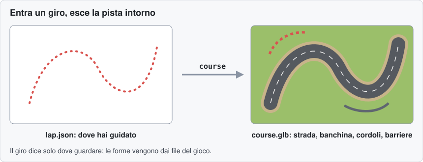
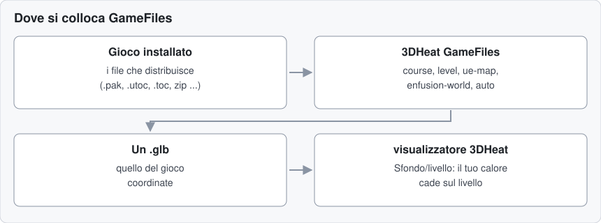

# 3DHeat GameFiles {#dheat-gamefiles}

**Che cos'è?** Uno strumento che costruisce un modello 3D di una pista da corsa o di un livello di
gioco a partire dai file di un gioco che hai già installato.

**A cosa serve?** Il visualizzatore 3DHeat dipinge dove hai guidato o giocato come mappa di calore.
Con questo strumento la dipinge sulla pista o sul livello reale, non nel vuoto.

**Esempio:** prendi un giro che hai guidato. Lo strumento costruisce attorno ad esso la strada e il
terreno come un unico file 3D, così il visualizzatore può dipingere la tua velocità o i tuoi
incidenti sulla pista reale:



Non hai mai usato la riga di comando? Inizia da [Prima di iniziare](before-you-start.md).

Più in dettaglio: legge i dati dei livelli dagli archivi che un gioco distribuisce e li scrive come
file glTF binario (`.glb`). Il suo compito principale è l'**esportazione del percorso**: gli dai un
giro, e scrive il terreno, la strada distinta da banchina ed erba, e i cordoli, le barriere, i muri di
pneumatici, i cartelli e gli edifici intorno.

Fa parte di [3DHeat](https://github.com/Holdi601/3DHeat), un visualizzatore di mappe di calore 3D in
tempo reale, di analisi di gara e di revisione delle partite
([documentazione](https://holdi601.github.io/3DHeat/)). I file `.glb` scritti da questo strumento sono
i livelli su cui il visualizzatore disegna il calore.



È uno dei tre modi per portare la geometria di un livello in 3DHeat:

| Percorso | Richiede | Fornisce |
|---|---|---|
| 3DHeat Unreal Exporter | il progetto Unreal aperto nell'editor | geometria esatta |
| 3DHeat GameCapture | uno schermo e una cattura | una stima |
| **3DHeat GameFiles** | **il gioco installato e distribuito** | **geometria esatta, senza progetto** |

Pacchetto Python: `heat3d_gamefiles`. Repository:
[Holdi601/3DHeat-GameFiles](https://github.com/Holdi601/3DHeat-GameFiles). Licenza: MIT.

## I lettori dei giochi {#the-games-own-readers}

Il lettore di ogni gioco è un progetto a sé, quindi un problema con i termini di un gioco tocca solo quel
gioco: installa quello per il tuo gioco (la sua pagina dice come), e sia il suo comando sia i verbi qui
funzionano. GameFiles esegue lo strumento del gioco con gli argomenti che gli hai dato; non importa nulla
dello strumento. Viene trovato come suo comando in `PATH`, come suo pacchetto installato, oppure come sua
cartella in `HEAT3D_<GAME>_MAPS` o accanto a GameFiles (`exporters/ext/<game>-maps` in una copia di lavoro di
3DHeat, oppure `3DHeat-Ext-<Game>` accanto a questa cartella). Quando non è installato, il verbo dice dove
prenderlo ed esce con codice 2.

| Gioco | Il suo strumento | Verbi qui che lo eseguono |
|---|---|---|
| Forza Horizon / Motorsport | [3DHeat-Ext-Forza](https://holdi601.github.io/3DHeat-Ext-Forza/) (`heat3d-forza-maps`) | `course` (giri di Forza), `courses`, `races`, `cars`, `terrain`; `identify`, `list`, `extract` di un `.minizip` |
| Battlefield (Frostbite) | [3DHeat-Ext-Battlefield](https://holdi601.github.io/3DHeat-Ext-Battlefield/) (`heat3d-battlefield-maps`) | `levels`, `level`; `identify` di un `.toc` di Frostbite |
| BeamNG.drive | [3DHeat-Ext-BeamNG](https://holdi601.github.io/3DHeat-Ext-BeamNG/) (`heat3d-beamng-maps`) | `course` (giri di BeamNG); `identify` di un `.cdae` o di un `.ter` |
| Assetto Corsa Rally | [3DHeat-Ext-ACRally](https://holdi601.github.io/3DHeat-Ext-ACRally/) (`heat3d-acrally-maps`) | `course` (giri di AC Rally) |
| Arma Reforger (Enfusion) | [3DHeat-Ext-Reforger](https://holdi601.github.io/3DHeat-Ext-Reforger/) (`heat3d-reforger-maps`) | `enfusion-worlds`, `enfusion-world` |

## Cosa sa fare {#what-it-can-do}

| Gioco o motore | Esportazione del percorso (`course`) | Lettura degli archivi |
|---|---|---|
| Forza Horizon (ForzaTech) | sì: terreno, strada e banchina, trama del terreno, modelli collocati con le loro trame | `identify`, `list`, `extract` su un `.minizip`; `identify` su un `.modelbin`; modelli, terreno e trame tramite `course` e `terrain` |
| BeamNG.drive | sì: terreno, decalcomanie della strada, circuiti modellati, modelli collocati, acqua | `identify`, `list`, `extract` su zip di livelli; `identify` su `.ter`, `.cdae`; `.dae` tramite `course` |
| Assetto Corsa Rally (Unreal 5.6) | sì: tessere del terreno della tappa, colore del terreno pre-calcolato, modelli collocati a colori piatti | `identify`, `list`, `extract` su `.utoc`/`.ucas` IoStore; pacchetti zen, mesh statiche, trame tramite `course` |
| Pacchetti Unreal `.pak` (versioni da 8 a 12) | no | `identify`, `list`, `extract` |
| Unity (formato 22 e successivi) | no | `identify`, `meshes` |
| Battlefield 6 (Frostbite `.toc`/`.cas`) | nessun giro; un livello intero con `level`: terreno, mesh collocate, le loro mappe di colore con `--textures` | `identify`, `levels`; bundle, mesh, terreno, trame e collocazione tramite `level` |
| `.vpk` di Source 2 | no | `identify`, `list`, `extract` |
| Giochi Unreal 5 con World Partition | nessun giro; una mappa intera con `ue-map` (elencate da `ue-maps`): paesaggio, edifici e oggetti HLOD, acqua | - |
| Arma Reforger (Enfusion) | nessun giro; un mondo intero con `enfusion-world` (elencati da `enfusion-worlds`): terreno nei suoi colori, il mare, edifici come scatole | - |
| Forza (auto) | `cars`: ogni auto a basso dettaglio, per la scheda Analisi di gara del visualizzatore | - |

I giri di Assetto Corsa EVO e di iRacing vengono rifiutati, con il motivo. Vedi
[Limiti e lacune note](limits-and-known-gaps.md).

## Installazione {#install}

Non hai mai usato la riga di comando? Leggi prima [Prima di iniziare](before-you-start.md).

Ti servono **Python 3.10 o successivo** (sviluppato su 3.13) e i pacchetti in
[`requirements.txt`](https://github.com/Holdi601/3DHeat-GameFiles/blob/main/requirements.txt).

```
git clone https://github.com/Holdi601/3DHeat-GameFiles.git
cd 3DHeat-GameFiles
pip install -r requirements.txt
```

Poi verifica: `python -m heat3d_gamefiles --help`. Dovresti vedere
`usage: heat3d_gamefiles [-h]` e l'elenco dei verbi. Esegui ogni comando dalla cartella del
repository, come `python -m heat3d_gamefiles <verbo>`.

| Pacchetto | A cosa serve |
|---|---|
| numpy | tutto ciò che decodifica la geometria |
| lz4 | archivi di Forza (per lo più blocchi LZ4), alcuni bundle di Unity, blocchi LZ4 IoStore |
| Pillow | decodifica delle trame BC1-BC7, scrittura delle trame JPEG nel `.glb` |
| msgpack, zstandard | le forme compilate di BeamNG (`.cdae`) |
| cryptography | solo per aprire un `.pak` cifrato con una chiave che già possiedi |
| pytest | i test |

Il contenuto Unreal compresso con **Oodle** richiede una libreria Oodle già presente sul tuo computer.
Questo strumento non ne distribuisce mai una. Vedi [Oodle](reader-oodle.md).

Lo strumento è scritto per Windows. Trova i giochi tramite l'elenco delle librerie di Steam e
`%LOCALAPPDATA%`, e carica Oodle come DLL di Windows. Altre piattaforme non sono state provate.

## Avvio rapido {#quick-start}

Un **file di giro** è una registrazione di dove è andata la tua auto: un elenco di punti x, y, z.
Viene da [3DHeat GameCapture](https://github.com/Holdi601/3DHeat-GameCapture) o dalla libreria di giri
dell'app FH Companion; va bene anche un CSV scritto a mano ([Input dei giri](lap-inputs.md)).

```
# Forza: un file di giro, una cartella di giri, oppure il nome di un percorso dalla libreria di FH Companion
python -m heat3d_gamefiles course "Example Circuit"
python -m heat3d_gamefiles course path\to\lap.json -o course.glb

# BeamNG.drive o Assetto Corsa Rally: un file heat3d-lap dice da quale gioco proviene
python -m heat3d_gamefiles course my_lap.json

# Ogni percorso della libreria di FH Companion, un .glb per ciascuno
python -m heat3d_gamefiles courses -o courses

# Battlefield 6: elenca i livelli, poi esportane uno (un file grande; vedi Comandi)
python -m heat3d_gamefiles levels
python -m heat3d_gamefiles level <level> -o level.glb --textures

# Unreal 5 World Partition e Arma Reforger: elenca, poi esporta
python -m heat3d_gamefiles ue-maps "<game>"
python -m heat3d_gamefiles ue-map "<game>" <map> -o map.glb
python -m heat3d_gamefiles enfusion-worlds
python -m heat3d_gamefiles enfusion-world <world> -o world.glb

# Ogni auto di Forza, per la scheda Analisi di gara del visualizzatore
python -m heat3d_gamefiles cars -o forza.h3dcars

# Che file è questo?
python -m heat3d_gamefiles identify some_archive.pak
```

Apri il `.glb` nel visualizzatore 3DHeat. Le coordinate del mondo del gioco vengono conservate (vedi
[Formato di output](output-format.md)), quindi un giro registrato si allinea al percorso.

## Mappa di questa documentazione {#map-of-this-documentation}

- [Prima di iniziare](before-you-start.md): Python, un terminale, il primo comando.
- [Comandi](commands.md): ogni verbo e ogni opzione, con esempi.
- [Riferimento dei comandi](../cli-reference.md): il `--help` di ogni verbo, generato dal codice.
- [Ispezionare gli archivi](inspecting-archives.md): `identify`, `list`, `extract`, `meshes`, passo per passo.
- [Esportazione del percorso](https://holdi601.github.io/3DHeat-Ext-Forza/course-export.html): come un giro diventa un percorso, per tutti i giochi.
  - [Forza Horizon](https://holdi601.github.io/3DHeat-Ext-Forza/course-forza-horizon.html)
  - [BeamNG.drive](https://holdi601.github.io/3DHeat-Ext-BeamNG/course-beamng.html)
  - [Assetto Corsa Rally](https://holdi601.github.io/3DHeat-Ext-ACRally/course-assetto-corsa-rally.html)
  - [Livelli di dettaglio e budget](detail-budget.md)
- [Livelli interi](whole-levels.md): un livello, una mappa o un mondo senza giro.
  - [Livelli di Battlefield 6](https://holdi601.github.io/3DHeat-Ext-Battlefield/level-battlefield.html): `levels`, `level`
  - [Mappe Unreal 5](level-unreal-world-partition.md): `ue-maps`, `ue-map`
  - [Mondi di Arma Reforger](https://holdi601.github.io/3DHeat-Ext-Reforger/level-arma-reforger.html): `enfusion-worlds`, `enfusion-world`
- [Auto di Forza](https://holdi601.github.io/3DHeat-Ext-Forza/forza-cars.html): `cars`, il file auto per la scheda Analisi di gara del visualizzatore.
- [Input dei giri](lap-inputs.md): ogni forma di file di giro accettata dallo strumento.
- [Formato di output](output-format.md): cosa c'è dentro il `.glb`.
- [Lettori degli archivi](archive-readers.md): una pagina per ogni formato di contenitore, con cosa legge,
  cosa non legge e perché.
- [Limiti e lacune note](limits-and-known-gaps.md)
- [Risoluzione dei problemi](troubleshooting.md): i messaggi di errore e cosa fare.
- [Regole e licenze](rules-and-licences.md): nessuna chiave, solo i tuoi file, nessuna ridistribuzione.
- [Aggiornamenti](updates.md): il controllo degli aggiornamenti e `heat3d_update`.
- [Sviluppo](development.md): mappa dei moduli e test, compresi i test che girano sui giochi installati.
- [Manutenzione](maintaining.md): la lista di controllo per il rilascio di queste pagine.

## Parte di 3DHeat {#part-of-3dheat}

3DHeat GameFiles è uno degli strumenti gratuiti intorno al visualizzatore 3DHeat:

| Strumento | Cosa fa | Documentazione |
|---|---|---|
| [3DHeat](https://github.com/Holdi601/3DHeat) | il visualizzatore: mappe di calore 3D, analisi di gara e revisione delle partite nel browser | [sito](https://holdi601.github.io/3DHeat/) |
| [GameFiles](https://github.com/Holdi601/3DHeat-GameFiles) | percorsi e livelli dai file che un gioco distribuisce, come `.glb` | [sito](https://holdi601.github.io/3DHeat-GameFiles/) |
| [GameCapture](https://github.com/Holdi601/3DHeat-GameCapture) | telemetria dei giri dai giochi di corsa; livelli ricostruiti dal video di gioco | [sito](https://holdi601.github.io/3DHeat-GameCapture/) |
| [Unreal Exporter](https://github.com/Holdi601/3DHeat-UnrealExporter) | un plugin dell'editor Unreal che salva un livello come `.glb` | [sito](https://holdi601.github.io/3DHeat-UnrealExporter/) |
| [CS2](https://github.com/Holdi601/3DHeat-CS2) | demo di Counter-Strike 2 in file di partita; mappe in `.glb` | [sito](https://holdi601.github.io/3DHeat-CS2/) |
| [Watcher](https://github.com/Holdi601/3DHeat-Watcher) | registra il tuo gioco in background da ciò che i giochi pubblicano | [sito](https://holdi601.github.io/3DHeat-Watcher/) |
| [Ext-WarThunder](https://github.com/Holdi601/3DHeat-Ext-WarThunder) | replay di War Thunder in file di partita | [sito](https://holdi601.github.io/3DHeat-Ext-WarThunder/) |
| [Ext-WoT](https://github.com/Holdi601/3DHeat-Ext-WoT) | replay di World of Tanks in file di partita | [sito](https://holdi601.github.io/3DHeat-Ext-WoT/) |
| [Ext-WoWs](https://github.com/Holdi601/3DHeat-Ext-WoWs) | replay di World of Warships in file di partita | [sito](https://holdi601.github.io/3DHeat-Ext-WoWs/) |
| [Ext-Squad](https://github.com/Holdi601/3DHeat-Ext-Squad) | demo dei server di Squad in file di partita | [sito](https://holdi601.github.io/3DHeat-Ext-Squad/) |
| [Ext-DCS](https://github.com/Holdi601/3DHeat-Ext-DCS) | mappe di DCS World in livelli `.glb` | [sito](https://holdi601.github.io/3DHeat-Ext-DCS/) |
| [Ext-IL2](https://github.com/Holdi601/3DHeat-Ext-IL2) | mappe di IL-2 Sturmovik in livelli `.glb` | [sito](https://holdi601.github.io/3DHeat-Ext-IL2/) |
| [Ext-Dota](https://github.com/Holdi601/3DHeat-Ext-Dota) | la mappa di Dota 2 dalla tua installazione, come livello 3D | [sito](https://holdi601.github.io/3DHeat-Ext-Dota/) |
| [Ext-DotaReplay](https://github.com/Holdi601/3DHeat-Ext-DotaReplay) | replay di Dota 2 | [sito](https://holdi601.github.io/3DHeat-Ext-DotaReplay/) |
| [Ext-Riot](https://github.com/Holdi601/3DHeat-Ext-Riot) | replay di League of Legends e VALORANT (ciò che contengono non cifrato) | [sito](https://holdi601.github.io/3DHeat-Ext-Riot/) |
| [Ext-Forza](https://github.com/Holdi601/3DHeat-Ext-Forza) | percorsi, gare e auto di Forza dalla tua installazione | [sito](https://holdi601.github.io/3DHeat-Ext-Forza/) |
| [Ext-Battlefield](https://github.com/Holdi601/3DHeat-Ext-Battlefield) | livelli di Battlefield (Frostbite) come livelli 3D | [sito](https://holdi601.github.io/3DHeat-Ext-Battlefield/) |
| [Ext-BeamNG](https://github.com/Holdi601/3DHeat-Ext-BeamNG) | percorsi di BeamNG.drive | [sito](https://holdi601.github.io/3DHeat-Ext-BeamNG/) |
| [Ext-ACRally](https://github.com/Holdi601/3DHeat-Ext-ACRally) | tappe di Assetto Corsa Rally come percorsi | [sito](https://holdi601.github.io/3DHeat-Ext-ACRally/) |
| [Ext-Reforger](https://github.com/Holdi601/3DHeat-Ext-Reforger) | mondi di Arma Reforger (Enfusion) come livelli 3D | [sito](https://holdi601.github.io/3DHeat-Ext-Reforger/) |
| [Ext-R6](https://github.com/Holdi601/3DHeat-Ext-R6) | replay di partite di Rainbow Six Siege | [sito](https://holdi601.github.io/3DHeat-Ext-R6/) |

I file di partita del visualizzatore sono descritti in
[Una partita in un file: `.3dheat`](https://holdi601.github.io/3DHeat/container.html);
un livello creato qui si carica accanto ad essi nel pannello Sfondo / livello del visualizzatore.
