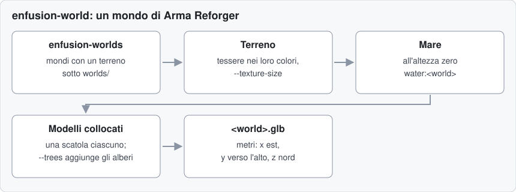

# Mondi di Arma Reforger: `enfusion-worlds` e `enfusion-world` {#arma-reforger-worlds-enfusion-worlds-and-enfusion-world}

**Che cos'è?** Un intero mondo di Arma Reforger come un unico file 3D. **Perché?** Perché il calore del
gioco abbia sotto di sé il suolo e gli edifici. (*Enfusion* è il motore con cui è fatto Arma Reforger; un
*mondo* è ciò che il gioco chiama mappa.)

Esporta un intero mondo Enfusion di Arma Reforger installato: il terreno nei colori delle sue tessere di
supertexture, il mare, e ogni modello collocato come un riquadro, nei metri propri del gioco.



## Passo per passo {#step-by-step}

1. **Elenca i mondi** che hanno un terreno:

   ```
   python -m heat3d_gamefiles enfusion-worlds
   python -m heat3d_gamefiles enfusion-worlds --install "D:\Games\Arma Reforger"
   ```

2. **Esportane uno**, con il nome della cartella sotto `worlds/` come elencato:

   ```
   python -m heat3d_gamefiles enfusion-world <world> -o world.glb
   ```

3. **Varianti:**

   ```
   python -m heat3d_gamefiles enfusion-world <world> --trees               # vegetation too, as boxes
   python -m heat3d_gamefiles enfusion-world <world> --texture-size 0      # flat colour, small file
   python -m heat3d_gamefiles enfusion-world <world> --ground-spacing 4 --no-structures
   ```

4. **Apri `world.glb`** nel pannello Sfondo / livello del visualizzatore di 3DHeat ([caricare un livello](https://holdi601.github.io/3DHeat/levels.html)).

## Opzioni {#options}

| Opzione | Predefinito | Significato |
|---|---|---|
| `<world>` | obbligatorio | un mondo come lo stampa `enfusion-worlds` |
| `-o`, `--out FILE` | `<world>.glb` | il file da scrivere |
| `--install CARTELLA` | la libreria Steam che contiene il gioco | la cartella del gioco |
| `--ground-spacing METRI` | 2 (quello del terreno) | la spaziatura dei vertici del terreno nel file |
| `--texture-size PIXEL` | 4096 | il lato maggiore dell'immagine del colore del suolo; 0 per colore piatto |
| `--no-structures` | | lascia fuori i modelli collocati |
| `--trees` | disattivato | colloca anche alberi e altra vegetazione, come riquadri |

## Esempio di output {#example-output}

```text
<world> -> world.glb
  ground      <n> triangles, <w> x <h> m; <n> of <n> tile-edge vertices disagree; colour <w> x <h>
  structure   <n> boxes from <n> entities
  water       <n> triangles (the sea)
  left out    <what>: <n>, ...
```

## Le parti {#the-parts}

`ground:<world>` (il terreno), `water:<world>` (il mare, ad altezza zero) e `structure:<world>` (i riquadri).
Le coordinate sono quelle del gioco: x verso est, y in alto, z verso nord, in metri, cioè ciò che una
registrazione in gioco riporta. Il sistema di riferimento del gioco è mancino; *Inverti un asse del mondo* nel
visualizzatore lo mostra senza specchiatura.

## Come viene letto e verificato {#how-it-is-read-and-checked}

Non serve Workbench e nulla è cifrato.

| Formato | Che cos'è | Verificato contro |
|---|---|---|
| `.pak` | un blocco di dati e un albero di directory, voci memorizzate o zlib | l'albero usa esattamente il suo blocco; le voci zlib campionate si espandono esattamente alla dimensione dichiarata |
| `.edds` | un'intestazione DDS, poi per ogni livello mip blocchi `COPY` o `LZ4 ` | i livelli a blocchi si decodificano esattamente alla loro dimensione usando esattamente i loro byte |
| `.terr` / `.ttile` | un'intestazione e tessere di altezze a 16 bit | ogni bordo condiviso tra tessere concorda esattamente |
| supertexture | il colore del suolo di ogni tessera, circa un metro per pixel | corrisponde al mare nelle altezze; nessun ribaltamento o trasposizione combacia altrettanto bene |
| `.ent` | nomi, GUID delle risorse, poi entità come valori tipizzati | un file di mondo si analizza fino al suo ultimo byte |
| `resourceDatabase.rdb` | GUID in percorso | quasi ogni GUID usato da un mondo nomina un file che esiste |

Gli oggetti segnati come posti a un'altezza assoluta stanno entro centimetri dal terreno decodificato (con la
griglia trasposta sarebbero a metri di distanza). Non vengono disegnati: i triangoli dei modelli stessi, gli
alberi per impostazione predefinita (`--trees` li aggiunge come riquadri), le entità figlie, laghi e fiumi,
le texture con intestazioni precedenti a DX10.

**Termini:** la licenza del gioco consente l'uso non commerciale e vieta l'ingegneria inversa dei file del
gioco. Leggere la tua installazione è una tua decisione sotto quella licenza; il risultato è per uso
personale e non va condiviso.
