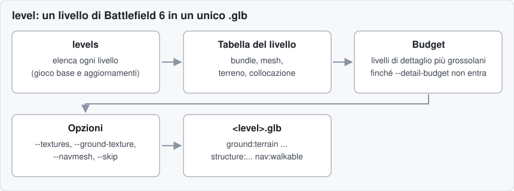

# Livelli di Battlefield 6: `levels` e `level` {#battlefield-6-levels-levels-and-level}

**Che cos'è?** Un intero livello di Battlefield 6 come un unico file 3D. **Perché?** Perché il calore delle tue
partite abbia sotto di sé il suolo e gli edifici. (*Frostbite* è il motore con cui è fatto Battlefield; una
*mappa delle altezze* è il suolo memorizzato come una griglia di altezze.)

Esporta un intero livello Frostbite del gioco installato: la mappa delle altezze del terreno, ogni mesh che i suoi
gruppi di modelli statici collocano, gli oggetti collocati uno per uno, il fondale del terreno attorno alla mappa,
e, se richiesto, le mappe colore delle superfici, le decalcomanie del terreno cotte nel suolo e le superfici
percorribili dai soldati.



## Passo per passo {#step-by-step}

1. **Elenca i livelli** che il gioco distribuisce:

   ```
   python -m heat3d_gamefiles levels
   python -m heat3d_gamefiles levels --install "D:\Games\<game folder>"
   ```

   Ogni riga è una tabella di livello (`levels/<level>/<level>.toc`) con la sua dimensione e la sua origine:
   `Data` per il gioco base, `Update/<pack>` per un aggiornamento.

2. **Esportane uno**, con il suo nome, una parte unica di esso, o il suo file `.toc`. Inizia senza texture per
   vedere forma e dimensione:

   ```
   python -m heat3d_gamefiles level <level> -o level.glb
   ```

3. **Aggiungi colore** quando sembra giusto:

   ```
   python -m heat3d_gamefiles level <level> -o level.glb --textures 512 --ground-texture 0.5
   ```

4. **Aggiungi le superfici percorribili**, oppure riduci il file:

   ```
   python -m heat3d_gamefiles level <level> --textures 512 --ground-texture 0.5 --navmesh
   python -m heat3d_gamefiles level <level> --textures 256 --detail-budget 3000000 --ground-spacing 8
   ```

5. **Apri `level.glb`** nel pannello Sfondo / livello del visualizzatore di 3DHeat ([caricare un livello](https://holdi601.github.io/3DHeat/levels.html)).

## Opzioni {#options}

| Opzione | Predefinito | Significato |
|---|---|---|
| `<level>` | obbligatorio | un nome come lo stampa `levels`, una parte unica di un nome, oppure il file `.toc` di un livello |
| `-o`, `--out FILE` | `<level>.glb` | il file da scrivere |
| `--install CARTELLA` | trovata nelle librerie Steam | la cartella del gioco |
| `--textures [PIXEL]` | disattivato; 512 senza una dimensione | la mappa colore di ogni superficie, al massimo PIXEL per lato |
| `--ground-texture [METRI]` | disattivato; 0,5 senza una dimensione | cuoce strade, piazzali e segnaletica nel colore del suolo, METRI per pixel |
| `--navmesh` | disattivato | aggiunge la mesh di navigazione del soldato come `nav:walkable` |
| `--ground-spacing METRI` | 4 | la spaziatura più fine della mappa delle altezze; 0 la lascia fuori |
| `--detail-budget N` | ogni copia al suo livello più grossolano, più un quarto, almeno 1.500.000 | un tetto sui triangoli (il terreno non viene mai reso più grossolano) |
| `--skip TESTO` | | lascia fuori i gruppi di modelli il cui nome di partizione contiene TESTO; ripetibile |
| `--by-mesh` | disattivato | una parte per mesh sorgente e materiale, per capire cos'è una parte |
| `--clamped-uvs` | disattivato | per i motori di rendering che non sanno ripetere una texture |

L'elenco completo, con le dimensioni da aspettarsi (un livello intero è centinaia di MB), è nei
[Comandi](commands.md#levels-and-level-frostbite). Come vengono letti tabelle, bundle, mesh e terreno è
descritto in [Frostbite](reader-frostbite.md).

## Esempio di output {#example-output}

Che cosa stampa `level`, a grandi linee (le righe come le scrive il codice; `<n>` e i nomi variano da livello a
livello):

```text
<n> copies of <n> meshes, from <n> static model groups
      <n>  <group>
      <n>  placed one by one (object and prefab references)
<n> meshes left out: <why>
<n> triangles, budget <n>; <n> meshes drawn at a coarser level to fit
           <n>  ground:terrain
           <n>  structure:buildings, <n> textures
           ...
<n> of <n> drawn sections carry their colour map; the rest are flat colours
Ground: <what the ground is>.
Navigation mesh: <tiles read>.
-> level.glb (<n> MB)
```

## Le parti {#the-parts}

`ground:terrain` (la mappa delle altezze), `ground:terrain backdrop` e `ground:terrain blend`,
`structure:<kind>` per ogni tipo di mesh (per mappa colore con `--textures`, con ` (destructible)` per ciò che una
partita può distruggere), e `nav:walkable` con `--navmesh`. Vedi [Formato di output](output-format.md).

Il file contiene i contenuti del gioco: è fatto per la macchina su cui è stato creato, non per essere passato in
giro ([Regole e licenze](rules-and-licences.md)).
