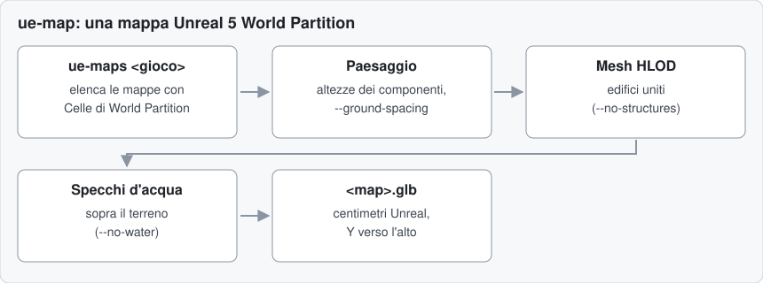

# Mappe World Partition di Unreal 5: `ue-maps` e `ue-map` {#unreal-5-world-partition-maps-ue-maps-and-ue-map}

**Che cos'è?** Un'intera mappa di un gioco Unreal 5 come un unico file 3D: il suolo, gli edifici e l'acqua.
**Perché?** Perché il calore di quel gioco abbia sotto di sé la mappa. (*World Partition* è il modo in cui Unreal 5
divide una grande mappa in pezzi; *HLOD* è un sostituto semplificato di un gruppo di edifici, quello che il gioco
disegna da lontano.)

Esporta un'intera mappa di un gioco Unreal 5 le cui mappe sono compilate come celle World Partition: il
paesaggio, le mesh HLOD unite della mappa (i suoi edifici e oggetti come il gioco li disegna da lontano) e i suoi
corpi d'acqua. Non servono editor né progetto, solo il gioco installato.



## Passo per passo {#step-by-step}

1. **Elenca le mappe.** `<game>` è la cartella del gioco, la sua `Content/Paks`, oppure il nome della sua cartella
   in una libreria Steam:

   ```
   python -m heat3d_gamefiles ue-maps "<Steam game folder name>"
   python -m heat3d_gamefiles ue-maps "D:\Games\<game>"
   ```

   Ogni mappa con celle World Partition compilate viene stampata con il suo percorso di pacchetto.

2. **Esportane una** per nome o per una sua parte unica:

   ```
   python -m heat3d_gamefiles ue-map "<game>" <map> -o map.glb
   ```

3. **Solo il suolo, oppure più grossolano:**

   ```
   python -m heat3d_gamefiles ue-map "<game>" <map> --no-structures --no-water
   python -m heat3d_gamefiles ue-map "<game>" <map> --ground-spacing 4
   ```

4. **Apri `map.glb`** nel pannello Sfondo / livello del visualizzatore di 3DHeat
   ([caricare un livello](https://holdi601.github.io/3DHeat/levels.html)).

## Opzioni {#options}

| Opzione | Predefinito | Significato |
|---|---|---|
| `<game>` | obbligatorio | la cartella del gioco, la sua `Content/Paks`, oppure il nome della sua cartella Steam |
| `<map>` | obbligatorio | un nome come lo stampa `ue-maps`, oppure una sua parte unica |
| `-o`, `--out FILE` | `<map>.glb` (in `$HEAT3D_LEVELS/<game>/` quando è impostata) | il file da scrivere |
| `--ground-spacing METRI` | 2 | la spaziatura dei vertici del paesaggio, arrotondata a un numero intero dei suoi quad |
| `--no-structures` | | lascia fuori gli edifici e gli oggetti HLOD |
| `--no-water` | | lascia fuori i corpi d'acqua |

I contenuti compressi con Oodle richiedono una libreria Oodle già presente sul computer (vedi [Oodle](reader-oodle.md)).

## Esempio di output {#example-output}

```text
<map> -> map.glb
  ground      <n> triangles from <n> landscape components; <n> of <n> vertices stored twice disagree
  structure   <n> triangles in <n> HLOD meshes
  water       <n> triangles from <n> water bodies
```

Il conteggio delle discordanze è un controllo interno: componenti paesaggio vicini memorizzano due volte il bordo
condiviso, e le due copie devono coincidere. Una mappa di 3 km a 2 m conta circa 4,6 milioni di triangoli di suolo.

## Le parti {#the-parts}

`ground:<map>` (il paesaggio), `structure:<map>` (le mesh HLOD) e `water:<map>` (l'acqua che sta sopra il suolo).

**Unità:** questa è l'unica esportazione **non in metri**: centimetri di Unreal, con Y e Z scambiati (Y in alto),
il sistema di riferimento che scrive l'Unreal Exporter di 3DHeat. La telemetria dello stesso gioco usa lo stesso
sistema, quindi si appoggia alla mappa.

## Come viene letto e verificato {#how-it-is-read-and-checked}

| Parte | Letta da | Verificata contro |
|---|---|---|
| suolo | la mappa delle altezze a 16 bit di ogni componente paesaggio, collocata dalla sua base di sezione sulla trasformazione del paesaggio | ogni vertice memorizzato due volte (su una cucitura o un bordo di componente) deve concordare; le discordanze vengono contate e stampate, non levigate |
| struttura | le mesh HLOD unite della mappa, costruite dal motore nello spazio del mondo | una mesh viene tenuta solo se i limiti che il suo componente memorizza descrivono i suoi vertici |
| acqua | la mesh di ogni corpo d'acqua, posata sulla griglia del suolo, tenuta dove sta sopra il suolo | l'acqua sta a pochi metri sopra il suolo sotto di essa, come un fiume sopra il suo letto |

Le proprietà del paesaggio vengono trovate per forma, non per numero di slot (gli slot cambiano tra le versioni
del motore). Le strutture sono i sostituti semplificati, non i modelli a pieno dettaglio. Vegetazione, decalcomanie
e materiali del paesaggio non vengono esportati; il suolo è senza texture e illuminato dal visualizzatore.
Dettagli sugli archivi: [Unreal 5 IoStore](reader-unreal-iostore.md).

**I tuoi file:** la mappa viene letta dal gioco installato sul tuo computer e scritta sul tuo disco,
per la tua analisi; nulla del gioco viene distribuito con questo strumento.
