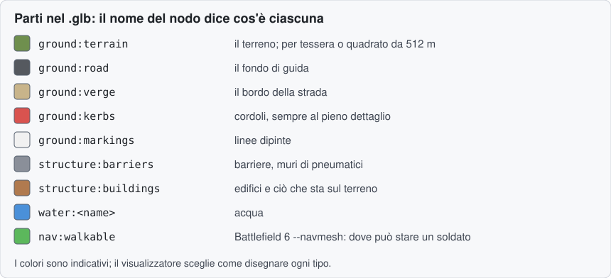

# Formato del file {#output-format}

Un `.glb` è un unico file 3D: il suolo, gli edifici e l'acqua di un percorso o di un
livello, che si apre nel pannello Sfondo / livello del visualizzatore 3DHeat.

Ogni esportazione (`course`, `courses`, `terrain`, `level`, `ue-map`, `enfusion-world`)
scrive un unico file **glTF 2.0 binario** (`.glb`). È volutamente piccolo e piatto, e
disposto nel modo in cui il visualizzatore 3DHeat legge un livello. Fonte:
[`glb.py`](https://github.com/Holdi601/3DHeat-GameFiles/blob/main/heat3d_gamefiles/glb.py).

## Struttura {#structure}

```
scene 0
 ├─ node "ground:terrain x-2046 z1023"  -> mesh 0 -> 1 primitive, material 0
 ├─ node "ground:road x-2046 z1023"     -> mesh 1 -> 1 primitive, material 1
 ├─ node "ground:markings"               -> mesh 2 -> ...
 ├─ node "ground:kerbs road_gen_rum_..." -> ...
 ├─ node "structure:barriers bar_armco_bclr"
 └─ ...
```

- **Un nodo per parte**, tutti alla radice della scena, **senza trasformazioni**. Tutta
  la geometria è già in coordinate del mondo.
- Ogni nodo ha una propria mesh con **una primitiva** e un proprio materiale. Il nodo, la
  mesh e il materiale portano tutti il nome della parte.
- Ogni primitiva ha **i propri array di vertici compatti**, solo i vertici che quella
  parte usa. Un array di vertici condiviso è glTF valido, ma un lettore che espande gli
  accessori di ogni primitiva terrebbe ogni vertice una volta per parte.
- `asset.generator` è `heat3d_gamefiles`.
- **Pochi `extras`**, e nessun nome di giro, gioco o pista:
  - una parte di Battlefield 6 di una mesh distruttibile porta `{"destructible": true}` sul suo nodo;
  - un percorso di Forza dice cosa contiene in `asset.extras` (versione del formato, id del
    percorso abbinato, quante copie del livello della gara stessa, luoghi; vedi
    [Percorsi di Forza Horizon](https://holdi601.github.io/3DHeat-Ext-Forza/course-forza-horizon.html#writing-the-file)), e
    le sue parti accese portano il loro livello sul nodo: `{"layer": "event", "route": <id>}`
    per il livello della gara stessa, `{"layer": "layer"}` per un altro livello acceso,
    `{"layer": "venue"}` per il suolo di un luogo.

  Tutto il resto di cui il visualizzatore ha bisogno sta nei nomi dei nodi.

## Nomi dei nodi: la classificazione {#node-names-the-classification}



Il visualizzatore prende la classe di una parte dal nome del **nodo** (con ripiego sul nome della
mesh), e solo quando corrisponde a

```
^(ground|structure|water)\s*[:|]
```

Tutto il resto viene classificato da un'euristica scritta per i paesaggi di Unreal.
Quindi ogni parte scritta dall'esportatore inizia con uno di questi prefissi, oppure
con `nav:` (sotto):

| Prefisso | Significato | Parti scritte |
|---|---|---|
| `ground:` | la superficie di guida e il terreno | `ground:road`, `ground:verge`, `ground:terrain`, `ground:gravel and dirt`, `ground:kerbs`, `ground:markings`, `ground:tyre marks`, `ground:venue`, `ground:plinths` |
| `structure:` | ciò che sorge sopra | `structure:barriers`, `structure:props`, `structure:signs`, `structure:buildings`, `structure:infrastructure`, `structure:bridges`, `structure:rocks`, `structure:smashables`, `structure:trees`; i livelli di Forza `structure:event_<category>` e `structure:layer_<category>` |
| `water:` | acqua | `water:water`; `water:<map>` (`ue-map`), `water:<world>` (`enfusion-world`) |
| `nav:` | dove può camminare un soldato (Battlefield 6, solo con `--navmesh`) | `nav:walkable` |

`nav:` non corrisponde al modello del visualizzatore qui sopra, quindi il visualizzatore lo ordina con la
sua euristica; è una parte separata perché si possa mostrarla o nasconderla da sola.
`ue-map` scrive `ground:<map>`, `structure:<map>` e `water:<map>`;
`enfusion-world` scrive `ground:<world>`, `structure:<world>` e `water:<world>`.

Dopo il tipo viene, a seconda del gioco:

| Esempio | Significato |
|---|---|
| `ground:road x-2046 z1023` | suolo di Forza nel tassello del terreno chiamato `x-2046 z1023` (unità di griglia, 1023 ogni 512 m) |
| `ground:road 3_-2` | suolo di BeamNG nel quadrato di 512 m (3, -2) |
| `ground:road 3_-2 asphalt_light` | superficie di guida modellata di BeamNG del materiale `asphalt_light` in quel quadrato |
| `ground:road 1_-4` | suolo di AC Rally nel quadrato di 512 m (1, -4) dello spazio di Unreal |
| `structure:barriers bar_armco_bclr` | modelli collocati di Forza che condividono una texture (il loro nome senza il GUID) |
| `structure:barriers` | modelli collocati senza texture (Forza, AC Rally) |
| `structure:event_barriers bar_example_bclr` | Forza: ciò che la gara abbinata mette in campo per sé, a parte il mondo di gioco libero (extras del nodo `{"layer": "event", "route": <id>}`) |
| `structure:layer_props` | Forza: un livello che il gioco accende per qualcosa di diverso da questa gara (un'attività, un oggetto da raccogliere, un livello di runtime) |
| `ground:venue`, `ground:plinths` | Forza: modelli già in coordinate del mondo - il suolo proprio di un luogo (il pavimento di uno stadio), e il suolo con cui una strada viene arredata |
| `structure:barriers armco_metal` | modelli collocati di BeamNG di un materiale |
| `ground:markings`, `water:water` | parti piatte, una per l'intero file |
| `ground:terrain` (Battlefield 6) | il campo altimetrico; `ground:terrain backdrop` le mesh del terreno lontano, `ground:terrain blend` le mesh che si fondono nel terreno |
| `nav:walkable` (Battlefield 6, `--navmesh`) | la mesh di navigazione del livello per un soldato: dove si può stare, verde piatto |
| `ground:terrain x-512 z-512` (Battlefield 6, `--ground-texture`) | il campo altimetrico sotto un tassello di decal cotto, indicato dall'angolo basso del tassello in metri |
| `structure:buildings t_concreteclean_01_cs` (Battlefield 6, `--textures`) | ogni superficie di quel tipo che mostra quella mappa di colore; senza `--textures`, una parte per tipo, senza suffisso |
| `structure:buildings t_concreteclean_01_cs (destructible)` (Battlefield 6) | lo stesso, per le mesh che una partita può distruggere: quelle con un asset di distruzione del proprio nome (muri, case, oggetti di scena). Il nodo porta anche gli extras glTF `{"destructible": true}`. I loro stati distrutti non vengono esportati |

Il visualizzatore può filtrare per questi nomi. Per esempio, "solo la superficie da corsa" è
`ground:road` insieme a `ground:kerbs`, in tutti e tre i giochi, e "il mondo senza gli oggetti di
scena della gara" è tutto tranne `structure:event_*`. Il prefisso è anche il
modo in cui il visualizzatore disegna una parte: il suolo come la superficie su cui giace il
calore, la struttura come ciò che sorge sopra.

## Unità, assi e sistema di riferimento {#units-axes-and-frame}

- **Metri, Y in alto**, la convenzione di glTF, per ogni esportazione tranne `ue-map`.
  Nulla viene riscalato o ricentrato: i numeri sono le coordinate del mondo del gioco,
  che è proprio il senso di leggere l'archivio invece di ricostruirlo.
- **Mappe di Unreal 5 (`ue-map`): centimetri**, l'unità propria di Unreal, con Y e Z
  scambiati perché Y sia in alto - il sistema di riferimento che scrive il 3DHeat Unreal
  Exporter e che usa la telemetria del gioco. L'unica esportazione che non è in metri.
- **Arma Reforger (`enfusion-world`):** i metri propri del gioco, x verso est, y in alto,
  z verso nord. Il sistema di riferimento del gioco è sinistrorso; l'opzione *invert world
  axis* del visualizzatore lo mostra senza specchiarlo.
- **Forza:** le coordinate del mondo proprie del gioco (x, y in alto, z), invariate. Le
  stesse della sua telemetria, quindi un giro registrato sta sul tracciato.
- **BeamNG.drive:** `(x, z, -y)` del mondo con Z in alto di BeamNG, che è la rotazione
  applicata dal registratore di telemetria. Una rotazione, non uno specchio.
- **Battlefield 6:** le coordinate del mondo proprie del gioco (x, y in alto, z), invariate:
  le trasformazioni di istanza del livello applicate a ogni mesh così come è memorizzata.
  Le copie specchiate vengono riavvolte perché le loro normali puntino verso l'esterno.
- **Assetto Corsa Rally:** il sistema di riferimento del giro. I centimetri di Unreal
  diventano metri, la Z di Unreal diventa y, e la X e la Y di Unreal diventano x e z in
  uno degli otto orientamenti con cui il giro si è adattato (vedi
  [Assetto Corsa Rally](https://holdi601.github.io/3DHeat-Ext-ACRally/course-assetto-corsa-rally.html#which-stage-and-which-way-round)).
  I triangoli vengono riavvolti dove quella mappatura specchia.

Ogni esportazione mantiene gli assi che usa la sua telemetria, così la registrazione e il
livello condividono un sistema di riferimento. Non è stato verificato se quel sistema, in
ciascun gioco, sia destrorso o sinistrorso.

## Dati dei vertici {#vertex-data}

Il valore predefinito è la forma **quantizzata** (`quantize=True`). Richiede l'estensione
`KHR_mesh_quantization`, elencata sia in `extensionsUsed` sia in `extensionsRequired`.

| Attributo | Quantizzato (predefinito) | Piena precisione (`quantize=False`) |
|---|---|---|
| `POSITION` | float32 VEC3, con min/max | float32 VEC3 |
| `NORMAL` | int8 VEC3 normalizzato, riempito fino a 4 byte (passo 4) | float32 VEC3 |
| `TEXCOORD_0` (solo parti con texture) | uint16 VEC2 normalizzato, limitato a 0-1; float32 VEC2 dove le texture si ripetono (Battlefield 6) | float32 VEC2 |
| `COLOR_0` (parti senza texture, quando una parte ha un colore) | uint8 VEC3 normalizzato, riempito fino a 4 byte | float32 VEC3 |
| indici | uint16 quando la parte ha al massimo 65.535 vertici, altrimenti uint32 | uint32 |

Un vertice è di 20 byte invece di 32 (24 invece di 44 con il colore). Questo toglie un
terzo a ogni file, ed è la differenza tra un percorso di città che si carica in una
scheda del browser e uno che non ci riesce. Il costo è meno di mezzo grado di normale e
1/65.535 di una UV (un quindicesimo di texel a 4.096 px). La riga di comando scrive sempre
la forma quantizzata. `write_glb(..., quantize=False)` in Python scrive l'altra.

Le normali vengono dal gioco dove il gioco le memorizza (terreno e modelli di Forza, forme
e terreno di BeamNG). Altrimenti vengono calcolate come normali lisce pesate per area dai
triangoli. Le normali di AC Rally vengono sempre calcolate.

## Materiali, colori e texture {#materials-colours-and-textures}

- Ogni materiale è `metallicFactor 0`, `roughnessFactor 1`.
- **Parte con texture:** `baseColorTexture` con l'immagine della parte, le sue UV, e nessun
  colore di vertice. glTF moltiplica i due, quindi una superficie uscirebbe scurita due volte.
- **Parte senza texture:** colore di vertice `COLOR_0` con il colore piatto della parte, e un
  `baseColorFactor` bianco. Se nessuna parte del file ha un colore, non c'è `COLOR_0`. Dove
  le parti condividono vertici, vince il colore della parte successiva, quindi le parti
  piatte vengono scritte in ordine di importanza crescente.
- Le **immagini** sono incorporate nel blocco binario come **JPEG**, qualità 90, senza
  sottocampionamento della crominanza, solo RGB (l'alfa viene scartato) - tranne una mappa
  con ritagli di Battlefield 6 (foglie, recinzioni), che è **PNG** con il suo alfa, su un
  materiale con `alphaMode` MASK, `alphaCutoff` 0,5 e `doubleSided` (vedi
  [Frostbite](https://holdi601.github.io/3DHeat-Ext-Battlefield/reader-frostbite.html#textures-and-materials)). Il visualizzatore 3DHeat scarta i
  texel sotto il valore di taglio. Un suolo di 2.048 px di erba e chiome d'albero è rumore
  per un codificatore senza perdite: diversi megabyte a tassello come PNG, meno di uno
  come JPEG. Un'immagine condivisa da più parti viene memorizzata una sola volta.
- Un solo campionatore per tutte le texture: ingrandimento lineare, riduzione lineare con
  mip lineare, **clamp to edge** su entrambi gli assi, per le esportazioni dei percorsi, le
  cui texture coprono le superfici una volta sola. BeamNG disegna le texture ripetute dei
  modelli come colori piatti (vedi [BeamNG.drive](https://holdi601.github.io/3DHeat-Ext-BeamNG/course-beamng.html#placed-models)).
- Un'esportazione di Battlefield 6 con `--textures`, i cui materiali si ripetono, scrive le
  coordinate di texture proprie del gioco, non limitate, come `TEXCOORD_0` float32 anche
  nella forma quantizzata, con un campionatore che **si ripete** su entrambi gli assi
  (`write_glb(..., repeat=True)`): un muro di mattoni è una coppia di triangoli la cui UV
  va da 0 a 40. Il visualizzatore 3DHeat avvolge una texture del genere dentro il suo atlante
  (vedi la sua pagina *Model levels*). Per un renderer che non sa ripetere una texture,
  `level --clamped-uvs` (`write_level(..., clamped=True)`) taglia ogni triangolo lungo le
  linee in cui la sua texture si ripete e sposta ogni pezzo in 0..1: gli stessi pixel sulla
  stessa superficie, circa un quinto di triangoli in più. I triangoli attraverso cui una
  texture si ripete più di 16 volte mantengono le loro coordinate. Un triangolo che la sua
  texture taglierebbe in più di 4 pezzi - la corteccia che si ripete lungo ogni ramo di un
  albero, il cui taglio ha trasformato i 1.099 triangoli di un albero in 51.735 - finisce in
  una parte propria, `<parte> (average colour)`, nel colore medio della texture; `level`
  dice quanti sono.

| Texture | Dimensione | Copre |
|---|---|---|
| suolo (tutti i giochi tranne Battlefield 6) | `--texture-size`: 2048, 1024 o 512 px | un quadrato di 512 m: 25, 50 o 100 cm per pixel |
| altezza di Battlefield 6 | il mip più grande della mappa di colore dello sfondo nel livello, ritagliato | il quadrato del terreno: 32 m per pixel nel livello controllato |
| superfici di Battlefield 6 | `--textures`: al massimo quel numero di px per lato | la texture propria della superficie, una volta per pezzo (tagliata dove si ripete) |
| suolo cotto di Battlefield 6 | `--ground-texture`: metri per pixel, tasselli di al massimo 4.096 px | un tassello dell'estensione dei decal: 2.048 m a 0,5 m per pixel |
| modello collocato di Forza | al massimo 256 px | la disposizione UV propria del modello |
| modello collocato di BeamNG | al massimo 256 px | la disposizione UV propria del modello, solo dove non si ripete |
| modello collocato di AC Rally | nessuna | colori piatti |

## Ciò che lo scrittore rifiuta {#what-the-writer-refuses}

`write_glb` solleva un errore invece di scrivere un file che un visualizzatore aprirebbe mostrando
qualcosa di sbagliato:

| Rifiutato | Perché |
|---|---|
| posizioni che non sono N x 3, o non finite | una mesh rotta |
| un indice oltre la fine della lista dei vertici | viene reso come rumore |
| una parte con texture quando il file non ha UV | viene resa come un pixel stirato |
| nessun triangolo | viene reso come niente |
| un array di normali, colori o UV di lunghezza sbagliata, o non finito | serve uno per vertice |

## Leggerlo altrove {#reading-it-elsewhere}

Ogni visualizzatore glTF 2.0 che supporta `KHR_mesh_quantization` dovrebbe aprire questi file.
Solo il visualizzatore 3DHeat è stato verificato; gli altri visualizzatori non sono verificati. Un
lettore senza l'estensione rifiuta il file, perché è contrassegnata come richiesta. I
file possono essere grandi: circa 80 MB per un circuito di campagna, fino a diverse centinaia
di MB per un percorso di città con il budget automatico.

## In 3DHeat {#in-3dheat}

Carica il `.glb` nel pannello Sfondo / livello del visualizzatore di
[3DHeat](https://github.com/Holdi601/3DHeat); la telemetria registrata nello stesso gioco
si appoggia su di esso, perché entrambi mantengono le coordinate del gioco. La
documentazione del visualizzatore ([holdi601.github.io/3DHeat](https://holdi601.github.io/3DHeat/))
descrive il pannello Sfondo / livello e i file delle partite che scrivono gli altri
strumenti ([Una partita in un file: `.3dheat`](https://holdi601.github.io/3DHeat/container.html)).
Un livello non è memorizzato in ogni file `.3dheat`: una partita ne indica il nome nei suoi
`references` (`kind: "level"`, nome e sha256), e il `.glb` resta accanto alle partite.
