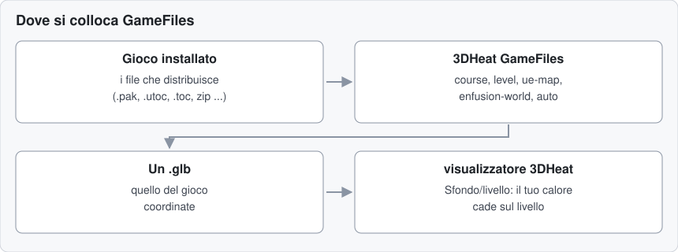

# Livelli interi {#whole-levels}

**In parole semplici:** per gli sparatutto e gli altri giochi senza giri, lo strumento salva
l'intera mappa come un unico file 3D, così il visualizzatore può disegnare dove sono andati i giocatori.

`course` ritaglia il terreno intorno a un giro. Per i giochi senza giri lo strumento esporta
un intero livello, mappa o mondo in una volta:

| Gioco o motore | Elenco | Esportazione | Pagina |
|---|---|---|---|
| Battlefield 6 (Frostbite) | `levels` | `level <level>` | [Livelli di Battlefield 6](https://holdi601.github.io/3DHeat-Ext-Battlefield/level-battlefield.html) |
| Giochi Unreal 5 World Partition | `ue-maps <game>` | `ue-map <game> <map>` | [Mappe Unreal 5](level-unreal-world-partition.md) |
| Arma Reforger (Enfusion) | `enfusion-worlds` | `enfusion-world <world>` | [Mondi di Arma Reforger](https://holdi601.github.io/3DHeat-Ext-Reforger/level-arma-reforger.html) |

Ogni coppia funziona allo stesso modo: il primo comando elenca ciò che il gioco installato
contiene, il secondo ne scrive uno come un unico `.glb` nelle coordinate del mondo del gioco stesso, così
le posizioni registrate in quel gioco cadono su di esso. Le parti si chiamano
`ground:`, `structure:` e `water:` come ogni altra esportazione (vedi
[Formato di output](output-format.md)); carica il file nel pannello Sfondo / livello del
visualizzatore 3DHeat.

