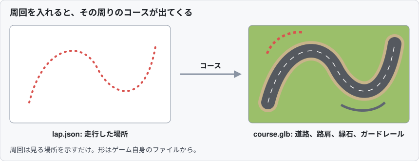
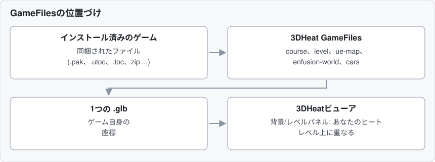

# 3DHeat GameFiles {#dheat-gamefiles}

**これは何？** すでにインストールしているゲームのファイルから、レースコースやゲームのレベルの3Dモデルを作るツールです。

**何に使うの？** 3DHeatビューアは、あなたが走ったり遊んだりした場所を、ヒートとして塗ります。このツールを使うと、空の場所ではなく、本物のコースやレベルの上に塗れるようになります。

**例:** 走った周回を1つ取ります。このツールは、その周りの道路と地面を1つの3Dファイルにまとめます。ビューアは、本物のコースの上にあなたの速度や衝突を塗ることができます:



コマンドラインは初めてですか？ まず [始める前に](before-you-start.md) を読んでください。

もう少し詳しく言うと、このツールはゲームが同梱するアーカイブからレベルのデータを読み出し、バイナリのglTF（`.glb`）ファイルとして書き出します。主な仕事は **コースの書き出し（course export）** です。周回を渡すと、地面、路肩と区別された道路と芝、そしてその周りの縁石、ガードレール、タイヤの壁、標識、建物を書き出します。

このツールは [3DHeat](https://github.com/Holdi601/3DHeat) の一部です。3DHeatは、リアルタイムの3Dテレメトリのヒートマップ、レース分析、マッチの振り返りのためのビューアです（[ドキュメント](https://holdi601.github.io/3DHeat/)）。このツールが書く `.glb` ファイルは、ビューアがその上にヒートを描くレベルです。



3DHeatにゲームのレベルの形状を入れる方法は、3つあります:

| 方法 | 必要なもの | 得られるもの |
|---|---|---|
| 3DHeat Unreal Exporter | エディターで開いたUnrealのプロジェクト | 正確な形状 |
| 3DHeat GameCapture | 画面とキャプチャ | 推定 |
| **3DHeat GameFiles** | **インストール済みで出荷されたゲーム** | **正確な形状、プロジェクトは不要** |

Pythonのパッケージ名は `heat3d_gamefiles`。リポジトリは [Holdi601/3DHeat-GameFiles](https://github.com/Holdi601/3DHeat-GameFiles)。ライセンスはMITです。

## できること {#what-it-can-do}

| ゲームまたはエンジン | コースの書き出し（`course`） | アーカイブの読み取り |
|---|---|---|
| Forza Horizon（ForzaTech） | はい: 地形、道路と路肩、地面のテクスチャ、それ自身のテクスチャで配置されたモデル | `.minizip` に対する `identify`、`list`、`extract`。`.modelbin` に対する `identify`。モデル、地形、テクスチャは `course` と `terrain` で |
| BeamNG.drive | はい: 地形、道路のデカール、モデル化されたサーキット、配置されたモデル、水 | レベルのzipに対する `identify`、`list`、`extract`。`.ter`、`.cdae` に対する `identify`。`.dae` は `course` で |
| Assetto Corsa Rally（Unreal 5.6） | はい: ステージの地面タイル、焼き込まれた地面の色、平らな色で配置されたモデル | IoStoreの `.utoc`/`.ucas` に対する `identify`、`list`、`extract`。zenパッケージ、スタティックメッシュ、テクスチャは `course` で |
| Unreal `.pak`（バージョン8〜12） | いいえ | `identify`、`list`、`extract` |
| Unity（フォーマット22以降） | いいえ | `identify`、`meshes` |
| Battlefield 6（Frostbite `.toc`/`.cas`） | 周回はなし。`level` でレベル全体: 地形、配置されたメッシュ、`--textures` でその色のマップ | `identify`、`levels`。バンドル、メッシュ、地形、テクスチャ、配置は `level` で |
| Source 2 `.vpk` | いいえ | `identify`、`list`、`extract` |
| Unreal 5 World Partition のゲーム | 周回はなし。`ue-map`（`ue-maps` で一覧）でマップ全体: ランドスケープ、HLODの建物と小物、水 | - |
| Arma Reforger（Enfusion） | 周回はなし。`enfusion-world`（`enfusion-worlds` で一覧）でワールド全体: 色のついた地形、海、箱にした建物 | - |
| Forza（車） | `cars`: すべての車を低い詳細度で。ビューアのレース分析 タブ用 | - |

Assetto Corsa EVO と iRacing の周回は、理由を示して拒否されます。[制限と既知の欠落](../limits-and-known-gaps.md) を参照してください。

## インストール {#install}

コマンドラインは初めてですか？ まず [始める前に](before-you-start.md) を読んでください。

必要なのは **Python 3.10 以降**（開発は3.13で行いました）と、[`requirements.txt`](https://github.com/Holdi601/3DHeat-GameFiles/blob/main/requirements.txt) にあるパッケージです。

```
git clone https://github.com/Holdi601/3DHeat-GameFiles.git
cd 3DHeat-GameFiles
pip install -r requirements.txt
```

次に確認します: `python -m heat3d_gamefiles --help`。`usage: heat3d_gamefiles [-h]` と、動詞の一覧が表示されるはずです。すべてのコマンドは、リポジトリのフォルダーから `python -m heat3d_gamefiles <verb>` の形で実行してください。

| パッケージ | 用途 |
|---|---|
| numpy | ジオメトリをデコードするすべての処理 |
| lz4 | Forzaのアーカイブ（ほとんどはLZ4ブロック）、一部のUnityのバンドル、IoStoreのLZ4ブロック |
| Pillow | BC1〜BC7のテクスチャのデコード、`.glb` 内のJPEGテクスチャの書き出し |
| msgpack、zstandard | BeamNGのコンパイル済みの形（`.cdae`） |
| cryptography | 手元にある鍵で暗号化された `.pak` を開く場合のみ |
| pytest | テスト |

**Oodle** で圧縮されたUnrealのコンテンツには、あなたのマシンにすでにあるOodleのライブラリが必要です。このツールには一切同梱されていません。[Oodle](../reader-oodle.md) を参照してください。

このツールはWindows向けに書かれています。ゲームはSteamのライブラリの一覧と `%LOCALAPPDATA%` から探し、OodleをWindowsのDLLとして読み込みます。ほかのプラットフォームでは試していません。

## クイックスタート {#quick-start}

**周回ファイル（lap file）** は、あなたの車がどこを走ったかの記録です。x、y、z の点の一覧です。[3DHeat GameCapture](https://github.com/Holdi601/3DHeat-GameCapture) か、FH Companion アプリの周回ライブラリから来ます。手で入力したCSVでも使えます（[周回の入力](../lap-inputs.md)）。

```
# Forza: 周回ファイル、周回のフォルダー、または FH Companion ライブラリのコース名
python -m heat3d_gamefiles course "Example Circuit"
python -m heat3d_gamefiles course path\to\lap.json -o course.glb

# BeamNG.drive または Assetto Corsa Rally: heat3d-lap ファイルがどのゲームのものかを示す
python -m heat3d_gamefiles course my_lap.json

# FH Companion ライブラリのすべてのコース。それぞれ1つの .glb
python -m heat3d_gamefiles courses -o courses

# Battlefield 6: レベルを一覧にしてから、1つを書き出す（大きなファイル。コマンドを参照）
python -m heat3d_gamefiles levels
python -m heat3d_gamefiles level <level> -o level.glb --textures

# Unreal 5 World Partition と Arma Reforger: 一覧にしてから書き出す
python -m heat3d_gamefiles ue-maps "<game>"
python -m heat3d_gamefiles ue-map "<game>" <map> -o map.glb
python -m heat3d_gamefiles enfusion-worlds
python -m heat3d_gamefiles enfusion-world <world> -o world.glb

# すべての Forza の車。ビューアのレース分析 タブ用
python -m heat3d_gamefiles cars -o forza.h3dcars

# このファイルは何？
python -m heat3d_gamefiles identify some_archive.pak
```

作られた `.glb` を3DHeatビューアで開いてください。ゲーム自身のワールド座標は保たれるので（[出力の形式](../output-format.md) を参照）、記録された周回がコースにぴったり重なります。

## このドキュメントの見取り図 {#map-of-this-documentation}

- [始める前に](before-you-start.md): Python、ターミナル、最初のコマンド。
- [コマンド](../commands.md): すべての動詞とオプション。例つき。
- [コマンドリファレンス](../cli-reference.md): すべての動詞の `--help`。コードから生成。
- [アーカイブの調べ方](../inspecting-archives.md): `identify`、`list`、`extract`、`meshes` を手順ごとに。
- [コースの書き出し](../course-export.md): 周回がコースになる仕組み。すべてのゲーム共通。
  - [Forza Horizon](../course-forza-horizon.md)
  - [BeamNG.drive](../course-beamng.md)
  - [Assetto Corsa Rally](../course-assetto-corsa-rally.md)
  - [詳細度と予算](../detail-budget.md)
- [レベル全体](../whole-levels.md): 周回なしのレベル、マップ、ワールド。
  - [Battlefield 6 のレベル](../level-battlefield.md): `levels`、`level`
  - [Unreal 5 のマップ](../level-unreal-world-partition.md): `ue-maps`、`ue-map`
  - [Arma Reforger のワールド](../level-arma-reforger.md): `enfusion-worlds`、`enfusion-world`
- [Forza の車](../forza-cars.md): `cars`。ビューアのレース分析 タブ用の車のファイル。
- [周回の入力](../lap-inputs.md): ツールが受け付けるすべての周回ファイルの形。
- [出力の形式](../output-format.md): `.glb` の中身。
- [アーカイブリーダー](../archive-readers.md): コンテナの形式ごとに1ページ。何を読み、何を読まないか、その理由。
- [制限と既知の欠落](../limits-and-known-gaps.md)
- [トラブルシューティング](../troubleshooting.md): エラーメッセージと、その対処。
- [ルールとライセンス](../rules-and-licences.md): 鍵なし、自分のファイル、再配布なし。
- [アップデート](../updates.md): 更新の確認と `heat3d_update`。
- [開発](../development.md): モジュールの地図とテスト。インストール済みのゲームに対して動くテストも含みます。
- [保守](../maintaining.md): これらのページのリリースチェックリスト。

## 3DHeatの一部 {#part-of-3dheat}

3DHeat GameFiles は、3DHeatビューアの周りにある無料のツールの一つです:

| ツール | 内容 | ドキュメント |
|---|---|---|
| [3DHeat](https://github.com/Holdi601/3DHeat) | ビューア: ブラウザでの3Dヒートマップ、レース分析、マッチの振り返り | [サイト](https://holdi601.github.io/3DHeat/) |
| [GameFiles](https://github.com/Holdi601/3DHeat-GameFiles) | ゲームが同梱するファイルから、コースとレベルを `.glb` として | [サイト](https://holdi601.github.io/3DHeat-GameFiles/) |
| [GameCapture](https://github.com/Holdi601/3DHeat-GameCapture) | レースゲームの周回テレメトリ。ゲーム映像から再構築したレベル | [サイト](https://holdi601.github.io/3DHeat-GameCapture/) |
| [Unreal Exporter](https://github.com/Holdi601/3DHeat-UnrealExporter) | レベルを `.glb` として保存する Unreal Editor のプラグイン | [サイト](https://holdi601.github.io/3DHeat-UnrealExporter/) |
| [CS2](https://github.com/Holdi601/3DHeat-CS2) | Counter-Strike 2 のデモをマッチファイルに。マップを `.glb` に | [サイト](https://holdi601.github.io/3DHeat-CS2/) |
| [Watcher](https://github.com/Holdi601/3DHeat-Watcher) | ゲームが公開する情報から、あなたのプレイをバックグラウンドで記録 | [サイト](https://holdi601.github.io/3DHeat-Watcher/) |
| [Ext-WarThunder](https://github.com/Holdi601/3DHeat-Ext-WarThunder) | War Thunder のリプレイをマッチファイルに | [サイト](https://holdi601.github.io/3DHeat-Ext-WarThunder/) |
| [Ext-WoT](https://github.com/Holdi601/3DHeat-Ext-WoT) | World of Tanks のリプレイをマッチファイルに | [サイト](https://holdi601.github.io/3DHeat-Ext-WoT/) |
| [Ext-WoWs](https://github.com/Holdi601/3DHeat-Ext-WoWs) | World of Warships のリプレイをマッチファイルに | [サイト](https://holdi601.github.io/3DHeat-Ext-WoWs/) |
| [Ext-Squad](https://github.com/Holdi601/3DHeat-Ext-Squad) | Squad のサーバーのデモをマッチファイルに | [サイト](https://holdi601.github.io/3DHeat-Ext-Squad/) |
| [Ext-DCS](https://github.com/Holdi601/3DHeat-Ext-DCS) | DCS World のマップを `.glb` のレベルに | [サイト](https://holdi601.github.io/3DHeat-Ext-DCS/) |
| [Ext-IL2](https://github.com/Holdi601/3DHeat-Ext-IL2) | IL-2 Sturmovik のマップを `.glb` のレベルに | [サイト](https://holdi601.github.io/3DHeat-Ext-IL2/) |

ビューアのマッチファイルは、[1 マッチを 1 ファイルに: `.3dheat`](https://holdi601.github.io/3DHeat/container.html) に説明があります。ここで作ったレベルは、ビューアの背景/レベルパネルで、それらと並べて読み込まれます。
