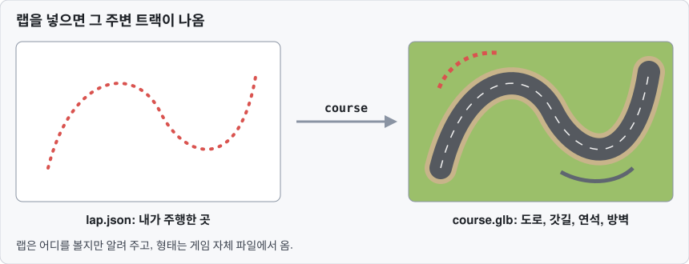
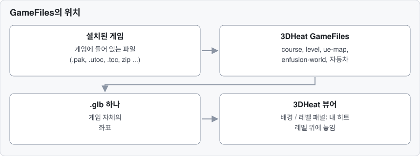

# 3DHeat GameFiles {#dheat-gamefiles}

**무엇입니까?** 이미 설치된 게임의 파일에서 레이스 코스나 게임 레벨의 3D 모델을 만들어 주는 도구입니다.

**왜 씁니까?** 3DHeat 뷰어는 여러분이 운전하거나 플레이한 곳을 열 맵으로 칠합니다. 이 도구를 쓰면 빈 공간이 아니라 실제 코스나 레벨 위에 칠할 수 있습니다.

**예시:** 여러분이 달린 랩 하나를 고르세요. 도구는 그 주변의 도로와 땅을 3D 파일 하나로 만들어, 뷰어가 여러분의 속도나 충돌을 실제 코스 위에 그릴 수 있게 합니다:



명령줄이 처음입니까? [시작하기 전에](before-you-start.md)부터 보세요.

조금 더 자세히 말하면, 이 도구는 게임이 함께 배포하는 아카이브에서 레벨 데이터를 읽어 이진 glTF(`.glb`) 파일로 씁니다. 주된 일은 **코스 내보내기**입니다. 랩을 넣으면, 지면과, 갓길 및 잔디와 구분된 도로, 그리고 그 주변의 연석, 장벽, 타이어 벽, 표지판, 건물을 씁니다.

이 도구는 [3DHeat](https://github.com/Holdi601/3DHeat)의 일부입니다. 3DHeat은 실시간 3D 텔레메트리 히트맵, 레이스 분석, 매치 리뷰를 위한 뷰어입니다([문서](https://holdi601.github.io/3DHeat/)). 이 도구가 쓰는 `.glb` 파일이, 뷰어가 히트맵을 그리는 레벨입니다.



레벨의 기하 데이터를 3DHeat으로 가져오는 방법은 세 가지입니다:

| 경로 | 필요한 것 | 결과 |
|---|---|---|
| 3DHeat Unreal Exporter | 에디터에 열린 Unreal 프로젝트 | 정확한 기하 |
| 3DHeat GameCapture | 화면과 캡처 | 추정치 |
| **3DHeat GameFiles** | **설치되어 배포된 게임** | **정확한 기하, 프로젝트 불필요** |

Python 패키지 이름은 `heat3d_gamefiles`입니다. 저장소는 [Holdi601/3DHeat-GameFiles](https://github.com/Holdi601/3DHeat-GameFiles)이고, 라이선스는 MIT입니다.

## 할 수 있는 일 {#what-it-can-do}

| 게임 또는 엔진 | 코스 내보내기 (`course`) | 아카이브 읽기 |
|---|---|---|
| Forza Horizon (ForzaTech) | 예: 지형, 도로와 갓길, 지면 텍스처, 자기 텍스처를 가진 배치 모델 | `.minizip`에서 `identify`, `list`, `extract`. `.modelbin`에서 `identify`. `course`와 `terrain`으로 모델, 지형, 텍스처 |
| BeamNG.drive | 예: 지형, 도로 데칼, 모델링된 서킷, 배치 모델, 물 | 레벨 zip에서 `identify`, `list`, `extract`. `.ter`, `.cdae`에서 `identify`. `course`로 `.dae` |
| Assetto Corsa Rally (Unreal 5.6) | 예: 스테이지 지면 타일, 구운 지면 색, 단색의 배치 모델 | IoStore `.utoc`/`.ucas`에서 `identify`, `list`, `extract`. zen 패키지, 스태틱 메시, 텍스처는 `course`로 |
| Unreal `.pak` (버전 8-12) | 없음 | `identify`, `list`, `extract` |
| Unity (형식 22 이상) | 없음 | `identify`, `meshes` |
| Battlefield 6 (Frostbite `.toc`/`.cas`) | 랩 없음. `level`로 레벨 전체: 지형, 배치된 메시, `--textures`를 쓰면 그 색 맵 | `identify`, `levels`. 번들, 메시, 지형, 텍스처, 배치는 `level`로 |
| Source 2 `.vpk` | 없음 | `identify`, `list`, `extract` |
| Unreal 5 World Partition 게임 | 랩 없음. `ue-map`(목록은 `ue-maps`)으로 맵 전체: 랜드스케이프, HLOD 건물과 소품, 물 | - |
| Arma Reforger (Enfusion) | 랩 없음. `enfusion-world`(목록은 `enfusion-worlds`)로 월드 전체: 색이 칠해진 지형, 바다, 상자로 된 건물 | - |
| Forza (자동차) | `cars`: 모든 자동차를 낮은 상세도로. 뷰어의 레이스 분석 탭용 | - |

Assetto Corsa EVO와 iRacing의 랩은 이유와 함께 거부됩니다. [한계와 알려진 공백](../limits-and-known-gaps.md)을 보세요.

## 설치 {#install}

명령줄이 처음입니까? 먼저 [시작하기 전에](before-you-start.md)를 읽으세요.

**Python 3.10 이상**(3.13에서 개발됨)과 [`requirements.txt`](https://github.com/Holdi601/3DHeat-GameFiles/blob/main/requirements.txt)에 있는 패키지가 필요합니다.

```
git clone https://github.com/Holdi601/3DHeat-GameFiles.git
cd 3DHeat-GameFiles
pip install -r requirements.txt
```

그다음 확인하세요: `python -m heat3d_gamefiles --help`. `usage: heat3d_gamefiles [-h]`와 동사(verb) 목록이 보여야 합니다. 모든 명령은 저장소 폴더에서 `python -m heat3d_gamefiles <verb>` 형태로 실행하세요.

| 패키지 | 쓰임 |
|---|---|
| numpy | 기하를 해독하는 모든 작업 |
| lz4 | Forza 아카이브(대부분 LZ4 블록), 일부 Unity 번들, IoStore LZ4 블록 |
| Pillow | BC1-BC7 텍스처 해독, `.glb` 안의 JPEG 텍스처 쓰기 |
| msgpack, zstandard | BeamNG의 컴파일된 형상(`.cdae`) |
| cryptography | 이미 가지고 있는 키로 암호화된 `.pak`을 열 때만 |
| pytest | 테스트 |

**Oodle**로 압축된 Unreal 콘텐츠에는 본인의 컴퓨터에 이미 있는 Oodle 라이브러리가 필요합니다. 이 도구에는 절대 들어 있지 않습니다. [Oodle](../reader-oodle.md)을 보세요.

이 도구는 Windows용으로 작성되었습니다. Steam의 라이브러리 목록과 `%LOCALAPPDATA%`에서 게임을 찾고, Oodle을 Windows DLL로 불러옵니다. 다른 플랫폼은 테스트하지 않았습니다.

## 빠른 시작 {#quick-start}

**랩 파일**은 여러분의 차가 어디로 갔는지를 기록한 것입니다. x, y, z 점들의 목록이지요. [3DHeat GameCapture](https://github.com/Holdi601/3DHeat-GameCapture)나 FH Companion 앱의 랩 라이브러리에서 나오며, 손으로 쓴 CSV도 됩니다([랩 입력](../lap-inputs.md)).

```
# Forza: 랩 파일, 랩 폴더, 또는 FH Companion 라이브러리의 코스 이름
python -m heat3d_gamefiles course "Example Circuit"
python -m heat3d_gamefiles course path\to\lap.json -o course.glb

# BeamNG.drive 또는 Assetto Corsa Rally: heat3d-lap 파일이 어느 게임의 것인지 알려 줍니다
python -m heat3d_gamefiles course my_lap.json

# FH Companion 라이브러리의 모든 코스, 코스마다 .glb 하나씩
python -m heat3d_gamefiles courses -o courses

# Battlefield 6: 레벨을 목록으로 보고, 하나를 내보내기 (큰 파일입니다. 명령 페이지 참고)
python -m heat3d_gamefiles levels
python -m heat3d_gamefiles level <level> -o level.glb --textures

# Unreal 5 World Partition과 Arma Reforger: 목록을 보고, 내보내기
python -m heat3d_gamefiles ue-maps "<game>"
python -m heat3d_gamefiles ue-map "<game>" <map> -o map.glb
python -m heat3d_gamefiles enfusion-worlds
python -m heat3d_gamefiles enfusion-world <world> -o world.glb

# 모든 Forza 자동차, 뷰어의 레이스 분석 탭용
python -m heat3d_gamefiles cars -o forza.h3dcars

# 이 파일은 무엇입니까?
python -m heat3d_gamefiles identify some_archive.pak
```

`.glb`를 3DHeat 뷰어에서 여세요. 게임 자체의 세계 좌표가 그대로 남으므로([출력 형식](../output-format.md) 참고), 기록한 랩이 코스와 맞아떨어집니다.

## 이 문서의 목차 {#map-of-this-documentation}

- [시작하기 전에](before-you-start.md): Python, 터미널, 첫 명령.
- [명령](../commands.md): 모든 동사와 옵션, 예시와 함께.
- [명령 참조](../cli-reference.md): 모든 동사의 `--help`, 코드에서 생성.
- [아카이브 살펴보기](../inspecting-archives.md): `identify`, `list`, `extract`, `meshes`를 단계별로.
- [코스 내보내기](../course-export.md): 모든 게임에서 랩이 코스가 되는 방법.
  - [Forza Horizon](../course-forza-horizon.md)
  - [BeamNG.drive](../course-beamng.md)
  - [Assetto Corsa Rally](../course-assetto-corsa-rally.md)
  - [상세 단계와 예산](../detail-budget.md)
- [레벨 전체](../whole-levels.md): 랩 없이 레벨, 맵, 월드 하나.
  - [Battlefield 6 레벨](../level-battlefield.md): `levels`, `level`
  - [Unreal 5 맵](../level-unreal-world-partition.md): `ue-maps`, `ue-map`
  - [Arma Reforger 월드](../level-arma-reforger.md): `enfusion-worlds`, `enfusion-world`
- [Forza 자동차](../forza-cars.md): `cars`, 뷰어의 레이스 분석 탭용 자동차 파일.
- [랩 입력](../lap-inputs.md): 이 도구가 받는 모든 랩 파일 형태.
- [출력 형식](../output-format.md): `.glb` 안에 무엇이 있는지.
- [아카이브 읽기 도구](../archive-readers.md): 컨테이너 형식마다 한 페이지씩, 각각이 읽는 것, 읽지 않는 것, 그 이유.
- [한계와 알려진 공백](../limits-and-known-gaps.md)
- [문제 해결](../troubleshooting.md): 오류 메시지와 그 대처.
- [규칙과 라이선스](../rules-and-licences.md): 키 없음, 본인의 파일, 재배포 없음.
- [업데이트](../updates.md): 업데이트 확인과 `heat3d_update`.
- [개발](../development.md): 모듈 구성과 테스트, 설치된 게임에 대해 도는 테스트 포함.
- [문서 관리](../maintaining.md): 이 페이지들의 릴리스 체크리스트.

## 3DHeat의 일부 {#part-of-3dheat}

3DHeat GameFiles는 3DHeat 뷰어 주변의 무료 도구 중 하나입니다:

| 도구 | 하는 일 | 문서 |
|---|---|---|
| [3DHeat](https://github.com/Holdi601/3DHeat) | 뷰어: 브라우저의 3D 히트맵, 레이스 분석, 매치 리뷰 | [사이트](https://holdi601.github.io/3DHeat/) |
| [GameFiles](https://github.com/Holdi601/3DHeat-GameFiles) | 게임이 배포하는 파일에서 코스와 레벨을 `.glb`로 | [사이트](https://holdi601.github.io/3DHeat-GameFiles/) |
| [GameCapture](https://github.com/Holdi601/3DHeat-GameCapture) | 레이싱 게임의 랩 텔레메트리. 게임플레이 영상에서 다시 만든 레벨 | [사이트](https://holdi601.github.io/3DHeat-GameCapture/) |
| [Unreal Exporter](https://github.com/Holdi601/3DHeat-UnrealExporter) | 레벨을 `.glb`로 저장하는 Unreal 에디터 플러그인 | [사이트](https://holdi601.github.io/3DHeat-UnrealExporter/) |
| [CS2](https://github.com/Holdi601/3DHeat-CS2) | Counter-Strike 2 데모를 매치 파일로, 맵을 `.glb`로 | [사이트](https://holdi601.github.io/3DHeat-CS2/) |
| [Watcher](https://github.com/Holdi601/3DHeat-Watcher) | 게임이 공개하는 것을 바탕으로 백그라운드에서 플레이를 기록 | [사이트](https://holdi601.github.io/3DHeat-Watcher/) |
| [Ext-WarThunder](https://github.com/Holdi601/3DHeat-Ext-WarThunder) | 워 썬더 리플레이를 매치 파일로 | [사이트](https://holdi601.github.io/3DHeat-Ext-WarThunder/) |
| [Ext-WoT](https://github.com/Holdi601/3DHeat-Ext-WoT) | 월드 오브 탱크 리플레이를 매치 파일로 | [사이트](https://holdi601.github.io/3DHeat-Ext-WoT/) |
| [Ext-WoWs](https://github.com/Holdi601/3DHeat-Ext-WoWs) | 월드 오브 워십 리플레이를 매치 파일로 | [사이트](https://holdi601.github.io/3DHeat-Ext-WoWs/) |
| [Ext-Squad](https://github.com/Holdi601/3DHeat-Ext-Squad) | Squad 서버 데모를 매치 파일로 | [사이트](https://holdi601.github.io/3DHeat-Ext-Squad/) |
| [Ext-DCS](https://github.com/Holdi601/3DHeat-Ext-DCS) | DCS World 맵을 `.glb` 레벨로 | [사이트](https://holdi601.github.io/3DHeat-Ext-DCS/) |
| [Ext-IL2](https://github.com/Holdi601/3DHeat-Ext-IL2) | IL-2 Sturmovik 맵을 `.glb` 레벨로 | [사이트](https://holdi601.github.io/3DHeat-Ext-IL2/) |

뷰어의 매치 파일은 [매치 하나를 파일 하나로: `.3dheat`](https://holdi601.github.io/3DHeat/container.html)에 설명되어 있습니다. 여기서 만든 레벨은 그 옆에서 뷰어의 배경 / 레벨 패널로 불러옵니다.
