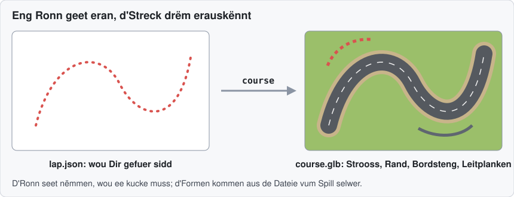
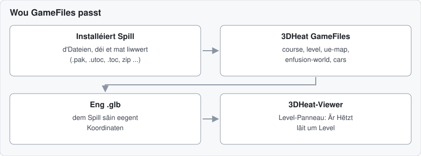

# 3DHeat GameFiles {#dheat-gamefiles}

**Wat ass et?** E Tool, dat en 3D-Modell vun enger Rennstreck oder vun engem Spilllevel
aus de Dateie vun engem Spill baut, dat Dir schonn installéiert hutt.

**Firwat sollt ech et benotzen?** Den 3DHeat-Viewer molt, wou Dir gefuer sidd oder gespillt hutt, als
Hëtzt. Mat dësem Tool molt hien et op déi richteg Streck oder dat richtegt Level, net an eidele Raum.

**Beispill:** Hollt eng Ronn, déi Dir gefuer sidd. D'Tool baut d'Strooss an d'Land drëm
als eng 3D-Datei, sou datt de Viewer Är Geschwindegkeet oder Crashen op der richteger Streck molen kann:



Nei op der Kommandozeil? Fänkt mat [Ier Dir ufänkt](before-you-start.md) un.

Méi genau: et liest Leveldaten aus den Archiver, déi e Spill mat liwwert, a schreift se
als binär glTF-Datei (`.glb`). Seng Haaptaarbecht ass den **Course-Export**: Dir gitt
him eng Ronn, an hie schreift de Buedem, d'Strooss ënnerscheet vu Rand a
Gras, an d'Bordsteng, Leitplanken, Pneumaueren, Schëlder a Gebaier drëm.

Et ass en Deel vun [3DHeat](https://github.com/Holdi601/3DHeat), engem Viewer fir
3D-Echtzäit-Telemetrie-Heatmaps, Course-Analys a Match-Iwwerpréiwung
([Dokumentatioun](https://holdi601.github.io/3DHeat/)). D'`.glb`-Dateien, déi dëst
Tool schreift, sinn d'Levelen, op déi de Viewer d'Hëtzt molt.



Et ass ee vun dräi Weeër, d'Geometrie vun engem Level an 3DHeat ze kréien:

| Wee | Brauch | Gëtt |
|---|---|---|
| 3DHeat Unreal Exporter | den Unreal-Projet am Editor oppen | exakt Geometrie |
| 3DHeat GameCapture | e Bildschierm an eng Opnam | eng Schätzung |
| **3DHeat GameFiles** | **dat installéiert, ausgeliwwert Spill** | **exakt Geometrie, kee Projet** |

Python-Package: `heat3d_gamefiles`. Repository:
[Holdi601/3DHeat-GameFiles](https://github.com/Holdi601/3DHeat-GameFiles). Lizenz: MIT.

## Wat et ka maachen {#what-it-can-do}

| Spill oder Engine | Course-Export (`course`) | Archiv liesen |
|---|---|---|
| Forza Horizon (ForzaTech) | jo: Terrain, Strooss a Rand, Buedemtextur, placéiert Modeller an hiren eegenen Texturen | `identify`, `list`, `extract` op enger `.minizip`; `identify` op enger `.modelbin`; Modeller, Terrain an Texturen iwwer `course` an `terrain` |
| BeamNG.drive | jo: Terrain, Stroossen-Decals, modelléiert Circuiten, placéiert Modeller, Waasser | `identify`, `list`, `extract` op Level-Zips; `identify` op `.ter`, `.cdae`; `.dae` iwwer `course` |
| Assetto Corsa Rally (Unreal 5.6) | jo: Etappe-Buedemkachelen, agebaakte Buedemfaarf, placéiert Modeller a flaache Faarwen | `identify`, `list`, `extract` op IoStore `.utoc`/`.ucas`; Zen-Packagen, Static Meshes, Texturen iwwer `course` |
| Unreal `.pak` (Versioune 8-12) | nee | `identify`, `list`, `extract` |
| Unity (Format 22 a méi spéit) | nee | `identify`, `meshes` |
| Battlefield 6 (Frostbite `.toc`/`.cas`) | keng Ronn; e ganzt Level mat `level`: Terrain, placéiert Meshen, hir Faarfkaarten mat `--textures` | `identify`, `levels`; Bundles, Meshen, Terrain, Texturen a Placement iwwer `level` |
| Source 2 `.vpk` | nee | `identify`, `list`, `extract` |
| Unreal-5-World-Partition-Spiller | keng Ronn; eng ganz Map mat `ue-map` (opgelëscht vun `ue-maps`): Landscape, HLOD-Gebaier a Props, Waasser | - |
| Arma Reforger (Enfusion) | keng Ronn; eng ganz Welt mat `enfusion-world` (opgelëscht vun `enfusion-worlds`): Terrain a senge Faarwen, d'Mier, Gebaier als Këschten | - |
| Forza (Autoen) | `cars`: all Auto mat wéinegen Detailer, fir den Course-Analys-Tab vum Viewer | - |

Ronnen aus Assetto Corsa EVO an iRacing ginn mat engem Grond refuséiert. Kuckt
[Grenzen a bekannt Lücken](../limits-and-known-gaps.md).

## Installéieren {#install}

Nei op der Kommandozeil? Liest fir d'éischt [Ier Dir ufänkt](before-you-start.md).

Dir braucht **Python 3.10 oder méi nei** (entwéckelt op 3.13) an d'Packagen an
[`requirements.txt`](https://github.com/Holdi601/3DHeat-GameFiles/blob/main/requirements.txt).

```
git clone https://github.com/Holdi601/3DHeat-GameFiles.git
cd 3DHeat-GameFiles
pip install -r requirements.txt
```

Dann préift et: `python -m heat3d_gamefiles --help`. Dir sollt
`usage: heat3d_gamefiles [-h]` an d'Lëscht vun de Verben gesinn. Féiert all Kommando am
Repository-Dossier aus, als `python -m heat3d_gamefiles <verb>`.

| Package | Gebraucht fir |
|---|---|
| numpy | alles, wat Geometrie dekodéiert |
| lz4 | Forza-Archiver (meeschtens LZ4-Blöck), e puer Unity-Bundles, IoStore-LZ4-Blöck |
| Pillow | BC1-BC7-Texturen dekodéieren, d'JPEG-Texturen an d'`.glb` schreiwen |
| msgpack, zstandard | dem BeamNG seng kompiléiert Shapes (`.cdae`) |
| cryptography | nëmmen fir eng verschlësselt `.pak` mat engem Schlëssel opzemaachen, deen Dir schonn hutt |
| pytest | d'Tester |

Unreal-Inhalt, mat **Oodle** komprimiert, brauch eng Oodle-Bibliothéik, déi schonn op
Ärem Rechner ass. Eng gëtt ni mat dësem Tool matgeliwwert. Kuckt [Oodle](../reader-oodle.md).

D'Tool ass fir Windows geschriwwen. Et fënnt Spiller iwwer d'Bibliothéikslëscht vu Steam an
`%LOCALAPPDATA%`, a lued Oodle als Windows-DLL. Aner Plattforme goufen net
getest.

## Séier Start {#quick-start}

Eng **Ronn-Datei** ass eng Opnam dovun, wou Äert Auto higaangen ass: eng Lëscht vun x-, y-, z-Punkten.
Si kënnt vun [3DHeat GameCapture](https://github.com/Holdi601/3DHeat-GameCapture)
oder vun der Ronn-Bibliothéik vun der FH-Companion-App; eng vun Hand getippt CSV geet och
([Ronn-Inputen](../lap-inputs.md)).

```
# Forza: a lap file, a lap folder, or a course name from the FH Companion library
python -m heat3d_gamefiles course "Example Circuit"
python -m heat3d_gamefiles course path\to\lap.json -o course.glb

# BeamNG.drive or Assetto Corsa Rally: a heat3d-lap file says which game it is from
python -m heat3d_gamefiles course my_lap.json

# Every course in the FH Companion library, one .glb each
python -m heat3d_gamefiles courses -o courses

# Battlefield 6: list the levels, then export one (a large file; see Commands)
python -m heat3d_gamefiles levels
python -m heat3d_gamefiles level <level> -o level.glb --textures

# Unreal 5 World Partition and Arma Reforger: list, then export
python -m heat3d_gamefiles ue-maps "<game>"
python -m heat3d_gamefiles ue-map "<game>" <map> -o map.glb
python -m heat3d_gamefiles enfusion-worlds
python -m heat3d_gamefiles enfusion-world <world> -o world.glb

# Every Forza car, for the viewer's race tab
python -m heat3d_gamefiles cars -o forza.h3dcars

# What is this file?
python -m heat3d_gamefiles identify some_archive.pak
```

Mécht d'`.glb` am 3DHeat-Viewer op. D'Weltkoordinate vum Spill selwer bleiwen erhalen
(kuckt [Ausgabeformat](../output-format.md)), sou datt eng opgeholl Ronn mam Course passt.

## Kaart vun dëser Dokumentatioun {#map-of-this-documentation}

- [Ier Dir ufänkt](before-you-start.md): Python, e Terminal, dee éischte Kommando.
- [Kommandoen](../commands.md): all Verb an Optioun, mat Beispiller.
- [Kommando-Referenz](../cli-reference.md): den `--help` vun all Verb, aus dem Code generéiert.
- [Archiver inspektéieren](../inspecting-archives.md): `identify`, `list`, `extract`, `meshes`, Schrëtt fir Schrëtt.
- [Course-Export](../course-export.md): wéi eng Ronn e Course gëtt, fir all Spiller.
  - [Forza Horizon](../course-forza-horizon.md)
  - [BeamNG.drive](../course-beamng.md)
  - [Assetto Corsa Rally](../course-assetto-corsa-rally.md)
  - [Detailniveaue an d'Budget](../detail-budget.md)
- [Ganz Levelen](../whole-levels.md): e Level, eng Map oder eng Welt ouni Ronn.
  - [Battlefield-6-Levelen](../level-battlefield.md): `levels`, `level`
  - [Unreal-5-Mappen](../level-unreal-world-partition.md): `ue-maps`, `ue-map`
  - [Arma-Reforger-Welten](../level-arma-reforger.md): `enfusion-worlds`, `enfusion-world`
- [Forza-Autoen](../forza-cars.md): `cars`, d'Autosdatei fir den Course-Analys-Tab vum Viewer.
- [Ronn-Inputen](../lap-inputs.md): all Ronn-Dateiform, déi d'Tool akzeptéiert.
- [Ausgabeformat](../output-format.md): wat an der `.glb` ass.
- [Archiv-Reader](../archive-readers.md): eng Säit pro Container-Format, déi ofdeckt,
  wat jidde liest, wat net, a firwat.
- [Grenzen a bekannt Lücken](../limits-and-known-gaps.md)
- [Fehlerbehebung](../troubleshooting.md): d'Feelermeldungen a wat ze maachen ass.
- [Reegelen a Lizenzen](../rules-and-licences.md): keng Schlësselen, Är eege Dateien, keng Weiderverdeelung.
- [Updates](../updates.md): de Update-Check an `heat3d_update`.
- [Entwécklung](../development.md): Modulkaart an Tester, och d'Tester, déi géint installéiert Spiller lafen.
- [Ënnerhalen](../maintaining.md): d'Release-Checklëscht fir dës Säiten.

## Deel vun 3DHeat {#part-of-3dheat}

3DHeat GameFiles ass ee vun de fräien Tools ronderëm den 3DHeat-Viewer:

| Tool | Wat et mécht | Docs |
|---|---|---|
| [3DHeat](https://github.com/Holdi601/3DHeat) | de Viewer: 3D-Heatmaps, Course-Analys a Match-Iwwerpréiwung am Browser | [Site](https://holdi601.github.io/3DHeat/) |
| [GameFiles](https://github.com/Holdi601/3DHeat-GameFiles) | Course a Levelen aus de Dateie vun engem Spill, als `.glb` | [Site](https://holdi601.github.io/3DHeat-GameFiles/) |
| [GameCapture](https://github.com/Holdi601/3DHeat-GameCapture) | Ronn-Telemetrie vu Rennspiller; Levelen aus Gameplay-Video nei opgebaut | [Site](https://holdi601.github.io/3DHeat-GameCapture/) |
| [Unreal Exporter](https://github.com/Holdi601/3DHeat-UnrealExporter) | en Unreal-Editor-Plugin, dat e Level als `.glb` späichert | [Site](https://holdi601.github.io/3DHeat-UnrealExporter/) |
| [CS2](https://github.com/Holdi601/3DHeat-CS2) | Counter-Strike-2-Demoen a Match-Dateien; Mappen a `.glb` | [Site](https://holdi601.github.io/3DHeat-CS2/) |
| [Watcher](https://github.com/Holdi601/3DHeat-Watcher) | hält Äert Spill am Hannergrond fest, aus deem, wat Spiller publizéieren | [Site](https://holdi601.github.io/3DHeat-Watcher/) |
| [Ext-WarThunder](https://github.com/Holdi601/3DHeat-Ext-WarThunder) | War-Thunder-Replays a Match-Dateien | [Site](https://holdi601.github.io/3DHeat-Ext-WarThunder/) |
| [Ext-WoT](https://github.com/Holdi601/3DHeat-Ext-WoT) | World-of-Tanks-Replays a Match-Dateien | [Site](https://holdi601.github.io/3DHeat-Ext-WoT/) |
| [Ext-WoWs](https://github.com/Holdi601/3DHeat-Ext-WoWs) | World-of-Warships-Replays a Match-Dateien | [Site](https://holdi601.github.io/3DHeat-Ext-WoWs/) |
| [Ext-Squad](https://github.com/Holdi601/3DHeat-Ext-Squad) | Squad-Server-Demoen a Match-Dateien | [Site](https://holdi601.github.io/3DHeat-Ext-Squad/) |
| [Ext-DCS](https://github.com/Holdi601/3DHeat-Ext-DCS) | DCS-World-Mappen a `.glb`-Levelen | [Site](https://holdi601.github.io/3DHeat-Ext-DCS/) |
| [Ext-IL2](https://github.com/Holdi601/3DHeat-Ext-IL2) | IL-2-Sturmovik-Mappen a `.glb`-Levelen | [Site](https://holdi601.github.io/3DHeat-Ext-IL2/) |

D'Match-Dateie vum Viewer si beschriwwen an
[Eng Datei pro Match: `.3dheat`](https://holdi601.github.io/3DHeat/container.html);
e Level, dat hei gemaach gouf, gëtt niewent hinnen am Panel „Hannergrond / Level“ vum Viewer gelueden.
