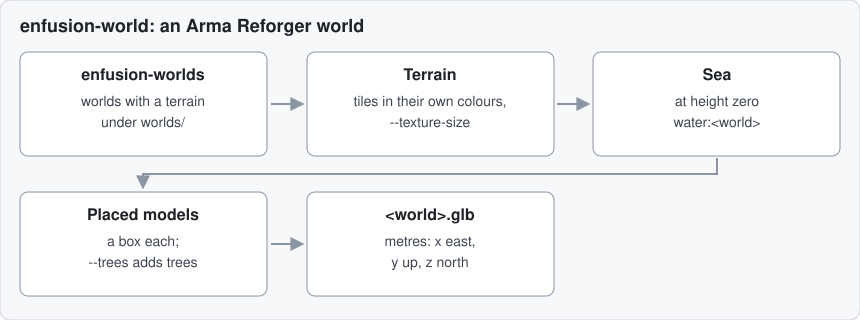

# Arma Reforger worlds: `enfusion-worlds` and `enfusion-world`

Exports a whole Enfusion world of the installed Arma Reforger: the terrain in
the colours of its own supertexture tiles, the sea, and every placed model as
a box, in the game's own metres.



## Step by step

1. **List the worlds** that have a terrain:

   ```
   python -m heat3d_gamefiles enfusion-worlds
   python -m heat3d_gamefiles enfusion-worlds --install "D:\Games\Arma Reforger"
   ```

2. **Export one**, by its folder name under `worlds/` as listed:

   ```
   python -m heat3d_gamefiles enfusion-world <world> -o world.glb
   ```

3. **Variations:**

   ```
   python -m heat3d_gamefiles enfusion-world <world> --trees               # vegetation too, as boxes
   python -m heat3d_gamefiles enfusion-world <world> --texture-size 0      # flat colour, small file
   python -m heat3d_gamefiles enfusion-world <world> --ground-spacing 4 --no-structures
   ```

4. **Open `world.glb`** in the 3DHeat viewer's Level panel.

## Options

| Option | Default | Meaning |
|---|---|---|
| `<world>` | required | a world as `enfusion-worlds` prints it |
| `-o`, `--out FILE` | `<world>.glb` | the file to write |
| `--install FOLDER` | the Steam library that holds the game | the game's folder |
| `--ground-spacing METRES` | 2 (the terrain's own) | the terrain's vertex spacing in the file |
| `--texture-size PIXELS` | 4096 | the ground colour image's larger side; 0 for flat colour |
| `--no-structures` | | leave the placed models out |
| `--trees` | off | also place trees and other vegetation, as boxes |

## Example output

```text
<world> -> world.glb
  ground      <n> triangles, <w> x <h> m; <n> of <n> tile-edge vertices disagree; colour <w> x <h>
  structure   <n> boxes from <n> entities
  water       <n> triangles (the sea)
  left out    <what>: <n>, ...
```

## The parts

`ground:<world>` (the terrain), `water:<world>` (the sea, at height zero) and
`structure:<world>` (the boxes), x east, y up, z north. How each is read and
checked is in the
[README](https://github.com/Holdi601/3DHeat-GameFiles#arma-reforger--enfusion-pak-terrain-and-world-files).
