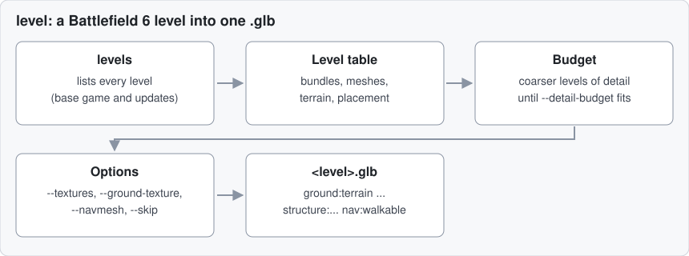

# Battlefield 6 levels: `levels` and `level`

Exports a whole Frostbite level of the installed game: the terrain heightfield,
every mesh its static model groups place, the objects placed one by one, the
terrain backdrop around the map, and on request the surfaces' colour maps, the
terrain decals baked into the ground and the soldiers' walkable surfaces.



## Step by step

1. **List the levels** the game ships:

   ```
   python -m heat3d_gamefiles levels
   python -m heat3d_gamefiles levels --install "D:\Games\<game folder>"
   ```

   Each line is a level table (`levels/<level>/<level>.toc`) with its size and
   where it comes from: `Data` for the base game, `Update/<pack>` for an update.

2. **Export one**, by its name, a unique part of it, or its `.toc` path. Start
   untextured to see the shape and the size:

   ```
   python -m heat3d_gamefiles level <level> -o level.glb
   ```

3. **Add colour** once it looks right:

   ```
   python -m heat3d_gamefiles level <level> -o level.glb --textures 512 --ground-texture 0.5
   ```

4. **Add the walkable surfaces**, or shrink the file:

   ```
   python -m heat3d_gamefiles level <level> --textures 512 --ground-texture 0.5 --navmesh
   python -m heat3d_gamefiles level <level> --textures 256 --detail-budget 3000000 --ground-spacing 8
   ```

5. **Open `level.glb`** in the 3DHeat viewer's Level panel.

## Options

| Option | Default | Meaning |
|---|---|---|
| `<level>` | required | a name as `levels` prints it, a unique part of one, or a level's `.toc` |
| `-o`, `--out FILE` | `<level>.glb` | the file to write |
| `--install FOLDER` | found in the Steam libraries | the game's folder |
| `--textures [PIXELS]` | off; 512 without a size | each surface's colour map, at most PIXELS a side |
| `--ground-texture [METRES]` | off; 0.5 without a size | bake roads, aprons and markings into the ground's colour, METRES a pixel |
| `--navmesh` | off | add the soldier's navigation mesh as `nav:walkable` |
| `--ground-spacing METRES` | 4 | the heightfield's finest spacing; 0 leaves it out |
| `--detail-budget N` | coarsest copies plus a quarter, at least 1,500,000 | a ceiling on triangles (the terrain is never coarsened) |
| `--skip TEXT` | | leave out model groups whose partition name contains TEXT; repeatable |
| `--by-mesh` | off | one part per source mesh and material, for finding what a part is |
| `--clamped-uvs` | off | for renderers that cannot repeat a texture |

The full table, with the sizes to expect (a whole level is hundreds of MB), is
on [Commands](commands.md#levels-and-level-frostbite). How the tables, bundles,
meshes and terrain are read is on [Frostbite](reader-frostbite.md).

## Example output

What `level` prints, in outline (the lines as the code writes them; `<n>` and
the names vary by level):

```text
<n> copies of <n> meshes, from <n> static model groups
      <n>  <group>
      <n>  placed one by one (object and prefab references)
<n> meshes left out: <why>
<n> triangles, budget <n>; <n> meshes drawn at a coarser level to fit
           <n>  ground:terrain
           <n>  structure:buildings, <n> textures
           ...
<n> of <n> drawn sections carry their colour map; the rest are flat colours
Ground: <what the ground is>.
Navigation mesh: <tiles read>.
-> level.glb (<n> MB)
```

## The parts

`ground:terrain` (the heightfield), `ground:terrain backdrop` and
`ground:terrain blend`, `structure:<kind>` per kind of mesh (per colour map
with `--textures`, with ` (destructible)` for what a match can destroy), and
`nav:walkable` with `--navmesh`. See [Output format](output-format.md).

The file holds the game's content: it is for the machine it was made on, not
for passing around ([Rules and licences](rules-and-licences.md)).
