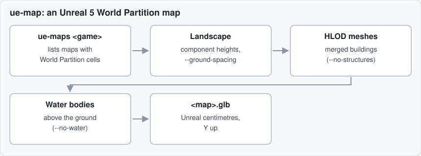

# Unreal 5 World Partition maps: `ue-maps` and `ue-map`

Exports a whole map of an Unreal 5 game whose maps are cooked as World
Partition cells: the landscape, the map's merged HLOD meshes (its buildings
and props as the game draws them at a distance) and its water bodies. No
editor and no project are needed, only the installed game.



## Step by step

1. **List the maps.** `<game>` is the game's folder, its `Content/Paks`, or the
   name of its folder in a Steam library:

   ```
   python -m heat3d_gamefiles ue-maps "<Steam game folder name>"
   python -m heat3d_gamefiles ue-maps "D:\Games\<game>"
   ```

   Every map with cooked World Partition cells is printed with its package path.

2. **Export one** by its name or a unique part of it:

   ```
   python -m heat3d_gamefiles ue-map "<game>" <map> -o map.glb
   ```

3. **Ground only, or coarser:**

   ```
   python -m heat3d_gamefiles ue-map "<game>" <map> --no-structures --no-water
   python -m heat3d_gamefiles ue-map "<game>" <map> --ground-spacing 4
   ```

4. **Open `map.glb`** in the 3DHeat viewer's Level panel.

## Options

| Option | Default | Meaning |
|---|---|---|
| `<game>` | required | the game's folder, its `Content/Paks`, or its Steam folder name |
| `<map>` | required | a name as `ue-maps` prints it, or a unique part of one |
| `-o`, `--out FILE` | `<map>.glb` | the file to write |
| `--ground-spacing METRES` | 2 | the landscape's vertex spacing, rounded to a whole number of its own quads |
| `--no-structures` | | leave the HLOD buildings and props out |
| `--no-water` | | leave the water bodies out |

Content compressed with Oodle needs an Oodle library already on the machine
(see [Oodle](reader-oodle.md)).

## Example output

```text
<map> -> map.glb
  ground      <n> triangles from <n> landscape components; <n> of <n> vertices stored twice disagree
  structure   <n> triangles in <n> HLOD meshes
  water       <n> triangles from <n> water bodies
```

The disagreement count is a self-check: neighbouring landscape components
store their shared edge twice, and the two must match. A 3 km map at 2 m is
about 4.6 million ground triangles.

## The parts

`ground:<map>` (the landscape), `structure:<map>` (the HLOD meshes) and
`water:<map>` (water standing above the ground), in Unreal centimetres with Y
and Z swapped. How each is read and checked is in the
[README](https://github.com/Holdi601/3DHeat-GameFiles#unreal-5-world-partition-maps--ue-map)
and on [Unreal 5 IoStore](reader-unreal-iostore.md).
