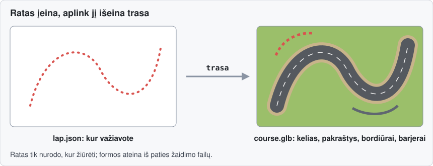
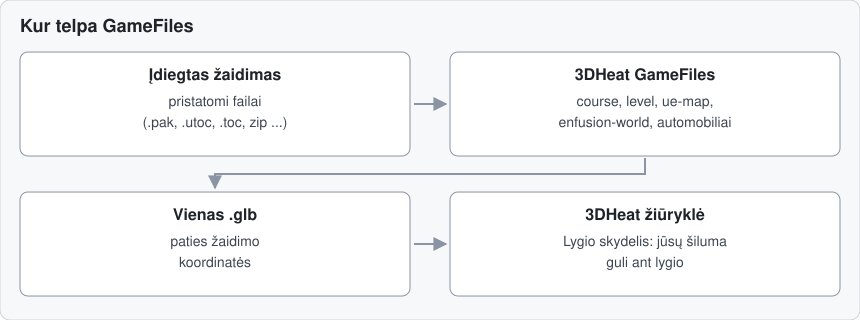

# 3DHeat GameFiles {#dheat-gamefiles}

**Kas tai?** Įrankis, kuris sukuria 3D lenktynių trasos ar žaidimo lygio modelį iš failų žaidimo, kurį jau turite įdiegtą.

**Kam tai naudoti?** 3DHeat žiūryklė nudažo, kur važiavote ar žaidėte, kaip šilumą. Su šiuo įrankiu jis nudažo tai ant tikros
trasos ar lygio, o ne ant tuščios erdvės.

**Pavyzdys:** paimkite ratą, kurį įveikėte. Įrankis sukuria aplinkui esantį kelią ir žemę kaip vieną 3D failą, kad žiūryklė galėtų
nudažyti jūsų greitį ar avarijas ant tikros trasos:



Nesate įpratę prie komandinės eilutės? Pradėkite nuo [Prieš pradedant](before-you-start.md).

Išsamiau: jis skaito lygių duomenis iš archyvų, kuriuos žaidimas pateikia, ir įrašo juos kaip dvejetainį glTF (`.glb`)
failą. Pagrindinis jo darbas – **trasos eksportas**: duodate ratą, o jis įrašo žemę, kelią, atskirtą nuo pakraščio ir
žolės, bei bordiūrus, barjerus, padangų sienas, ženklus ir pastatus aplink jį.

Tai dalis [3DHeat](https://github.com/Holdi601/3DHeat) – žiūryklės realaus laiko 3D telemetrijos šilumos žemėlapiams,
lenktynių analizei ir rungtynių apžvalgai ([dokumentacija](https://holdi601.github.io/3DHeat/)). `.glb` failai, kuriuos
įrašo šis įrankis, yra lygiai, ant kurių žiūryklė piešia šilumą.



Yra trys būdai, kaip gauti lygio geometriją į 3DHeat:

| Kelias | Ko reikia | Ką duoda |
|---|---|---|
| 3DHeat Unreal Exporter | Unreal projektas atidarytas redaktoriuje | tiksli geometrija |
| 3DHeat GameCapture | ekranas ir įrašymas | apytikslis įvertinimas |
| **3DHeat GameFiles** | **įdiegtas, pristatytas žaidimas** | **tiksli geometrija, be projekto** |

Python paketas: `heat3d_gamefiles`. Saugykla:
[Holdi601/3DHeat-GameFiles](https://github.com/Holdi601/3DHeat-GameFiles). Licencija: MIT.

## Ką jis gali {#what-it-can-do}

| Žaidimas ar variklis | Trasos eksportas (`course`) | Archyvų skaitymas |
|---|---|---|
| Forza Horizon (ForzaTech) | taip: reljefas, kelias ir pakraštys, žemės tekstūra, įdėti modeliai su savo tekstūromis | `identify`, `list`, `extract` `.minizip` faile; `identify` `.modelbin` faile; modeliai, reljefas ir tekstūros per `course` ir `terrain` |
| BeamNG.drive | taip: reljefas, kelio dekalai, modeliuotos trasos, įdėti modeliai, vanduo | `identify`, `list`, `extract` lygių zip failuose; `identify` `.ter`, `.cdae` failuose; `.dae` per `course` |
| Assetto Corsa Rally (Unreal 5.6) | taip: etapo žemės plytelės, įkepta žemės spalva, įdėti modeliai plokščiomis spalvomis | `identify`, `list`, `extract` IoStore `.utoc`/`.ucas` failuose; zen paketai, statiniai tinklai, tekstūros per `course` |
| Unreal `.pak` (versijos 8–12) | ne | `identify`, `list`, `extract` |
| Unity (formatas 22 ir naujesnis) | ne | `identify`, `meshes` |
| Battlefield 6 (Frostbite `.toc`/`.cas`) | ne trasos; visas lygis su `level`: reljefas, įdėti tinklai, jų spalvų žemėlapiai su `--textures` | `identify`, `levels`; paketai, tinklai, reljefas, tekstūros ir išdėstymas per `level` |
| Source 2 `.vpk` | ne | `identify`, `list`, `extract` |
| Unreal 5 World Partition žaidimai | ne trasos; visas žemėlapis su `ue-map` (rodomas `ue-maps`): kraštovaizdis, HLOD pastatai ir rekvizitai, vanduo | - |
| Arma Reforger (Enfusion) | ne trasos; visas pasaulis su `enfusion-world` (rodomas `enfusion-worlds`): reljefas jo spalvomis, jūra, pastatai kaip dėžės | - |
| Forza (automobiliai) | `cars`: kiekvienas automobilis žemu detalumu, žiūryklės Lenktynių analizės skirtukui | - |

Ratai iš Assetto Corsa EVO ir iRacing atmetami su priežastimi. Žr. [Apribojimai ir žinomi trūkumai](../limits-and-known-gaps.md).

## Įdiegimas {#install}

Nesate įpratę prie komandinės eilutės? Pirmiausia perskaitykite [Prieš pradedant](before-you-start.md).

Jums reikia **Python 3.10 ar naujesnės versijos** (kurta su 3.13) ir paketų iš
[`requirements.txt`](https://github.com/Holdi601/3DHeat-GameFiles/blob/main/requirements.txt).

```
git clone https://github.com/Holdi601/3DHeat-GameFiles.git
cd 3DHeat-GameFiles
pip install -r requirements.txt
```

Tada patikrinkite: `python -m heat3d_gamefiles --help`. Turėtumėte matyti `usage: heat3d_gamefiles [-h]` ir veiksmažodžių
sąrašą. Visas komandas vykdykite iš saugyklos aplanko kaip `python -m heat3d_gamefiles <verb>`.

| Paketas | Kam naudojamas |
|---|---|
| numpy | viskam, kas dekoduoja geometriją |
| lz4 | Forza archyvams (daugiausia LZ4 blokai), kai kuriems Unity paketams, IoStore LZ4 blokams |
| Pillow | BC1–BC7 tekstūrų dekodavimui, JPEG tekstūrų rašymui `.glb` faile |
| msgpack, zstandard | BeamNG sukompiliuotoms formoms (`.cdae`) |
| cryptography | tik užšifruoto `.pak` atidarymui su raktu, kurį jau turite |
| pytest | testams |

Unreal turiniui, suspaustam **Oodle** formatu, reikia Oodle bibliotekos, jau esančios jūsų kompiuteryje. Su šiuo įrankiu
niekada nepateikiama. Žr. [Oodle](../reader-oodle.md).

Įrankis parašytas Windows sistemai. Jis randa žaidimus per Steam bibliotekų sąrašą ir `%LOCALAPPDATA%`, o Oodle įkelia kaip
Windows DLL. Kitos platformos neišbandytos.

## Greita pradžia {#quick-start}

**Ratų failas** – tai įrašas, kur važiavo jūsų automobilis: x, y, z taškų sąrašas.
Jis gaunamas iš [3DHeat GameCapture](https://github.com/Holdi601/3DHeat-GameCapture)
arba FH Companion programėlės ratų bibliotekos; rankiniu būdu įvestas CSV failas taip pat tinka
([Ratų įvestys](../lap-inputs.md)).

```
# Forza: ratų failas, ratų aplankas arba trasos pavadinimas iš FH Companion bibliotekos
python -m heat3d_gamefiles course "Example Circuit"
python -m heat3d_gamefiles course path\to\lap.json -o course.glb

# BeamNG.drive arba Assetto Corsa Rally: heat3d-lap failas nurodo, iš kurio žaidimo jis yra
python -m heat3d_gamefiles course my_lap.json

# Kiekviena trasa iš FH Companion bibliotekos, po vieną .glb
python -m heat3d_gamefiles courses -o courses

# Battlefield 6: išvardykite lygius, tada eksportuokite vieną (didelis failas; žr. Komandos)
python -m heat3d_gamefiles levels
python -m heat3d_gamefiles level <level> -o level.glb --textures

# Unreal 5 World Partition ir Arma Reforger: išvardykite, tada eksportuokite
python -m heat3d_gamefiles ue-maps "<game>"
python -m heat3d_gamefiles ue-map "<game>" <map> -o map.glb
python -m heat3d_gamefiles enfusion-worlds
python -m heat3d_gamefiles enfusion-world <world> -o world.glb

# Kiekvienas Forza automobilis, žiūryklės lenktynių skirtukui
python -m heat3d_gamefiles cars -o forza.h3dcars

# Kas tai per failas?
python -m heat3d_gamefiles identify some_archive.pak
```

Atidarykite `.glb` 3DHeat žiūryklėje. Žaidimo pačios pasaulio koordinatės išsaugomos
(žr. [Išvesties formatas](../output-format.md)), todėl įrašytas ratas sutampa su trasa.

## Dokumentacijos žemėlapis {#map-of-this-documentation}

- [Prieš pradedant](before-you-start.md): Python, terminalas, pirmoji komanda.
- [Komandos](../commands.md): kiekvienas veiksmažodis ir parinktis su pavyzdžiais.
- [Komandų nuoroda](../cli-reference.md): kiekvieno veiksmažodžio `--help`, sugeneruotas iš kodo.
- [Archyvų tyrimas](../inspecting-archives.md): `identify`, `list`, `extract`, `meshes`, žingsnis po žingsnio.
- [Trasos eksportas](../course-export.md): kaip ratas tampa trasa, visiems žaidimams.
  - [Forza Horizon](../course-forza-horizon.md)
  - [BeamNG.drive](../course-beamng.md)
  - [Assetto Corsa Rally](../course-assetto-corsa-rally.md)
  - [Detalumo lygiai ir biudžetas](../detail-budget.md)
- [Visi lygiai](../whole-levels.md): lygis, žemėlapis ar pasaulis be rato.
  - [Battlefield 6 lygiai](../level-battlefield.md): `levels`, `level`
  - [Unreal 5 žemėlapiai](../level-unreal-world-partition.md): `ue-maps`, `ue-map`
  - [Arma Reforger pasauliai](../level-arma-reforger.md): `enfusion-worlds`, `enfusion-world`
- [Forza automobiliai](../forza-cars.md): `cars`, automobilių failas žiūryklės lenktynių skirtukui.
- [Ratų įvestys](../lap-inputs.md): visi ratų failų formatai, kuriuos priima įrankis.
- [Išvesties formatas](../output-format.md): kas yra `.glb` viduje.
- [Archyvų skaitytuvai](../archive-readers.md): po puslapį kiekvienam konteinerio formatui: ką jis skaito, ko ne, ir kodėl.
- [Apribojimai ir žinomi trūkumai](../limits-and-known-gaps.md)
- [Trikčių šalinimas](../troubleshooting.md): klaidų pranešimai ir ką daryti.
- [Taisyklės ir licencijos](../rules-and-licences.md): jokių raktų, jūsų pačių failai, jokio platinimo.
- [Atnaujinimai](../updates.md): atnaujinimų patikrinimas ir `heat3d_update`.
- [Kūrimas](../development.md): modulių žemėlapis ir testai, įskaitant testus, kurie veikia su įdiegtais žaidimais.
- [Šių dokumentų priežiūra](../maintaining.md): šių puslapių išleidimo kontrolinis sąrašas.

## Dalis 3DHeat {#part-of-3dheat}

3DHeat GameFiles yra vienas iš nemokamų įrankių aplink 3DHeat žiūryklę:

| Įrankis | Ką daro | Dokumentacija |
|---|---|---|
| [3DHeat](https://github.com/Holdi601/3DHeat) | žiūryklė: 3D šilumos žemėlapiai, lenktynių analizė ir rungtynių apžvalga naršyklėje | [svetainė](https://holdi601.github.io/3DHeat/) |
| [GameFiles](https://github.com/Holdi601/3DHeat-GameFiles) | trasos ir lygiai iš žaidimų pristatomų failų, kaip `.glb` | [svetainė](https://holdi601.github.io/3DHeat-GameFiles/) |
| [GameCapture](https://github.com/Holdi601/3DHeat-GameCapture) | ratų telemetrija iš lenktynių žaidimų; lygiai, atkurti iš žaidimo vaizdo | [svetainė](https://holdi601.github.io/3DHeat-GameCapture/) |
| [Unreal Exporter](https://github.com/Holdi601/3DHeat-UnrealExporter) | Unreal Editor papildinys, kuris įrašo lygį kaip `.glb` | [svetainė](https://holdi601.github.io/3DHeat-UnrealExporter/) |
| [CS2](https://github.com/Holdi601/3DHeat-CS2) | Counter-Strike 2 demo į rungtynių failus; žemėlapiai į `.glb` | [svetainė](https://holdi601.github.io/3DHeat-CS2/) |
| [Watcher](https://github.com/Holdi601/3DHeat-Watcher) | fone įrašo jūsų žaidimą iš to, ką skelbia žaidimai | [svetainė](https://holdi601.github.io/3DHeat-Watcher/) |
| [Ext-WarThunder](https://github.com/Holdi601/3DHeat-Ext-WarThunder) | War Thunder įrašai į rungtynių failus | [svetainė](https://holdi601.github.io/3DHeat-Ext-WarThunder/) |
| [Ext-WoT](https://github.com/Holdi601/3DHeat-Ext-WoT) | World of Tanks įrašai į rungtynių failus | [svetainė](https://holdi601.github.io/3DHeat-Ext-WoT/) |
| [Ext-WoWs](https://github.com/Holdi601/3DHeat-Ext-WoWs) | World of Warships įrašai į rungtynių failus | [svetainė](https://holdi601.github.io/3DHeat-Ext-WoWs/) |
| [Ext-Squad](https://github.com/Holdi601/3DHeat-Ext-Squad) | Squad serverių demo į rungtynių failus | [svetainė](https://holdi601.github.io/3DHeat-Ext-Squad/) |
| [Ext-DCS](https://github.com/Holdi601/3DHeat-Ext-DCS) | DCS World žemėlapiai į `.glb` lygius | [svetainė](https://holdi601.github.io/3DHeat-Ext-DCS/) |
| [Ext-IL2](https://github.com/Holdi601/3DHeat-Ext-IL2) | IL-2 Sturmovik žemėlapiai į `.glb` lygius | [svetainė](https://holdi601.github.io/3DHeat-Ext-IL2/) |

Kiekvienas žaidimo skaitytuvas yra atskiras mažas projektas su savo licencijos failu, leidimais ir problemų sekimo sistema, todėl jį galima atskirai įdiegti, atnaujinti, prižiūrėti - arba teisių turėtojo prašymu atšaukti - nepaveikiant žiūryklės ar kitų įrankių.

Žiūryklės rungtynių failai aprašyti
[Vienas failas rungtynėms: `.3dheat`](https://holdi601.github.io/3DHeat/container.html);
čia sukurtas lygis įkeliamas šalia jų žiūryklės Lygio skydelyje.
