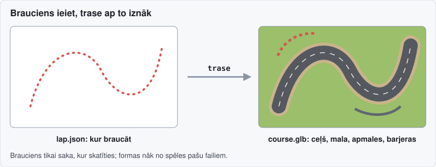
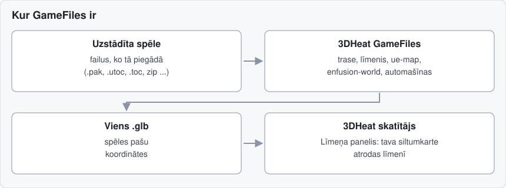

# 3DHeat GameFiles {#dheat-gamefiles}

**Kas tas ir?** Rīks, kas veido braucamās trases vai spēles līmeņa 3D modeli no failiem spēlei, kuru jau
esat uzstādījis.

**Kāpēc to lietot?** 3DHeat skatītājs krāso, kur braucāt vai spēlējāt, kā siltumkarti. Ar šo rīku
krāsa parādās uz īstās trases vai līmeņa, nevis uz tukšas telpas.

**Piemērs:** ņemiet braucienu, ko esat nobraucis. Rīks izveido ceļu un apkārtējo zemi kā vienu 3D failu,
lai skatītājs varētu uzkrāsot jūsu ātrumu vai avārijas uz īstās trases:



Nekad neesat strādājis ar komandrindu? Sāciet ar [Pirms sākat](before-you-start.md).

Sīkāk: tas nolasa līmeņa datus no arhīviem, ko spēle piegādā, un raksta tos kā bināru glTF (`.glb`) failu.
Tā galvenais darbs ir **trases eksports**: dod tam braucienu, un tas raksta zemi, ceļu, kas nošķirts no
malas un zāles, kā arī apmales, barjeras, riepu sienas, zīmes un ēkas ap to.

Tā ir daļa no [3DHeat](https://github.com/Holdi601/3DHeat), skatītāja reāllaika 3D telemetrijas
siltumkartēm, sacensību analīzei un maču pārskatam
([dokumentācija](https://holdi601.github.io/3DHeat/)). `.glb` faili, ko šis rīks raksta, ir līmeņi, uz kuriem
skatītājs zīmē siltumu.



Ir trīs veidi, kā 3DHeat iegūst līmeņa ģeometriju:

| Ceļš | Vajag | Dod |
|---|---|---|
| 3DHeat Unreal Exporter | Unreal projektu, kas atvērts redaktorā | precīzu ģeometriju |
| 3DHeat GameCapture | ekrānu un ierakstu | aplēsi |
| **3DHeat GameFiles** | **uzstādītu, piegādātu spēli** | **precīzu ģeometriju, bez projekta** |

Python pakotne: `heat3d_gamefiles`. Repozitorijs:
[Holdi601/3DHeat-GameFiles](https://github.com/Holdi601/3DHeat-GameFiles). Licence: MIT.

## Ko tas var {#what-it-can-do}

| Spēle vai dzinējs | Trases eksports (`course`) | Arhīvu lasīšana |
|---|---|---|
| Forza Horizon (ForzaTech) | jā: reljefs, ceļš un mala, zemes tekstūra, novietoti modeļi ar savām tekstūrām | `identify`, `list`, `extract` uz `.minizip`; `identify` uz `.modelbin`; modeļi, reljefs un tekstūras caur `course` un `terrain` |
| BeamNG.drive | jā: reljefs, ceļa uzlīmes, modelēti riņķi, novietoti modeļi, ūdens | `identify`, `list`, `extract` uz līmeņu zip failiem; `identify` uz `.ter`, `.cdae`; `.dae` caur `course` |
| Assetto Corsa Rally (Unreal 5.6) | jā: posma zemes flīzes, cepta zemes krāsa, novietoti modeļi vienkāršās krāsās | `identify`, `list`, `extract` uz IoStore `.utoc`/`.ucas`; zen paketes, statiskie tīkli, tekstūras caur `course` |
| Unreal `.pak` (versijas 8-12) | nē | `identify`, `list`, `extract` |
| Unity (formāts 22 un jaunāks) | nē | `identify`, `meshes` |
| Battlefield 6 (Frostbite `.toc`/`.cas`) | nav braucienam; viss līmenis ar `level`: reljefs, novietoti tīkli, to krāsu kartes ar `--textures` | `identify`, `levels`; paketes, tīkli, reljefs, tekstūras un novietojums caur `level` |
| Source 2 `.vpk` | nē | `identify`, `list`, `extract` |
| Unreal 5 World Partition spēles | nav braucienam; viss karte ar `ue-map` (uzskaitītas ar `ue-maps`): zemes virsma, HLOD ēkas un priekšmeti, ūdens | - |
| Arma Reforger (Enfusion) | nav braucienam; visa pasaule ar `enfusion-world` (uzskaitītas ar `enfusion-worlds`): reljefs tā krāsās, jūra, ēkas kā kastes | - |
| Forza (automašīnas) | `cars`: katra automašīna mazā detalizācijā skatītāja Sacensību cilnei | - |

Braucieni no Assetto Corsa EVO un iRacing tiek noraidīti ar iemeslu. Skat.
[Ierobežojumi un zināmās nepilnības](../limits-and-known-gaps.md).

## Uzstādīšana {#install}

Nekad neesat strādājis ar komandrindu? Vispirms izlasiet [Pirms sākat](before-you-start.md).

Vajag **Python 3.10 vai jaunāku** (izstrādāts ar 3.13) un pakotnes no
[`requirements.txt`](https://github.com/Holdi601/3DHeat-GameFiles/blob/main/requirements.txt).

```
git clone https://github.com/Holdi601/3DHeat-GameFiles.git
cd 3DHeat-GameFiles
pip install -r requirements.txt
```

Tad pārbaudiet: `python -m heat3d_gamefiles --help`. Jums vajadzētu redzēt
`usage: heat3d_gamefiles [-h]` un komandu sarakstu. Katru komandu palaidiet no repozitorija mapes,
kā `python -m heat3d_gamefiles <verb>`.

| Pakotne | Kam tā ir |
|---|---|
| numpy | viss, kas dekodē ģeometriju |
| lz4 | Forza arhīvi (galvenokārt LZ4 bloki), dažas Unity paketes, IoStore LZ4 bloki |
| Pillow | BC1-BC7 tekstūru dekodēšana, JPEG tekstūru rakstīšana `.glb` failā |
| msgpack, zstandard | BeamNG kompilētās formas (`.cdae`) |
| cryptography | tikai šifrēta `.pak` atvēršanai ar atslēgu, kas jums jau ir |
| pytest | testi |

Unreal saturs, kas saspiests ar **Oodle**, vajag Oodle bibliotēku, kas jau atrodas jūsu datorā. Tās
šis rīks nekad nepiegādā. Skat. [Oodle](../reader-oodle.md).

Rīks ir rakstīts Windows videi. Tas atrod spēles, izmantojot Steam bibliotēku sarakstu un
`%LOCALAPPDATA%`, un ielādē Oodle kā Windows DLL. Citās platformās nav pārbaudīts.

## Ātrais sākums {#quick-start}

**Brauciena fails** ir ieraksts par to, kur jūsu auto brauca: x, y, z punktu saraksts. To dod
[3DHeat GameCapture](https://github.com/Holdi601/3DHeat-GameCapture) vai FH Companion lietotnes braucienu
bibliotēka; arī ar roku rakstīts CSV strādā ([Braucienu ievade](../lap-inputs.md)).

```
# Forza: braucienu fails, braucienu mape vai trases nosaukums no FH Companion bibliotēkas
python -m heat3d_gamefiles course "Example Circuit"
python -m heat3d_gamefiles course path\to\lap.json -o course.glb

# BeamNG.drive vai Assetto Corsa Rally: heat3d-lap fails saka, no kuras spēles tas ir
python -m heat3d_gamefiles course my_lap.json

# Katra trase FH Companion bibliotēkā, pa vienam .glb
python -m heat3d_gamefiles courses -o courses

# Battlefield 6: uzskaitiet līmeņus, tad eksportējiet vienu (liels fails; skat. Komandas)
python -m heat3d_gamefiles levels
python -m heat3d_gamefiles level <level> -o level.glb --textures

# Unreal 5 World Partition un Arma Reforger: uzskaitiet, tad eksportējiet
python -m heat3d_gamefiles ue-maps "<game>"
python -m heat3d_gamefiles ue-map "<game>" <map> -o map.glb
python -m heat3d_gamefiles enfusion-worlds
python -m heat3d_gamefiles enfusion-world <world> -o world.glb

# Katra Forza automašīna skatītāja Sacensību cilnei
python -m heat3d_gamefiles cars -o forza.h3dcars

# Kas ir šis fails?
python -m heat3d_gamefiles identify some_archive.pak
```

Atveriet `.glb` 3DHeat skatītājā. Spēles pašas pasaules koordinātes tiek saglabātas
(skat. [Izvades formāts](../output-format.md)), tāpēc ierakstītais brauciens sakrīt ar trasi.

## Šīs dokumentācijas karte {#map-of-this-documentation}

- [Pirms sākat](before-you-start.md): Python, termināls, pirmā komanda.
- [Komandas](../commands.md): katrs verbs un katra iespēja, ar piemēriem.
- [Komandu atsauce](../cli-reference.md): katra verba `--help`, ģenerēts no koda.
- [Arhīvu pārbaude](../inspecting-archives.md): `identify`, `list`, `extract`, `meshes`, soli pa solim.
- [Trases eksports](../course-export.md): kā brauciens kļūst par trasi visām spēlēm.
  - [Forza Horizon](../course-forza-horizon.md)
  - [BeamNG.drive](../course-beamng.md)
  - [Assetto Corsa Rally](../course-assetto-corsa-rally.md)
  - [Detalizācijas līmeņi un budžets](../detail-budget.md)
- [Veseli līmeņi](../whole-levels.md): līmenis, karte vai pasaule bez braucienu.
  - [Battlefield 6 līmeņi](../level-battlefield.md): `levels`, `level`
  - [Unreal 5 kartes](../level-unreal-world-partition.md): `ue-maps`, `ue-map`
  - [Arma Reforger pasaules](../level-arma-reforger.md): `enfusion-worlds`, `enfusion-world`
- [Forza automašīnas](../forza-cars.md): `cars`, automašīnu fails skatītāja Sacensību cilnei.
- [Braucienu ievade](../lap-inputs.md): katra braucienu faila forma, ko rīks pieņem.
- [Izvades formāts](../output-format.md): kas ir `.glb` iekšpusē.
- [Arhīvu lasītāji](../archive-readers.md): viena lapa katram konteinera formātam, kurā aprakstīts, ko tas nolasa,
  ko ne un kāpēc.
- [Ierobežojumi un zināmās nepilnības](../limits-and-known-gaps.md)
- [Problēmu risināšana](../troubleshooting.md): kļūdu ziņojumi un ko darīt.
- [Noteikumi un licences](../rules-and-licences.md): nav atslēgu, jūsu paši faili, nekādas pārdales.
- [Atjauninājumi](../updates.md): atjauninājumu pārbaude un `heat3d_update`.
- [Izstrāde](../development.md): moduļu karte un testi, arī testi, kas darbojas ar uzstādītām spēlēm.
- [Uzturēšana](../maintaining.md): izlaides kontrolsaraksts šīm lapām.

## Daļa no 3DHeat {#part-of-3dheat}

3DHeat GameFiles ir viens no bezmaksas rīkiem ap 3DHeat skatītāju:

| Rīks | Ko tas dara | Dokumentācija |
|---|---|---|
| [3DHeat](https://github.com/Holdi601/3DHeat) | skatītājs: 3D siltumkartes, sacensību analīze un maču pārskats pārlūkā | [vietne](https://holdi601.github.io/3DHeat/) |
| [GameFiles](https://github.com/Holdi601/3DHeat-GameFiles) | trases un līmeņi no spēles piegādātajiem failiem, kā `.glb` | [vietne](https://holdi601.github.io/3DHeat-GameFiles/) |
| [GameCapture](https://github.com/Holdi601/3DHeat-GameCapture) | braucienu telemetrija no sacensību spēlēm; līmeņi, atjaunoti no spēles video | [vietne](https://holdi601.github.io/3DHeat-GameCapture/) |
| [Unreal Exporter](https://github.com/Holdi601/3DHeat-UnrealExporter) | Unreal Editor spraudnis, kas saglabā līmeni kā `.glb` | [vietne](https://holdi601.github.io/3DHeat-UnrealExporter/) |
| [CS2](https://github.com/Holdi601/3DHeat-CS2) | Counter-Strike 2 demo maču failos; kartes `.glb` | [vietne](https://holdi601.github.io/3DHeat-CS2/) |
| [Watcher](https://github.com/Holdi601/3DHeat-Watcher) | fona režīmā ieraksta jūsu spēli no tā, ko spēles publicē | [vietne](https://holdi601.github.io/3DHeat-Watcher/) |
| [Ext-WarThunder](https://github.com/Holdi601/3DHeat-Ext-WarThunder) | War Thunder ieraksti maču failos | [vietne](https://holdi601.github.io/3DHeat-Ext-WarThunder/) |
| [Ext-WoT](https://github.com/Holdi601/3DHeat-Ext-WoT) | World of Tanks ieraksti maču failos | [vietne](https://holdi601.github.io/3DHeat-Ext-WoT/) |
| [Ext-WoWs](https://github.com/Holdi601/3DHeat-Ext-WoWs) | World of Warships ieraksti maču failos | [vietne](https://holdi601.github.io/3DHeat-Ext-WoWs/) |
| [Ext-Squad](https://github.com/Holdi601/3DHeat-Ext-Squad) | Squad servera demo maču failos | [vietne](https://holdi601.github.io/3DHeat-Ext-Squad/) |
| [Ext-DCS](https://github.com/Holdi601/3DHeat-Ext-DCS) | DCS World kartes `.glb` līmeņos | [vietne](https://holdi601.github.io/3DHeat-Ext-DCS/) |
| [Ext-IL2](https://github.com/Holdi601/3DHeat-Ext-IL2) | IL-2 Sturmovik kartes `.glb` līmeņos | [vietne](https://holdi601.github.io/3DHeat-Ext-IL2/) |

Skatītāja maču faili ir aprakstīti lapā
[Viens fails vienam maču: `.3dheat`](https://holdi601.github.io/3DHeat/container.html);
šeit izveidots līmenis tiek ielādēts blakus tiem skatītāja Līmeņa panelī.
