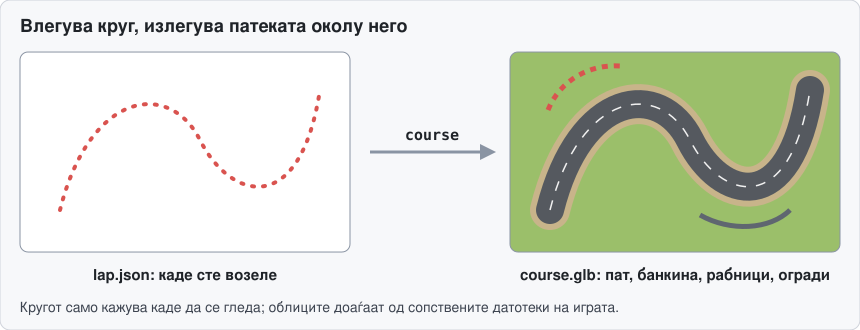
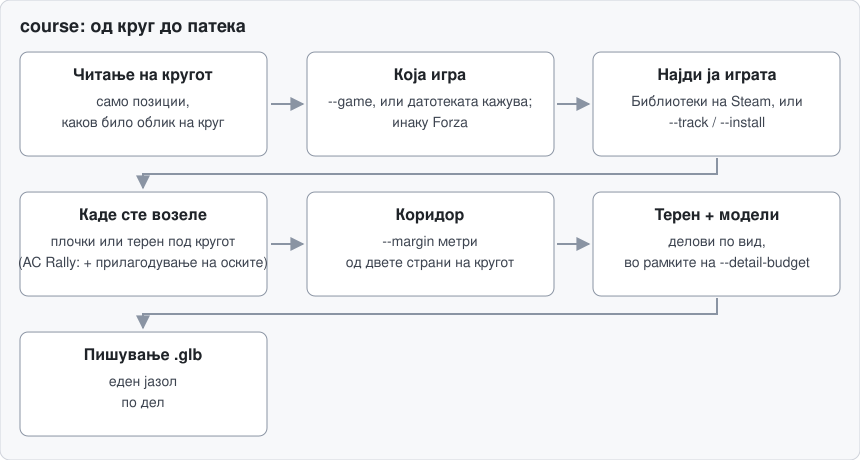

# Извоз на патека {#course-export}

**Со обични зборови:** возевте еден круг; ова ја гради патеката по која возевте, како
3D датотека. Кругот е само линија од точки; патот, тревата и рабниците доаѓаат од
сопствените датотеки на играта.

`course` го претвора кругот во патека (course): земјата во појас од двете страни од
местото каде што поминал автомобилот, и она што стои на таа земја, како една `.glb`
датотека за прегледувачот. Оваа страница го опфаќа она што го делат сите три поддржани
игри. Страниците под неа го опфаќаат она што се разликува:

- [Forza Horizon](course-forza-horizon.md): архиви `.minizip` на ForzaTech
- [BeamNG.drive](course-beamng.md): zip архиви, висинско поле на терен, компилирани форми
- [Assetto Corsa Rally](course-assetto-corsa-rally.md): Unreal 5 IoStore, етапа од типот World Partition
- [Нивоа на детали и буџетот](detail-budget.md): колку триаголници добиваат поставените модели и кои копии остануваат

## Чекорите {#the-steps}

Зборови што се користат подолу: **рамка** (frame) е накај каде гледаат оските;
**коридорот** е појасот земја од двете страни на кругот; **плочка** (tile) е еден
квадратен дел од теренот на играта; **LOD** (ниво на детали) е една од поедноставените
копии на моделот.

1. **Прочитајте го кругот.** Само позиции, од која било форма во
   [Влезови за круг](lap-inputs.md). Брзината и командите не се користат. Круг со
   помалку од два примероци се одбива („holds no driving“).
2. **Одлучете која е играта.** `--game`, потоа полето `game` на самата датотека на
   кругот, потоа Forza (видете [Команди](commands.md#which-game)).
3. **Најдете ја инсталираната игра.** Сите три ја пребаруваат секоја Steam библиотека
   наведена во `config\libraryfolders.vdf` на Steam. Forza пребарува и `C:\XboxGames`.
   `--track` (Forza) или `--install` (BeamNG, AC Rally) го прескокнува пребарувањето.
4. **Најдете каде е возен кругот.** Ова никогаш не се одлучува само по совпаѓање на
   име. Forza ја избира патеката чии плочки на терен го покриваат кругот. BeamNG го
   избира нивото на чиј терен (или патишта) лежат примероците од кругот. AC Rally ја
   пробува секоја етапа во осум ориентации на оските и ја избира онаа што го става
   најголемиот дел од кругот на пат.
5. **Исечете коридор** од `--margin` метри од двете страни на возењето (подолу).
6. **Изградете ја земјата** во коридорот, класирана како пат, раб, чакал и земја, терен,
   ознаки, траги од гуми или вода, и испечете текстура на земјата за секој квадрат од
   512 m.
7. **Поставете ги моделите** што стојат во коридорот, по категорија, на ниво на детали
   избрано според растојанието и буџетот на триаголници.
8. **Напишете ја `.glb`**: еден именуван јазол по дел. Видете [Формат на излезот](output-format.md).

Што печати едно извршување - овде на синтетичка инсталација на BeamNG.drive што ја
градат тестовите, круг од 50 m по лента од пат:

## Коридорот {#the-corridor}

Исечокот е појас околу возената линија, а не рамката за ограничување на кругот. За
кружна патека двете се речиси исти. За спринт од точка до точка рамката е најмногу
ридска страна покрај која никој не вози, а појасот може да биде една десетина од
нејзината површина. Извор:
[`corridor.py`](https://github.com/Holdi601/3DHeat-GameFiles/blob/main/heat3d_gamefiles/corridor.py).

Како се гради:

- Возењето се проектира на рамнината на земјата: x и z на кругот
  (BeamNG: x и y од сопствената рамка на играта).
- Се растеризира на решетка од ќелии од **4 m** (`CELL`). Секоја ќелија што ја допира
  возењето се проширува со диск со радиус `margin + 4 m` во сите правци.
- Последователни примероци на растојание помало од **50 m** (`JOIN`) се поврзуваат со
  точки на секои 4 m, за појасот да нема празнини. Примероци подалеку еден од друг се
  сметаат за одделни делови од возењето и не се поврзуваат. Библиотечна патека е многу
  датотеки на кругови поврзани една по друга, а крајот на еден спринт и почетокот на
  следниот не смеат да повлечат појас преку мапата.
- Триаголникот се задржува ако кој било агол, средина на кој било раб, или неговиот
  центроид лежи во појасот. Средните точки фаќаат голем триаголник што лежи преку тесен
  појас со сите агли надвор.
- Висината никогаш не е дел од исечокот. Кутија што ја ограничува висината би ја
  исекла земјата под ридот по кој се искачува патот.

Конзолата ја пријавува површината на коридорот, на пример
`cutting 80 m either side of the driving: 1.53 km2 of a 6,000 by 3,600 m box`.

BeamNG и AC Rally градат и поширок коридор на **досег** (reach) од `margin + 60 m`.
Поставен модел се разгледува ако неговото потекло лежи во коридорот на досег, а се црта
само ако неговиот отисок го допира вистинскиот коридор. На тој начин долг објект чие
потекло е веднаш надвор од појасот не се губи. BeamNG го користи коридорот на досег и
за да избере кои декали на патот да се нацртаат.

## Од што е направена земјата {#what-the-ground-is-made-of}

Секој извоз ги класира триаголниците на земјата во истите видови, а секој вид се
пишува како свој дел за прегледувачот да може да го покаже или скрие:

| Вид | Име на делот | Рамна боја (линеарен RGB) | Forza | BeamNG | AC Rally |
|---|---|---|---|---|---|
| пат | `ground:road` | 0.22, 0.22, 0.23 | ленти на патот: делот со асфалт | слоеви од типот `ASPHALT`, декали на пат, моделиран пат | плочки на патеката (`/MeshesTrack/`) |
| раб | `ground:verge` | 0.52, 0.47, 0.30 | ленти на патот: банкината | тротоари и модели на раб | - |
| чакал и земја | `ground:gravel and dirt` | 0.50, 0.42, 0.30 | - | слоеви и декали од земја, чакал, песок, кал | - |
| терен | `ground:terrain` | 0.30, 0.44, 0.18 | сè друго | сè друго | плочки `_Terrain` и далечен терен |
| рабници | `ground:kerbs` | 0.60, 0.12, 0.10 (Forza) | реквизити `road_gen_rum*` | модели на kerb, curb и rumble | модели на kerb и curb |
| ознаки | `ground:markings` | 0.90, 0.90, 0.88 | подмрежи на декали, подигнати 5 cm | насликани во текстурата | - |
| траги од гуми | `ground:tyre marks` | 0.20, 0.17, 0.16 | подмрежи на декали, подигнати 5 cm | насликани во текстурата | - |
| вода | `water:water` | 0.16, 0.34, 0.48 | материјали на вода | рамнина на море, блокови вода, реки | - |

Рамните бои се избрани да се читаат на прв поглед, а не да одговараат на играта. Се
користат за делови без текстура и од прегледувачи што ги игнорираат текстурите. Извор:
[`surfaces.py`](https://github.com/Holdi601/3DHeat-GameFiles/blob/main/heat3d_gamefiles/surfaces.py).

Деловите на земјата се делат по квадрат од 512 m, а секој квадрат носи своја испечена
слика, па имињата на деловите го носат квадратот:

| Игра | Име на дел од земјата | Клуч на квадратот |
|---|---|---|
| Forza | `ground:road x-2046 z1023` | името на решетката на плочката на терен (чекори од 1023, видете [Forza Horizon](course-forza-horizon.md)) |
| BeamNG | `ground:road 3_-2` | `floor(x / 512)`, `floor(y / 512)` во метри на BeamNG |
| AC Rally | `ground:road 1_-4` | `floor(x / 51200)`, `floor(y / 51200)` во сантиметри на Unreal |

## Што стои на неа {#what-stands-on-it}

Поставените модели се пишуваат во делови со име `structure:<category>`, или
`ground:kerbs` за рабниците (во сите три игри). Кога делот има своја текстура, името на
текстурата или материјалот ја следи категоријата, на пример
`structure:barriers bar_armco_bclr`.

| Категорија | Forza | BeamNG | AC Rally |
|---|---|---|---|
| бариери | да | да | да |
| реквизити | да | да | да |
| знаци | да | да | да |
| згради | да (замени за цели згради таму каде што ги има играта) | да | да |
| инфраструктура | да | да | да |
| мостови | да | да | (класирани како инфраструктура) |
| карпи | да | да | да |
| рабници | да, како земја | да, како земја | да, како земја |
| дрвја | со `--trees` | со `--trees` | со `--trees` |
| скршливи предмети | со `--trees` | - | - |

Начинот на кој се распределува детаљот е ист во сите три. Копиите во рамки на 25 m од
возењето почнуваат со полн детаљ, копиите на 25-60 m едно ниво погруби, а подалечните
копии на најгрубото ниво. Потоа најскапите модели се спуштаат додека не се вклопи
буџетот на триаголници, а таму каде што ни најгрубите нивоа не се вклопуваат во буџет
што сте го дале, копиите се изоставуваат. Рабниците никогаш не се поедноставуваат или
изоставуваат. Видете [Нивоа на детали и буџетот](detail-budget.md).

## Опции што го обликуваат резултатот {#options-that-shape-the-result}

| Сакате | Користете |
|---|---|
| помала датотека | `--no-textures` (рамни бои), `--texture-size 1024` или `512`, `--detail-budget N`, `--margin 40` |
| само земјата | `--no-placed` |
| и околината | `--trees` |
| друг сезон (Forza) | `--season winter` |
| игра надвор од Steam | `--track` (Forza) или `--install` (BeamNG, AC Rally) |
| круг што пребарувањето не го поставува | `--level` (BeamNG, AC Rally), `--track` (Forza) |

## Координати {#coordinates}

Секој извоз пишува метри со Y нагоре, во рамка со која се порамнува снимен круг од
истата игра:

| Игра | Напишана рамка |
|---|---|
| Forza | сопствените светски координати на играта, непроменети |
| BeamNG | `(x, z, -y)` од светот на BeamNG со Z нагоре, што е ротацијата што ја применува снимачот на телеметрија |
| AC Rally | рамката на кругот, најдена со прилагодување: сантиметрите на Unreal стануваат метри, а X и Y на Unreal стануваат x и z на кругот во која од осумте ориентации одговара |

Видете [Формат на излезот](output-format.md).
