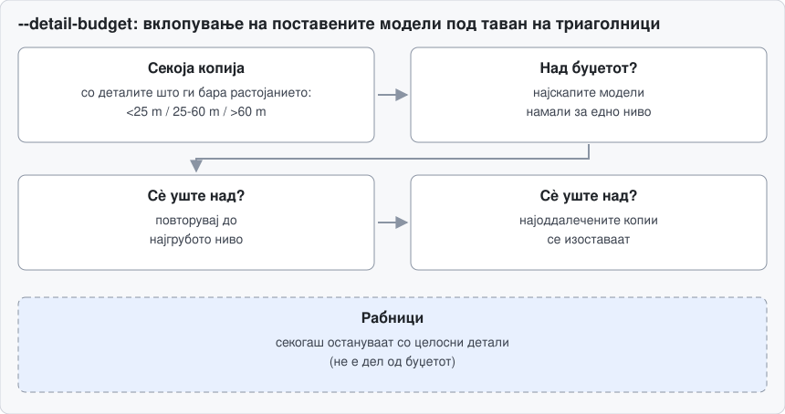

# Нивоа на детали и буџетот {#levels-of-detail-and-the-budget}

**Триаголник** е мало рамно парче од 3D модел. Повеќе триаголници значи поголема,
побавна датотека. **Буџетот** е граница за тоа колку. **Ниво на детали** е поедноставена
копија на моделот, што се користи кога е далеку.

Најфиното ниво на сè што е поставено околу една патека се неколку милиони триаголници.
На пример, стотици сегменти од заштитна ограда и купови гуми по околу илјада триаголници
секој. Градски коридор содржи над сто илјади копии. Затоа секој извоз на патека им дава
на поставените модели **буџет на триаголници** и одлучува, за секој модел, на кое ниво
на детали се црта и, ако треба, кои копии да се изостават.

Шемата е напишана за Forza
([`forzaplacement.py`](https://github.com/Holdi601/3DHeat-GameFiles/blob/main/heat3d_gamefiles/forzaplacement.py):
`choose_levels`, `auto_budget`, `_fit`), а BeamNG и AC Rally ги користат нејзините делови.
Теренот не се брои во буџетот.

## Појаси на растојание {#distance-bands}

Растојанието на секоја копија до возењето се мери во рамнината на земјата, до најблискиот
примерок од кругот. Кругот прво се проретчува на најмногу 1.000 точки, што чини неколку
метри прецизност и ништо што овде е важно. Копиите потоа паѓаат во три појаса, а секој
пар (модел, појас) се буџетира одделно:

| Појас | Растојание | Почнува на |
|---|---|---|
| блиску | под 25 m (`NEAR`) | најфиното ниво |
| средно | 25-60 m (`FAR`) | едно ниво погрубо |
| далеку | 60 m и повеќе | најгрубото ниво |

Без рута (Forza `terrain --box`), растојанието се мери до средината на кутијата.

## Спуштање за да се вклопи {#stepping-down-to-fit}



Цената на записот (модел, појас) е копии x триаголници на неговото тековно ниво. Додека
збирот е над буџетот, записот што чини најмногу се спушта едно ниво, и тоа се повторува
додека збирот не се вклопи или ништо повеќе не може да се спушти. Прикачените записи
никогаш не се спуштаат:

| Игра | Прикачено на полн детаљ |
|---|---|
| Forza | рабници (`road_gen_rum*`) |
| BeamNG | рабници и секоја форма што носи површина за возење |
| AC Rally | рабници |

Резимето на Forza го пријавува ова како
`N of M models drawn at a coarser level to fit the budget`.

## Автоматскиот буџет {#the-automatic-budget}

Без `--detail-budget`, буџетот сам се димензионира така што **ниту една копија не се
изоставува**:

```
budget = max(1,500,000, 1.25 x sum(copies x coarsest level))
```

Прикачените записи се бројат на нивното најфино ниво. Тие 25% (`HEADROOM`) дозволуваат
она покрај патот да задржи малку детаљ. На селска патека ова е подот од 1,5 милиони
(`DEFAULT_BUDGET`). На градска патека, каде коридорот содржи над сто илјади копии,
нараснува до над десет милиони, а датотеката до неколку стотици MB. Прегледувачот тоа го
вчитува.

## Буџет што го давате вие {#a-budget-you-give}

`--detail-budget N` е **таван**. Нивоата се спуштаат како погоре. Ако ни најгрубите нивоа
не се вклопуваат, копиите се изоставуваат:

| Игра | Редослед по кој се изоставуваат копиите |
|---|---|
| Forza | прво сè на 25 m или повеќе од возењето, потоа она што стои покрај патот; во секоја група, прво она што од патот изгледа најмало: најголемо растојание / големина (големина = дијагоналата на рамката за ограничување на моделот помножена со неговата најголема скала, најмалку 0,25 m) |
| BeamNG | прво најоддалечените од возењето |
| AC Rally | прво најоддалечените од возењето, како BeamNG |
| Battlefield 6 | прво најмалите: дијагонала на рамка за ограничување помножена со скала |

Рабниците (и, за BeamNG, моделите на површината за возење) никогаш не се изоставуваат,
па буџет помал од она што тие самите чинат го надминуваат тие и ништо друго.

Алатката за Forza користи растојание над големина затоа што, подредено само по
растојание, клима-уред на ѕид на девет метри ја надживува фасадата од дваесет метри на
која виси, на дванаесет метри. Она покрај патот оди последно без разлика на големината,
бидејќи бариера од три метри на пет метри од линијата е раб на патеката, а зграда од
педесет метри шеесет метри назад е околина.

Резимето пријавува
`N of M copies left out to fit the budget, the smallest and furthest from the driving first (--detail-budget raises it)`
(Forza), или `N copies left out to fit the budget, the furthest from the driving first (--detail-budget raises it)`
(BeamNG, AC Rally).

## Цели згради (Forza) {#whole-buildings-forza}

Замена за цела зграда се брои како една копија, на растојание измерено до најблискиот
раб на зградата. Се задржува или изоставува како целина. Модуларните парчиња што ги
заменува воопшто не се буџетираат. Видете
[Forza Horizon](course-forza-horizon.md#buildings-drawn-whole).

## Што е ниво на детали, по игра {#what-a-level-of-detail-is-per-game}

| Игра | Нивоата доаѓаат од |
|---|---|
| Forza | маската на ниво по триаголник на подмрежите `Mesh` на моделот (бит `level + 1`); `0xFFFF` парчиња што се кршат само за модел без означено ниво |
| BeamNG | `details` на формата `.cdae` со ненегативна големина, најголемото прво; за `.dae`, бројот на крајот од имињата на јазлите на мрежата (`barrier75`, `barrier40`) |
| AC Rally | зачуваните нивоа на детали на статичната мрежа, најфиното прво |
| Battlefield 6 | нивоата на детали на MeshSet, најфиното прво, броејќи само секции што се цртаат (не копиите само за сенка и длабочина), и не последно ниво што е замена за далечен поглед (материјали `M_LastLod`, `M_Billboard`, `M_Vista`: решетката на столб станува полн шип) |

`level` на Battlefield 6 нема круг, па нема појаси на растојание: секоја мрежа е еден
запис, секоја копија на исто ниво. Автоматскиот буџет е формулата погоре со прикачена
позадина на теренот; висинското поле е надвор од буџетот и се димензионира со
`--ground-spacing`. Под буџет што го давате вие, штом секоја мрежа е на најгрубо ниво,
копиите се изоставуваат прво најмалите, каде големина е дијагоналата на рамката за
ограничување на мрежата помножена со скалата на копијата, бидејќи нема возење од кое да
се мери растојание. Позадината на теренот никогаш не се изоставува. Едно ниво
автоматски излегува на околу десет милиони триаголници.

## Избор на број {#choosing-a-number}

| Сакате | Пробајте |
|---|---|
| сè, полн детаљ близу патот | оставете автоматски |
| датотека неколку пати помала | `--detail-budget 500000` со `--texture-size 1024` |
| само земја | `--no-placed` (без буџет) |
