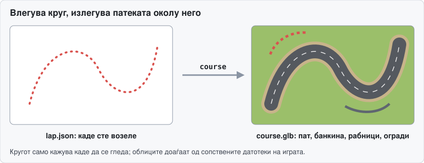
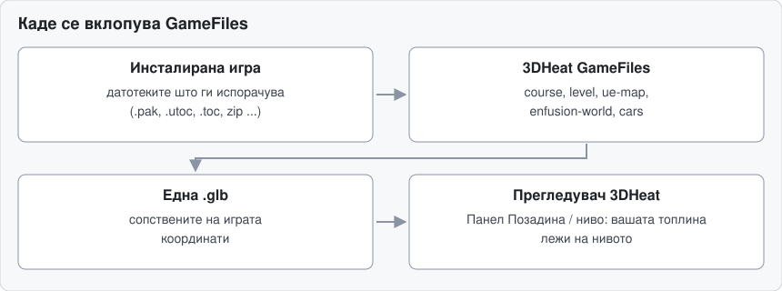

# 3DHeat GameFiles {#dheat-gamefiles}

**Што е тоа?** Алатка што гради 3D модел на тркачка патека или на ниво од игра
од датотеките на игра што веќе ја имате инсталирано.

**Зошто би ја користел?** Прегледувачот 3DHeat прикажува каде сте возеле или играле како
топлина. Со оваа алатка тоа го прикажува на вистинската патека или ниво, а не во празен простор.

**Пример:** земете круг што сте го возеле. Алатката ги гради патот и теренот околу него
како една 3D датотека, па прегледувачот може да ја прикаже вашата брзина или судири на вистинската патека:



Нови сте со командната линија? Започнете со [Пред да започнете](before-you-start.md).

Подетално: чита податоци за нивоа од архивите што ги испорачува играта и ги пишува
како бинарна датотека glTF (`.glb`). Нејзината главна задача е **извозот на патека (course)**: ѝ
давате круг, а таа го запишува теренот, патот разликуван од банкина и
трева, и рабниците, оградите, гумените ѕидови, знаците и зградите околу него.

Дел е од [3DHeat](https://github.com/Holdi601/3DHeat), прегледувач за
3D топлински мапи во реално време, анализа на трки и преглед на натпревари
([документација](https://holdi601.github.io/3DHeat/)). Датотеките `.glb` што ги пишува оваа
алатка се нивоата врз кои прегледувачот ја црта топлината.



Тоа е еден од три начина да се внесе геометријата на ниво во 3DHeat:

| Начин | Бара | Дава |
|---|---|---|
| 3DHeat Unreal Exporter | проектот на Unreal отворен во уредувачот | точна геометрија |
| 3DHeat GameCapture | екран и снимање | процена |
| **3DHeat GameFiles** | **инсталираната, испорачана игра** | **точна геометрија, без проект** |

Python пакет: `heat3d_gamefiles`. Складиште:
[Holdi601/3DHeat-GameFiles](https://github.com/Holdi601/3DHeat-GameFiles). Лиценца: MIT.

## Што може да прави {#what-it-can-do}

| Игра или engine | Извоз на патека (`course`) | Читање на архиви |
|---|---|---|
| Forza Horizon (ForzaTech) | да: терен, пат и банкина, текстура на земја, поставени модели во нивните текстури | `identify`, `list`, `extract` на `.minizip`; `identify` на `.modelbin`; модели, терен и текстури преку `course` и `terrain` |
| BeamNG.drive | да: терен, налепници на пат, моделирани патеки, поставени модели, вода | `identify`, `list`, `extract` на zip-ови на нивоа; `identify` на `.ter`, `.cdae`; `.dae` преку `course` |
| Assetto Corsa Rally (Unreal 5.6) | да: плочки на терен на етапа, испечена боја на земја, поставени модели во рамни бои | `identify`, `list`, `extract` на IoStore `.utoc`/`.ucas`; zen пакети, статични мрежи, текстури преку `course` |
| Unreal `.pak` (верзии 8-12) | не | `identify`, `list`, `extract` |
| Unity (формат 22 и понов) | не | `identify`, `meshes` |
| Battlefield 6 (Frostbite `.toc`/`.cas`) | без круг; цело ниво со `level`: терен, поставени мрежи, нивните мапи на боја со `--textures` | `identify`, `levels`; пакети (bundles), мрежи, терен, текстури и поставување преку `level` |
| Source 2 `.vpk` | не | `identify`, `list`, `extract` |
| Игри на Unreal 5 World Partition | без круг; цела мапа со `ue-map` (наведена од `ue-maps`): терен (landscape), HLOD згради и реквизити, вода | - |
| Arma Reforger (Enfusion) | без круг; цел свет со `enfusion-world` (наведен од `enfusion-worlds`): терен во своите бои, море, згради како кутии | - |
| Forza (автомобили) | `cars`: секој автомобил со ниски детали, за табот Анализа на трка на прегледувачот | - |

Круговите од Assetto Corsa EVO и iRacing се одбиваат со образложение. Видете
[Ограничувања и познати празнини](limits-and-known-gaps.md).

## Инсталација {#install}

Нови сте со командната линија? Прво прочитајте [Пред да започнете](before-you-start.md).

Потребен ви е **Python 3.10 или понов** (развиено на 3.13) и пакетите во
[`requirements.txt`](https://github.com/Holdi601/3DHeat-GameFiles/blob/main/requirements.txt).

```
git clone https://github.com/Holdi601/3DHeat-GameFiles.git
cd 3DHeat-GameFiles
pip install -r requirements.txt
```

Потоа проверете: `python -m heat3d_gamefiles --help`. Треба да видите
`usage: heat3d_gamefiles [-h]` и списокот на глаголи. Пуштајте ја секоја команда од
папката на складиштето, како `python -m heat3d_gamefiles <verb>`.

| Пакет | За што се користи |
|---|---|
| numpy | сè што декодира геометрија |
| lz4 | архиви на Forza (главно LZ4 блокови), некои пакети (bundles) на Unity, LZ4 блокови на IoStore |
| Pillow | декодирање на текстури BC1-BC7, пишување на JPEG текстурите во `.glb` |
| msgpack, zstandard | компајлираните облици на BeamNG (`.cdae`) |
| cryptography | само за отворање шифриран `.pak` со клуч што веќе го имате |
| pytest | тестовите |

Содржина на Unreal компресирана со **Oodle** бара библиотека Oodle што веќе е
на вашата машина. Таква никогаш не се испорачува со оваа алатка. Видете [Oodle](reader-oodle.md).

Алатката е напишана за Windows. Ги наоѓа игрите преку списокот на библиотеки на Steam и
`%LOCALAPPDATA%`, а Oodle го вчитува како Windows DLL. Други платформи не се
тестирани.

## Брз почеток {#quick-start}

**Датотека со круг (lap file)** е снимка на тоа каде одел вашиот автомобил: список од точки x, y, z.
Доаѓа од [3DHeat GameCapture](https://github.com/Holdi601/3DHeat-GameCapture)
или од библиотеката на кругови на апликацијата FH Companion; рачно напишан CSV исто така работи
([Влезови за круг](lap-inputs.md)).

```
# Forza: a lap file, a lap folder, or a course name from the FH Companion library
python -m heat3d_gamefiles course "Example Circuit"
python -m heat3d_gamefiles course path\to\lap.json -o course.glb

# BeamNG.drive or Assetto Corsa Rally: a heat3d-lap file says which game it is from
python -m heat3d_gamefiles course my_lap.json

# Every course in the FH Companion library, one .glb each
python -m heat3d_gamefiles courses -o courses

# Battlefield 6: list the levels, then export one (a large file; see Commands)
python -m heat3d_gamefiles levels
python -m heat3d_gamefiles level <level> -o level.glb --textures

# Unreal 5 World Partition and Arma Reforger: list, then export
python -m heat3d_gamefiles ue-maps "<game>"
python -m heat3d_gamefiles ue-map "<game>" <map> -o map.glb
python -m heat3d_gamefiles enfusion-worlds
python -m heat3d_gamefiles enfusion-world <world> -o world.glb

# Every Forza car, for the viewer's race tab
python -m heat3d_gamefiles cars -o forza.h3dcars

# What is this file?
python -m heat3d_gamefiles identify some_archive.pak
```

Отворете ја `.glb` во прегледувачот 3DHeat. Сопствените светски координати на играта се чуваат
(видете [Формат на излезот](output-format.md)), па снимениот круг се порамнува со патеката.

## Карта на оваа документација {#map-of-this-documentation}

- [Пред да започнете](before-you-start.md): Python, терминал, првата команда.
- [Команди](commands.md): секој глагол и опција, со примери.
- [Упатство за команди](../cli-reference.md): `--help` на секој глагол, генерирано од кодот.
- [Преглед на архиви](inspecting-archives.md): `identify`, `list`, `extract`, `meshes`, чекор по чекор.
- [Извоз на патека](course-export.md): како кругот станува патека, за сите игри.
  - [Forza Horizon](course-forza-horizon.md)
  - [BeamNG.drive](course-beamng.md)
  - [Assetto Corsa Rally](course-assetto-corsa-rally.md)
  - [Нивоа на детали и буџетот](detail-budget.md)
- [Цели нивоа](whole-levels.md): ниво, мапа или свет без круг.
  - [Нивоа на Battlefield 6](level-battlefield.md): `levels`, `level`
  - [Мапи на Unreal 5](level-unreal-world-partition.md): `ue-maps`, `ue-map`
  - [Светови на Arma Reforger](level-arma-reforger.md): `enfusion-worlds`, `enfusion-world`
- [Автомобили од Forza](forza-cars.md): `cars`, датотеката со автомобили за табот Анализа на трка на прегледувачот.
- [Влезови за круг](lap-inputs.md): секој облик на датотека со круг што алатката го прифаќа.
- [Формат на излезот](output-format.md): што има внатре во `.glb`.
- [Читачи на архиви](archive-readers.md): по една страница за секој формат на контејнер, што
  секој чита, што не чита, и зошто.
- [Ограничувања и познати празнини](limits-and-known-gaps.md)
- [Отстранување проблеми](troubleshooting.md): пораките за грешки и што да се прави.
- [Правила и лиценци](rules-and-licences.md): без клучеви, вашите сопствени датотеки, без редистрибуција.
- [Ажурирања](updates.md): проверката за ажурирање и `heat3d_update`.
- [Развој](development.md): карта на модулите и тестови, вклучително тестовите што работат врз инсталирани игри.
- [Одржување](maintaining.md): списокот за проверка при издание за овие страници.

## Дел од 3DHeat {#part-of-3dheat}

3DHeat GameFiles е една од бесплатните алатки околу прегледувачот 3DHeat:

| Алатка | Што прави | Документација |
|---|---|---|
| [3DHeat](https://github.com/Holdi601/3DHeat) | прегледувачот: 3D топлински мапи, анализа на трки и преглед на натпревари во прелистувачот | [сајт](https://holdi601.github.io/3DHeat/) |
| [GameFiles](https://github.com/Holdi601/3DHeat-GameFiles) | патеки и нивоа од датотеките што ги испорачува играта, како `.glb` | [сајт](https://holdi601.github.io/3DHeat-GameFiles/) |
| [GameCapture](https://github.com/Holdi601/3DHeat-GameCapture) | телеметрија на кругови од тркачки игри; нивоа обновени од видео од игра | [сајт](https://holdi601.github.io/3DHeat-GameCapture/) |
| [Unreal Exporter](https://github.com/Holdi601/3DHeat-UnrealExporter) | приклучок за Unreal Editor што го зачувува нивото како `.glb` | [сајт](https://holdi601.github.io/3DHeat-UnrealExporter/) |
| [CS2](https://github.com/Holdi601/3DHeat-CS2) | демоа од Counter-Strike 2 во датотеки за натпревари; мапи во `.glb` | [сајт](https://holdi601.github.io/3DHeat-CS2/) |
| [Watcher](https://github.com/Holdi601/3DHeat-Watcher) | ја снима вашата игра во заднина од она што играта го објавува | [сајт](https://holdi601.github.io/3DHeat-Watcher/) |
| [Ext-WarThunder](https://github.com/Holdi601/3DHeat-Ext-WarThunder) | снимки од War Thunder во датотеки за натпревари | [сајт](https://holdi601.github.io/3DHeat-Ext-WarThunder/) |
| [Ext-WoT](https://github.com/Holdi601/3DHeat-Ext-WoT) | снимки од World of Tanks во датотеки за натпревари | [сајт](https://holdi601.github.io/3DHeat-Ext-WoT/) |
| [Ext-WoWs](https://github.com/Holdi601/3DHeat-Ext-WoWs) | снимки од World of Warships во датотеки за натпревари | [сајт](https://holdi601.github.io/3DHeat-Ext-WoWs/) |
| [Ext-Squad](https://github.com/Holdi601/3DHeat-Ext-Squad) | демоа од Squad сервери во датотеки за натпревари | [сајт](https://holdi601.github.io/3DHeat-Ext-Squad/) |
| [Ext-DCS](https://github.com/Holdi601/3DHeat-Ext-DCS) | мапи од DCS World во нивоа `.glb` | [сајт](https://holdi601.github.io/3DHeat-Ext-DCS/) |
| [Ext-IL2](https://github.com/Holdi601/3DHeat-Ext-IL2) | мапи од IL-2 Sturmovik во нивоа `.glb` | [сајт](https://holdi601.github.io/3DHeat-Ext-IL2/) |

Датотеките за натпревари на прегледувачот се опишани во
[Една датотека по натпревар: `.3dheat`](https://holdi601.github.io/3DHeat/container.html);
ниво направено тука се вчитува покрај нив во панелот Позадина / ниво на прегледувачот.
