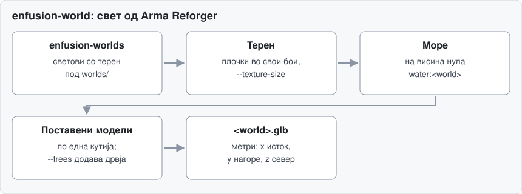

# Светови на Arma Reforger: `enfusion-worlds` и `enfusion-world` {#arma-reforger-worlds-enfusion-worlds-and-enfusion-world}

**Што е тоа?** Цел свет на Arma Reforger како една 3D датотека. **Зошто?** За топлинската
мапа од играта да има земја и згради под себе. (*Enfusion* е engine-от со кој е направен
Arma Reforger; *свет* е тоа што играта го нарекува мапа.)

Извезува цел Enfusion свет од инсталираниот Arma Reforger: теренот во боите на неговите
сопствени плочки supertexture, морето и секој поставен модел како кутија, во сопствените
метри на играта.



## Чекор по чекор {#step-by-step}

1. **Наведете ги световите** што имаат терен:

   ```
   python -m heat3d_gamefiles enfusion-worlds
   python -m heat3d_gamefiles enfusion-worlds --install "D:\Games\Arma Reforger"
   ```

2. **Извезете еден**, по името на неговата папка под `worlds/` како што е наведено:

   ```
   python -m heat3d_gamefiles enfusion-world <world> -o world.glb
   ```

3. **Варијации:**

   ```
   python -m heat3d_gamefiles enfusion-world <world> --trees               # vegetation too, as boxes
   python -m heat3d_gamefiles enfusion-world <world> --texture-size 0      # flat colour, small file
   python -m heat3d_gamefiles enfusion-world <world> --ground-spacing 4 --no-structures
   ```

4. **Отворете ја `world.glb`** во панелот Позадина / ниво на прегледувачот 3DHeat ([вчитување ниво](https://holdi601.github.io/3DHeat/levels.html)).

## Опции {#options}

| Опција | Стандардно | Значење |
|---|---|---|
| `<world>` | задолжително | свет како што го печати `enfusion-worlds` |
| `-o`, `--out FILE` | `<world>.glb` | датотеката што се пишува |
| `--install FOLDER` | Steam библиотеката што ја содржи играта | папката на играта |
| `--ground-spacing METRES` | 2 (сопственото на теренот) | растојанието меѓу темињата на теренот во датотеката |
| `--texture-size PIXELS` | 4096 | поголемата страна на сликата со боја на земјата; 0 за рамна боја |
| `--no-structures` | | изостави ги поставените модели |
| `--trees` | исклучено | постави и дрвја и друга вегетација, како кутии |

## Пример за излез {#example-output}

```text
<world> -> world.glb
  ground      <n> triangles, <w> x <h> m; <n> of <n> tile-edge vertices disagree; colour <w> x <h>
  structure   <n> boxes from <n> entities
  water       <n> triangles (the sea)
  left out    <what>: <n>, ...
```

## Деловите {#the-parts}

`ground:<world>` (теренот), `water:<world>` (морето, на висина нула) и
`structure:<world>` (кутиите). Координатите се сопствените на играта: x исток, y горе,
z север, во метри - она што го пријавува снимка во играта. Рамката на играта е лева;
*Инвертирај оска на светот* во прегледувачот ја покажува неогледално.

## Како се чита и проверува {#how-it-is-read-and-checked}

Не е потребен Workbench и ништо не е шифрирано.

| Формат | Што е | Проверено со |
|---|---|---|
| `.pak` | дел со податоци и дрво на директориуми, записи складирани или zlib | дрвото го троши својот дел точно; примероци од zlib записи се распакуваат точно до наведената големина |
| `.edds` | DDS заглавие, па по mip ниво делови `COPY` или `LZ4 ` | нивоата во делови се декодираат точно до својата големина користејќи точно свои бајти |
| `.terr` / `.ttile` | заглавие и плочки со 16-битни висини | секој заеднички раб на плочка се совпаѓа точно |
| supertexture | бојата на земјата на секоја плочка, околу метар по пиксел | се совпаѓа со морето во висините; ниту превртување ниту транспонирање не одговара подобро |
| `.ent` | имиња, GUID-и на ресурси, па ентитети како типизирани вредности | датотеката на светот се парсира до последниот бајт |
| `resourceDatabase.rdb` | GUID во патека | речиси секој GUID што го користи светот именува датотека што постои |

Објектите означени дека стојат на апсолутна висина седат на неколку сантиметри од
декодираниот терен (со транспонирана решетка би биле метри настрана). Не се цртаат:
сопствените триаголници на моделите, дрвјата по стандард (`--trees` ги додава како
кутии), дете-ентитети, езера и реки, текстури со pre-DX10 заглавија.

**Услови:** лиценцата на играта дозволува некомерцијална употреба и забранува
реверзно инженерство на датотеките на играта. Читањето на вашата сопствена инсталација е
ваша одлука според неа; излезот е за ваша употреба и не се споделува.
