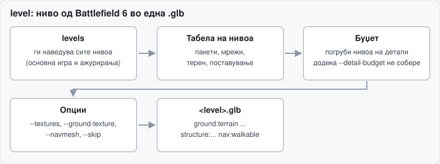

# Нивоа на Battlefield 6: `levels` и `level` {#battlefield-6-levels-levels-and-level}

**Што е тоа?** Цело ниво на Battlefield 6 како една 3D датотека. **Зошто?** За топлинската
мапа од вашите натпревари да има земја и згради под себе. (*Frostbite* е engine-от со кој е
направен Battlefield; *висинско поле* (heightfield) е земјата складирана како решетка од
висини.)

Извезува цело Frostbite ниво од инсталираната игра: висинското поле на теренот, секоја
мрежа што ја поставуваат неговите групи статични модели, објектите поставени еден по
еден, позадината на теренот околу мапата, и по барање мапите со боја на површините,
декалите на теренот испечени во земјата и површините по кои можат да одат војниците.



## Чекор по чекор {#step-by-step}

1. **Наведете ги нивоата** што ги испорачува играта:

   ```
   python -m heat3d_gamefiles levels
   python -m heat3d_gamefiles levels --install "D:\Games\<game folder>"
   ```

   Секоја линија е табела на ниво (`levels/<level>/<level>.toc`) со нејзината големина и
   од каде доаѓа: `Data` за основната игра, `Update/<pack>` за ажурирање.

2. **Извезете едно**, по неговото име, единствен дел од него, или патеката на `.toc`.
   Почнете без текстури за да ги видите обликот и големината:

   ```
   python -m heat3d_gamefiles level <level> -o level.glb
   ```

3. **Додајте боја** кога ќе изгледа добро:

   ```
   python -m heat3d_gamefiles level <level> -o level.glb --textures 512 --ground-texture 0.5
   ```

4. **Додајте ги површините за одење**, или смалете ја датотеката:

   ```
   python -m heat3d_gamefiles level <level> --textures 512 --ground-texture 0.5 --navmesh
   python -m heat3d_gamefiles level <level> --textures 256 --detail-budget 3000000 --ground-spacing 8
   ```

5. **Отворете ја `level.glb`** во панелот Позадина / ниво на прегледувачот 3DHeat ([вчитување ниво](https://holdi601.github.io/3DHeat/levels.html)).

## Опции {#options}

| Опција | Стандардно | Значење |
|---|---|---|
| `<level>` | задолжително | име како што го печати `levels`, единствен дел од него, или `.toc` на ниво |
| `-o`, `--out FILE` | `<level>.glb` | датотеката што се пишува |
| `--install FOLDER` | најдено во Steam библиотеките | папката на играта |
| `--textures [PIXELS]` | исклучено; 512 без големина | мапата со боја на секоја површина, најмногу PIXELS по страна |
| `--ground-texture [METRES]` | исклучено; 0,5 без големина | испечи ги патиштата, платформите и ознаките во бојата на земјата, METRES по пиксел |
| `--navmesh` | исклучено | додај ја навигациската мрежа на војникот како `nav:walkable` |
| `--ground-spacing METRES` | 4 | најфиното растојание на висинското поле; 0 го изоставува |
| `--detail-budget N` | најгрубите копии плус една четвртина, најмалку 1.500.000 | таван на триаголници (теренот никогаш не се огрубува) |
| `--skip TEXT` | | изостави ги групите модели чие име на партиција го содржи TEXT; може да се повторува |
| `--by-mesh` | исклучено | еден дел по изворна мрежа и материјал, за наоѓање што е еден дел |
| `--clamped-uvs` | исклучено | за рендерери што не можат да повторуваат текстура |

Целосната табела, со големините што да ги очекувате (цело ниво се стотици MB), е на
[Команди](commands.md#levels-and-level-frostbite). Како се читаат табелите, пакетите,
мрежите и теренот е на [Frostbite](reader-frostbite.md).

## Пример за излез {#example-output}

Што печати `level`, во груб преглед (линиите како што ги пишува кодот; `<n>` и
имињата се менуваат по ниво):

```text
<n> copies of <n> meshes, from <n> static model groups
      <n>  <group>
      <n>  placed one by one (object and prefab references)
<n> meshes left out: <why>
<n> triangles, budget <n>; <n> meshes drawn at a coarser level to fit
           <n>  ground:terrain
           <n>  structure:buildings, <n> textures
           ...
<n> of <n> drawn sections carry their colour map; the rest are flat colours
Ground: <what the ground is>.
Navigation mesh: <tiles read>.
-> level.glb (<n> MB)
```

## Деловите {#the-parts}

`ground:terrain` (висинското поле), `ground:terrain backdrop` и
`ground:terrain blend`, `structure:<kind>` по вид мрежа (по мапа со боја
со `--textures`, со ` (destructible)` за она што може да се уништи во натпревар), и
`nav:walkable` со `--navmesh`. Видете [Формат на излезот](output-format.md).

Датотеката ја содржи содржината на играта: е за машината на која е направена, а не за
препраќање ([Правила и лиценци](rules-and-licences.md)).
