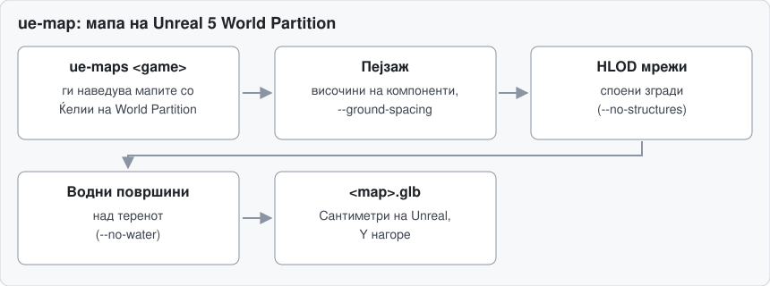

# Мапи на Unreal 5 World Partition: `ue-maps` и `ue-map` {#unreal-5-world-partition-maps-ue-maps-and-ue-map}

**Што е тоа?** Цела мапа на игра со Unreal 5 како една 3D датотека: земјата, зградите и
водата. **Зошто?** За топлинската мапа од таа игра да има мапа под себе.
(*World Partition* е начинот на кој Unreal 5 дели голема мапа на парчиња; *HLOD* е
поедноставена замена за група згради, онаа што играта ја црта далеку.)

Извезува цела мапа од игра со Unreal 5 чии мапи се готови (cooked) како ќелии на World
Partition: пејзажот (landscape), споените HLOD мрежи на мапата (нејзините згради и
реквизити како што ги црта играта оддалеку) и нејзините водни тела. Не е потребен ни
editor ни проект, само инсталираната игра.



## Чекор по чекор {#step-by-step}

1. **Наведете ги мапите.** `<game>` е папката на играта, нејзината `Content/Paks`, или
   името на нејзината папка во Steam библиотека:

   ```
   python -m heat3d_gamefiles ue-maps "<Steam game folder name>"
   python -m heat3d_gamefiles ue-maps "D:\Games\<game>"
   ```

   Секоја мапа со готови ќелии на World Partition се печати со патеката на нејзиниот
   пакет.

2. **Извезете една** по име или единствен дел од него:

   ```
   python -m heat3d_gamefiles ue-map "<game>" <map> -o map.glb
   ```

3. **Само земја, или погрубо:**

   ```
   python -m heat3d_gamefiles ue-map "<game>" <map> --no-structures --no-water
   python -m heat3d_gamefiles ue-map "<game>" <map> --ground-spacing 4
   ```

4. **Отворете ја `map.glb`** во панелот Позадина / ниво на прегледувачот 3DHeat
   ([вчитување ниво](https://holdi601.github.io/3DHeat/levels.html)).

## Опции {#options}

| Опција | Стандардно | Значење |
|---|---|---|
| `<game>` | задолжително | папката на играта, нејзината `Content/Paks`, или името на нејзината Steam папка |
| `<map>` | задолжително | име како што го печати `ue-maps`, или единствен дел од него |
| `-o`, `--out FILE` | `<map>.glb` | датотеката што се пишува |
| `--ground-spacing METRES` | 2 | растојанието меѓу темињата на пејзажот, заокружено на цел број од неговите сопствени квадрати |
| `--no-structures` | | изостави ги HLOD зградите и реквизитите |
| `--no-water` | | изостави ги водните тела |

Содржина компресирана со Oodle бара библиотека Oodle што веќе е на машината
(видете [Oodle](reader-oodle.md)).

## Пример за излез {#example-output}

```text
<map> -> map.glb
  ground      <n> triangles from <n> landscape components; <n> of <n> vertices stored twice disagree
  structure   <n> triangles in <n> HLOD meshes
  water       <n> triangles from <n> water bodies
```

Бројот на несогласувања е самопроверка: соседните компоненти на пејзажот го чуваат
заедничкиот раб двапати, а двете мора да се совпаѓаат. Мапа од 3 km со 2 m е околу
4,6 милиони триаголници на земјата.

## Деловите {#the-parts}

`ground:<map>` (пејзажот), `structure:<map>` (HLOD мрежите) и
`water:<map>` (вода што стои над земјата).

**Единици:** ова е единствениот извоз **што не е во метри**: сантиметри на Unreal, со
заменети Y и Z (Y горе), рамката што ја пишува 3DHeat Unreal Exporter. Телеметријата од
истата игра ја користи истата рамка, па лежи на мапата.

## Како се чита и проверува {#how-it-is-read-and-checked}

| Дел | Се чита од | Проверено со |
|---|---|---|
| земја | 16-битната карта на висини на секоја компонента на пејзажот, поставена по нејзината основа на секција на трансформацијата на пејзажот | секое теме складирано двапати (на шев или раб на компонента) мора да се совпаѓа; несогласувањата се бројат и печатат, не се измазнуваат |
| структури | споените HLOD мрежи на мапата, изградени од engine-от во светски простор | мрежата се задржува само ако границите што ги кешира нејзината компонента ги опишуваат нејзините сопствени темиња |
| вода | мрежата на секое водно тело, положена на решетката на земјата, задржана каде стои над земјата | водата седи неколку метри над земјата под неа, како што река седи над своето корито |

Својствата на пејзажот се наоѓаат по облик, а не по број на слот (слотовите се
поместуваат меѓу верзиите на engine-от). Структурите се поедноставените замени, а не
моделите со полн детаљ. Растенијата, декалите и материјалите на пејзажот не се
извезуваат; земјата е без текстура и ја засенчува прегледувачот. Детали за архивите:
[Unreal 5 IoStore](reader-unreal-iostore.md).

**Вашите сопствени датотеки:** мапата се чита од играта инсталирана на вашиот компјутер и
се запишува на вашиот диск за ваша сопствена анализа; ништо од играта не се испорачува со
оваа алатка.
