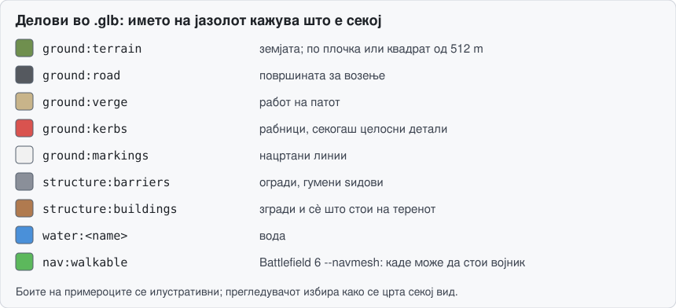

# Формат на излезот {#output-format}

`.glb` е една 3D датотека: теренот, зградите и водата на една патека или
ниво, што ја отворате во панелот Позадина / ниво на прегледувачот 3DHeat.

Секој извоз (`course`, `courses`, `terrain`, `level`, `ue-map`, `enfusion-world`) пишува една **бинарна glTF 2.0**
датотека (`.glb`). Намерно е мала и рамна, и распоредена онака како што прегледувачот
3DHeat чита ниво. Извор:
[`glb.py`](https://github.com/Holdi601/3DHeat-GameFiles/blob/main/heat3d_gamefiles/glb.py).

## Структура {#structure}

```
scene 0
 ├─ node "ground:terrain x-2046 z1023"  -> mesh 0 -> 1 primitive, material 0
 ├─ node "ground:road x-2046 z1023"     -> mesh 1 -> 1 primitive, material 1
 ├─ node "ground:markings"               -> mesh 2 -> ...
 ├─ node "ground:kerbs road_gen_rum_..." -> ...
 ├─ node "structure:barriers bar_armco_bclr"
 └─ ...
```

- **Еден јазол по дел**, сите во коренот на сцената, **без трансформации**. Целата
  геометрија е веќе во светски простор.
- Секој јазол има своја мрежа со **еден примитив** и свој материјал. Јазолот,
  мрежата и материјалот сите го носат името на делот.
- Секој примитив има **свои компактни низи од темиња**, само темињата што
  ги користи тој дел. Заедничка низа од темиња е дозволен glTF, но читач што ги проширува пристапувачите на секој
  примитив би држел секое теме по еднаш за секој дел.
- `asset.generator` е `heat3d_gamefiles`.
- **Малку `extras`**, и без име на круг, игра или патека:
  - дел од Battlefield 6 од уништлива мрежа носи `{"destructible": true}` на својот јазол;
  - патека од Forza кажува што содржи во `asset.extras` (верзија на форматот, совпаднат
    идентификатор на рута, колку копии од сопствениот слој на трката, места; видете
    [Патеки од Forza Horizon](course-forza-horizon.md#writing-the-file)), а нејзините
    вклучени делови го носат својот слој на јазолот: `{"layer": "event", "route": <id>}`
    за сопствениот слој на трката, `{"layer": "layer"}` за друг вклучен слој,
    `{"layer": "venue"}` за земјата на место.

  Сè друго што му треба на прегледувачот е во имињата на јазлите.

## Имиња на јазли: класификацијата {#node-names-the-classification}



Прегледувачот ја зема класата на делот од името на **јазолот** (а ако го нема, од името на
мрежата), и само кога се совпаѓа со

```
^(ground|structure|water)\s*[:|]
```

Сè друго се класифицира со хеуристика напишана за пејзажи на Unreal. Затоа
секој дел што го пишува извозникот почнува со еден од овие префикси, или со
`nav:` (подолу):

| Префикс | Значење | Напишани делови |
|---|---|---|
| `ground:` | површината за возење и земјата | `ground:road`, `ground:verge`, `ground:terrain`, `ground:gravel and dirt`, `ground:kerbs`, `ground:markings`, `ground:tyre marks`, `ground:venue`, `ground:plinths` |
| `structure:` | што стои на неа | `structure:barriers`, `structure:props`, `structure:signs`, `structure:buildings`, `structure:infrastructure`, `structure:bridges`, `structure:rocks`, `structure:smashables`, `structure:trees`; слоеви на Forza `structure:event_<category>` и `structure:layer_<category>` |
| `water:` | вода | `water:water`; `water:<map>` (`ue-map`), `water:<world>` (`enfusion-world`) |
| `nav:` | каде може да оди војник (Battlefield 6, само `--navmesh`) | `nav:walkable` |

`nav:` не се совпаѓа со горниот образец на прегледувачот, па прегледувачот го сортира со
својата хеуристика; тоа е одделен дел за да можете да го прикажете или скриете сам.
`ue-map` пишува `ground:<map>`, `structure:<map>` и `water:<map>`;
`enfusion-world` пишува `ground:<world>`, `structure:<world>` и `water:<world>`.

После видот следува, зависно од играта:

| Пример | Значење |
|---|---|
| `ground:road x-2046 z1023` | земја на Forza во плочката на терен именувана `x-2046 z1023` (единици на мрежа, 1023 на 512 m) |
| `ground:road 3_-2` | земја на BeamNG во квадрат од 512 m (3, -2) |
| `ground:road 3_-2 asphalt_light` | моделирана површина за возење на BeamNG од материјал `asphalt_light` во тој квадрат |
| `ground:road 1_-4` | земја на AC Rally во квадрат од 512 m (1, -4) од просторот на Unreal |
| `structure:barriers bar_armco_bclr` | поставени модели на Forza што споделуваат една текстура (нејзиното име без GUID) |
| `structure:barriers` | поставени модели без текстура (Forza, AC Rally) |
| `structure:event_barriers bar_example_bclr` | Forza: што трката совпадната си го поставува за себе, одделно од светот за слободно возење (extras на јазолот `{"layer": "event", "route": <id>}`) |
| `structure:layer_props` | Forza: слој што играта го вклучува за нешто друго освен оваа трка (активност, предмет за собирање, слој за време на извршување) |
| `ground:venue`, `ground:plinths` | Forza: модели веќе во светски координати - земјата на место (подот на стадион) и земја со која е украсена улица |
| `structure:barriers armco_metal` | поставени модели на BeamNG од еден материјал |
| `ground:markings`, `water:water` | рамни делови, еден за цела датотека |
| `ground:terrain` (Battlefield 6) | висинското поле; `ground:terrain backdrop` далечните мрежи на терен, `ground:terrain blend` мрежи што се претопуваат во теренот |
| `nav:walkable` (Battlefield 6, `--navmesh`) | навигациската мрежа на нивото за војник: каде може да се стои, рамно зелено |
| `ground:terrain x-512 z-512` (Battlefield 6, `--ground-texture`) | висинското поле под една испечена плочка со декали, именувана по нејзиниот долен агол во метри |
| `structure:buildings t_concreteclean_01_cs` (Battlefield 6, `--textures`) | секоја површина од тој вид што ја покажува таа мапа на бои; без `--textures`, еден дел по вид, без наставка |
| `structure:buildings t_concreteclean_01_cs (destructible)` (Battlefield 6) | исто, за мрежи што може да се уништат во натпревар: оние со средство за уништување со свое име (ѕидови, куќи, реквизити). Јазолот ги носи и glTF extras `{"destructible": true}`. Нивните уништени состојби не се извезуваат |

Прегледувачот може да филтрира по овие имиња. На пример, „само тркачката површина“ е
`ground:road` заедно со `ground:kerbs`, во сите три игри, а „светот без
сопствените реквизити на трката“ е сè освен `structure:event_*`. Префиксот е и
начинот на кој прегледувачот црта дел: земјата како површина врз која лежи топлината, структурата како
она што стои на неа.

## Единици, оски и систем {#units-axes-and-frame}

- **Метри, Y нагоре**, конвенцијата на glTF, за секој извоз освен `ue-map`. Ништо
  не се прескалира ниту се центрира одново: броевите се светските координати на играта, што
  е целта на читањето на архивата наместо реконструкцијата.
- **Мапи на Unreal 5 (`ue-map`): сантиметри**, сопствената единица на Unreal, со заменети Y и Z
  така што Y е нагоре - системот што го пишува 3DHeat Unreal Exporter и
  го користи телеметријата на играта. Единствениот извоз што не е во метри.
- **Arma Reforger (`enfusion-world`):** метри на самата игра, x исток, y нагоре,
  z север. Системот на играта е леворак; *Инвертирај оска на светот* на прегледувачот
  го прикажува неогледално.
- **Forza:** светските координати на самата игра (x, y нагоре, z), непроменети. Исти како
  нејзината телеметрија, па снимениот круг лежи на патеката.
- **BeamNG.drive:** `(x, z, -y)` од светот на BeamNG со Z нагоре, што е ротацијата што ја применува
  снимачот на телеметрија. Ротација, а не огледало.
- **Battlefield 6:** светските координати на самата игра (x, y нагоре, z), непроменети:
  трансформациите на инстанците на нивото применети на секоја мрежа како што е зачувана. Огледалните
  копии се навиваат одново за нивните нормали да гледаат нанадвор.
- **Assetto Corsa Rally:** системот на кругот. Сантиметрите на Unreal стануваат метри,
  Z на Unreal станува y, а X и Y на Unreal стануваат x и z во која и да е од осумте
  ориентации на која се вклопил кругот (видете
  [Assetto Corsa Rally](course-assetto-corsa-rally.md#which-stage-and-which-way-round)).
  Триаголниците се навиваат одново таму каде тоа пресликување огледува.

Секој извоз ги задржува оските што ги користи неговата телеметрија, така што снимката и нивото
делат еден систем. Дали тој систем е лев или десен во секоја игра
не е проверено.

## Податоци за темињата {#vertex-data}

Основната форма е **квантизираната** (`quantize=True`). Бара го
проширувањето `KHR_mesh_quantization`, наведено и во `extensionsUsed` и во
`extensionsRequired`.

| Атрибут | Квантизирано (основно) | Полна прецизност (`quantize=False`) |
|---|---|---|
| `POSITION` | float32 VEC3, со min/max | float32 VEC3 |
| `NORMAL` | int8 VEC3 нормализирано, дополнето на 4 бајти (чекор 4) | float32 VEC3 |
| `TEXCOORD_0` (само текстурирани делови) | uint16 VEC2 нормализирано, ограничено на 0-1; float32 VEC2 таму каде текстурите се повторуваат (Battlefield 6) | float32 VEC2 |
| `COLOR_0` (нетекстурирани делови, кога некој дел има боја) | uint8 VEC3 нормализирано, дополнето на 4 бајти | float32 VEC3 |
| индекси | uint16 кога делот има најмногу 65.535 темиња, инаку uint32 | uint32 |

Едно теме е 20 бајти наместо 32 (24 наместо 44 со боја). Тоа одзема
третина од секоја датотека, и е разликата меѓу тоа градска патека да се вчита во
таб на прегледувач или да не се вчита. Цената е под половина степен кај нормалата и 1/65.535 од
UV (една петнаесеттина од тексел на 4.096 px). Командната линија секогаш ја пишува
квантизираната форма. `write_glb(..., quantize=False)` во Python ја пишува другата.

Нормалите доаѓаат од играта таму каде ги чува (терен и модели на Forza, обликите и теренот
на BeamNG). Инаку се пресметуваат како мазни нормали пондерирани по површина
од триаголниците. Нормалите на AC Rally секогаш се пресметуваат.

## Материјали, бои и текстури {#materials-colours-and-textures}

- Секој материјал е `metallicFactor 0`, `roughnessFactor 1`.
- **Текстуриран дел:** `baseColorTexture` со сликата на делот, UV и без боја на темиња.
  glTF ги множи двете, па површината би излегла затемнета двапати.
- **Нетекстуриран дел:** боја на темиња `COLOR_0` со рамната боја на делот и
  бел `baseColorFactor`. Ако ниту еден дел во датотеката нема боја, нема
  `COLOR_0`. Таму каде деловите споделуваат темиња, победува бојата на подоцнежниот дел, па рамните
  делови се пишуваат по редослед на растечка важност.
- **Сликите** се вградени во бинарниот дел како **JPEG**, квалитет 90, без подсемплирање на
  хроминанса, само RGB (алфата се отфрла) - освен Battlefield 6 мапа со исечоци
  (лисја, огради), која е **PNG** со својата алфа, на материјал со
  `alphaMode` MASK, `alphaCutoff` 0.5 и `doubleSided` (видете
  [Frostbite](reader-frostbite.md#textures-and-materials)). Прегледувачот 3DHeat
  ги отфрла текселите под границата. Земја од 2048 px од трева и круни од дрвја
  е шум за кодер без загуби: неколку мегабајти по плочка како PNG, под еден
  како JPEG. Слика споделена од повеќе делови се чува еднаш.
- Еден семплер за сите текстури: линеарно зголемување, linear-mipmap-linear
  намалување, **clamp to edge** на двете оски, за извозите на патеки, чии
  текстури ги покриваат површините еднаш. BeamNG ги црта повторувачките текстури на модели како
  рамни бои (видете [BeamNG.drive](course-beamng.md#placed-models)).
- Извоз на Battlefield 6 со `--textures`, чии материјали се плочкаат, ги пишува
  сопствените координати на текстура на играта, неограничени, како float32 `TEXCOORD_0` дури и во
  квантизираната форма, со семплер што **повторува** на двете оски
  (`write_glb(..., repeat=True)`): ѕид од тули е пар триаголници чие
  UV оди од 0 до 40. Прегледувачот 3DHeat ја завиткува таквата текстура во својот атлас (видете
  неговата страница *Model levels*). За рендерер што не може да повторува текстура,
  `level --clamped-uvs` (`write_level(..., clamped=True)`) го сече секој триаголник
  по линиите каде неговата текстура се повторува и го поместува секое парче во 0..1:
  истите пиксели на истата површина, околу една петтина повеќе триаголници. Триаголниците
  преку кои текстурата се повторува повеќе од 16 пати ги задржуваат своите координати. Триаголник
  што неговата текстура би го исекла на повеќе од 4 парчиња - кора што се повторува по
  секоја гранка на дрво, и сечењето претвори 1.099 триаголници на едно дрво во
  51.735 - оди во свој дел, `<part> (average colour)`, во
  просечната боја на текстурата; `level` кажува колку.

| Текстура | Големина | Покрива |
|---|---|---|
| земја (сите игри освен Battlefield 6) | `--texture-size`: 2048, 1024 или 512 px | еден квадрат од 512 m: 25, 50 или 100 cm по пиксел |
| висинско поле на Battlefield 6 | најголемиот mip на мапата на бои на позадината во нивото, исечен | квадратот на теренот: 32 m по пиксел во проверено ниво |
| површини на Battlefield 6 | `--textures`: најмногу толку px по страна | сопствената текстура на површината, еднаш по парче (сечена таму каде се повторува) |
| испечена земја на Battlefield 6 | `--ground-texture`: метри по пиксел, плочки од најмногу 4.096 px | една плочка од обемот на декалите: 2.048 m на 0,5 m по пиксел |
| поставен модел на Forza | најмногу 256 px | сопствениот UV распоред на моделот |
| поставен модел на BeamNG | најмногу 256 px | сопствениот UV распоред на моделот, само таму каде не се повторува |
| поставен модел на AC Rally | нема | рамни бои |

## Што писателот го одбива {#what-the-writer-refuses}

`write_glb` фрла грешка наместо да запише датотека што прегледувач би ја отворил и би ја прикажал
погрешно:

| Одбиено | Затоа што |
|---|---|
| позиции што не се N x 3, или не се конечни | расипана мрежа |
| индекс надвор од крајот на списокот со темиња | се рендерира како шум |
| текстуриран дел кога датотеката нема UV | се рендерира како еден размачкан пиксел |
| воопшто нема триаголници | се рендерира како ништо |
| низа од нормали, бои или UV со погрешна должина, или која не е конечна | потребна е по една за секое теме |

## Читање на друго место {#reading-it-elsewhere}

Секој прегледувач за glTF 2.0 што го поддржува `KHR_mesh_quantization` треба да ги отвори овие
датотеки. Проверен е само прегледувачот 3DHeat; другите прегледувачи не се потврдени. Читач
без проширувањето ја одбива датотеката, бидејќи е означена како задолжителна. Датотеките може да се големи: околу 80 MB за
рурална тркачка патека, до неколку стотини MB за градска патека со автоматскиот
буџет.

## Во 3DHeat {#in-3dheat}

Вчитајте ја `.glb` во панелот Позадина / ниво на прегледувачот [3DHeat](https://github.com/Holdi601/3DHeat); телеметријата што ја снимате во истата игра лежи на неа, бидејќи двете
ги држат координатите на играта. Сопствената документација на прегледувачот
([holdi601.github.io/3DHeat](https://holdi601.github.io/3DHeat/)) го опфаќа
панелот Позадина / ниво и датотеките за натпревари што ги пишуваат другите алатки
([Една датотека по натпревар: `.3dheat`](https://holdi601.github.io/3DHeat/container.html)).
Нивото не се чува во секоја `.3dheat` датотека: натпреварот го именува во своите
`references` (`kind: "level"`, име и sha256), а `.glb` останува покрај
натпреварите.
