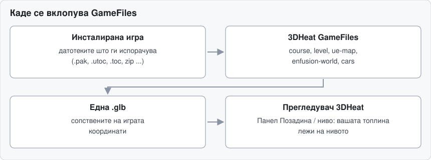

# Цели нивоа {#whole-levels}

**Со прости зборови:** за пукачки и други игри без кругови, алатката ја зачувува
целата мапа како една 3D датотека, за прегледувачот да нацрта каде се движеле играчите на неа.

`course` го сече теренот околу еден круг. За игри без кругови алатката извезува
цело ниво, мапа или свет одеднаш:

| Игра или engine | Список | Извоз | Страница |
|---|---|---|---|
| Battlefield 6 (Frostbite) | `levels` | `level <level>` | [Нивоа на Battlefield 6](level-battlefield.md) |
| Игри со Unreal 5 World Partition | `ue-maps <game>` | `ue-map <game> <map>` | [Мапи на Unreal 5](level-unreal-world-partition.md) |
| Arma Reforger (Enfusion) | `enfusion-worlds` | `enfusion-world <world>` | [Светови на Arma Reforger](level-arma-reforger.md) |

Секој пар работи на ист начин: првиот глагол наведува што ја држи инсталираната игра,
вториот запишува едно од нив како единствена `.glb` во сопствените светски координати на играта,
па позициите снимени во таа игра лежат на неа. Деловите се
именувани `ground:`, `structure:` и `water:` како и секој друг извоз (видете
[Формат на излезот](output-format.md)); вчитајте ја датотеката во панелот Позадина / ниво на прегледувачот 3DHeat.

