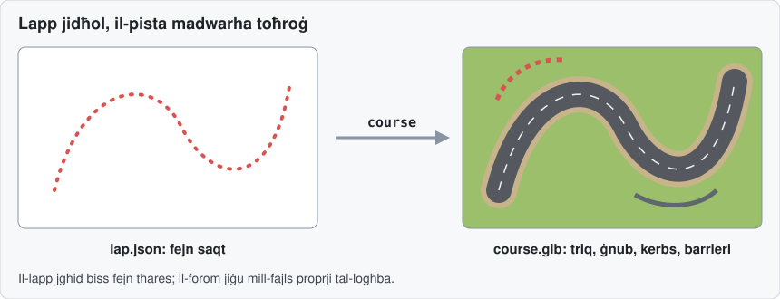
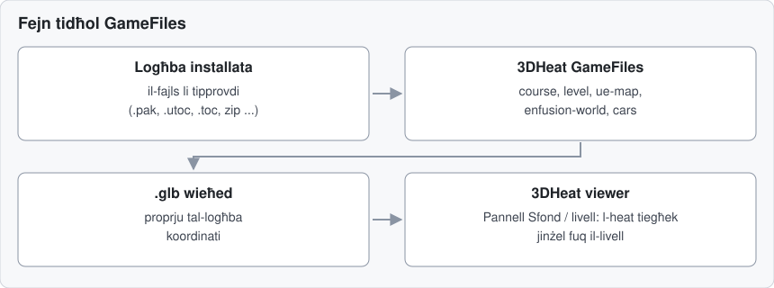

# 3DHeat GameFiles {#dheat-gamefiles}

**X'inhi?** Għodda li tibni mudell 3D ta' pista tat-tlielaq jew livell ta' logħba
mill-fajls ta' logħba li diġà għandek installata.

**Għaliex nużaha?** Il-viewer ta' 3DHeat ipinġi fejn saqt jew lgħabt bħala
heat. B'din l-għodda jpinġih fuq il-pista jew il-livell veru, mhux fuq spazju vojt.

**Eżempju:** ħu lapp li saqt. L-għodda tibni t-triq u l-art madwarha
bħala fajl 3D wieħed, biex il-viewer ipinġi l-veloċità jew il-ħabtiet tiegħek fuq il-pista vera:



Ġdid mal-linja tal-kmandi? Ibda b'[Qabel ma tibda](before-you-start.md).

B'aktar dettall: taqra d-dejta tal-livelli mill-arkivji li tipprovdi logħba u tikteb
fajl glTF binarju (`.glb`). Il-ħidma ewlenija tagħha hija l-**esportazzjoni tal-kors**: int
tagħtiha lapp, u hi tikteb l-art, it-triq mifruda mill-ġenb u mill-ħaxix, u
l-kerbs, il-barrieri, il-ħitan tat-tyres, is-sinjali u l-bini madwarha.

Hija parti minn [3DHeat](https://github.com/Holdi601/3DHeat), viewer għal
heatmaps 3D tat-telemetrija f'ħin reali, analiżi tat-tlielaq u reviżjoni tal-partiti
([dokumentazzjoni](https://holdi601.github.io/3DHeat/)). Il-fajls `.glb` li tikteb din
l-għodda huma l-livelli li fuqhom il-viewer ipinġi l-heat.



Hija waħda minn tliet modi biex iddaħħal il-ġeometrija ta' livell f'3DHeat:

| Rotta | Teħtieġ | Tagħti |
|---|---|---|
| 3DHeat Unreal Exporter | il-proġett ta' Unreal miftuħ fl-editor | ġeometrija eżatta |
| 3DHeat GameCapture | skrin u capture | stima |
| **3DHeat GameFiles** | **il-logħba installata, kif ġiet mibgħuta** | **ġeometrija eżatta, ebda proġett** |

Pakkett Python: `heat3d_gamefiles`. Repożitorju:
[Holdi601/3DHeat-GameFiles](https://github.com/Holdi601/3DHeat-GameFiles). Liċenzja: MIT.

## X'tista' tagħmel {#what-it-can-do}

| Logħba jew magna | Esportazzjoni tal-kors (`course`) | Qari tal-arkivji |
|---|---|---|
| Forza Horizon (ForzaTech) | iva: terren, triq u ġnub, texture tal-art, mudelli mqiegħda fit-texturi tagħhom | `identify`, `list`, `extract` fuq `.minizip`; `identify` fuq `.modelbin`; mudelli, terren u texturi permezz ta' `course` u `terrain` |
| BeamNG.drive | iva: terren, decals tat-triq, ċirkwiti mmudellati, mudelli mqiegħda, ilma | `identify`, `list`, `extract` fuq zips tal-livelli; `identify` fuq `.ter`, `.cdae`; `.dae` permezz ta' `course` |
| Assetto Corsa Rally (Unreal 5.6) | iva: tiles tal-art tal-istage, kulur tal-art maħmuġ, mudelli mqiegħda f'kuluri ċatti | `identify`, `list`, `extract` fuq IoStore `.utoc`/`.ucas`; pakketti zen, static meshes, texturi permezz ta' `course` |
| Unreal `.pak` (verżjonijiet 8-12) | le | `identify`, `list`, `extract` |
| Unity (format 22 u aktar tard) | le | `identify`, `meshes` |
| Battlefield 6 (Frostbite `.toc`/`.cas`) | ebda lapp; livell sħiħ b'`level`: terren, meshes mqiegħda, il-mapep tal-kulur tagħhom b'`--textures` | `identify`, `levels`; bundles, meshes, terren, texturi u tqegħid permezz ta' `level` |
| Source 2 `.vpk` | le | `identify`, `list`, `extract` |
| Logħob ta' Unreal 5 World Partition | ebda lapp; mappa sħiħa b'`ue-map` (elenkata minn `ue-maps`): landscape, bini u props HLOD, ilma | - |
| Arma Reforger (Enfusion) | ebda lapp; dinja sħiħa b'`enfusion-world` (elenkata minn `enfusion-worlds`): terren fil-kuluri tiegħu, il-baħar, bini bħala kaxxi | - |
| Forza (karozzi) | `cars`: kull karozza f'dettall baxx, għat-tab Analiżi tat-tellieqa tal-viewer | - |

Laps minn Assetto Corsa EVO u iRacing jiġu miċħuda b'raġuni. Ara
[Limiti u lakuni magħrufa](../limits-and-known-gaps.md).

## Installa {#install}

Ġdid mal-linja tal-kmandi? Aqra [Qabel ma tibda](before-you-start.md) l-ewwel.

Teħtieġ **Python 3.10 jew aktar ġdid** (żviluppat fuq 3.13) u l-pakketti f'
[`requirements.txt`](https://github.com/Holdi601/3DHeat-GameFiles/blob/main/requirements.txt).

```
git clone https://github.com/Holdi601/3DHeat-GameFiles.git
cd 3DHeat-GameFiles
pip install -r requirements.txt
```

Imbagħad ittestja: `python -m heat3d_gamefiles --help`. Għandek tara
`usage: heat3d_gamefiles [-h]` u l-lista tal-verbs. Ħaddem kull kmand mill-folder
tar-repożitorju, bħala `python -m heat3d_gamefiles <verb>`.

| Pakkett | Użat għal |
|---|---|
| numpy | kull ma jiddekodifika ġeometrija |
| lz4 | arkivji ta' Forza (l-aktar blokki LZ4), xi bundles ta' Unity, blokki LZ4 ta' IoStore |
| Pillow | dekodifikar ta' texturi BC1-BC7, kitba tat-texturi JPEG fil-`.glb` |
| msgpack, zstandard | il-forom ikkompilati ta' BeamNG (`.cdae`) |
| cryptography | biss biex tiftaħ `.pak` ikkriptat b'ċavetta li diġà għandek |
| pytest | it-testijiet |

Kontenut ta' Unreal ikkompressat b'**Oodle** jeħtieġ libreriji Oodle li diġà
jinsabu fuq il-magna tiegħek. Qatt ma tintbagħat waħda ma' din l-għodda. Ara [Oodle](../reader-oodle.md).

L-għodda hija miktuba għal Windows. Issib il-logħob mil-lista tal-librerija ta' Steam u
`%LOCALAPPDATA%`, u tgħabbi Oodle bħala DLL ta' Windows. Pjattaformi oħra ma ġewx
ittestjati.

## Bidu veloċi {#quick-start}

**Fajl tal-lapp** huwa reġistrazzjoni ta' fejn marret il-karozza tiegħek: lista ta' punti x, y, z.
Tiġi minn [3DHeat GameCapture](https://github.com/Holdi601/3DHeat-GameCapture)
jew mil-librerija tal-laps tal-app FH Companion; CSV miktub bl-id jaħdem ukoll
([Inputs tal-lapp](../lap-inputs.md)).

```
# Forza: a lap file, a lap folder, or a course name from the FH Companion library
python -m heat3d_gamefiles course "Example Circuit"
python -m heat3d_gamefiles course path\to\lap.json -o course.glb

# BeamNG.drive or Assetto Corsa Rally: a heat3d-lap file says which game it is from
python -m heat3d_gamefiles course my_lap.json

# Every course in the FH Companion library, one .glb each
python -m heat3d_gamefiles courses -o courses

# Battlefield 6: list the levels, then export one (a large file; see Commands)
python -m heat3d_gamefiles levels
python -m heat3d_gamefiles level <level> -o level.glb --textures

# Unreal 5 World Partition and Arma Reforger: list, then export
python -m heat3d_gamefiles ue-maps "<game>"
python -m heat3d_gamefiles ue-map "<game>" <map> -o map.glb
python -m heat3d_gamefiles enfusion-worlds
python -m heat3d_gamefiles enfusion-world <world> -o world.glb

# Every Forza car, for the viewer's race tab
python -m heat3d_gamefiles cars -o forza.h3dcars

# What is this file?
python -m heat3d_gamefiles identify some_archive.pak
```

Iftaħ il-`.glb` fil-viewer ta' 3DHeat. Il-koordinati proprji tad-dinja tal-logħba jinżammu
(ara [Format tal-output](../output-format.md)), allura lapp irrekordjat jaqbel mal-kors.

## Mappa ta' din id-dokumentazzjoni {#map-of-this-documentation}

- [Qabel ma tibda](before-you-start.md): Python, terminal, l-ewwel kmand.
- [Kmandi](../commands.md): kull verb u għażla, b'eżempji.
- [Referenza tal-kmandi](../cli-reference.md): il-`--help` ta' kull verb, iġġenerat mill-kodiċi.
- [Spezzjoni tal-arkivji](../inspecting-archives.md): `identify`, `list`, `extract`, `meshes`, pass b'pass.
- [Esportazzjoni tal-kors](../course-export.md): kif lapp isir kors, għal kull logħba.
  - [Forza Horizon](../course-forza-horizon.md)
  - [BeamNG.drive](../course-beamng.md)
  - [Assetto Corsa Rally](../course-assetto-corsa-rally.md)
  - [Livelli ta' dettall u l-budget](../detail-budget.md)
- [Livelli sħaħ](../whole-levels.md): livell, mappa jew dinja mingħajr lapp.
  - [Livelli ta' Battlefield 6](../level-battlefield.md): `levels`, `level`
  - [Mapep ta' Unreal 5](../level-unreal-world-partition.md): `ue-maps`, `ue-map`
  - [Dinjiet ta' Arma Reforger](../level-arma-reforger.md): `enfusion-worlds`, `enfusion-world`
- [Karozzi ta' Forza](../forza-cars.md): `cars`, il-fajl tal-karozzi għat-tab Analiżi tat-tellieqa tal-viewer.
- [Inputs tal-lapp](../lap-inputs.md): kull forma ta' fajl tal-lapp li l-għodda taċċetta.
- [Format tal-output](../output-format.md): x'hemm ġewwa l-`.glb`.
- [Qarrejja tal-arkivji](../archive-readers.md): paġna waħda għal kull format ta' container, li tkopri
  x'jaqra kull wieħed, x'ma jaqrax, u għaliex.
- [Limiti u lakuni magħrufa](../limits-and-known-gaps.md)
- [Soluzzjoni ta' problemi](../troubleshooting.md): il-messaġġi ta' żball u x'għandek tagħmel.
- [Regoli u liċenzji](../rules-and-licences.md): ebda ċwievet, fajls tiegħek, ebda redistribuzzjoni.
- [Aġġornamenti](../updates.md): il-kontroll tal-aġġornamenti u `heat3d_update`.
- [Żvilupp](../development.md): mappa tal-moduli u testijiet, inklużi dawk li jaħdmu fuq logħob installat.
- [Manutenzjoni](../maintaining.md): il-lista ta' kontroll tar-rilaxx għal dawn il-paġni.

## Parti minn 3DHeat {#part-of-3dheat}

3DHeat GameFiles hija waħda mill-għodod b'xejn madwar il-viewer ta' 3DHeat:

| Għodda | X'tagħmel | Dokumenti |
|---|---|---|
| [3DHeat](https://github.com/Holdi601/3DHeat) | il-viewer: heatmaps 3D, analiżi tat-tlielaq u reviżjoni tal-partiti fil-browser | [sit](https://holdi601.github.io/3DHeat/) |
| [GameFiles](https://github.com/Holdi601/3DHeat-GameFiles) | korsijiet u livelli mill-fajls li tipprovdi logħba, bħala `.glb` | [sit](https://holdi601.github.io/3DHeat-GameFiles/) |
| [GameCapture](https://github.com/Holdi601/3DHeat-GameCapture) | telemetrija tal-laps minn logħob tat-tlielaq; livelli mibnija mill-ġdid minn vidjo tal-logħba | [sit](https://holdi601.github.io/3DHeat-GameCapture/) |
| [Unreal Exporter](https://github.com/Holdi601/3DHeat-UnrealExporter) | plugin ta' Unreal Editor li jsalva livell bħala `.glb` | [sit](https://holdi601.github.io/3DHeat-UnrealExporter/) |
| [CS2](https://github.com/Holdi601/3DHeat-CS2) | demos ta' Counter-Strike 2 f'fajls tal-partiti; mapep f'`.glb` | [sit](https://holdi601.github.io/3DHeat-CS2/) |
| [Watcher](https://github.com/Holdi601/3DHeat-Watcher) | jirrekordja l-logħob tiegħek fl-isfond minn dak li jippubblikaw il-logħob | [sit](https://holdi601.github.io/3DHeat-Watcher/) |
| [Ext-WarThunder](https://github.com/Holdi601/3DHeat-Ext-WarThunder) | replays ta' War Thunder f'fajls tal-partiti | [sit](https://holdi601.github.io/3DHeat-Ext-WarThunder/) |
| [Ext-WoT](https://github.com/Holdi601/3DHeat-Ext-WoT) | replays ta' World of Tanks f'fajls tal-partiti | [sit](https://holdi601.github.io/3DHeat-Ext-WoT/) |
| [Ext-WoWs](https://github.com/Holdi601/3DHeat-Ext-WoWs) | replays ta' World of Warships f'fajls tal-partiti | [sit](https://holdi601.github.io/3DHeat-Ext-WoWs/) |
| [Ext-Squad](https://github.com/Holdi601/3DHeat-Ext-Squad) | demos tas-server ta' Squad f'fajls tal-partiti | [sit](https://holdi601.github.io/3DHeat-Ext-Squad/) |
| [Ext-DCS](https://github.com/Holdi601/3DHeat-Ext-DCS) | mapep ta' DCS World f'livelli `.glb` | [sit](https://holdi601.github.io/3DHeat-Ext-DCS/) |
| [Ext-IL2](https://github.com/Holdi601/3DHeat-Ext-IL2) | mapep ta' IL-2 Sturmovik f'livelli `.glb` | [sit](https://holdi601.github.io/3DHeat-Ext-IL2/) |

Il-fajls tal-partiti tal-viewer huma deskritti f'
[Fajl wieħed għal kull partita: `.3dheat`](https://holdi601.github.io/3DHeat/container.html);
livell magħmul hawn jitgħabba maġenbhom fil-pannell Sfond / livell tal-viewer.
