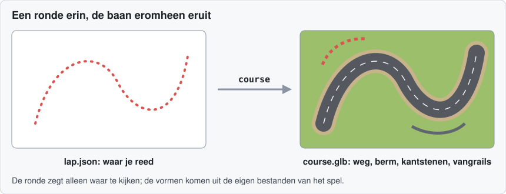
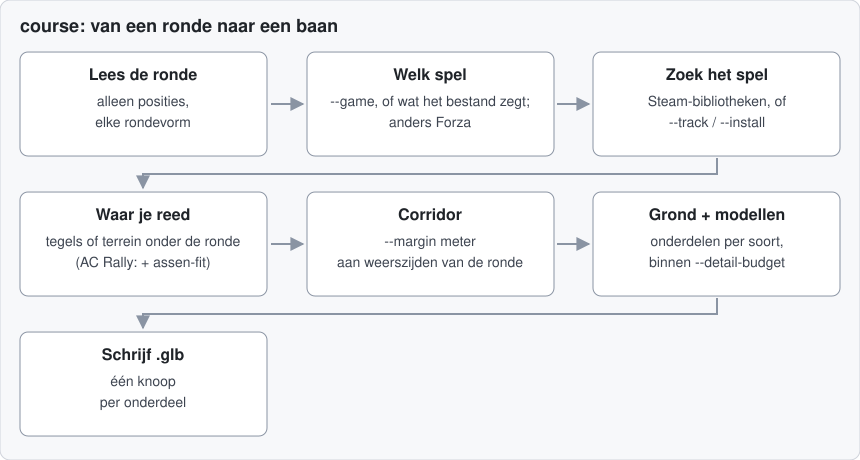

# Baan-export {#course-export}

**In gewone woorden:** je reed een ronde; dit bouwt de baan waarop je reed, als 3D-bestand. De ronde is alleen een reeks punten. De weg, het gras en de kantstenen komen uit de eigen bestanden van het spel.

`course` maakt van een ronde een baan: de grond in een strook aan beide kanten van waar de auto reed, en wat er op die grond staat, samen in één `.glb` voor de viewer. Deze pagina behandelt wat alle drie de ondersteunde spellen gemeen hebben. De pagina's eronder behandelen wat verschilt:

- [Forza Horizon](course-forza-horizon.md): ForzaTech `.minizip`-archieven
- [BeamNG.drive](course-beamng.md): zip-archieven, een terrein-hoogteveld, gecompileerde vormen
- [Assetto Corsa Rally](course-assetto-corsa-rally.md): Unreal 5 IoStore, een World Partition-etappe
- [Detailniveaus en het budget](detail-budget.md): hoeveel driehoeken de geplaatste modellen krijgen, en welke kopieën blijven

## De stappen {#the-steps}

Woorden die hieronder gebruikt worden: een **frame** is de richting waarin de assen wijzen; de **corridor** is de strook grond aan beide kanten van de ronde; een **tegel** is één vierkant stuk van het terrein van een spel; een **LOD** (detailniveau) is een van de eenvoudigere kopieën van een model.

1. **Lees de ronde.** Alleen posities, uit een van de vormen in [Rondebestanden](lap-inputs.md). Snelheid en bediening worden niet gebruikt. Een ronde met minder dan twee punten wordt geweigerd (`holds no driving`).
2. **Bepaal het spel.** Eerst `--game`, dan het veld `game` van het lapbestand, dan Forza (zie [Commando's](commands.md#which-game)).
3. **Vind het geïnstalleerde spel.** Alle drie zoeken in elke Steam-bibliotheek die in `config\libraryfolders.vdf` van Steam staat. Forza zoekt ook in `C:\XboxGames`. `--track` (Forza) of `--install` (BeamNG, AC Rally) slaat de zoektocht over.
4. **Vind waar de ronde is gereden.** Dit wordt nooit alleen op naam bepaald. Forza kiest de baan waarvan de terreintegels de ronde bedekken. BeamNG kiest het level waarop de punten van de ronde liggen (het terrein of de wegen). AC Rally probeert elke etappe in acht richtingen van de assen en kiest de richting die het meeste van de ronde op de weg legt.
5. **Snijd een corridor** van `--margin` meter aan beide kanten van de rijlijn (hieronder).
6. **Bouw de grond** binnen de corridor, ingedeeld als weg, berm, grind en zand, terrein, markeringen, bandensporen of water, en bak een grondtextuur voor elk vierkant van 512 m.
7. **Plaats de modellen** die in de corridor staan, per categorie, op een detailniveau dat wordt gekozen op afstand en een driehoeksbudget.
8. **Schrijf de `.glb`**: één benoemd knooppunt per deel. Zie [Uitvoerformaat](output-format.md).

Wat een run afdrukt, hier op een nagebootste BeamNG.drive-installatie uit de tests, een ronde van 50 m over een strook weg:

## De corridor {#the-corridor}

De snede is een strook rond de gereden lijn, niet de begrenzingsdoos van de ronde. Bij een circuit zijn die vrijwel gelijk. Bij een sprint van A naar B is de doos vooral heuvelland waar niemand langs rijdt, en kan de strook een tiende van het oppervlak zijn. Bron: [`corridor.py`](https://github.com/Holdi601/3DHeat-GameFiles/blob/main/heat3d_gamefiles/corridor.py).

Zo wordt hij gebouwd:

- De rijlijn wordt op het grondvlak geprojecteerd: x en z van de ronde (BeamNG: x en y van het eigen stelsel van het spel).
- Hij wordt gerasterd op een raster van **4 m** cellen (`CELL`). Elke cel die de rijlijn raakt, wordt naar alle kanten verbreed met een schijf met straal `margin + 4 m`.
- Opeenvolgende punten die minder dan **50 m** uit elkaar liggen (`JOIN`), worden verbonden met punten elke 4 m, zodat de strook geen gaten heeft. Punten die verder uit elkaar liggen, worden gezien als losse stukken rijden en niet verbonden. Een bibliotheekbaan bestaat uit veel rondebestanden achter elkaar, en de finish van de ene sprint en de start van de volgende mogen geen strook over de kaart trekken.
- Een driehoek blijft staan als een hoek, het midden van een zijde of zijn zwaartepunt in de strook ligt. De middelpunten vangen een grote driehoek die over een smalle strook ligt terwijl al zijn hoeken erbuiten vallen.
- De hoogte speelt nooit mee in de snede. Een doos die de hoogte begrenst, zou de grond wegsnijden onder een heuvel die de weg beklimt.

De console meldt het oppervlak van de corridor, bijvoorbeeld `cutting 80 m either side of the driving: 1.53 km2 of a 6,000 by 3,600 m box`.

BeamNG en AC Rally bouwen ook een bredere **reikwijdte-corridor** van `margin + 60 m`. Een geplaatst model wordt meegenomen als zijn oorsprong in de reikwijdte-corridor ligt, en alleen getekend als zijn voetafdruk de echte corridor raakt. Zo gaat een lang object waarvan de oorsprong net buiten de strook ligt, niet verloren. BeamNG gebruikt de reikwijdte-corridor ook om te kiezen welke wegdecals worden geschilderd.

## Waar de grond uit bestaat {#what-the-ground-is-made-of}

Elke export deelt de gronddriehoeken in dezelfde soorten in, en elke soort wordt als eigen deel geschreven, zodat de viewer hem kan tonen of verbergen:

| Soort | Delnaam | Vlakke kleur (lineaire RGB) | Forza | BeamNG | AC Rally |
|---|---|---|---|---|---|
| weg | `ground:road` | 0.22, 0.22, 0.23 | wegstroken: asfaltdeel | lagen van het type `ASPHALT`, wegdecals, gemodelleerde weg | baantegels (`/MeshesTrack/`) |
| berm | `ground:verge` | 0.52, 0.47, 0.30 | wegstroken: de berm | stoepen en bermmodellen | - |
| grind en zand | `ground:gravel and dirt` | 0.50, 0.42, 0.30 | - | lagen en decals van aarde, grind, zand, modder | - |
| terrein | `ground:terrain` | 0.30, 0.44, 0.18 | al het overige | al het overige | `_Terrain`-tegels en verre terrein |
| kantstenen | `ground:kerbs` | 0.60, 0.12, 0.10 (Forza) | `road_gen_rum*`-rekwisieten | kantsteen-, stoep- en trilstrookmodellen | kantsteenmodellen |
| markeringen | `ground:markings` | 0.90, 0.90, 0.88 | decal-submeshes, 5 cm opgetild | in de textuur geschilderd | - |
| bandensporen | `ground:tyre marks` | 0.20, 0.17, 0.16 | decal-submeshes, 5 cm opgetild | in de textuur geschilderd | - |
| water | `water:water` | 0.16, 0.34, 0.48 | watermaterialen | zeevlak, waterblokken, rivieren | - |

De vlakke kleuren zijn gekozen om in één oogopslag leesbaar te zijn, niet om het spel na te bootsen. Ze worden gebruikt voor delen zonder textuur en door viewers die texturen negeren. Bron: [`surfaces.py`](https://github.com/Holdi601/3DHeat-GameFiles/blob/main/heat3d_gamefiles/surfaces.py).

Grondonderdelen worden per vierkant van 512 m gesplitst, en elk vierkant draagt zijn eigen gebakken afbeelding, dus de delnamen bevatten het vierkant:

| Spel | Delnaam van de grond | Sleutel van het vierkant |
|---|---|---|
| Forza | `ground:road x-2046 z1023` | de rasternaam van de terreintegel (stappen van 1023, zie [Forza Horizon](course-forza-horizon.md)) |
| BeamNG | `ground:road 3_-2` | `floor(x / 512)`, `floor(y / 512)` in BeamNG-meters |
| AC Rally | `ground:road 1_-4` | `floor(x / 51200)`, `floor(y / 51200)` in Unreal-centimeters |

## Wat erop staat {#what-stands-on-it}

Geplaatste modellen worden geschreven in delen met de naam `structure:<categorie>`, of `ground:kerbs` voor kantstenen (in alle drie de spellen). Heeft een deel zijn eigen textuur, dan volgt de naam van de textuur of het materiaal de categorie, bijvoorbeeld `structure:barriers bar_armco_bclr`.

| Categorie | Forza | BeamNG | AC Rally |
|---|---|---|---|
| barrières | ja | ja | ja |
| rekwisieten | ja | ja | ja |
| borden | ja | ja | ja |
| gebouwen | ja (volledige gebouwen als stand-in, waar het spel die heeft) | ja | ja |
| infrastructuur | ja | ja | ja |
| bruggen | ja | ja | (ingedeeld als infrastructuur) |
| rotsen | ja | ja | ja |
| kantstenen | ja, als grond | ja, als grond | ja, als grond |
| bomen | met `--trees` | met `--trees` | met `--trees` |
| breekbare objecten | met `--trees` | - | - |

De verdeling van detail is in alle drie gelijk. Kopieën binnen 25 m van de rijlijn beginnen op volledig detail, kopieën op 25-60 m één niveau grover, en verdere kopieën op het grofste niveau. Daarna stappen de duurste modellen omlaag tot een driehoeksbudget past. Waar zelfs de grofste niveaus niet passen binnen een budget dat je opgeeft, worden kopieën weggelaten. Kantstenen worden nooit vereenvoudigd of weggelaten. Zie [Detailniveaus en het budget](detail-budget.md).

## Opties die het resultaat bepalen {#options-that-shape-the-result}

| Wat je wilt | Gebruik |
|---|---|
| een kleiner bestand | `--no-textures` (vlakke kleuren), `--texture-size 1024` of `512`, `--detail-budget N`, `--margin 40` |
| alleen de grond | `--no-placed` |
| de omgeving erbij | `--trees` |
| een ander seizoen (Forza) | `--season winter` |
| een spel buiten Steam | `--track` (Forza) of `--install` (BeamNG, AC Rally) |
| een ronde die de zoektocht niet plaatst | `--level` (BeamNG, AC Rally), `--track` (Forza) |

## Coördinaten {#coordinates}

Elke export schrijft meters met Y omhoog, in een stelsel waarin een opgenomen ronde van hetzelfde spel past:

| Spel | Geschreven stelsel |
|---|---|
| Forza | de eigen wereldcoördinaten van het spel, ongewijzigd |
| BeamNG | `(x, z, -y)` van de Z-omhoog-wereld van BeamNG, de rotatie die de telemetrie-opnemer toepast |
| AC Rally | het stelsel van de ronde, gevonden door te passen: Unreal-centimeters worden meters, en Unreal X en Y worden de x en z van de ronde, in welke van de acht richtingen ook past |

Zie [Uitvoerformaat](output-format.md).
