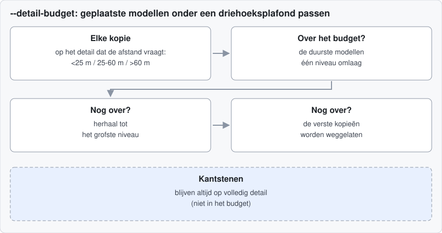

# Detailniveaus en het budget {#levels-of-detail-and-the-budget}

Een **driehoek** is een piepklein plat stukje van een 3D-model. Meer driehoeken betekent een groter, trager bestand. Het **budget** is een limiet op hoeveel het er zijn. Een **detailniveau** is een eenvoudiger kopie van een model, die wordt gebruikt wanneer het ver weg staat.

Het fijnste niveau van alles wat rond een circuit geplaatst is, telt meerdere miljoenen driehoeken. Denk aan honderden vangrailsegmenten en bandenstapels van elk ongeveer duizend driehoeken. Een stadscorridor bevat meer dan honderdduizend kopieën. Daarom geeft elke baan-export de geplaatste modellen een **driehoeksbudget**, en bepaalt hij per model op welk detailniveau het wordt getekend, en, indien nodig, welke kopieën worden weggelaten.

Het schema is geschreven voor Forza
([`forzaplacement.py`](https://github.com/Holdi601/3DHeat-GameFiles/blob/main/heat3d_gamefiles/forzaplacement.py):
`choose_levels`, `auto_budget`, `_fit`), en BeamNG en AC Rally hergebruiken de onderdelen ervan.
Het terrein telt niet mee in het budget.

## Afstandsbanden {#distance-bands}

De afstand van elke kopie tot de rijlijn wordt gemeten in het grondvlak, tot het dichtstbijzijnde rondepunt. De ronde wordt eerst uitgedund tot hoogstens 1.000 punten; dat kost een paar meter precisie en niets wat hier telt. De kopieën vallen daarna in drie banden, en elk paar (model, band) wordt apart begroot:

| Band | Afstand | Begint op |
|---|---|---|
| dichtbij | minder dan 25 m (`NEAR`) | het fijnste niveau |
| middel | 25-60 m (`FAR`) | één niveau grover |
| ver | 60 m en meer | het grofste niveau |

Zonder een route (Forza `terrain --box`) wordt de afstand gemeten tot het midden van de doos.

## Omlaag stappen om te passen {#stepping-down-to-fit}



De kosten van een item (model, band) zijn kopieën x driehoeken op het huidige niveau. Zolang het totaal boven het budget ligt, stapt het item dat de meeste kosten één niveau omlaag, en dat herhaalt zich tot het totaal past of niets verder kan. Vastgezette items stappen nooit:

| Spel | Vastgezet op volledig detail |
|---|---|
| Forza | kantstenen (`road_gen_rum*`) |
| BeamNG | kantstenen, en elke vorm die rijoppervlak draagt |
| AC Rally | kantstenen |

De samenvatting van Forza meldt dit als `N of M models drawn at a coarser level to fit the budget`.

## Het automatische budget {#the-automatic-budget}

Zonder `--detail-budget` bepaalt het budget zichzelf, zodat **geen enkele kopie wordt weggelaten**:

```
budget = max(1,500,000, 1.25 x sum(copies x coarsest level))
```

Vastgezette items tellen mee op hun fijnste niveau. De 25% (`HEADROOM`) laat zaken naast de weg wat detail houden. Bij een landcircuit is dit de ondergrens van 1,5 miljoen (`DEFAULT_BUDGET`). Bij een stadsbaan, waar de corridor meer dan honderdduizend kopieën bevat, groeit het tot boven de tien miljoen, en het bestand tot enkele honderden MB. De viewer laadt dat.

## Een budget dat je opgeeft {#a-budget-you-give}

`--detail-budget N` is een **plafond**. Niveaus stappen omlaag zoals hierboven. Als zelfs de grofste niveaus niet passen, worden kopieën weggelaten:

| Spel | Volgorde waarin kopieën worden weggelaten |
|---|---|
| Forza | eerst alles op 25 m of meer van de rijlijn, dan wat naast de weg staat; binnen elke groep eerst wat er van de weg het kleinst uitziet: grootste afstand / grootte (grootte = de diagonaal van de begrenzingsdoos van het model keer zijn grootste schaal, minimaal 0,25 m) |
| BeamNG | het verst van de rijlijn eerst |
| AC Rally | het verst van de rijlijn eerst, zoals BeamNG |
| Battlefield 6 | het kleinst eerst: diagonaal van de begrenzingsdoos keer schaal |

Kantstenen (en voor BeamNG de modellen van het rijoppervlak) worden nooit weggelaten. Een budget dat kleiner is dan wat zij alleen al kosten, wordt dus door hen overschreden, en door niets anders.

De tool gebruikt bij Forza afstand boven grootte, omdat wie alleen op afstand sorteert, een airconditioningunit op een muur negen meter weg laat staan terwijl de gevel van twintig meter waaraan hij hangt, twaalf meter verder, al is weggelaten. Dingen naast de weg gaan als laatste, wat hun grootte ook is, omdat een barrière van drie meter op vijf meter van de lijn de rand van de baan is, terwijl een gebouw van vijftig meter zestig meter terug scenery is.

De samenvatting meldt `N of M copies left out to fit the budget, the smallest and furthest from the driving first (--detail-budget raises it)` (Forza), of `N copies left out to fit the budget, the furthest from the driving first (--detail-budget raises it)` (BeamNG, AC Rally).

## Hele gebouwen (Forza) {#whole-buildings-forza}

Een stand-in voor een compleet gebouw telt als één kopie, op een afstand gemeten tot de dichtstbijzijnde rand van het gebouw. Het wordt als geheel bewaard of weggelaten. De modulaire stukken die het vervangt, worden helemaal niet begroot. Zie [Forza Horizon](course-forza-horizon.md#buildings-drawn-whole).

## Wat een detailniveau is, per spel {#what-a-level-of-detail-is-per-game}

| Spel | Niveaus komen uit |
|---|---|
| Forza | het driehoeksgewijze niveaumasker van de `Mesh`-submeshes van het model (bit `level + 1`); `0xFFFF`-breekbare stukken alleen voor een model zonder gemarkeerd niveau |
| BeamNG | de `details` van de `.cdae`-vorm met een niet-negatieve grootte, grootste eerst; voor `.dae` het getal aan het eind van de mesh-knoopnamen (`barrier75`, `barrier40`) |
| AC Rally | de opgeslagen detailniveaus van de statische mesh, fijnste eerst |
| Battlefield 6 | de detailniveaus van het MeshSet, fijnste eerst, alleen de getekende secties meegerekend (niet de schaduw- en alleen-diepte-kopieën), en niet een laatste niveau dat een stand-in op afstand is (materialen `M_LastLod`, `M_Billboard`, `M_Vista`: het gaas van een mast wordt dan een massieve piek) |

Het `level`-commando van Battlefield 6 heeft geen ronde, dus er zijn geen afstandsbanden: elke mesh is één item, en elke kopie staat op hetzelfde niveau. Het automatische budget is de formule hierboven, met het terrein-achtergrondstuk vastgezet; het hoogteveld valt buiten het budget en wordt bepaald door `--ground-spacing`. Onder een budget dat je opgeeft, worden, zodra elke mesh op zijn grofste niveau staat, kopieën weggelaten, het kleinst eerst. De grootte is hier de diagonaal van de begrenzingsdoos van de mesh keer de schaal van de kopie, omdat er geen rijlijn is om afstand vanaf te meten. Het terrein-achtergrondstuk wordt nooit weggelaten. Een level komt automatisch op ongeveer tien miljoen driehoeken.

## Een getal kiezen {#choosing-a-number}

| Je wilt | Probeer |
|---|---|
| alles, volledig detail dicht bij de weg | laat het automatisch |
| een bestand dat enkele keren kleiner is | `--detail-budget 500000` met `--texture-size 1024` |
| alleen de grond | `--no-placed` (geen budget nodig) |
