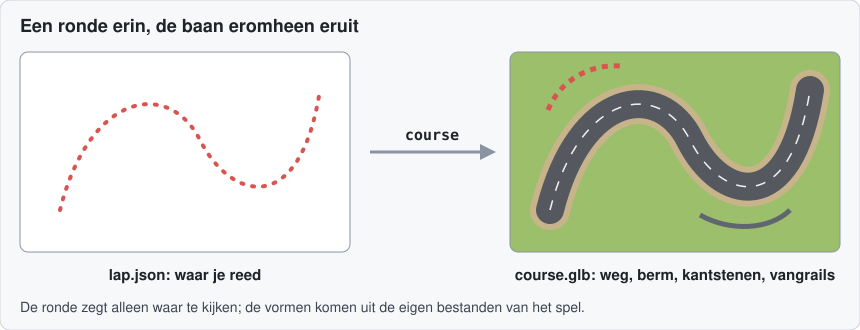
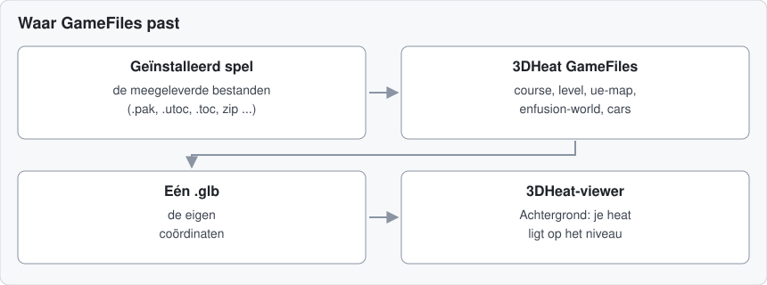

# 3DHeat GameFiles {#dheat-gamefiles}

**Wat is het?** Een hulpmiddel dat een 3D-model maakt van een racebaan of een spelniveau
uit de bestanden van een spel dat je al geïnstalleerd hebt.

**Waarom zou ik het gebruiken?** De 3DHeat-viewer schildert waar je hebt gereden of gespeeld als
heat. Met dit hulpmiddel schildert hij het op de echte baan of het echte niveau, niet op lege ruimte.

**Voorbeeld:** neem een ronde die je hebt gereden. Het hulpmiddel bouwt de weg en het land eromheen
als één 3D-bestand, zodat de viewer je snelheid of crashes op de echte baan kan schilderen:



Nog nooit met de opdrachtregel gewerkt? Begin met [Voordat je begint](before-you-start.md).

Meer in detail: het leest niveaudata uit de archieven die een spel meelevert en schrijft die
als binair glTF-bestand (`.glb`). De belangrijkste taak is de **baanexport**: je geeft een
ronde, en het schrijft de grond, de weg onderscheiden van de berm en het gras, en de
kantstenen, vangrails, banden-muren, borden en gebouwen eromheen.

Het hoort bij [3DHeat](https://github.com/Holdi601/3DHeat), een viewer voor realtime 3D-telemetrie
heatmaps, Race-analyse en wedstrijdanalyse
([documentatie](https://holdi601.github.io/3DHeat/)). De `.glb`-bestanden die dit
hulpmiddel schrijft, zijn de niveaus waarop de viewer de heat tekent.



Er zijn drie manieren om de geometrie van een niveau in 3DHeat te krijgen:

| Route | Heeft nodig | Levert |
|---|---|---|
| 3DHeat Unreal Exporter | het Unreal-project geopend in de editor | exacte geometrie |
| 3DHeat GameCapture | een scherm en een opname | een schatting |
| **3DHeat GameFiles** | **het geïnstalleerde, meegeleverde spel** | **exacte geometrie, geen project nodig** |

Python-pakket: `heat3d_gamefiles`. Repository:
[Holdi601/3DHeat-GameFiles](https://github.com/Holdi601/3DHeat-GameFiles). Licentie: MIT.

## Wat het kan {#what-it-can-do}

| Spel of engine | Baanexport (`course`) | Archieven lezen |
|---|---|---|
| Forza Horizon (ForzaTech) | ja: terrein, weg en berm, grondtextuur, geplaatste modellen in hun eigen texturen | `identify`, `list`, `extract` op een `.minizip`; `identify` op een `.modelbin`; modellen, terrein en texturen via `course` en `terrain` |
| BeamNG.drive | ja: terrein, wegdecals, gemodelleerde circuits, geplaatste modellen, water | `identify`, `list`, `extract` op niveau-zips; `identify` op `.ter`, `.cdae`; `.dae` via `course` |
| Assetto Corsa Rally (Unreal 5.6) | ja: grondtegels van de etappe, ingebakken grondkleur, geplaatste modellen in vlakke kleuren | `identify`, `list`, `extract` op IoStore `.utoc`/`.ucas`; zen-pakketten, statische meshes, texturen via `course` |
| Unreal `.pak` (versies 8-12) | nee | `identify`, `list`, `extract` |
| Unity (formaat 22 en later) | nee | `identify`, `meshes` |
| Battlefield 6 (Frostbite `.toc`/`.cas`) | geen ronde; een heel niveau met `level`: terrein, geplaatste meshes, hun kleurkaarten met `--textures` | `identify`, `levels`; bundels, meshes, terrein, texturen en plaatsing via `level` |
| Source 2 `.vpk` | nee | `identify`, `list`, `extract` |
| Unreal 5 World Partition-spellen | geen ronde; een hele kaart met `ue-map` (weergegeven door `ue-maps`): landschap, HLOD-gebouwen en props, water | - |
| Arma Reforger (Enfusion) | geen ronde; een hele wereld met `enfusion-world` (weergegeven door `enfusion-worlds`): terrein in zijn kleuren, de zee, gebouwen als dozen | - |
| Forza (auto's) | `cars`: elke auto op lage detailgraad, voor het tabblad Race-analyse van de viewer | - |

Ronden uit Assetto Corsa EVO en iRacing worden geweigerd, met een reden. Zie
[Beperkingen en bekende gaten](../limits-and-known-gaps.md).

## Installatie {#install}

Nog nooit met de opdrachtregel gewerkt? Lees eerst [Voordat je begint](before-you-start.md).

Je hebt **Python 3.10 of later** nodig (ontwikkeld op 3.13) en de pakketten in
[`requirements.txt`](https://github.com/Holdi601/3DHeat-GameFiles/blob/main/requirements.txt).

```
git clone https://github.com/Holdi601/3DHeat-GameFiles.git
cd 3DHeat-GameFiles
pip install -r requirements.txt
```

Controleer daarna: `python -m heat3d_gamefiles --help`. Je ziet
`usage: heat3d_gamefiles [-h]` en de lijst met werkwoorden. Voer elke opdracht uit vanuit de
map van de repository, als `python -m heat3d_gamefiles <werkwoord>`.

| Pakket | Waarvoor het dient |
|---|---|
| numpy | alles dat geometrie decodeert |
| lz4 | Forza-archieven (meestal LZ4-blokken), sommige Unity-bundels, IoStore LZ4-blokken |
| Pillow | BC1-BC7-texturen decoderen, de JPEG-texturen in de `.glb` schrijven |
| msgpack, zstandard | de gecompileerde vormen van BeamNG (`.cdae`) |
| cryptography | alleen om een versleuteld `.pak` te openen met een sleutel die je al hebt |
| pytest | de tests |

Unreal-inhoud die met **Oodle** is gecomprimeerd, heeft een Oodle-bibliotheek nodig die al op
je computer staat. Die wordt nooit met dit hulpmiddel meegeleverd. Zie [Oodle](../reader-oodle.md).

Het hulpmiddel is geschreven voor Windows. Het vindt spellen via de bibliotheeklijst van Steam
en `%LOCALAPPDATA%`, en laadt Oodle als Windows-DLL. Andere platformen zijn niet getest.

## Snelstart {#quick-start}

Een **ronde-bestand** is een opname van waar je auto heen ging: een lijst met x-, y-, z-punten.
Het komt uit [3DHeat GameCapture](https://github.com/Holdi601/3DHeat-GameCapture)
of de rondebibliotheek van de FH Companion-app; een met de hand getypte CSV werkt ook
([Rondeinvoer](../lap-inputs.md)).

```
# Forza: een ronde-bestand, een rondemap, of een baannaam uit de FH Companion-bibliotheek
python -m heat3d_gamefiles course "Example Circuit"
python -m heat3d_gamefiles course path\to\lap.json -o course.glb

# BeamNG.drive of Assetto Corsa Rally: een heat3d-lap-bestand vertelt welk spel het is
python -m heat3d_gamefiles course my_lap.json

# Elke baan in de FH Companion-bibliotheek, één .glb per stuk
python -m heat3d_gamefiles courses -o courses

# Battlefield 6: eerst de niveaus weergeven, dan één exporteren (een groot bestand; zie Commando's)
python -m heat3d_gamefiles levels
python -m heat3d_gamefiles level <level> -o level.glb --textures

# Unreal 5 World Partition en Arma Reforger: eerst weergeven, dan exporteren
python -m heat3d_gamefiles ue-maps "<game>"
python -m heat3d_gamefiles ue-map "<game>" <map> -o map.glb
python -m heat3d_gamefiles enfusion-worlds
python -m heat3d_gamefiles enfusion-world <world> -o world.glb

# Elke Forza-auto, voor het tabblad Race-analyse van de viewer
python -m heat3d_gamefiles cars -o forza.h3dcars

# Wat is dit bestand?
python -m heat3d_gamefiles identify some_archive.pak
```

Open de `.glb` in de 3DHeat-viewer. De wereldcoördinaten van het spel blijven behouden
(zie [Uitvoerformaat](../output-format.md)), dus een opgenomen ronde past op de baan.

## Overzicht van deze documentatie {#map-of-this-documentation}

- [Voordat je begint](before-you-start.md): Python, een terminal, het eerste commando.
- [Commando's](../commands.md): elk werkwoord en elke optie, met voorbeelden.
- [Commandoreferentie](../cli-reference.md): de `--help` van elk werkwoord, gegenereerd uit de code.
- [Archieven inspecteren](../inspecting-archives.md): `identify`, `list`, `extract`, `meshes`, stap voor stap.
- [Baanexport](../course-export.md): hoe een ronde een baan wordt, voor alle spellen.
  - [Forza Horizon](../course-forza-horizon.md)
  - [BeamNG.drive](../course-beamng.md)
  - [Assetto Corsa Rally](../course-assetto-corsa-rally.md)
  - [Detailniveaus en het budget](../detail-budget.md)
- [Hele niveaus](../whole-levels.md): een niveau, kaart of wereld zonder ronde.
  - [Battlefield 6-niveaus](../level-battlefield.md): `levels`, `level`
  - [Unreal 5-kaarten](../level-unreal-world-partition.md): `ue-maps`, `ue-map`
  - [Arma Reforger-werelden](../level-arma-reforger.md): `enfusion-worlds`, `enfusion-world`
- [Forza-auto's](../forza-cars.md): `cars`, het auto-bestand voor het tabblad Race-analyse van de viewer.
- [Rondeinvoer](../lap-inputs.md): elke vorm van rondebestand die het hulpmiddel accepteert.
- [Uitvoerformaat](../output-format.md): wat er in de `.glb` zit.
- [Archieflezers](../archive-readers.md): één pagina per containerformaat, met wat elk leest, wat niet, en waarom.
- [Beperkingen en bekende gaten](../limits-and-known-gaps.md)
- [Problemen oplossen](../troubleshooting.md): de foutmeldingen en wat je dan doet.
- [Regels en licenties](../rules-and-licences.md): geen sleutels, je eigen bestanden, niet doorgeven.
- [Updates](../updates.md): de updatecontrole en `heat3d_update`.
- [Ontwikkeling](../development.md): modulekaart en tests, inclusief de tests die tegen geïnstalleerde spellen draaien.
- [Onderhoud](../maintaining.md): de checklist per release voor deze pagina's.

## Onderdeel van 3DHeat {#part-of-3dheat}

3DHeat GameFiles is een van de gratis hulpmiddelen rond de 3DHeat-viewer:

| Tool | Wat die doet | Documentatie |
|---|---|---|
| [3DHeat](https://github.com/Holdi601/3DHeat) | de viewer: 3D-heatmaps, Race-analyse en wedstrijdanalyse in de browser | [site](https://holdi601.github.io/3DHeat/) |
| [GameFiles](https://github.com/Holdi601/3DHeat-GameFiles) | banen en niveaus uit de bestanden die spellen meeleveren, als `.glb` | [site](https://holdi601.github.io/3DHeat-GameFiles/) |
| [GameCapture](https://github.com/Holdi601/3DHeat-GameCapture) | rondetelemetrie uit racespellen; niveaus opnieuw opgebouwd uit gameplayvideo | [site](https://holdi601.github.io/3DHeat-GameCapture/) |
| [Unreal Exporter](https://github.com/Holdi601/3DHeat-UnrealExporter) | een plug-in voor de Unreal Editor die een niveau als `.glb` opslaat | [site](https://holdi601.github.io/3DHeat-UnrealExporter/) |
| [CS2](https://github.com/Holdi601/3DHeat-CS2) | Counter-Strike 2-demo's naar wedstrijdbestanden; kaarten naar `.glb` | [site](https://holdi601.github.io/3DHeat-CS2/) |
| [Watcher](https://github.com/Holdi601/3DHeat-Watcher) | legt je spel op de achtergrond vast uit wat spellen publiceren | [site](https://holdi601.github.io/3DHeat-Watcher/) |
| [Ext-WarThunder](https://github.com/Holdi601/3DHeat-Ext-WarThunder) | War Thunder-replays naar wedstrijdbestanden | [site](https://holdi601.github.io/3DHeat-Ext-WarThunder/) |
| [Ext-WoT](https://github.com/Holdi601/3DHeat-Ext-WoT) | World of Tanks-replays naar wedstrijdbestanden | [site](https://holdi601.github.io/3DHeat-Ext-WoT/) |
| [Ext-WoWs](https://github.com/Holdi601/3DHeat-Ext-WoWs) | World of Warships-replays naar wedstrijdbestanden | [site](https://holdi601.github.io/3DHeat-Ext-WoWs/) |
| [Ext-Squad](https://github.com/Holdi601/3DHeat-Ext-Squad) | Squad-serverdemo's naar wedstrijdbestanden | [site](https://holdi601.github.io/3DHeat-Ext-Squad/) |
| [Ext-DCS](https://github.com/Holdi601/3DHeat-Ext-DCS) | DCS World-kaarten naar `.glb`-niveaus | [site](https://holdi601.github.io/3DHeat-Ext-DCS/) |
| [Ext-IL2](https://github.com/Holdi601/3DHeat-Ext-IL2) | IL-2 Sturmovik-kaarten naar `.glb`-niveaus | [site](https://holdi601.github.io/3DHeat-Ext-IL2/) |

De wedstrijdbestanden van de viewer staan beschreven in
[Eén bestand per wedstrijd: `.3dheat`](https://holdi601.github.io/3DHeat/container.html);
een hier gemaakt niveau wordt er naast geladen in het paneel Achtergrond / level van de viewer.
