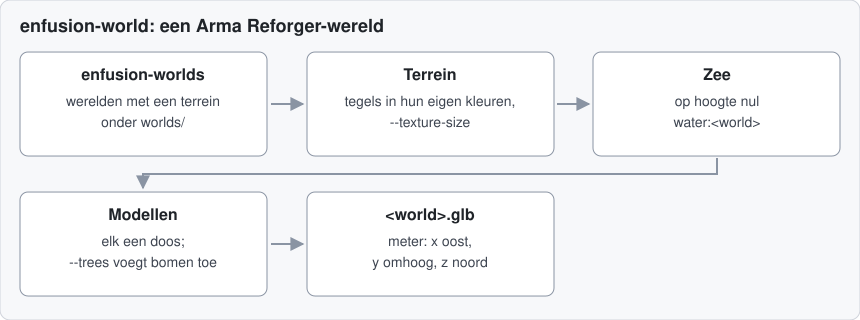

# Arma Reforger-werelden: `enfusion-worlds` en `enfusion-world` {#arma-reforger-worlds-enfusion-worlds-and-enfusion-world}

**Wat is het?** Een complete Arma Reforger-wereld als één 3D-bestand. **Waarom?** Zodat de hitte uit het spel de grond en de gebouwen eronder heeft. (*Enfusion* is de engine waarmee Arma Reforger is gemaakt; een *wereld* is wat het spel een map noemt.)

Exporteert een volledige Enfusion-wereld van het geïnstalleerde Arma Reforger: het terrein in de kleuren van zijn eigen supertexture-tegels, de zee, en elk geplaatst model als een doos, in de eigen meters van het spel.



## Stap voor stap {#step-by-step}

1. **Toon de werelden** die een terrein hebben:

   ```
   python -m heat3d_gamefiles enfusion-worlds
   python -m heat3d_gamefiles enfusion-worlds --install "D:\Games\Arma Reforger"
   ```

2. **Exporteer er één**, met zijn mapnaam onder `worlds/` zoals die in de lijst staat:

   ```
   python -m heat3d_gamefiles enfusion-world <world> -o world.glb
   ```

3. **Varianten:**

   ```
   python -m heat3d_gamefiles enfusion-world <world> --trees               # vegetation too, as boxes
   python -m heat3d_gamefiles enfusion-world <world> --texture-size 0      # flat colour, small file
   python -m heat3d_gamefiles enfusion-world <world> --ground-spacing 4 --no-structures
   ```

4. **Open `world.glb`** in het paneel Achtergrond / level van de 3DHeat-viewer ([een level laden](https://holdi601.github.io/3DHeat/levels.html)).

## Opties {#options}

| Optie | Standaard | Betekenis |
|---|---|---|
| `<world>` | verplicht | een wereld zoals `enfusion-worlds` die afdrukt |
| `-o`, `--out FILE` | `<world>.glb` | het bestand dat geschreven wordt |
| `--install FOLDER` | de Steam-bibliotheek waarin het spel staat | de map van het spel |
| `--ground-spacing METRES` | 2 (dat van het terrein zelf) | de afstand tussen de vertices van het terrein in het bestand |
| `--texture-size PIXELS` | 4096 | de langste zijde van de grondkleurafbeelding; 0 voor een vlakke kleur |
| `--no-structures` | | laat de geplaatste modellen weg |
| `--trees` | uit | plaats ook bomen en andere vegetatie, als dozen |

## Voorbeelduitvoer {#example-output}

```text
<world> -> world.glb
  ground      <n> triangles, <w> x <h> m; <n> of <n> tile-edge vertices disagree; colour <w> x <h>
  structure   <n> boxes from <n> entities
  water       <n> triangles (the sea)
  left out    <what>: <n>, ...
```

## De onderdelen {#the-parts}

`ground:<world>` (het terrein), `water:<world>` (de zee, op hoogte nul) en
`structure:<world>` (de dozen). Coördinaten zijn die van het spel zelf: x oostwaarts, y omhoog,
z noordwaarts, in meters, zoals een opname in het spel ze meldt. Het assenstelsel van het spel is linkshandig; *invert world axis* in de viewer toont het ongespiegeld.

## Hoe het gelezen en gecontroleerd wordt {#how-it-is-read-and-checked}

Er is geen Workbench nodig en niets is versleuteld.

| Formaat | Wat het is | Gecontroleerd tegen |
|---|---|---|
| `.pak` | een datablok en een mappenboom, opgeslagen of zlib | de boom gebruikt zijn blok precies op; gesamplede zlib-items decomprimeren tot precies hun opgegeven grootte |
| `.edds` | een DDS-header, dan per mip-niveau `COPY`- of `LZ4 `-blokken | gebloksde niveaus decoderen tot precies hun grootte, met precies hun bytes |
| `.terr` / `.ttile` | een header en tegels van 16-bits hoogtes | elke gedeelde tegelrand klopt precies |
| supertexture | de grondkleur van elke tegel, ongeveer een meter per pixel | het klopt met de zee in de hoogtes; geen omdraaiing of transpositie past beter |
| `.ent` | namen, resource-GUID's, dan entiteiten als getypeerde waarden | een wereldbestand parseert tot zijn laatste byte |
| `resourceDatabase.rdb` | GUID naar pad | bijna elke GUID die een wereld gebruikt, noemt een bestand dat bestaat |

Objecten die gemarkeerd zijn als staand op een absolute hoogte, staan binnen centimeters van het gedecodeerde terrein (met het rooster getransponeerd zouden ze meters ernaast zitten). Niet getekend: de driehoeken van de modellen zelf, bomen standaard (`--trees` voegt ze toe als dozen), kindentiteiten, meren en rivieren, en texturen met pre-DX10-headers.

**Voorwaarden:** de licentie van het spel staat niet-commercieel gebruik toe en verbiedt reverse engineering van de spelbestanden. Het lezen van je eigen installatie is jouw keuze onder die licentie; de uitvoer is voor eigen gebruik en wordt niet gedeeld.
