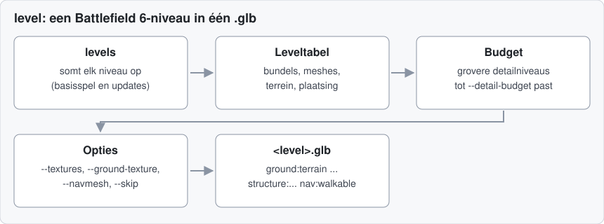

# Battlefield 6-levels: `levels` en `level` {#battlefield-6-levels-levels-and-level}

**Wat is het?** Een compleet Battlefield 6-level als één 3D-bestand. **Waarom?** Zodat de hitte uit je wedstrijden de grond en gebouwen eronder heeft. (*Frostbite* is de engine waarmee Battlefield is gemaakt; een *hoogteveld* is de grond opgeslagen als een rooster van hoogtes.)

Exporteert een compleet Frostbite-level van het geïnstalleerde spel: het hoogteveld van het terrein, elke mesh die de statische modelgroepen plaatsen, de objecten die één voor één geplaatst zijn, het achtergrondstuk van het terrein rond de kaart, en op verzoek de kleurkaarten van de oppervlakken, de terreindecals die in de grond gebakken zijn, en de loopbare oppervlakken van de soldaten.



## Stap voor stap {#step-by-step}

1. **Toon de levels** die het spel meelevert:

   ```
   python -m heat3d_gamefiles levels
   python -m heat3d_gamefiles levels --install "D:\Games\<game folder>"
   ```

   Elke regel is een leveltabel (`levels/<level>/<level>.toc`) met zijn grootte en waar hij vandaan komt: `Data` voor het basisspel, `Update/<pack>` voor een update.

2. **Exporteer er één**, op naam, op een uniek deel ervan, of op zijn `.toc`-pad. Begin zonder kleur om de vorm en de grootte te zien:

   ```
   python -m heat3d_gamefiles level <level> -o level.glb
   ```

3. **Voeg kleur toe** zodra het er goed uitziet:

   ```
   python -m heat3d_gamefiles level <level> -o level.glb --textures 512 --ground-texture 0.5
   ```

4. **Voeg de loopbare oppervlakken toe**, of maak het bestand kleiner:

   ```
   python -m heat3d_gamefiles level <level> --textures 512 --ground-texture 0.5 --navmesh
   python -m heat3d_gamefiles level <level> --textures 256 --detail-budget 3000000 --ground-spacing 8
   ```

5. **Open `level.glb`** in het paneel Achtergrond / level van de 3DHeat-viewer ([een level laden](https://holdi601.github.io/3DHeat/levels.html)).

## Opties {#options}

| Optie | Standaard | Betekenis |
|---|---|---|
| `<level>` | verplicht | een naam zoals `levels` die afdrukt, een uniek deel ervan, of de `.toc` van een level |
| `-o`, `--out FILE` | `<level>.glb` | het bestand dat geschreven wordt |
| `--install FOLDER` | gevonden in de Steam-bibliotheken | de map van het spel |
| `--textures [PIXELS]` | uit; 512 zonder getal | de kleurkaart van elk oppervlak, hoogstens PIXELS aan een zijde |
| `--ground-texture [METRES]` | uit; 0,5 zonder getal | wegen, opstelplaatsen en markeringen in de grondkleur inbakken, METRES per pixel |
| `--navmesh` | uit | voeg het navigatiemesh van de soldaat toe als `nav:walkable` |
| `--ground-spacing METRES` | 4 | de fijnste afstand van het hoogteveld; 0 laat het weg |
| `--detail-budget N` | de grofste kopieën plus een kwart, minstens 1.500.000 | een maximum aantal driehoeken (het terrein wordt nooit grover gemaakt) |
| `--skip TEXT` | | laat modelgroepen weg waarvan de partitienaam TEXT bevat; herhaalbaar |
| `--by-mesh` | uit | één deel per bron-mesh en materiaal, om te zien wat een deel is |
| `--clamped-uvs` | uit | voor renderers die een textuur niet kunnen herhalen |

De volledige tabel, met de groottes die je kunt verwachten (een compleet level is honderden MB), staat op [Commando's](commands.md#levels-and-level-frostbite). Hoe de tabellen, bundels, meshes en het terrein gelezen worden, staat op [Frostbite](reader-frostbite.md).

## Voorbeelduitvoer {#example-output}

Wat `level` afdrukt, in grote lijnen (de regels zoals de code ze schrijft; `<n>` en de namen verschillen per level):

```text
<n> copies of <n> meshes, from <n> static model groups
      <n>  <group>
      <n>  placed one by one (object and prefab references)
<n> meshes left out: <why>
<n> triangles, budget <n>; <n> meshes drawn at a coarser level to fit
           <n>  ground:terrain
           <n>  structure:buildings, <n> textures
           ...
<n> of <n> drawn sections carry their colour map; the rest are flat colours
Ground: <what the ground is>.
Navigation mesh: <tiles read>.
-> level.glb (<n> MB)
```

## De onderdelen {#the-parts}

`ground:terrain` (het hoogteveld), `ground:terrain backdrop` en
`ground:terrain blend`, `structure:<kind>` per soort mesh (per kleurkaart met `--textures`, met ` (destructible)` voor wat in een wedstrijd kan worden vernield), en `nav:walkable` met `--navmesh`. Zie [Uitvoerformaat](output-format.md).

Het bestand bevat de inhoud van het spel: het is bedoeld voor de computer waarop het gemaakt is, niet om rond te sturen ([Regels en licenties](rules-and-licences.md)).
