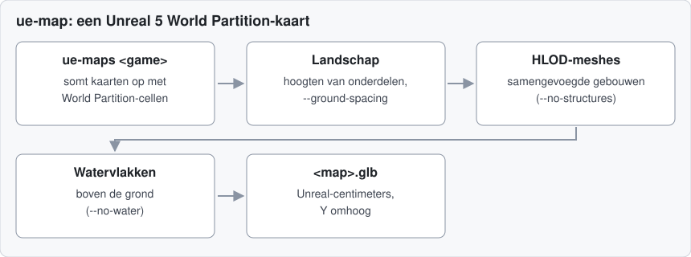

# Unreal 5 World Partition-kaarten: `ue-maps` en `ue-map` {#unreal-5-world-partition-maps-ue-maps-and-ue-map}

**Wat is het?** Een complete kaart van een Unreal 5-spel als één 3D-bestand: de grond, de gebouwen en het water. **Waarom?** Zodat de hitte uit dat spel de kaart eronder heeft. (*World Partition* is hoe Unreal 5 een grote kaart in stukken splitst; *HLOD* is een vereenvoudigde stand-in voor een groep gebouwen, de versie die het spel op afstand tekent.)

Exporteert een complete kaart van een Unreal 5-spel waarvan de kaarten als World Partition-cellen zijn gebakken: het landschap, de samengevoegde HLOD-meshes van de kaart (zijn gebouwen en rekwisieten zoals het spel ze op afstand tekent) en zijn waterlichamen. Er is geen editor en geen project nodig, alleen het geïnstalleerde spel.



## Stap voor stap {#step-by-step}

1. **Toon de kaarten.** `<game>` is de map van het spel, zijn `Content/Paks`, of de naam van zijn map in een Steam-bibliotheek:

   ```
   python -m heat3d_gamefiles ue-maps "<Steam game folder name>"
   python -m heat3d_gamefiles ue-maps "D:\Games\<game>"
   ```

   Elke kaart met gebakken World Partition-cellen wordt afgedrukt met zijn pakketpad.

2. **Exporteer er één** op naam of op een uniek deel ervan:

   ```
   python -m heat3d_gamefiles ue-map "<game>" <map> -o map.glb
   ```

3. **Alleen de grond, of grover:**

   ```
   python -m heat3d_gamefiles ue-map "<game>" <map> --no-structures --no-water
   python -m heat3d_gamefiles ue-map "<game>" <map> --ground-spacing 4
   ```

4. **Open `map.glb`** in het paneel Achtergrond / level van de 3DHeat-viewer ([een level laden](https://holdi601.github.io/3DHeat/levels.html)).

## Opties {#options}

| Optie | Standaard | Betekenis |
|---|---|---|
| `<game>` | verplicht | de map van het spel, zijn `Content/Paks`, of zijn Steam-mapnaam |
| `<map>` | verplicht | een naam zoals `ue-maps` die afdrukt, of een uniek deel ervan |
| `-o`, `--out FILE` | `<map>.glb` | het bestand dat geschreven wordt |
| `--ground-spacing METRES` | 2 | de afstand tussen de vertices van het landschap, afgerond op een heel aantal van zijn eigen vierkanten |
| `--no-structures` | | laat de HLOD-gebouwen en rekwisieten weg |
| `--no-water` | | laat de waterlichamen weg |

Inhoud die met Oodle is gecomprimeerd, heeft een Oodle-bibliotheek nodig die al op de pc staat (zie [Oodle](reader-oodle.md)).

## Voorbeelduitvoer {#example-output}

```text
<map> -> map.glb
  ground      <n> triangles from <n> landscape components; <n> of <n> vertices stored twice disagree
  structure   <n> triangles in <n> HLOD meshes
  water       <n> triangles from <n> water bodies
```

Het aantal afwijkingen is een zelfcontrole: aangrenzende landschapscomponenten slaan hun gedeelde rand twee keer op, en die twee moeten gelijk zijn. Een kaart van 3 km op 2 m is ongeveer 4,6 miljoen gronddriehoeken.

## De onderdelen {#the-parts}

`ground:<map>` (het landschap), `structure:<map>` (de HLOD-meshes) en
`water:<map>` (water dat boven de grond staat).

**Eenheden:** dit is de enige export **niet in meters**: Unreal-centimeters, met Y en Z omgewisseld (Y omhoog), het stelsel dat de 3DHeat Unreal Exporter schrijft. Telemetrie uit hetzelfde spel gebruikt hetzelfde stelsel, dus die ligt op de kaart.

## Hoe het gelezen en gecontroleerd wordt {#how-it-is-read-and-checked}

| Onderdeel | Gelezen uit | Gecontroleerd tegen |
|---|---|---|
| grond | de 16-bits hoogtekaart van elke landschapscomponent, geplaatst op zijn sectiebasis op de transformatie van het landschap | elke vertex die twee keer is opgeslagen (op een naad of een componentrand) moet kloppen; afwijkingen worden geteld en afgedrukt, niet gladgestreken |
| structuur | de samengevoegde HLOD-meshes van de kaart, door de engine in wereldruimte gebouwd | een mesh wordt alleen behouden als de begrenzing die zijn component cachet zijn eigen vertices beschrijft |
| water | de mesh van elk waterlichaam, op het grondrooster gelegd, behouden waar het boven de grond staat | water ligt enkele meters boven de grond eronder, zoals een rivier boven zijn bedding |

De eigenschappen van het landschap worden gevonden op vorm, niet op slotnummer (slots verschuiven tussen engineversies). De structuren zijn de vereenvoudigde stand-ins, niet de modellen op volledig detail. Gebladerte, decals en landschapsmaterialen worden niet geëxporteerd; de grond heeft geen textuur en wordt door de viewer beschaduwd. Details van de archieven: [Unreal 5 IoStore](reader-unreal-iostore.md).

**Voorwaarden:** de licenties van spellen staan meestal persoonlijk, niet-commercieel gebruik toe en verbieden reverse engineering "to the extent that such actions cannot be prohibited by law". Het lezen van je eigen installatie is jouw keuze onder die licenties; de uitvoer is voor eigen gebruik en wordt niet gedeeld.
