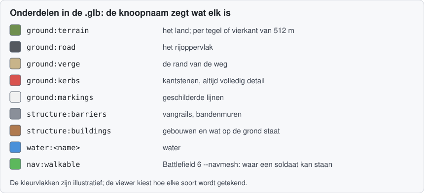

# Uitvoerformaat {#output-format}

Een `.glb` is één 3D-bestand: de grond, de gebouwen en het water van een baan of level, dat je opent
in het paneel Achtergrond / level van de 3DHeat-viewer.

Elke export (`course`, `courses`, `terrain`, `level`, `ue-map`, `enfusion-world`) schrijft één **binaire
glTF 2.0**-bestand (`.glb`). Het is bewust klein en vlak, en ingedeeld zoals de 3DHeat-viewer een level
leest. Bron: [`glb.py`](https://github.com/Holdi601/3DHeat-GameFiles/blob/main/heat3d_gamefiles/glb.py).

## Structuur {#structure}

```
scene 0
 ├─ node "ground:terrain x-2046 z1023"  -> mesh 0 -> 1 primitive, material 0
 ├─ node "ground:road x-2046 z1023"     -> mesh 1 -> 1 primitive, material 1
 ├─ node "ground:markings"               -> mesh 2 -> ...
 ├─ node "ground:kerbs road_gen_rum_..." -> ...
 ├─ node "structure:barriers bar_armco_bclr"
 └─ ...
```

- **Eén node per deel**, allemaal aan de wortel van de scène, **zonder transformaties**. Alle geometrie
  staat al in wereldruimte.
- Elke node heeft zijn eigen mesh met **één primitive** en zijn eigen materiaal. De node, de mesh en het
  materiaal dragen alle de naam van het deel.
- Elke primitive heeft **zijn eigen compacte vertexarrays**, alleen de vertices die dat deel gebruikt. Een
  gedeelde vertexarray is geldige glTF, maar een lezer die de accessors van elke primitive uitschrijft, zou
  dan elke vertex één keer per deel vasthouden.
- `asset.generator` is `heat3d_gamefiles`.
- **Weinig `extras`**, en geen naam van ronde, spel of baan:
  - een Battlefield 6-deel van een vernietigbare mesh draagt `{"destructible": true}` op zijn node;
  - een Forza-baan zegt wat hij bevat in `asset.extras` (formaatversie, gekoppeld route-id, hoeveel kopieën
    van de eigen laag van de race, locaties; zie
    [Forza Horizon-banen](course-forza-horizon.md#writing-the-file)), en zijn ingeschakelde delen dragen hun
    laag op de node: `{"layer": "event", "route": <id>}` voor de eigen laag van de race,
    `{"layer": "layer"}` voor een andere ingeschakelde laag, `{"layer": "venue"}` voor de grond van een locatie.

  Al het andere wat de viewer nodig heeft, staat in de node-namen.

## Node-namen: de indeling {#node-names-the-classification}



De viewer haalt de klasse van een deel uit de **node**-naam (en valt terug op de meshnaam), en alleen als
die overeenkomt met

```
^(ground|structure|water)\s*[:|]
```

Al het andere wordt ingedeeld door een heuristiek die voor Unreal-landschappen is geschreven. Elk deel dat
de exporter schrijft, begint dus met een van deze voorvoegsels, of met `nav:` (hieronder).

| Voorvoegsel | Betekenis | Geschreven delen |
|---|---|---|
| `ground:` | het rijoppervlak en het land | `ground:road`, `ground:verge`, `ground:terrain`, `ground:gravel and dirt`, `ground:kerbs`, `ground:markings`, `ground:tyre marks`, `ground:venue`, `ground:plinths` |
| `structure:` | wat erop staat | `structure:barriers`, `structure:props`, `structure:signs`, `structure:buildings`, `structure:infrastructure`, `structure:bridges`, `structure:rocks`, `structure:smashables`, `structure:trees`; Forza-lagen `structure:event_<category>` en `structure:layer_<category>` |
| `water:` | water | `water:water`; `water:<map>` (`ue-map`), `water:<world>` (`enfusion-world`) |
| `nav:` | waar een soldaat kan lopen (Battlefield 6, alleen met `--navmesh`) | `nav:walkable` |

`nav:` komt niet overeen met het patroon van de viewer hierboven, dus de viewer sorteert het met zijn
heuristiek; het is een apart deel zodat je het op zichzelf kunt tonen of verbergen. `ue-map` schrijft
`ground:<map>`, `structure:<map>` en `water:<map>`; `enfusion-world` schrijft `ground:<world>`,
`structure:<world>` en `water:<world>`.

Na de soort komt, afhankelijk van het spel:

| Voorbeeld | Betekenis |
|---|---|
| `ground:road x-2046 z1023` | Forza-grond in de terreintegel `x-2046 z1023` (rasterwaarden, 1023 per 512 m) |
| `ground:road 3_-2` | BeamNG-grond in vierkant van 512 m (3, -2) |
| `ground:road 3_-2 asphalt_light` | BeamNG-gemodelleerd rijoppervlak van materiaal `asphalt_light` in dat vierkant |
| `ground:road 1_-4` | AC Rally-grond in vierkant van 512 m (1, -4) van Unreal-ruimte |
| `structure:barriers bar_armco_bclr` | Forza-geplaatste modellen die één textuur delen (zijn naam zonder de GUID) |
| `structure:barriers` | geplaatste modellen zonder textuur (Forza, AC Rally) |
| `structure:event_barriers bar_example_bclr` | Forza: wat de gekoppelde race voor zichzelf neerzet, los van de wereld van de vrije rijmodus (node-extras `{"layer": "event", "route": <id>}`) |
| `structure:layer_props` | Forza: een laag die het spel aanzet voor iets anders dan deze race (een activiteit, een verzamelobject, een runtime-laag) |
| `ground:venue`, `ground:plinths` | Forza: modellen die al in wereldcoördinaten staan - de eigen grond van een locatie (de vloer van een stadion), en grond waarmee een straat wordt aangekleed |
| `structure:barriers armco_metal` | BeamNG-geplaatste modellen van één materiaal |
| `ground:markings`, `water:water` | vlakke delen, één voor het hele bestand |
| `ground:terrain` (Battlefield 6) | het hoogteveld; `ground:terrain backdrop` de verre terreinmeshes, `ground:terrain blend` meshes die in het terrein overlopen |
| `nav:walkable` (Battlefield 6, `--navmesh`) | het navigatiemesh van het level voor een soldaat: waar men kan staan, vlak groen |
| `ground:terrain x-512 z-512` (Battlefield 6, `--ground-texture`) | het hoogteveld onder één ingebakken decaltegel, genoemd naar de lage hoek van de tegel in meters |
| `structure:buildings t_concreteclean_01_cs` (Battlefield 6, `--textures`) | elk oppervlak van die soort dat die kleurkaart toont; zonder `--textures` één deel per soort, zonder achtervoegsel |
| `structure:buildings t_concreteclean_01_cs (destructible)` (Battlefield 6) | hetzelfde, voor meshes die een match kan vernietigen: die met een vernietigingsasset van hun eigen naam (muren, huizen, rekwisieten). De node draagt ook de glTF-extras `{"destructible": true}`. Hun vernietigde toestanden worden niet geëxporteerd |

De viewer kan op deze namen filteren. "Alleen het racevlak" is bijvoorbeeld `ground:road` samen met
`ground:kerbs`, in alle drie de spellen; "de wereld zonder de eigen rekwisieten van de race" is alles behalve
`structure:event_*`. Het voorvoegsel bepaalt ook hoe de viewer een deel tekent: grond als het oppervlak waarop
de hitte ligt, structuur als wat erop staat.

## Eenheden, assen en kader {#units-axes-and-frame}

- **Meters, Y omhoog**, de conventie van glTF, voor elke export behalve `ue-map`. Niets wordt herschaald of
  opnieuw gecentreerd: de getallen zijn de wereldcoördinaten van het spel, en dat is het punt van het lezen van
  het archief in plaats van reconstrueren.
- **Unreal 5-kaarten (`ue-map`): centimeters**, de eigen eenheid van Unreal, met Y en Z omgewisseld zodat Y
  omhoog is - het kader dat de 3DHeat Unreal Exporter schrijft en dat de telemetrie van het spel gebruikt. De
  enige export die niet in meters is.
- **Arma Reforger (`enfusion-world`):** de eigen meters van het spel, x oost, y omhoog, z noord. Het kader van
  het spel is linkshandig; de viewer-instelling *invert world axis* toont het zonder spiegeling.
- **Forza:** de eigen wereldcoördinaten van het spel (x, y omhoog, z), ongewijzigd. Hetzelfde als de telemetrie,
  zodat een opgenomen ronde op de baan ligt.
- **BeamNG.drive:** `(x, z, -y)` van de Z-omhoog-wereld van BeamNG, de rotatie die de telemetrie-opnemer
  toepast. Een rotatie, geen spiegeling.
- **Battlefield 6:** de eigen wereldcoördinaten van het spel (x, y omhoog, z), ongewijzigd: de
  instantietransformaties van het level worden op elk mesh toegepast zoals opgeslagen. Gespiegelde kopieën
  worden opnieuw gewonden zodat hun normalen naar buiten wijzen.
- **Assetto Corsa Rally:** het kader van de ronde. Unreal-centimeters worden meters, Unreal Z wordt y, en Unreal
  X en Y worden x en z in een van de acht oriëntaties waarin de ronde paste (zie
  [Assetto Corsa Rally](course-assetto-corsa-rally.md#which-stage-and-which-way-round)). Driehoeken worden
  opnieuw gewonden waar die afbeelding spiegelt.

Elke export houdt de assen aan die zijn telemetrie gebruikt, zodat de opname en het level één kader delen. Of
dat kader in elk spel links- of rechtshandig is, is niet gecontroleerd.

## Vertexdata {#vertex-data}

De standaard is de **gekwantiseerde** vorm (`quantize=True`). Die heeft de extensie `KHR_mesh_quantization`
nodig, die in zowel `extensionsUsed` als `extensionsRequired` staat.

| Attribuut | Gekwantiseerd (standaard) | Volle precisie (`quantize=False`) |
|---|---|---|
| `POSITION` | float32 VEC3, met min/max | float32 VEC3 |
| `NORMAL` | int8 VEC3 genormaliseerd, opgevuld tot 4 bytes (stap 4) | float32 VEC3 |
| `TEXCOORD_0` (alleen getextureerde delen) | uint16 VEC2 genormaliseerd, afgeknepen tot 0-1; float32 VEC2 waar texturen zich herhalen (Battlefield 6) | float32 VEC2 |
| `COLOR_0` (ongetextureerde delen, als enig deel een kleur heeft) | uint8 VEC3 genormaliseerd, opgevuld tot 4 bytes | float32 VEC3 |
| indices | uint16 als het deel hoogstens 65.535 vertices heeft, anders uint32 | uint32 |

Een vertex is 20 bytes in plaats van 32 (24 in plaats van 44 met kleur). Dat scheelt een derde van elk
bestand, en het is het verschil tussen een stadsbaan die in een browsertabblad laadt en een die dat niet doet.
De kosten zijn minder dan een halve graad normaal en 1/65.535 van een UV (een vijftiende van een texel op 4.096
px). De opdrachtregel schrijft altijd de gekwantiseerde vorm. `write_glb(..., quantize=False)` in Python
schrijft de andere.

Normalen komen uit het spel waar het ze opslaat (Forza-terrein en -modellen, BeamNG-vormen en -terrein).
Anders worden ze berekend als oppervlaktegewogen gladde normalen uit de driehoeken. AC Rally-normalen worden
altijd berekend.

## Materialen, kleuren en texturen {#materials-colours-and-textures}

- Elk materiaal is `metallicFactor 0`, `roughnessFactor 1`.
- **Getextureerd deel:** `baseColorTexture` met de afbeelding, UV's van het deel, en geen vertexkleur. glTF
  vermenigvuldigt de twee, dus een oppervlak zou twee keer donker uitkomen.
- **Ongetextureerd deel:** vertexkleur `COLOR_0` met de vlakke kleur van het deel, en een witte `baseColorFactor`.
  Heeft geen enkel deel in het bestand een kleur, dan is er geen `COLOR_0`. Waar delen vertices delen, wint de
  kleur van het latere deel, dus vlakke delen worden in volgorde van oplopend belang geschreven.
- **Afbeeldingen** worden als **JPEG** in het binaire blok ingesloten, kwaliteit 90, zonder chroma-subsampling,
  alleen RGB (alfa wordt weggelaten) - behalve een Battlefield 6-uitknipkaart (bladeren, hekken), die **PNG**
  is met zijn alfa, op een materiaal met `alphaMode` MASK, `alphaCutoff` 0,5 en `doubleSided` (zie
  [Frostbite](reader-frostbite.md#textures-and-materials)). De 3DHeat-viewer gooit texels onder de cutoff weg. Een
  grond van 2048 px met gras en boomkruinen is voor een verliesloze codec ruis: enkele megabytes per tegel als
  PNG, onder één als JPEG. Een afbeelding die door meerdere delen wordt gedeeld, wordt één keer opgeslagen.
- Eén sampler voor alle texturen: lineaire vergroting, lineair-mipmap-lineaire verkleining, **clamp to edge** op
  beide assen, voor de baanexports, waarvan de texturen hun oppervlak één keer bedekken. BeamNG tekent
  herhalende modeltexturen als vlakke kleuren (zie [BeamNG.drive](course-beamng.md#placed-models)).
- Een Battlefield 6-export met `--textures`, waarvan de materialen tegelen, schrijft de eigen texturecoördinaten
  van het spel, niet afgeknepen, als float32 `TEXCOORD_0` zelfs in de gekwantiseerde vorm, met een sampler die op
  beide assen **herhaalt** (`write_glb(..., repeat=True)`): een bakstenen muur is één paar driehoeken waarvan de
  UV loopt van 0 tot 40. De 3DHeat-viewer wikkelt zo'n textuur binnen zijn atlas (zie de pagina *Model levels*).
  Voor een renderer die een textuur niet kan herhalen, knipt `level --clamped-uvs` (`write_level(..., clamped=True)`)
  elke driehoek langs de lijnen waar zijn textuur zich herhaalt, en verplaatst elk stuk naar 0..1: dezelfde pixels
  op hetzelfde oppervlak, ongeveer een vijfde meer driehoeken. Driehoeken waarover een textuur zich meer dan 16 keer
  herhaalt, behouden hun coördinaten. Een driehoek die zijn textuur in meer dan 4 stukken zou knippen - schors die
  zich over elke tak van een boom herhaalt, wat één boom van 1.099 driehoeken in 51.735 veranderde - gaat in een
  eigen deel, `<part> (average colour)`, in de gemiddelde kleur van de textuur; `level` zegt hoeveel.

| Textuur | Grootte | Dekt |
|---|---|---|
| grond (alle spellen behalve Battlefield 6) | `--texture-size`: 2048, 1024 of 512 px | één vierkant van 512 m: 25, 50 of 100 cm per pixel |
| Battlefield 6-hoogteveld | de grootste mip van de achtergrondkleurkaart in het level, bijgesneden | het terreinvierkant: 32 m per pixel in het gecontroleerde level |
| Battlefield 6-oppervlakken | `--textures`: hoogstens dat aantal px per zijde | de eigen textuur van het oppervlak, één keer per stuk (geknipt waar die zich herhaalt) |
| Battlefield 6 ingebakken grond | `--ground-texture`: meter per pixel, tegels van hoogstens 4.096 px | één tegel van de omvang van de decals: 2.048 m bij 0,5 m per pixel |
| Forza-geplaatst model | hoogstens 256 px | de eigen UV-indeling van het model |
| BeamNG-geplaatst model | hoogstens 256 px | de eigen UV-indeling van het model, alleen waar die zich niet herhaalt |
| AC Rally-geplaatst model | geen | vlakke kleuren |

## Wat de schrijver weigert {#what-the-writer-refuses}

`write_glb` geeft een fout in plaats van een bestand te schrijven dat een viewer zou openen en verkeerd zou
tonen:

| Geweigerd | Omdat |
|---|---|
| posities die niet N x 3 zijn, of niet eindig | een kapot mesh |
| een index voorbij het einde van de vertexlijst | wordt als ruis getekend |
| een getextureerd deel wanneer het bestand geen UV's heeft | wordt als één uitgesmeerde pixel getekend |
| helemaal geen driehoeken | wordt als niets getekend |
| een normaal-, kleur- of UV-array met een verkeerde lengte, of niet eindig | er is er één per vertex nodig |

## Elders lezen {#reading-it-elsewhere}

Elke glTF 2.0-viewer die `KHR_mesh_quantization` ondersteunt, zou deze bestanden moeten openen. Alleen de
3DHeat-viewer is gecontroleerd; andere viewers zijn niet geverifieerd. Een lezer zonder de extensie weigert het
bestand, omdat die als verplicht is aangegeven. De bestanden kunnen groot zijn: ongeveer 80 MB voor een
nationaal circuit, tot enkele honderden MB voor een stadsbaan met het automatische budget.

## In 3DHeat {#in-3dheat}

Laad de `.glb` in het paneel Achtergrond / level van de [3DHeat](https://github.com/Holdi601/3DHeat)-viewer; de
telemetrie die je in hetzelfde spel opneemt, ligt erop, omdat beide de coördinaten van het spel behouden. De
eigen documentatie van de viewer ([holdi601.github.io/3DHeat](https://holdi601.github.io/3DHeat/)) beschrijft het
paneel Achtergrond / level en de wedstrijdbestanden die de andere tools schrijven
([Eén bestand per match: `.3dheat`](https://holdi601.github.io/3DHeat/container.html)). Een level wordt niet in
elk `.3dheat`-bestand opgeslagen: een match noemt het in zijn `references` (`kind: "level"`, naam en sha256) en de
`.glb` blijft naast de matches staan.
