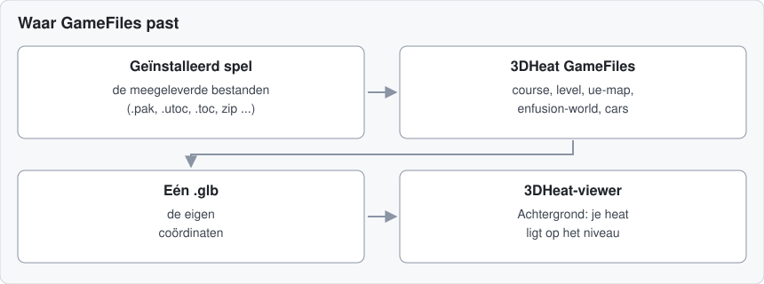

# Hele levels {#whole-levels}

**In gewone woorden:** voor shooters en andere spellen zonder ronden slaat het hulpmiddel de hele kaart op als één 3D-bestand, zodat de viewer kan tekenen waar spelers op geweest zijn.

`course` snijdt het terrein rond een ronde uit. Voor spellen zonder ronden exporteert het hulpmiddel in één keer een heel level, een kaart of een wereld:

| Spel of engine | Lijst | Export | Pagina |
|---|---|---|---|
| Battlefield 6 (Frostbite) | `levels` | `level <level>` | [Battlefield 6-levels](level-battlefield.md) |
| Unreal 5-spellen met World Partition | `ue-maps <game>` | `ue-map <game> <map>` | [Unreal 5-kaarten](level-unreal-world-partition.md) |
| Arma Reforger (Enfusion) | `enfusion-worlds` | `enfusion-world <world>` | [Arma Reforger-werelden](level-arma-reforger.md) |

Elk paar werkt op dezelfde manier. Het eerste commando toont wat het geïnstalleerde spel bevat. Het tweede schrijft er één ervan als één `.glb` in de eigen wereldcoördinaten van het spel, zodat posities die in dat spel zijn opgenomen erop liggen. De delen heten `ground:`, `structure:` en `water:`, net als bij elke andere export (zie [Uitvoerformaat](output-format.md)). Laad het bestand in het paneel **Achtergrond / level** van de 3DHeat-viewer.

