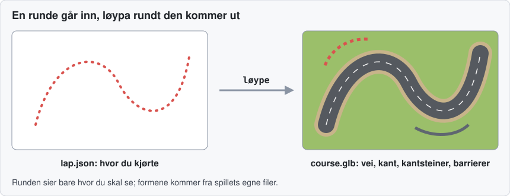
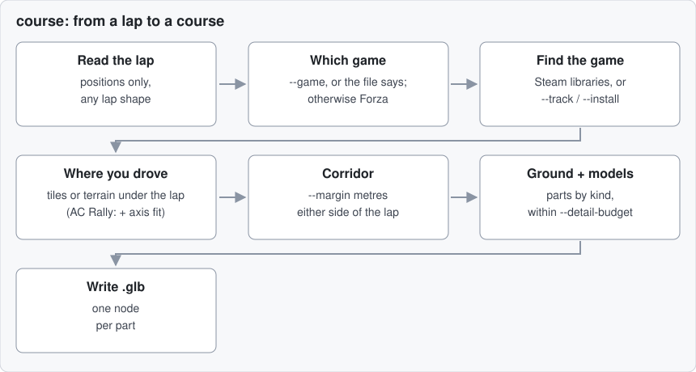

# Løypeeksport

**Med egne ord:** du kjørte en runde; dette bygger banen du kjørte på, som en 3D-fil. Runden
er bare en linje med punkter; veien, gresset og kantsteinene kommer fra spillets egne filer.

`course` gjør en runde om til en løype: bakken i et bånd på hver side av der bilen kjørte,
og det som står på bakken, som én `.glb` for visningen. Denne siden dekker det alle tre
støttede spillene har felles. Sidene under den dekker det som skiller dem:

- [Forza Horizon](course-forza-horizon.md): ForzaTech `.minizip`-arkiver
- [BeamNG.drive](course-beamng.md): zip-arkiver, et terrenghøydefelt, kompilerte former
- [Assetto Corsa Rally](course-assetto-corsa-rally.md): Unreal 5 IoStore, en World Partition-etappe
- [Detaljnivåer og budsjett](detail-budget.md): hvor mange trekanter de plasserte modellene får, og hvilke kopier som blir

## Stegene

Ord som brukes under: en **ramme** er hvilken vei aksene peker; **korridoren** er båndet av
bakke på hver side av runden; en **flis** er ett kvadratisk stykke av et spills terreng; et
**LOD** (detaljnivå) er en enklere kopi av en modell.

1. **Les runden.** Bare posisjoner, fra en av formene i [Rundeinndata](lap-inputs.md).
   Fart og inndata brukes ikke. En runde med færre enn to prøver avvises («holds no driving»).
2. **Avgjør spillet.** `--game`, deretter rundefilens eget `game`, deretter Forza (se
   [Kommandoer](commands.md#which-game)).
3. **Finn det installerte spillet.** Alle tre søker i hvert Steam-bibliotek som står i Steams
   `config\libraryfolders.vdf`. Forza søker også i `C:\XboxGames`. `--track` (Forza) eller
   `--install` (BeamNG, AC Rally) hopper over søket.
4. **Finn hvor runden ble kjørt.** Dette avgjøres aldri av navnelikhet alene. Forza velger
   banen hvis terrenghelliser dekker runden. BeamNG velger nivået som terrenget (eller
   veiene) der rundeprøvene ligger på. AC Rally prøver hver etappe i åtte aksevinklinger og
   velger den som legger mest av runden på vei.
5. **Skjær ut en korridor** `--margin` meter på hver side av kjøringen (nedenfor).
6. **Bygg bakken** inne i korridoren, klassifisert som vei, skulder, grus og jord, terreng,
   merking, dekkspor eller vann, og bak en bakketekstur for hvert 512 m kvadrat.
7. **Plasser modellene** som står i korridoren, etter kategori, på et detaljnivå valgt etter
   avstand og et trekantbudsjett.
8. **Skriv `.glb`-filen**: én navngitt node per del. Se [Utdataformat](output-format.md).

Hva en kjøring skriver ut, her på en syntetisk BeamNG.drive-installasjon som testene lager,
en 50 m runde nedover en veistripe:

## Korridoren

Utskjæringen er et bånd rundt den kjørte linjen, ikke rundens bounding box. For en rundbane er
de to nesten like. For en punkt-til-punkt-sprint er boksen mest bakke som ingen kjører forbi,
og båndet kan være en tiendedel av arealet. Kilde:
[`corridor.py`](https://github.com/Holdi601/3DHeat-GameFiles/blob/main/heat3d_gamefiles/corridor.py).

Slik bygges den:

- Kjøringen projiseres ned på bakkeplanet: rundens x og z (BeamNG: spillets egne x og y).
- Den rastreres på et rutenett med **4 m** celler (`CELL`). Hver celle kjøringen berører,
  utvides med en skive med radius `margin + 4 m` i alle retninger.
- Påfølgende prøver som ligger mindre enn **50 m** fra hverandre (`JOIN`), knyttes sammen med
  punkter hver 4. m, så båndet ikke får hull. Prøver som ligger lenger fra hverandre, regnes
  som separate strekk med kjøring og knyttes ikke sammen. En bibliotekløype er mange rundefiler
  etter hverandre, og målgangen i én sprint og startet på den neste må ikke tegne et bånd over
  kartet.
- En trekant beholdes hvis et hjørne, midten av en kant eller tyngdepunktet ligger i båndet.
  Midtpunktene fanger en stor trekant som ligger tvers over et smalt bånd med alle hjørnene
  utenfor.
- Høyde er aldri en del av utskjæringen. En boks som avgrenset høyden, ville klippe bakken bort
  under en bakke veien klatrer opp.

Konsollen rapporterer områdets størrelse, for eksempel
`cutting 80 m either side of the driving: 1.53 km2 of a 6,000 by 3,600 m box`.

BeamNG og AC Rally bygger også et bredere **rekkevidde**-bånd på `margin + 60 m`. En plassert
modell tas med hvis origo ligger i rekkeviddebåndet, og tegnes bare hvis fotavtrykket rører det
egentlige båndet. Slik går ikke en lang gjenstand tapt når origo ligger like utenfor. BeamNG
bruker også rekkeviddebåndet til å velge hvilke veidekaler som males.

## Hva bakken består av

Hver eksport klassifiserer bakketrekantene i de samme slagene, og hvert slag skrives som sin
egen del, slik at visningen kan vise eller skjule den:

| Slag | Delnavn | Flat farge (lineær RGB) | Forza | BeamNG | AC Rally |
|---|---|---|---|---|---|
| vei | `ground:road` | 0,22, 0,22, 0,23 | veistriper: asfaltdelen | `ASPHALT`-typelag, veidekaler, modellert vei | banefliser (`/MeshesTrack/`) |
| skulder | `ground:verge` | 0,52, 0,47, 0,30 | veistriper: skulderen | fortau og skuldermodeller | - |
| grus og jord | `ground:gravel and dirt` | 0,50, 0,42, 0,30 | - | jord-, grus-, sand- og gjørmelag og dekaler | - |
| terreng | `ground:terrain` | 0,30, 0,44, 0,18 | alt annet | alt annet | `_Terrain`-fliser og fjernt terreng |
| kantstein | `ground:kerbs` | 0,60, 0,12, 0,10 (Forza) | `road_gen_rum*`-rekvisitter | kantstein-, kurv- og rumble-modeller | kantstein- og kurvmodeller |
| merking | `ground:markings` | 0,90, 0,90, 0,88 | dekal-undermasker, løftet 5 cm | malt inn i teksturen | - |
| dekkspor | `ground:tyre marks` | 0,20, 0,17, 0,16 | dekal-undermasker, løftet 5 cm | malt inn i teksturen | - |
| vann | `water:water` | 0,16, 0,34, 0,48 | vannmaterialer | havplan, vannblokker, elver | - |

De flate fargene er valgt for å kunne leses med et blikk, ikke for å ligne spillet. De brukes
for deler uten tekstur og av visninger som ignorerer teksturer. Kilde:
[`surfaces.py`](https://github.com/Holdi601/3DHeat-GameFiles/blob/main/heat3d_gamefiles/surfaces.py).

Bakkedelene deles per 512 m kvadrat, og hvert kvadrat har sitt eget innbakte bilde, så delnavnene
bærer kvadratet:

| Spill | Bakkedelens navn | Kvadratnøkkel |
|---|---|---|
| Forza | `ground:road x-2046 z1023` | flisens rutenettnavn (steg på 1023, se [Forza Horizon](course-forza-horizon.md)) |
| BeamNG | `ground:road 3_-2` | `floor(x / 512)`, `floor(y / 512)` i BeamNG-meter |
| AC Rally | `ground:road 1_-4` | `floor(x / 51200)`, `floor(y / 51200)` i Unreal-centimeter |

## Det som står på bakken

Plasserte modeller skrives i deler som heter `structure:<category>`, eller `ground:kerbs` for
kantstein (i alle tre spillene). Når en del har sin egen tekstur, følger tekstur- eller
materialnavnet kategorien, for eksempel `structure:barriers bar_armco_bclr`.

| Kategori | Forza | BeamNG | AC Rally |
|---|---|---|---|
| barrierer | ja | ja | ja |
| rekvisitter | ja | ja | ja |
| skilt | ja | ja | ja |
| bygninger | ja (hele bygninger som stand-ins der spillet har dem) | ja | ja |
| infrastruktur | ja | ja | ja |
| broer | ja | ja | (regnes som infrastruktur) |
| steiner | ja | ja | ja |
| kantstein | ja, som bakke | ja, som bakke | ja, som bakke |
| trær | med `--trees` | med `--trees` | med `--trees` |
| knuste ting | med `--trees` | - | - |

Hvordan detaljen fordeles, er likt i alle tre. Kopier innen 25 m fra kjøringen starter med full
detalj, kopier 25-60 m unna ett nivå grovere, og kopier lenger ut på det groveste nivået.
Deretter trapper de dyreste modellene ned til et trekantbudsjett passer, og der selv de groveste
nivåene ikke får plass i et budsjett du gir, utelates kopier. Kantstein forenkles aldri og utelates
aldri. Se [Detaljnivåer og budsjett](detail-budget.md).

## Valg som former resultatet

| Ønsker | Bruk |
|---|---|
| en mindre fil | `--no-textures` (flate farger), `--texture-size 1024` eller `512`, `--detail-budget N`, `--margin 40` |
| bare bakken | `--no-placed` |
| scenografien også | `--trees` |
| en annen årstid (Forza) | `--season winter` |
| et spill utenfor Steam | `--track` (Forza) eller `--install` (BeamNG, AC Rally) |
| en runde søket ikke finner | `--level` (BeamNG, AC Rally), `--track` (Forza) |

## Koordinater

Hver eksport skriver meter med Y opp, i en ramme som en innspilt runde fra samme spill passer til:

| Spill | Skrevet ramme |
|---|---|
| Forza | spillets egne verdenskoordinater, uendret |
| BeamNG | `(x, z, -y)` av BeamNGs Z-opp-verden, som er rotasjonen telemetriopptakeren bruker |
| AC Rally | rundens ramme, funnet ved tilpasning: Unreal-centimeter blir meter, og Unreal X og Y blir rundens x og z i den av åtte retninger som passer |

Se [Utdataformat](output-format.md).
