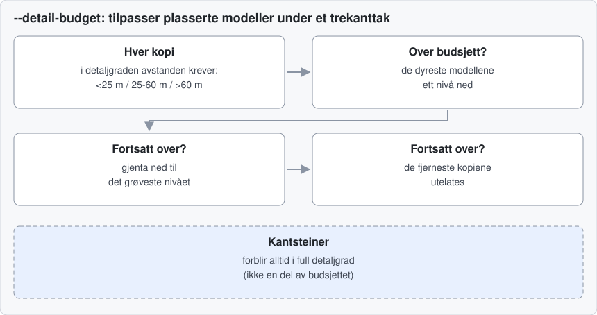

# Detaljnivåer og budsjettet {#levels-of-detail-and-the-budget}

En **trekant** er en liten flat bit av en 3D-modell. Flere trekanter gir en
større og tregere fil. **Budsjettet** er en grense for hvor mange. Et **detaljnivå**
er en enklere kopi av en modell, brukt når den er langt unna.

Det finste nivået av alt som er plassert rundt en bane, er flere millioner
trekanter. For eksempel hundrevis av veirekkverkssegmenter og dekkstabler på rundt
tusen trekanter hver. En bykorridor har over hundre tusen kopier. Så hver
baneeksport gir de plasserte modellene et **budsjett for trekanter** og bestemmer,
per modell, hvilket detaljnivå den tegnes i, og om det trengs, hvilke kopier som
skal utelates.

Ordningen ble skrevet for Forza
([`forzaplacement.py`](https://github.com/Holdi601/3DHeat-GameFiles/blob/main/heat3d_gamefiles/forzaplacement.py):
`choose_levels`, `auto_budget`, `_fit`), og BeamNG og AC Rally gjenbruker deler av
den. Terrenget teller ikke mot budsjettet.

## Avstandsbånd {#distance-bands}

Avstanden fra hver kopi til kjøringen måles i bakkeplanet, til nærmeste
rundepunkt. Runden tynnes først ut til høyst 1 000 punkter, noe som koster
noen meter nøyaktighet og ingenting som betyr noe her. Kopiene havner så i tre
bånd, og hvert par (modell, bånd) budsjetteres for seg:

| Bånd | Avstand | Starter på |
|---|---|---|
| nær | under 25 m (`NEAR`) | det fineste nivået |
| middels | 25-60 m (`FAR`) | ett nivå grovere |
| langt | 60 m og mer | det grovest nivået |

Uten en rute (Forza `terrain --box`) måles avstanden til midten av boksen.

## Trinn ned for å passe {#stepping-down-to-fit}



Kostnaden for en (modell, bånd)-oppføring er kopier x trekanter på dens nåværende
nivå. Så lenge totalen er over budsjettet, trinnes oppføringen som koster mest ned
ett nivå, og det gjentas til totalen passer eller ingenting kan gå lenger ned.
Låste oppføringer trinnes aldri:

| Spill | Låst på full detalj |
|---|---|
| Forza | kantstein (`road_gen_rum*`) |
| BeamNG | kantstein, og hver form som bærer kjøreflaten |
| AC Rally | kantstein |

Forza-oppsummeringen rapporterer dette som
`N of M models drawn at a coarser level to fit the budget`.

## Det automatiske budsjettet {#the-automatic-budget}

Uten `--detail-budget` tilpasser budsjettet seg selv slik at **ingen kopi
utelates**:

```
budget = max(1,500,000, 1.25 x sum(copies x coarsest level))
```

Låste oppføringer teller på sitt fineste nivå. De 25 % (`HEADROOM`) lar ting ved
veien beholde litt detalj. På en landeveisbane er dette gulvet på 1,5 millioner
(`DEFAULT_BUDGET`). På en bybane, der korridoren har over hundre tusen kopier,
vokser det til over ti millioner, og filen til flere hundre MB. Visningen laster
den.

## Et budsjett du gir {#a-budget-you-give}

`--detail-budget N` er et **tak**. Nivåene trinnes ned som over. Hvis selv de
groveste nivåene ikke passer, utelates kopier:

| Spill | Rekkefølge kopier utelates i |
|---|---|
| Forza | først alt 25 m eller mer fra kjøringen, deretter det som står ved veien; innen hver gruppe, det som ser minst ut fra veien først: størst avstand / størrelse (størrelse = modellens diagonal i omsluttende boks ganger største skala, minst 0,25 m) |
| BeamNG | lengst fra kjøringen først |
| AC Rally | lengst fra kjøringen først, som BeamNG |
| Battlefield 6 | minst først: diagonal i omsluttende boks ganger skala |

Kantstein (og, for BeamNG, modeller av kjøreflaten) utelates aldri, så et
budsjett som er mindre enn det de koster alene, overskrides av dem og av ingenting
annet.

Verktøyet bruker avstand delt på størrelse for Forza fordi en enhet for
klimaanlegg på en vegg ni meter unna ellers ville overleve en tjue meter lang fasade
den henger på, tolv meter unna, hvis rekkefølgen bare var etter avstand. Ting ved
veien går sist uansett størrelse, fordi en tre meter høy barriere fem meter fra
linjen er kanten av banen, mens en femti meter lang bygning seksti meter unna er
kulisse.

Oppsummeringen rapporterer
`N of M copies left out to fit the budget, the smallest and furthest from the driving first (--detail-budget raises it)`
(Forza), eller `N copies left out to fit the budget, the furthest from the driving first (--detail-budget raises it)`
(BeamNG, AC Rally).

## Hele bygninger (Forza) {#whole-buildings-forza}

En stand-in for en hel bygning teller som én kopi, med avstand målt til bygningens
nærmeste kant. Den beholdes eller utelates som en enhet. De modulære delene den
erstatter, budsjetteres ikke i det hele tatt. Se
[Forza Horizon](https://holdi601.github.io/3DHeat-Ext-Forza/course-forza-horizon.html#buildings-drawn-whole).

## Hva et detaljnivå er, per spill {#what-a-level-of-detail-is-per-game}

| Spill | Nivåene kommer fra |
|---|---|
| Forza | nivåmasken per trekant i modellens `Mesh`-undermasker (bit `level + 1`); `0xFFFF`-knusbare deler bare for en modell uten markert nivå |
| BeamNG | `.cdae`-formens `details` med en ikke-negativ størrelse, størst først; for `.dae`, tallet på slutten av navnene på mesh-noder (`barrier75`, `barrier40`) |
| AC Rally | den statiske modellens lagrede detaljnivåer, fineste først |
| Battlefield 6 | MeshSet-ens detaljnivåer, fineste først, og teller bare de tegnede delene (ikke skygge- og dybdekopiene), og ikke et siste nivå som er en erstatning for fjernvisning (materialene `M_LastLod`, `M_Billboard`, `M_Vista`: en mast sitt gitterverk blir en massiv spiss) |

Battlefield 6s `level` har ingen runde, så det finnes ingen avstandsbånd: hver
modell er én oppføring, hver kopi på samme nivå. Det automatiske budsjettet er
formelen over, med terrengets bakgrunn låst; høydefeltet er utenfor budsjettet og
dimensjoneres av `--ground-spacing`. Under et budsjett du gir, når hver modell er
på sitt groveste, utelates kopier minst først, der størrelsen er modellens diagonal
i omsluttende boks ganger kopiens skala, siden det ikke finnes noen kjøring å måle
avstand fra. Terrengbakgrunnen utelates aldri. Et nivå kommer til omtrent ti
millioner trekanter automatisk.

## Å velge et tall {#choosing-a-number}

| Du vil ha | Prøv |
|---|---|
| alt, full detalj nær veien | la det være automatisk |
| en fil noen ganger mindre | `--detail-budget 500000` med `--texture-size 1024` |
| bare bakken | `--no-placed` (ingen budsjett involvert) |
