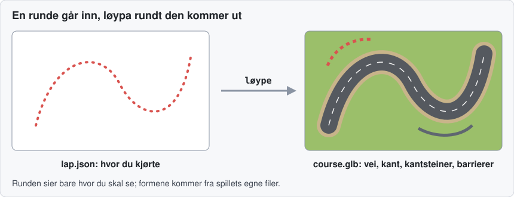
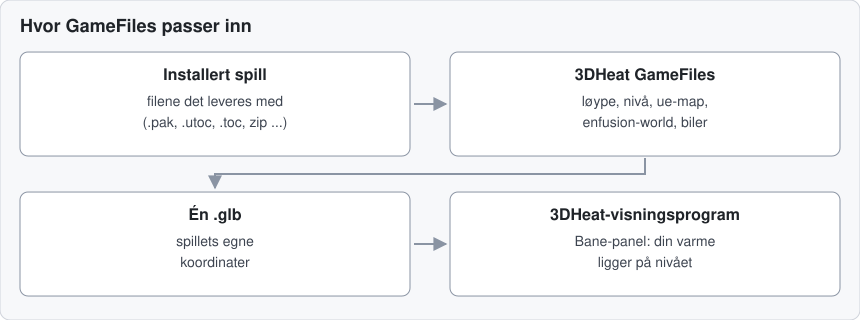

# 3DHeat GameFiles {#dheat-gamefiles}

**Hva er det?** Et verktøy som lager en 3D-modell av en løpebane eller et spillnivå
fra filene til et spill du allerede har installert.

**Hvorfor skulle jeg bruke det?** 3DHeat-visningsprogrammet maler hvor du kjørte eller
spilte som varme. Med dette verktøyet maler det på den ekte banen eller nivået, ikke på
tomt rom.

**Eksempel:** ta en runde du kjørte. Verktøyet lager veien og området rundt som én 3D-fil,
slik at visningsprogrammet kan male farten eller krasjene dine på den ekte banen:



Ny til kommandolinjen? Start med [Før du begynner](before-you-start.md).

Mer detaljert: verktøyet leser nivådata fra arkivene et spill leveres med, og skriver dem
som en binær glTF-fil (`.glb`). Hovedjobben er **banøksporten**: du gir den en runde, og
den skriver bakken, veien skilt fra kanten og gresset, og kantsteiner, barrierer,
dekkvegger, skilt og bygninger rundt den.

Det er en del av [3DHeat](https://github.com/Holdi601/3DHeat), et visningsprogram for
varmekart av sanntidstelemetri, løpsanalyse og kampgjennomgang
([dokumentasjon](https://holdi601.github.io/3DHeat/)). `.glb`-filene dette verktøyet
skriver, er nivåene visningsprogrammet maler varmekartet på.



Det finnes tre måter å få et nivås geometri inn i 3DHeat:

| Vei | Trenger | Gir |
|---|---|---|
| 3DHeat Unreal Exporter | prosjektet i Unreal åpent i editoren | nøyaktig geometri |
| 3DHeat GameCapture | en skjerm og en opptaksfangst | et anslag |
| **3DHeat GameFiles** | **det installerte, utgitte spillet** | **nøyaktig geometri, uten prosjekt** |

Python-pakke: `heat3d_gamefiles`. Repositorium:
[Holdi601/3DHeat-GameFiles](https://github.com/Holdi601/3DHeat-GameFiles). Lisens: MIT.


## Spillenes egne lesere {#the-games-own-readers}

Hver spilleser er sitt eget lille prosjekt med egen lisensfil, egne utgivelser og egen
sakssporing, slik at den kan installeres, oppdateres, vedlikeholdes - eller trekkes tilbake
på forespørsel fra en rettighetshaver - for seg selv, uten å påvirke visningsprogrammet
eller de andre verktøyene. Installer det for ditt spill (siden forteller hvordan), så
fungerer både dens egen kommando og kommandoene her. GameFiles kjører spillets verktøy med
argumentene du ga, og ingenting av verktøyet importeres. Det finnes som kommandoen sin på
`PATH`, som den installerte pakken, eller som mappen sin i `HEAT3D_<GAME>_MAPS` eller ved
siden av GameFiles (`exporters/ext/<game>-maps` i en 3DHeat-kopi, eller `3DHeat-Ext-<Game>`
ved siden av denne mappen). Når det ikke er installert, sier kommandoen hvor du får det, og
avslutter med kode 2.

| Spill | Dets eget verktøy | Kommandoer her som kjører det |
|---|---|---|
| Forza Horizon / Motorsport | [3DHeat-Ext-Forza](https://holdi601.github.io/3DHeat-Ext-Forza/) (`heat3d-forza-maps`) | `course` (Forza-runder), `courses`, `races`, `cars`, `terrain`; `identify`, `list`, `extract` av en `.minizip` |
| Battlefield (Frostbite) | [3DHeat-Ext-Battlefield](https://holdi601.github.io/3DHeat-Ext-Battlefield/) (`heat3d-battlefield-maps`) | `levels`, `level`; `identify` av en Frostbite-`.toc` |
| BeamNG.drive | [3DHeat-Ext-BeamNG](https://holdi601.github.io/3DHeat-Ext-BeamNG/) (`heat3d-beamng-maps`) | `course` (BeamNG-runder); `identify` av en `.cdae` eller `.ter` |
| Assetto Corsa Rally | [3DHeat-Ext-ACRally](https://holdi601.github.io/3DHeat-Ext-ACRally/) (`heat3d-acrally-maps`) | `course` (AC Rally-runder) |
| Arma Reforger (Enfusion) | [3DHeat-Ext-Reforger](https://holdi601.github.io/3DHeat-Ext-Reforger/) (`heat3d-reforger-maps`) | `enfusion-worlds`, `enfusion-world` |

## Hva det kan gjøre {#what-it-can-do}

| Spill eller motor | Banøkst (`course`) | Arkivlesing |
|---|---|---|
| Forza Horizon (ForzaTech) | ja: terreng, vei og kant, bakketekstur, plasserte modeller i egne teksturer | `identify`, `list`, `extract` på en `.minizip`; `identify` på en `.modelbin`; modeller, terreng og teksturer gjennom `course` og `terrain` |
| BeamNG.drive | ja: terreng, veidekaler, modellerte baner, plasserte modeller, vann | `identify`, `list`, `extract` på nivå-zip-filer; `identify` på `.ter`, `.cdae`; `.dae` gjennom `course` |
| Assetto Corsa Rally (Unreal 5.6) | ja: etappens bakkeruter, innbakt bakkefarge, plasserte modeller i flate farger | `identify`, `list`, `extract` på IoStore `.utoc`/`.ucas`; zen-pakker, statiske nett og teksturer gjennom `course` |
| Unreal `.pak` (versjon 8-12) | nei | `identify`, `list`, `extract` |
| Unity (format 22 og nyere) | nei | `identify`, `meshes` |
| Battlefield 6 (Frostbite `.toc`/`.cas`) | ingen runde; et helt nivå med `level`: terreng, plasserte nett, deres fargekart med `--textures` | `identify`, `levels`; pakker, nett, terreng, teksturer og plassering gjennom `level` |
| Source 2 `.vpk` | nei | `identify`, `list`, `extract` |
| Unreal 5 World Partition-spill | ingen runde; et helt kart med `ue-map` (listet med `ue-maps`): landskap, HLOD-bygninger og rekvisitter, vann | - |
| Arma Reforger (Enfusion) | ingen runde; en hel verden med `enfusion-world` (listet med `enfusion-worlds`): terreng i sine farger, havet, bygninger som bokser | - |
| Forza (biler) | `cars`: alle biler i lav detalj, for visningsprogrammets fane for løpsanalyse | - |

Runder fra Assetto Corsa EVO og iRacing avvises med en grunn. Se
[Begrensninger og kjente mangler](limits-and-known-gaps.md).

## Installer {#install}

Ny til kommandolinjen? Les [Før du begynner](before-you-start.md) først.

Du trenger **Python 3.10 eller nyere** (utviklet på 3.13) og pakkene i
[`requirements.txt`](https://github.com/Holdi601/3DHeat-GameFiles/blob/main/requirements.txt).

```
git clone https://github.com/Holdi601/3DHeat-GameFiles.git
cd 3DHeat-GameFiles
pip install -r requirements.txt
```

Sjekk så: `python -m heat3d_gamefiles --help`. Du bør se
`usage: heat3d_gamefiles [-h]` og listen over kommandoer. Kjør alle kommandoer fra
depotmappen, som `python -m heat3d_gamefiles <kommando>`.

| Pakke | Brukes til |
|---|---|
| numpy | alt som dekoder geometri |
| lz4 | Forza-arkiver (mest LZ4-blokker), noen Unity-pakker, IoStore LZ4-blokker |
| Pillow | dekoding av BC1-BC7-teksturer, skriving av JPEG-teksturene i `.glb` |
| msgpack, zstandard | BeamNGs kompilerte former (`.cdae`) |
| cryptography | bare for å åpne en kryptert `.pak` med en nøkkel du allerede har |
| pytest | testene |

Unreal-innhold komprimert med **Oodle** trenger et Oodle-bibliotek som allerede finnes på
maskinen din. Et slikt følger aldri med dette verktøyet. Se [Oodle](reader-oodle.md).

Verktøyet er skrevet for Windows. Det finner spill via Steams bibliotekliste og
`%LOCALAPPDATA%`, og laster Oodle som en Windows-DLL. Andre plattformer er ikke testet.

## Hurtigstart {#quick-start}

En **rundefil** er en opptak av hvor bilen din kjørte: en liste med x-, y-, z-punkter.
Den kommer fra [3DHeat GameCapture](https://github.com/Holdi601/3DHeat-GameCapture) eller
FH Companion-appens rundebibliotek; en CSV-fil du skriver for hånd fungerer også
([Rundeinndata](lap-inputs.md)).

```
# Forza: en rundefil, en rundemappe, eller et banenavn fra FH Companion-biblioteket
python -m heat3d_gamefiles course "Example Circuit"
python -m heat3d_gamefiles course path\to\lap.json -o course.glb

# BeamNG.drive eller Assetto Corsa Rally: en heat3d-lap-fil sier hvilket spill den er fra
python -m heat3d_gamefiles course my_lap.json

# Hver bane i FH Companion-biblioteket, én .glb hver
python -m heat3d_gamefiles courses -o courses

# Battlefield 6: list nivåene, eksporter så ett (en stor fil; se Kommandoer)
python -m heat3d_gamefiles levels
python -m heat3d_gamefiles level <level> -o level.glb --textures

# Unreal 5 World Partition og Arma Reforger: list, eksporter så
python -m heat3d_gamefiles ue-maps "<game>"
python -m heat3d_gamefiles ue-map "<game>" <map> -o map.glb
python -m heat3d_gamefiles enfusion-worlds
python -m heat3d_gamefiles enfusion-world <world> -o world.glb

# Hver Forza-bil, for visningsprogrammets løpsfane
python -m heat3d_gamefiles cars -o forza.h3dcars

# Hva er denne filen?
python -m heat3d_gamefiles identify some_archive.pak
```

Åpne `.glb`-filen i 3DHeat-visningsprogrammet. Spillets egne verdenskoordinater beholdes
(se [Utdataformat](output-format.md)), så en innspilt runde passer med banen.

## Oversikt over dokumentasjonen {#map-of-this-documentation}

- [Før du begynner](before-you-start.md): Python, en terminal, den første kommandoen.
- [Kommandoer](commands.md): hver kommando og alternativ, med eksempler.
- [Kommandoreferanse](../cli-reference.md): hver kommandos `--help`, generert fra koden.
- [Inspisere arkiver](inspecting-archives.md): `identify`, `list`, `extract`, `meshes`, steg for steg.
- [Banøkst](https://holdi601.github.io/3DHeat-Ext-Forza/course-export.html): hvordan en runde blir en bane, for alle spill.
  - [Forza Horizon](https://holdi601.github.io/3DHeat-Ext-Forza/course-forza-horizon.html)
  - [BeamNG.drive](https://holdi601.github.io/3DHeat-Ext-BeamNG/course-beamng.html)
  - [Assetto Corsa Rally](https://holdi601.github.io/3DHeat-Ext-ACRally/course-assetto-corsa-rally.html)
  - [Detaljnivåer og budsjettet](detail-budget.md)
- [Hele nivåer](whole-levels.md): et nivå, kart eller en verden uten runde.
  - [Battlefield 6-nivåer](https://holdi601.github.io/3DHeat-Ext-Battlefield/level-battlefield.html): `levels`, `level`
  - [Unreal 5-kart](level-unreal-world-partition.md): `ue-maps`, `ue-map`
  - [Arma Reforger-verdener](https://holdi601.github.io/3DHeat-Ext-Reforger/level-arma-reforger.html): `enfusion-worlds`, `enfusion-world`
- [Forza-biler](https://holdi601.github.io/3DHeat-Ext-Forza/forza-cars.html): `cars`, bilfilen for visningsprogrammets løpsfane.
- [Rundeinndata](lap-inputs.md): hver form for rundefil verktøyet godtar.
- [Utdataformat](output-format.md): hva som er inne i `.glb`.
- [Arkivlesere](archive-readers.md): én side per containerformat, med hva den leser, hva den ikke
  leser, og hvorfor.
- [Begrensninger og kjente mangler](limits-and-known-gaps.md)
- [Feilsøking](troubleshooting.md): feilmeldingene og hva du gjør med dem.
- [Regler og lisenser](rules-and-licences.md): ingen nøkler, dine egne filer, ingen videredistribusjon.
- [Oppdateringer](updates.md): oppdateringssjekken og `heat3d_update`.
- [Utvikling](development.md): modulkart og tester, inkludert testene som kjører mot installerte spill.
- [Vedlikehold](maintaining.md): utgivelsessjekklisten for disse sidene.

## Del av 3DHeat {#part-of-3dheat}

3DHeat GameFiles er ett av de gratis verktøyene rundt 3DHeat-visningsprogrammet:

| Verktøy | Hva det gjør | Dokumentasjon |
|---|---|---|
| [3DHeat](https://github.com/Holdi601/3DHeat) | visningsprogrammet: 3D-varmekart, løpsanalyse og kampgjennomgang i nettleseren | [nettsted](https://holdi601.github.io/3DHeat/) |
| [GameFiles](https://github.com/Holdi601/3DHeat-GameFiles) | baner og nivåer fra filene spill leveres med, som `.glb` | [nettsted](https://holdi601.github.io/3DHeat-GameFiles/) |
| [GameCapture](https://github.com/Holdi601/3DHeat-GameCapture) | rundetelemetri fra racingspill; nivåer rekonstruert fra spillvideo | [nettsted](https://holdi601.github.io/3DHeat-GameCapture/) |
| [Unreal Exporter](https://github.com/Holdi601/3DHeat-UnrealExporter) | et Unreal Editor-tillegg som lagrer et nivå som `.glb` | [nettsted](https://holdi601.github.io/3DHeat-UnrealExporter/) |
| [CS2](https://github.com/Holdi601/3DHeat-CS2) | Counter-Strike 2-demoer til kampfiler; kart til `.glb` | [nettsted](https://holdi601.github.io/3DHeat-CS2/) |
| [Watcher](https://github.com/Holdi601/3DHeat-Watcher) | tar opp spilling din i bakgrunnen, fra det spill publiserer | [nettsted](https://holdi601.github.io/3DHeat-Watcher/) |
| [Ext-WarThunder](https://github.com/Holdi601/3DHeat-Ext-WarThunder) | War Thunder-replays til kampfiler | [nettsted](https://holdi601.github.io/3DHeat-Ext-WarThunder/) |
| [Ext-WoT](https://github.com/Holdi601/3DHeat-Ext-WoT) | World of Tanks-replays til kampfiler | [nettsted](https://holdi601.github.io/3DHeat-Ext-WoT/) |
| [Ext-WoWs](https://github.com/Holdi601/3DHeat-Ext-WoWs) | World of Warships-replays til kampfiler | [nettsted](https://holdi601.github.io/3DHeat-Ext-WoWs/) |
| [Ext-Squad](https://github.com/Holdi601/3DHeat-Ext-Squad) | Squad-serverdemoer til kampfiler | [nettsted](https://holdi601.github.io/3DHeat-Ext-Squad/) |
| [Ext-DCS](https://github.com/Holdi601/3DHeat-Ext-DCS) | DCS World-kart til `.glb`-nivåer | [nettsted](https://holdi601.github.io/3DHeat-Ext-DCS/) |
| [Ext-IL2](https://github.com/Holdi601/3DHeat-Ext-IL2) | IL-2 Sturmovik-kart til `.glb`-nivåer | [nettsted](https://holdi601.github.io/3DHeat-Ext-IL2/) |
| [Ext-Dota](https://github.com/Holdi601/3DHeat-Ext-Dota) | Dota 2-kartet fra din egen installasjon som et 3D-nivå | [nettsted](https://holdi601.github.io/3DHeat-Ext-Dota/) |
| [Ext-DotaReplay](https://github.com/Holdi601/3DHeat-Ext-DotaReplay) | Dota 2-replays | [nettsted](https://holdi601.github.io/3DHeat-Ext-DotaReplay/) |
| [Ext-Riot](https://github.com/Holdi601/3DHeat-Ext-Riot) | League of Legends- og VALORANT-replays (det de bærer ukryptert) | [nettsted](https://holdi601.github.io/3DHeat-Ext-Riot/) |
| [Ext-Forza](https://github.com/Holdi601/3DHeat-Ext-Forza) | Forza-baner, løp og biler fra din egen installasjon | [nettsted](https://holdi601.github.io/3DHeat-Ext-Forza/) |
| [Ext-Battlefield](https://github.com/Holdi601/3DHeat-Ext-Battlefield) | Battlefield-nivåer (Frostbite) som 3D-nivåer | [nettsted](https://holdi601.github.io/3DHeat-Ext-Battlefield/) |
| [Ext-BeamNG](https://github.com/Holdi601/3DHeat-Ext-BeamNG) | BeamNG.drive-baner | [nettsted](https://holdi601.github.io/3DHeat-Ext-BeamNG/) |
| [Ext-ACRally](https://github.com/Holdi601/3DHeat-Ext-ACRally) | Assetto Corsa Rally-etapper som baner | [nettsted](https://holdi601.github.io/3DHeat-Ext-ACRally/) |
| [Ext-Reforger](https://github.com/Holdi601/3DHeat-Ext-Reforger) | Arma Reforger-verdener (Enfusion) som 3D-nivåer | [nettsted](https://holdi601.github.io/3DHeat-Ext-Reforger/) |
| [Ext-R6](https://github.com/Holdi601/3DHeat-Ext-R6) | Rainbow Six Siege-kampreplays | [nettsted](https://holdi601.github.io/3DHeat-Ext-R6/) |

Visningsprogrammets kampfiler er beskrevet i
[Én fil per kamp: `.3dheat`](https://holdi601.github.io/3DHeat/container.html);
et nivå laget her lastes inn ved siden av dem, i visningsprogrammets panel for
Bakgrunn / nivå.
