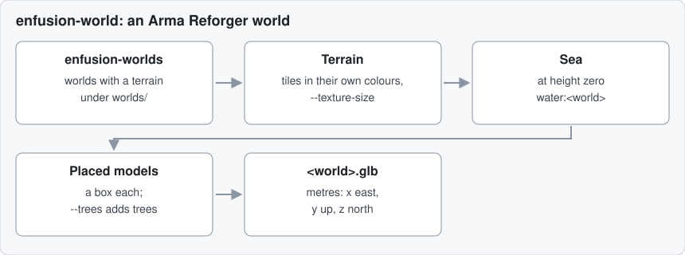

# Arma Reforger-verdener: `enfusion-worlds` og `enfusion-world`

**Hva er det?** En hel Arma Reforger-verden som én 3D-fil. **Hvorfor?** Slik at varmen fra spillet
har bakken og bygningene under seg. (*Enfusion* er motoren Arma Reforger er laget med; en *verden* er
det spillet kaller et kart.)

Eksporterer en hel Enfusion-verden av det installerte Arma Reforger: terrenget i fargene til sine egne
supertekstur-fliser, havet, og hver plassert modell som en boks, i spillets egne meter.



## Steg for steg

1. **List verdenene** som har et terreng:

   ```
   python -m heat3d_gamefiles enfusion-worlds
   python -m heat3d_gamefiles enfusion-worlds --install "D:\Games\Arma Reforger"
   ```

2. **Eksporter én**, med mappenavnet under `worlds/` slik det listes:

   ```
   python -m heat3d_gamefiles enfusion-world <world> -o world.glb
   ```

3. **Varianter:**

   ```
   python -m heat3d_gamefiles enfusion-world <world> --trees               # vegetation too, as boxes
   python -m heat3d_gamefiles enfusion-world <world> --texture-size 0      # flat colour, small file
   python -m heat3d_gamefiles enfusion-world <world> --ground-spacing 4 --no-structures
   ```

4. **Åpne `world.glb`** i 3DHeat-visningens panel for bakgrunn/nivå ([laste et nivå](https://holdi601.github.io/3DHeat/levels.html)).

## Valg

| Valg | Standard | Betydning |
|---|---|---|
| `<world>` | påkrevd | en verden slik `enfusion-worlds` skriver den ut |
| `-o`, `--out FILE` | `<world>.glb` (i `$HEAT3D_LEVELS/<game>/` når den er satt) | filen som skrives |
| `--install FOLDER` | Steam-biblioteket som har spillet | spillets mappe |
| `--ground-spacing METRES` | 2 (terrengets egen) | avstanden mellom terrengets hjørnepunkter i filen |
| `--texture-size PIXELS` | 4096 | bakgrunnsfargebildets lengste side; 0 for flat farge |
| `--no-structures` | | utelat de plasserte modellene |
| `--trees` | av | plasser også trær og annen vegetasjon, som bokser |

## Eksempel på utdata

```text
<world> -> world.glb
  ground      <n> triangles, <w> x <h> m; <n> of <n> tile-edge vertices disagree; colour <w> x <h>
  structure   <n> boxes from <n> entities
  water       <n> triangles (the sea)
  left out    <what>: <n>, ...
```

## Delene

`ground:<world>` (terrenget), `water:<world>` (havet, på høyde null) og `structure:<world>` (boksene).
Koordinatene er spillets egne: x øst, y opp, z nord, i meter, det et innspilt opptak i spillet
rapporterer. Spillets ramme er venstrehendt; *invert world axis* i visningen viser den uten speiling.

## Hvordan den leses og kontrolleres

Ingen Workbench trengs, og ingenting er kryptert.

| Format | Hva det er | Kontrollert mot |
|---|---|---|
| `.pak` | en datablokk og et katalogtre, oppføringer lagret eller zlib | treet bruker opp sin blokk nøyaktig; stikkprøver av zlib-oppføringer pakkes ut til nøyaktig sin oppgitte størrelse |
| `.edds` | en DDS-header, deretter per mip-nivå `COPY`- eller `LZ4 `-blokker | oppdelte nivåer dekodes til nøyaktig sin størrelse ved å bruke nøyaktig sine byte |
| `.terr` / `.ttile` | en header og fliser med 16-bits høyder | hver delt flisekant stemmer nøyaktig |
| supertekstur | hver flis' bakkefarge, omtrent en meter per piksel | den stemmer med havet i høydene; ingen speiling eller transponering passer like godt |
| `.ent` | navn, ressurs-GUID-er, deretter entiteter som typede verdier | en verdensfil parses til sin siste byte |
| `resourceDatabase.rdb` | GUID til sti | nesten hver GUID en verden bruker, navngir en fil som finnes |

Objekter merket som stående på en absolutt høyde ligger innen centimeter fra det dekodede terrenget
(med rutenettet transponert ville de vært meter av). Ikke tegnet: modellenes egne trekanter, trær som
standard (`--trees` legger dem til som bokser), barneentiteter, innsjøer og elver, teksturer med
pre-DX10-headere.

**Begreper:** spillets lisens tillater ikke-kommersiell bruk og forbyr revers utvikling av spillfilene.
Å lese din egen installasjon er din egen avgjørelse under den; resultatet er til din egen bruk og skal
ikke deles.
