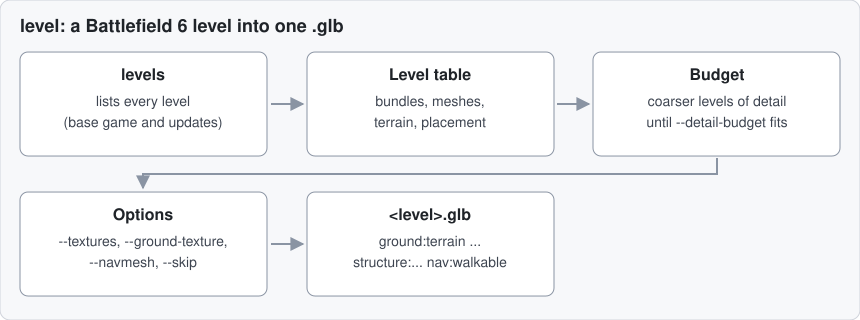

# Battlefield 6-nivåer: `levels` og `level`

**Hva er det?** Et helt Battlefield 6-nivå som én 3D-fil. **Hvorfor?** Slik at varmen fra kampene
dine har bakken og bygningene under seg. (*Frostbite* er motoren Battlefield er laget med; et
*høydefelt* er bakken lagret som et rutenett av høyder.)

Eksporterer et helt Frostbite-nivå av det installerte spillet: høydefeltet, hver mesh som dens
statiske modellgrupper plasserer, objektene plassert ett og ett, terrengkulissen rundt kartet, og på
forespørsel overflatenes fargekart, terrengdekalene innbakt i bakken og soldatenes gangbare flater.



## Steg for steg

1. **List nivåene** spillet leveres med:

   ```
   python -m heat3d_gamefiles levels
   python -m heat3d_gamefiles levels --install "D:\Games\<game folder>"
   ```

   Hver linje er en nivåtabell (`levels/<level>/<level>.toc`) med størrelsen og hvor den kommer fra:
   `Data` for grunnspillet, `Update/<pack>` for en oppdatering.

2. **Eksporter ett**, med navnet, en unik del av det, eller stien til `.toc`-filen. Start uten tekstur
   for å se formen og størrelsen:

   ```
   python -m heat3d_gamefiles level <level> -o level.glb
   ```

3. **Legg til farge** når det ser riktig ut:

   ```
   python -m heat3d_gamefiles level <level> -o level.glb --textures 512 --ground-texture 0.5
   ```

4. **Legg til de gangbare flatene**, eller gjør filen mindre:

   ```
   python -m heat3d_gamefiles level <level> --textures 512 --ground-texture 0.5 --navmesh
   python -m heat3d_gamefiles level <level> --textures 256 --detail-budget 3000000 --ground-spacing 8
   ```

5. **Åpne `level.glb`** i 3DHeat-visningens panel for bakgrunn/nivå ([laste et nivå](https://holdi601.github.io/3DHeat/levels.html)).

## Valg

| Valg | Standard | Betydning |
|---|---|---|
| `<level>` | påkrevd | et navn slik `levels` skriver det, en unik del av et, eller et nivås `.toc` |
| `-o`, `--out FILE` | `<level>.glb` (i `$HEAT3D_LEVELS/<game>/` når den er satt) | filen som skrives |
| `--install FOLDER` | funnet i Steam-bibliotekene | spillets mappe |
| `--textures [PIXELS]` | av; 512 uten størrelse | hver overflates fargekart, høyst PIXELS på en side |
| `--ground-texture [METRES]` | av; 0,5 uten størrelse | bake veier, plasser og merking inn i bakkens farge, METRES per piksel |
| `--navmesh` | av | legg til soldatens navigasjonsmesh som `nav:walkable` |
| `--ground-spacing METRES` | 4 | høydefeltets fineste avstand; 0 utelater det |
| `--detail-budget N` | groveste kopier pluss en fjerdedel, minst 1 500 000 | et tak på trekanter (terrenget gjøres aldri grovere) |
| `--skip TEXT` | | utelat modellgrupper der partisjonsnavnet inneholder TEXT; kan gjentas |
| `--by-mesh` | av | én del per kildemesh og materiale, for å finne ut hva en del er |
| `--clamped-uvs` | av | for visninger som ikke kan gjenta en tekstur |

Hele tabellen, med størrelsene du kan vente deg (et helt nivå er hundrevis av MB), står på
[Kommandoer](commands.md#levels-and-level-frostbite). Hvordan tabellene, pakkene, meshene og terrenget
leses, står på [Frostbite](reader-frostbite.md).

## Eksempel på utdata

Det `level` skriver ut, i grove trekk (linjene slik koden skriver dem; `<n>` og navnene varierer
mellom nivåer):

```text
<n> copies of <n> meshes, from <n> static model groups
      <n>  <group>
      <n>  placed one by one (object and prefab references)
<n> meshes left out: <why>
<n> triangles, budget <n>; <n> meshes drawn at a coarser level to fit
           <n>  ground:terrain
           <n>  structure:buildings, <n> textures
           ...
<n> of <n> drawn sections carry their colour map; the rest are flat colours
Ground: <what the ground is>.
Navigation mesh: <tiles read>.
-> level.glb (<n> MB)
```

## Delene

`ground:terrain` (høydefeltet), `ground:terrain backdrop` og `ground:terrain blend`,
`structure:<kind>` per type mesh (per fargekart med `--textures`, med ` (destructible)` for det en kamp
kan ødelegge), og `nav:walkable` med `--navmesh`. Se [Utdataformat](output-format.md).

Filen inneholder spillets innhold: den er laget for maskinen den ble laget på, ikke for å sendes videre
([Regler og lisenser](rules-and-licences.md)).
