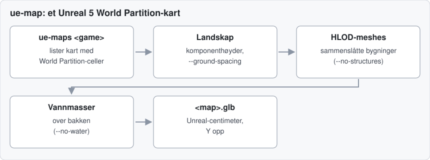

# Unreal 5 World Partition-kart: `ue-maps` og `ue-map` {#unreal-5-world-partition-maps-ue-maps-and-ue-map}

**Hva er det?** Et helt kart fra et Unreal 5-spill som én 3D-fil: bakken, bygningene og vannet. **Hvorfor?**
Slik at varmen fra det spillet har kartet under seg. (*World Partition* er måten Unreal 5 deler et stort kart
i biter på; *HLOD* er en forenklet stand-in for en gruppe bygninger, den spillet tegner på lang avstand.)

Eksporterer et helt kart fra et Unreal 5-spill der kartene er kompilert som World Partition-celler:
landskapet, kartets sammenslåtte HLOD-meshes (bygningene og rekvisittene slik spillet tegner dem på
avstand) og dets vannlegemer. Ingen editor og ingen prosjektfil trengs, bare det installerte spillet.



## Steg for steg {#step-by-step}

1. **List kartene.** `<game>` er spillets mappe, dens `Content/Paks`, eller navnet på dens mappe i et
   Steam-bibliotek:

   ```
   python -m heat3d_gamefiles ue-maps "<Steam game folder name>"
   python -m heat3d_gamefiles ue-maps "D:\Games\<game>"
   ```

   Hvert kart med kompilerte World Partition-celler skrives ut med sin pakkesti.

2. **Eksporter ett** etter navn eller en unik del av det:

   ```
   python -m heat3d_gamefiles ue-map "<game>" <map> -o map.glb
   ```

3. **Bare bakken, eller grovere:**

   ```
   python -m heat3d_gamefiles ue-map "<game>" <map> --no-structures --no-water
   python -m heat3d_gamefiles ue-map "<game>" <map> --ground-spacing 4
   ```

4. **Åpne `map.glb`** i 3DHeat-visningens panel for bakgrunn/nivå
   ([laste et nivå](https://holdi601.github.io/3DHeat/levels.html)).

## Valg {#options}

| Valg | Standard | Betydning |
|---|---|---|
| `<game>` | påkrevd | spillets mappe, dens `Content/Paks`, eller dens Steam-mappenavn |
| `<map>` | påkrevd | et navn slik `ue-maps` skriver det, eller en unik del av et |
| `-o`, `--out FILE` | `<map>.glb` (i `$HEAT3D_LEVELS/<game>/` når den er satt) | filen som skrives |
| `--ground-spacing METRES` | 2 | landskapets avstand mellom hjørnepunkter, avrundet til et helt antall av sine egne firkanter |
| `--no-structures` | | utelat HLOD-bygningene og rekvisittene |
| `--no-water` | | utelat vannlegemene |

Innhold komprimert med Oodle trenger et Oodle-bibliotek som allerede finnes på maskinen (se
[Oodle](reader-oodle.md)).

## Eksempel på utdata {#example-output}

```text
<map> -> map.glb
  ground      <n> triangles from <n> landscape components; <n> of <n> vertices stored twice disagree
  structure   <n> triangles in <n> HLOD meshes
  water       <n> triangles from <n> water bodies
```

Antallet uenige er en selvkontroll: nabolandskapskomponenter lagrer sin felles kant to ganger, og de to
må stemme. Et 3 km kart på 2 m er omtrent 4,6 millioner bakketrekanter.

## Delene {#the-parts}

`ground:<map>` (landskapet), `structure:<map>` (HLOD-meshene) og `water:<map>` (vann som står over bakken).

**Enheter:** dette er den eneste eksporten **som ikke er i meter**: Unreal-centimeter, med Y og Z byttet
om (Y opp), rammen Unreal Exporter til 3DHeat skriver. Telemetri fra samme spill bruker samme ramme, så
den ligger på kartet.

## Hvordan den leses og kontrolleres {#how-it-is-read-and-checked}

| Del | Leses fra | Kontrollert mot |
|---|---|---|
| bakke | hver landskapskomponents 16-bits høydekart, plassert etter sin seksjonsbase på landskapets transform | hvert hjørnepunkt lagret to ganger (på en søm eller en komponentkant) må stemme; uenigheter telles og skrives ut, de glattes ikke |
| struktur | kartets sammenslåtte HLOD-meshes, bygget av motoren i verdensrommet | en mesh beholdes bare hvis boksen komponenten cacher, beskriver dens egne hjørnepunkter |
| vann | hvert vannlegemes mesh, lagt på bakkerutenettet, beholdt der den står over bakken | vann ligger noen meter over bakken under det, som en elv over sin bunn |

Landskapets egenskaper finnes etter form, ikke etter spornummer (sporene flytter seg mellom
motorversjoner). Strukturene er de forenklede stand-inene, ikke de fullt detaljerte modellene. Vegetasjon,
dekaler og landskapsmaterialer eksporteres ikke; bakken er utekstyrt og skyggelagt av visningen. Detaljer om
arkivene: [Unreal 5 IoStore](reader-unreal-iostore.md).

**Dine egne filer:** kartet leses fra spillet som er installert på maskinen din, og skrives til disken
din for din egen analyse; ingenting fra spillet følger med dette verktøyet.
