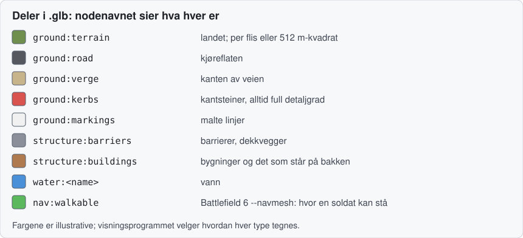

# Utdataformat {#output-format}

En `.glb` er én 3D-fil: bakken, bygningene og vannet i en bane eller et nivå, som du
åpner i 3DHeat-visningens panel for Bakgrunn / nivå.

Hver eksport (`course`, `courses`, `terrain`, `level`, `ue-map`, `enfusion-world`) skriver én
**binær glTF 2.0**-fil (`.glb`). Den er med vilje liten og flat, og lagt opp slik 3DHeat-
visningen leser et nivå. Kilde:
[`glb.py`](https://github.com/Holdi601/3DHeat-GameFiles/blob/main/heat3d_gamefiles/glb.py).

## Struktur {#structure}

```
scene 0
 ├─ node "ground:terrain x-2046 z1023"  -> mesh 0 -> 1 primitive, material 0
 ├─ node "ground:road x-2046 z1023"     -> mesh 1 -> 1 primitive, material 1
 ├─ node "ground:markings"               -> mesh 2 -> ...
 ├─ node "ground:kerbs road_gen_rum_..." -> ...
 ├─ node "structure:barriers bar_armco_bclr"
 └─ ...
```

- **Én node per del**, alle i scenens rot, **uten transformasjoner**. All geometri er
  allerede i verdensrom.
- Hver node har sin egen mesh med **én primitive** og sitt eget materiale. Noden, meshen og
  materialet bærer alle delens navn.
- Hver primitive har **sine egne kompakte vertexmatriser**, bare de verteksene delen bruker.
  En delt vertexmatrise er gyldig glTF, men en leser som utvider hver primitives accessors,
  ville da holde hver vertex én gang per del.
- `asset.generator` er `heat3d_gamefiles`.
- **Få `extras`**, og ingen runde-, spill- eller banenavn:
  - en Battlefield 6-del av en ødeleggbar modell bærer `{"destructible": true}` på sin node;
  - en Forza-bane sier hva den inneholder i `asset.extras` (formatversjon, matchet rute-id,
    hvor mange kopier av løpets eget lag, steder; se
    [Forza Horizon-baner](https://holdi601.github.io/3DHeat-Ext-Forza/course-forza-horizon.html#writing-the-file)),
    og dens påslåtte deler bærer sitt lag på noden: `{"layer": "event", "route": <id>}`
    for løpets eget lag, `{"layer": "layer"}` for et annet påslått lag,
    `{"layer": "venue"}` for et stedsbakkes underlag.

  Alt annet visningen trenger, står i nodenavnene.

## Nodenavn: klassifiseringen {#node-names-the-classification}



Visningen tar en dels klasse fra **nodenavnet** (faller tilbake til meshnavnet), og bare når
det stemmer med

```
^(ground|structure|water)\s*[:|]
```

Alt annet klassifiseres av en heuristikk skrevet for Unreal-landskaper. Så hver del eksportøren
skriver begynner med ett av disse prefiksene, eller med `nav:` (se under):

| Prefiks | Betydning | Deler som skrives |
|---|---|---|
| `ground:` | kjørekanten og landet | `ground:road`, `ground:verge`, `ground:terrain`, `ground:gravel and dirt`, `ground:kerbs`, `ground:markings`, `ground:tyre marks`, `ground:venue`, `ground:plinths` |
| `structure:` | det som står på den | `structure:barriers`, `structure:props`, `structure:signs`, `structure:buildings`, `structure:infrastructure`, `structure:bridges`, `structure:rocks`, `structure:smashables`, `structure:trees`; Forza-lag `structure:event_<category>` og `structure:layer_<category>` |
| `water:` | vann | `water:water`; `water:<map>` (`ue-map`), `water:<world>` (`enfusion-world`) |
| `nav:` | hvor en soldat kan gå (Battlefield 6, bare med `--navmesh`) | `nav:walkable` |

`nav:` passer ikke med visningens mønster ovenfor, så visningen sorterer det etter sin
heuristikk; det er en egen del så du kan vise eller skjule den alene. `ue-map` skriver
`ground:<map>`, `structure:<map>` og `water:<map>`; `enfusion-world` skriver `ground:<world>`,
`structure:<world>` og `water:<world>`.

Etter typen kommer, avhengig av spillet:

| Eksempel | Betydning |
|---|---|
| `ground:road x-2046 z1023` | Forza-bakke i terrengflisen `x-2046 z1023` (rutenettenheter, 1023 per 512 m) |
| `ground:road 3_-2` | BeamNG-bakke i 512 m-firkanten (3, -2) |
| `ground:road 3_-2 asphalt_light` | BeamNG-modellert kjøreflate av materialet `asphalt_light` i den firkanten |
| `ground:road 1_-4` | AC Rally-bakke i 512 m-firkanten (1, -4) i Unreal-rommet |
| `structure:barriers bar_armco_bclr` | Forza-plasserte modeller som deler én tekstur (dens navn uten GUID) |
| `structure:barriers` | plasserte modeller uten tekstur (Forza, AC Rally) |
| `structure:event_barriers bar_example_bclr` | Forza: det det tilpassede løpet legger ut for seg selv, utenom den frie verdenen (node-extras `{"layer": "event", "route": <id>}`) |
| `structure:layer_props` | Forza: et lag spillet slår på for noe annet enn dette løpet (en aktivitet, et samleobjekt, et kjøretidslag) |
| `ground:venue`, `ground:plinths` | Forza: modeller allerede i verdenskoordinater - et stedsbakkes eget underlag (et stadions gulv), og underlag en gate er pyntet med |
| `structure:barriers armco_metal` | BeamNG-plasserte modeller av ett materiale |
| `ground:markings`, `water:water` | flate deler, én for hele filen |
| `ground:terrain` (Battlefield 6) | høydefeltet; `ground:terrain backdrop` de fjerne terrengmodellene, `ground:terrain blend` modeller som smelter inn i terrenget |
| `nav:walkable` (Battlefield 6, `--navmesh`) | nivåets navigasjonsnett for en soldat: der man kan stå, flatt grønt |
| `ground:terrain x-512 z-512` (Battlefield 6, `--ground-texture`) | høydefeltet under én innbakt dekalflis, navngitt etter flisens lave hjørne i meter |
| `structure:buildings t_concreteclean_01_cs` (Battlefield 6, `--textures`) | hver overflate av den typen som viser det fargekartet; uten `--textures`, én del per type, uten suffiks |
| `structure:buildings t_concreteclean_01_cs (destructible)` (Battlefield 6) | det samme, for modeller en kamp kan ødelegge: de som har en ødeleggelsesressurs med sitt eget navn (vegger, hus, rekvisitter). Noden bærer også glTF-extras `{"destructible": true}`. Tilstandene etter ødeleggelse eksporteres ikke |

Visningen kan filtrere etter disse navnene. For eksempel er "bare løpsflaten" `ground:road`
sammen med `ground:kerbs`, i alle tre spillene, og "verdenen uten løpets egne rekvisitter" er
alt unntatt `structure:event_*`. Prefikset er også hvordan visningen tegner en del: bakke som
overflaten varmen ligger på, struktur som det som står på den.

## Enheter, akser og ramme {#units-axes-and-frame}

- **Meter, Y opp**, glTFs konvensjon, for hver eksport unntatt `ue-map`. Ingenting skaleres
  eller sentreres på nytt: tallene er spillets verdenskoordinater, som er poenget med å lese
  arkivet i stedet for å rekonstruere.
- **Unreal 5-kart (`ue-map`): centimeter**, Unreals egen enhet, med Y og Z byttet om så Y er
  opp - rammen 3DHeat Unreal Exporter skriver og spillets telemetri bruker. Den ene eksporten
  som ikke er i meter.
- **Arma Reforger (`enfusion-world`):** spillets egne meter, x øst, y opp, z nord. Spillets
  ramme er venstrehåndet; visningens *invert world axis* viser den uspeilet.
- **Forza:** spillets egne verdenskoordinater (x, y opp, z), uendret. Det samme som dets
  telemetri, så en innspilt runde ligger på banen.
- **BeamNG.drive:** `(x, z, -y)` i BeamNGs Z-opp-verden, som er rotasjonen telemetriopptakeren
  bruker. En rotasjon, ikke en speiling.
- **Battlefield 6:** spillets egne verdenskoordinater (x, y opp, z), uendret: nivåets
  instanstransformasjoner brukt på hver mesh slik den er lagret. Speilede kopier vikles om
  slik at normalene peker utover.
- **Assetto Corsa Rally:** rundens ramme. Unreal-centimeter blir meter, Unreal Z blir y, og
  Unreal X og Y blir x og z i hvilken av de åtte orienteringene runden passet (se
  [Assetto Corsa Rally](https://holdi601.github.io/3DHeat-Ext-ACRally/course-assetto-corsa-rally.html#which-stage-and-which-way-round)).
  Trekanter vikles om der koblingen speiler.

Hver eksport beholder aksene telemetrien bruker, så innspillingen og nivået deler en ramme.
Om den rammen er venstre- eller høyrehåndet i hvert spill, er ikke kontrollert.

## Vertexdata {#vertex-data}

Standarden er den **kvantiserte** formen (`quantize=True`). Den trenger
`KHR_mesh_quantization`-utvidelsen, som står i både `extensionsUsed` og
`extensionsRequired`.

| Attributt | Kvantisert (standard) | Full presisjon (`quantize=False`) |
|---|---|---|
| `POSITION` | float32 VEC3, med min/max | float32 VEC3 |
| `NORMAL` | int8 VEC3 normalisert, utfylt til 4 byte (skritt 4) | float32 VEC3 |
| `TEXCOORD_0` (bare delene med tekstur) | uint16 VEC2 normalisert, begrenset til 0-1; float32 VEC2 der teksturer gjentas (Battlefield 6) | float32 VEC2 |
| `COLOR_0` (deler uten tekstur, når noen del har en farge) | uint8 VEC3 normalisert, utfylt til 4 byte | float32 VEC3 |
| indekser | uint16 når delen har høyst 65 535 vertekser, ellers uint32 | uint32 |

En vertex er 20 byte i stedet for 32 (24 i stedet for 44 med farge). Det tar en tredjedel av
hver fil, og det er forskjellen på om en bybane laster i en nettleserfane eller ikke. Prisen er
under et halvt grads normal og 1/65 535 av en UV (en femtendedel av en texel på 4 096 px).
Kommandolinjen skriver alltid den kvantiserte formen. `write_glb(..., quantize=False)` i Python
skriver den andre.

Normalene kommer fra spillet der det lagrer dem (Forza-terreng og -modeller, BeamNG-former og
-terreng). Ellers beregnes de som areavektede glatte normaler fra trekantene. AC Rally-normaler
beregnes alltid.

## Materialer, farger og teksturer {#materials-colours-and-textures}

- Hvert materiale er `metallicFactor 0`, `roughnessFactor 1`.
- **Del med tekstur:** `baseColorTexture` med delens bilde, UV-er, og ingen vertexfarge. glTF
  multipliserer de to, så en overflate ville blitt mørkere to ganger.
- **Del uten tekstur:** vertexfarge `COLOR_0` med delens flate farge, og en hvit
  `baseColorFactor`. Hvis ingen del i filen har en farge, finnes ingen `COLOR_0`. Der deler
  deler vertekser, vinner senere delens farge, så flate deler skrives i stigende viktighet.
- **Bilder** er innebygd i binærdelen som **JPEG**, kvalitet 90, ingen kromatisk nedsampling,
  bare RGB (alfa fjernes) - unntatt et Battlefield 6-utskjæringskart (løv, gjerder), som er
  **PNG** med sin alfa, på et materiale med `alphaMode` MASK, `alphaCutoff` 0,5 og `doubleSided`
  (se [Frostbite](https://holdi601.github.io/3DHeat-Ext-Battlefield/reader-frostbite.html#textures-and-materials)).
  3DHeat-visningen kaster texels under grensen. En 2048 px bakke av gress og trekroner er støy for
  en tapsfri koder: flere megabyte per flis som PNG, under én som JPEG. Et bilde delt av flere
  deler lagres én gang.
- **Én sampler for alle teksturer:** lineær forstørring, lineær-mipmap-lineær forminsking, **klem
  til kant** på begge akser, for baneeksportene, hvis teksturer dekker sine overflater én gang.
  BeamNG tegner gjentatte modelltekstur som flate farger (se
  [BeamNG.drive](https://holdi601.github.io/3DHeat-Ext-BeamNG/course-beamng.html#placed-models)).
- En Battlefield 6-eksport med `--textures`, der materialene flislegges, skriver spillets egne
  tekstur-koordinater, ubegrenset, som float32 `TEXCOORD_0` selv i den kvantiserte formen, med en
  sampler som **gjentar** på begge akser (`write_glb(..., repeat=True)`): en murvegg er ett par
  trekanter der UV-en går fra 0 til 40. 3DHeat-visningen legger en slik tekstur inn i sin atlas (se
  dens side *Model levels*). For en renderer som ikke kan gjenta en tekstur, kutter
  `level --clamped-uvs` (`write_level(..., clamped=True)`) hver trekant langs linjene der teksturen
  gjentas og flytter hver bit inn i 0..1: de samme pikslene på samme overflate, omtrent en femtedel
  flere trekanter. Trekanter der en tekstur gjentas mer enn 16 ganger, beholder sine koordinater.
  En trekant som teksturen ville kuttet i mer enn 4 biter - bark som gjentas nedover hver gren på et
  tre, der kuttet gjorde ett tres 1 099 trekanter til 51 735 - går i en egen del,
  `<part> (average colour)`, i teksturens gjennomsnittsfarge; `level` sier hvor mange det er.

| Tekstur | Størrelse | Dekker |
|---|---|---|
| bakke (alle spill unntatt Battlefield 6) | `--texture-size`: 2048, 1024 eller 512 px | én 512 m-firkant: 25, 50 eller 100 cm per piksel |
| Battlefield 6-høydefelt | terrengbakgrunnens fargekarts største mip i nivået, beskåret | terrengfirkanten: 32 m per piksel i det kontrollerte nivået |
| Battlefield 6-overflater | `--textures`: høyst så mange px per side | overflatens egen tekstur, én gang per del (kuttet der den gjentas) |
| Battlefield 6 innbakt bakke | `--ground-texture`: meter per piksel, fliser på høyst 4 096 px | én flis av dekalenes utstrekning: 2 048 m på 0,5 m per piksel |
| Forza plassert modell | høyst 256 px | modellens egen UV-layout |
| BeamNG plassert modell | høyst 256 px | modellens egen UV-layout, bare der den ikke gjentas |
| AC Rally plassert modell | ingen | flate farger |

## Hva skriveren nekter {#what-the-writer-refuses}

`write_glb` kaster en feil i stedet for å skrive en fil en visning ville åpnet og vist feil:

| Nektet | Fordi |
|---|---|
| posisjoner som ikke er N x 3, eller ikke endelige | en ødelagt modell |
| en indeks forbi enden av vertexlisten | gjengis som støy |
| en del med tekstur når filen mangler UV-er | gjengis som én utydelig piksel |
| ingen trekanter i det hele tatt | gjengis som ingenting |
| en normal-, farge- eller UV-matrise med feil lengde, eller som ikke er endelig | én per vertex er nødvendig |

## Lesing andre steder {#reading-it-elsewhere}

Enhver glTF 2.0-visning som støtter `KHR_mesh_quantization`, bør åpne disse filene. Bare
3DHeat-visningen er kontrollert; andre visninger er ikke verifisert. En leser uten utvidelsen
avviser filen, fordi den er markert som påkrevd. Filene kan bli store: rundt 80 MB for en
landeveisbane, opptil flere hundre MB for en bybane med det automatiske budsjettet.

## I 3DHeat {#in-3dheat}

Last `.glb`-filen inn i [3DHeat](https://github.com/Holdi601/3DHeat)-visningens panel for
Bakgrunn / nivå; telemetrien du tar opp i samme spill, ligger på den, fordi begge beholder spillets
koordinater. Visningens egen dokumentasjon
([holdi601.github.io/3DHeat](https://holdi601.github.io/3DHeat/)) dekker panelet for Bakgrunn /
nivå og kampfilene de andre verktøyene skriver
([Én fil per kamp: `.3dheat`](https://holdi601.github.io/3DHeat/container.html)). Et nivå lagres
ikke i hver `.3dheat`-fil: en kamp nevner det i sine `references` (`kind: "level"`, navn og sha256),
og `.glb`-filen blir liggende ved siden av kampene.
