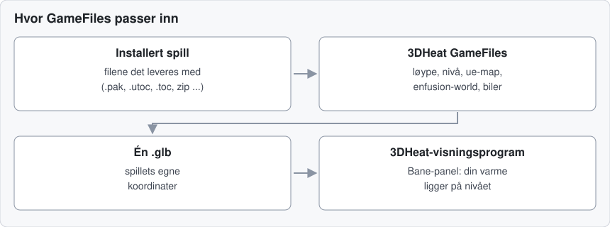

# Hele nivåer {#whole-levels}

**Med enkle ord:** for skytespill og andre spill uten runder lagrer verktøyet hele kartet
som én 3D-fil, slik at visningen kan tegne hvor spillerne har vært på det.

`course` klipper ut bakken rundt en runde. For spill uten runder eksporterer verktøyet et helt
nivå, kart eller verden om gangen:

| Spill eller motor | Liste | Eksport | Side |
|---|---|---|---|
| Battlefield 6 (Frostbite) | `levels` | `level <level>` | [Battlefield 6-nivåer](https://holdi601.github.io/3DHeat-Ext-Battlefield/level-battlefield.html) |
| Unreal 5 World Partition-spill | `ue-maps <game>` | `ue-map <game> <map>` | [Unreal 5-kart](level-unreal-world-partition.md) |
| Arma Reforger (Enfusion) | `enfusion-worlds` | `enfusion-world <world>` | [Arma Reforger-verdener](https://holdi601.github.io/3DHeat-Ext-Reforger/level-arma-reforger.html) |

Hvert par fungerer likt: det første verbet lister det den installerte spillet har, og det andre
skriver ett av dem som en enkelt `.glb` i spillets egne verdenskoordinater, slik at posisjoner
innspilt i det spillet ligger på den. Delene heter `ground:`, `structure:` og `water:` som alle andre
eksporter (se [Utdataformat](output-format.md)); last filen inn i 3DHeat-visningens panel for
Bakgrunn / nivå.

