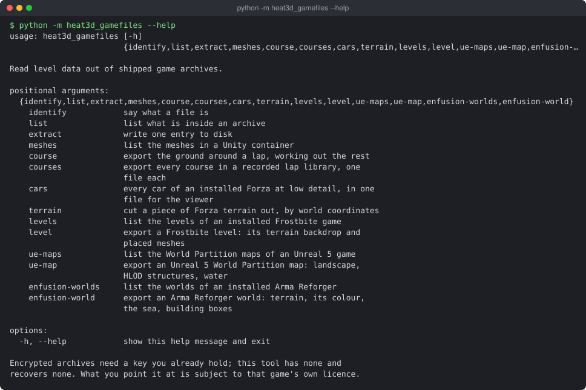

# Polecenia {#commands}

Każde polecenie uruchamia się jako `python -m heat3d_gamefiles <czasownik> ...`
z folderu repozytorium. Czasowniki są ułożone w kolejności, w jakiej zwykle ich
potrzebujesz: co to za plik, co jest w środku, wyciągnij jedną część i zamień
okrążenie w tor.

| Czasownik | Przyjmuje | Robi |
|---|---|---|
| [`identify`](#identify) | dowolny plik | podaje, jaki to format kontenera, czytając jego bajty |
| [`list`](#list) | archiwum Unreal `.pak` lub IoStore `.utoc`, Source 2 `.vpk`, ForzaTech `.minizip` albo zip | wypisuje jego wpisy |
| [`extract`](#extract) | to samo | zapisuje jeden wpis na dysku |
| [`meshes`](#meshes) | plik Unity `SerializedFile` | wypisuje i sprawdza jego siatki |
| [`course`](#course) | okrążenie | eksportuje tor wokół niego (Forza, BeamNG.drive, Assetto Corsa Rally) |
| [`courses`](#courses) | bibliotekę zapisanych okrążeń | uruchamia `course` dla każdego toru w niej (Forza) |
| [`races`](#races) | zainstalowaną grę Forza | wypisuje każdy wyścig zdefiniowany w grze: co dodaje, co ukrywa, areny i stan jego eksportu |
| [`terrain`](#terrain) | folder toru Forza | wycina obszar według współrzędnych świata |
| [`levels`](#levels-and-level-frostbite) | zainstalowaną grę Frostbite (Battlefield 6) | wypisuje jej poziomy |
| [`level`](#levels-and-level-frostbite) | nazwę poziomu | eksportuje poziom: teren, umieszczone siatki i opcjonalnie ich mapy kolorów (Battlefield 6) |
| [`cars`](#cars) | zainstalowaną grę Forza | każdy samochód w niskim detalu, w jednym pliku dla zakładki Analiza wyścigowa w przeglądarce |
| [`ue-maps`](#ue-maps-and-ue-map-unreal-5-world-partition) | grę na Unreal 5 | wypisuje jej mapy World Partition |
| [`ue-map`](#ue-maps-and-ue-map-unreal-5-world-partition) | nazwę mapy | eksportuje mapę: teren, konstrukcje HLOD, wodę |
| [`enfusion-worlds`](#enfusion-worlds-and-enfusion-world-arma-reforger) | zainstalowany Arma Reforger | wypisuje jego światy |
| [`enfusion-world`](#enfusion-worlds-and-enfusion-world-arma-reforger) | nazwę świata | eksportuje świat: teren w jego kolorach, morze, budynki jako pudełka |

**Jak czytać przykłady:** `<x>` oznacza, że wstawiasz własną wartość, bez
nawiasów ostrych; `[...]` oznacza opcję; ścieżkę ze spacjami ujmij w
„podwójne cudzysłowy”, na przykład `"C:\Games\My Game"`. Jesteś tu nowy? Zobacz
[Zanim zaczniesz](before-you-start.md). Pełny `--help` każdego czasownika jest
w [Opisie poleceń](../cli-reference.md).

Za każdym uruchomieniem program może najpierw sprawdzić, czy nie ma nowszego
wydania. Zobacz [Aktualizacje](updates.md). `HEAT3D_NO_UPDATE=1` wyłącza to
sprawdzanie.

Źródło: [`cli.py`](https://github.com/Holdi601/3DHeat-GameFiles/blob/main/heat3d_gamefiles/cli.py).
Strony krok po kroku: [Przeglądanie archiwów](inspecting-archives.md), [Eksport toru](course-export.md),
[Całe poziomy](whole-levels.md), [Samochody Forza](forza-cars.md).



## Kody wyjścia {#exit-codes}

| Kod | Znaczenie |
|---|---|
| 0 | sukces |
| 1 | praca się nie udała (nieczytelne okrążenie, nie znaleziono gry, nie ma czego eksportować, tor w `courses` się nie udał; dla `list` i `extract`: plik, który nie jest żadnym z archiwów, które te polecenia czytają, plik, którego nie da się otworzyć lub przeczytać - zaszyfrowany pak bez `--key`, zaszyfrowany kontener IoStore - albo wpis, którego nie ma w archiwum) |
| 2 | złe argumenty (argparse), ścieżka, która nie istnieje, `--key`, który nie ma 64 cyfr szesnastkowych, albo `terrain` podany razem z obydwoma lub bez żadnego z `--box` i `--route` |

Błędy `list` i `extract` są wypisywane jako jedna linia w standardowym
wyjściu błędów, a nie jako ślad Pythona (traceback).

---

## identify {#identify}

```
python -m heat3d_gamefiles identify <path>
```

To czyta plik i mówi, jaki to kontener. Nie patrzy na rozszerzenie (jedynym
wyjątkiem jest `.ucas`, poniżej). Próbuje formatów w tej kolejności i zatrzymuje
się na pierwszym, który się zgadza:

1. **Unreal `.pak`**: stopka z sygnaturą pak w ostatnich 1 024 bajtach. Wypisuje
   wersję, przesunięcie i rozmiar indeksu, to, czy indeks jest zaszyfrowany, oraz
   metody kompresji.
2. **Unreal IoStore `.utoc`**: sygnatura IoStore na początku. Wypisuje wersję,
   liczbę fragmentów (chunków) i to, czy kontener jest zaszyfrowany; dla
   niezaszyfrowanego - liczbę plików, jakie nazywa jego katalog (i pod jakim
   punktem montowania), metody kompresji oraz to, czy obok leży jego `.ucas`.
   `.ucas` nie ma własnego nagłówka, więc rozpoznaje się go po `.utoc` o tej samej
   nazwie obok niego, a `identify` nazywa wtedy ten plik.
3. **ForzaTech `.minizip`**: sygnatura `PGZP`. Wypisuje wersję, liczbę wpisów i
   segmentów oraz to, czy obok leży `ChunkContentsMiniZip<n>.txt` z nazwami wpisów
   (a jeśli tak, to czy nazywa tyle samo wpisów, ile ich jest).
4. **zip**: nagłówek lokalny pliku zip na początku. Wypisuje liczbę wpisów, sześć
   najczęstszych rozszerzeń oraz nazwy poziomów, gdy wpisy leżą w `levels/<nazwa>/`,
   jak w archiwum poziomu BeamNG.drive.
5. **Unity**: pakiet `UnityFS` (wypisuje wersję silnika i liczbę wpisów) albo
   gołe `SerializedFile` (wypisuje format, wersję silnika, liczbę obiektów i sześć
   najczęstszych klas).
6. **Frostbite `.toc`**: wypisuje rodzaj (`plain` albo `signed`), miejsce, w
   którym zaczyna się drzewo, oraz liczbę zasobów (sekcja binarnej tabeli) albo
   liczbę superbundli (drzewo DbObject).
7. **Source 2 `.vpk`**: wypisuje wersję, liczbę wpisów i pierwszą siatkę nawigacyjną
   `.nav`, jeśli archiwum ją ma.
8. **BeamNG `.cdae`**: kształt w wersji 31, który się da odczytać. Wypisuje liczbę
   siatek, liczbę narysowanych poziomów szczegółowości i pierwsze materiały.
9. **BeamNG `.ter`**: nie ma sygnatury, więc wszystko musi się zgadzać - bok od 2
   do 16 384, tyle wysokości i bajtów warstw ile wynosi bok do kwadratu, a potem
   od 1 do 255 drukowalnych nazw warstw. Wypisuje wersję, rozmiar i nazwy warstw.
10. **ForzaTech `.modelbin`**: wypisuje wersję, liczbę fragmentów i sześć
    najczęstszych znaczników fragmentów. Zawartości fragmentów tu nie dekoduje.

Formaty, które mają własną sygnaturę (2-4), są sprawdzane przed Unity i
Frostbite, bo ich sprawdzenia czytają cały plik: archiwum Forza ma dziesiątki
gigabajtów.

Jeśli żaden nie pasuje, program wypisuje `not a format this tool reads` i
ostatni powód. Ten powód pochodzi z sprawdzenia ForzaTech.

Przykład (wymyślony):

```
> python -m heat3d_gamefiles identify pakchunk0-Windows.pak
pakchunk0-Windows.pak  (1,234,567,890 bytes)
  Unreal pak, version 11
    index      2,345,678 bytes at 1,232,000,000
    encrypted  no
    methods    Oodle
```

```
> python -m heat3d_gamefiles identify GeoChunk0.minizip
GeoChunk0.minizip  (12,345,678,901 bytes)
  ForzaTech .minizip archive, version 101
    entries    98,304 in 192 segments
    names      ChunkContentsMiniZip0.txt
```

## list {#list}

```
python -m heat3d_gamefiles list <archive> [--filter TEXT] [--limit N] [--key HEX]
```

| Opcja | Domyślnie | Znaczenie |
|---|---|---|
| `<archive>` | wymagane | pak Unreal `.pak`; tabela IoStore `.utoc` (albo `.ucas` obok niej); Source 2 `.vpk` (dla podzielonych VPK - `_dir.vpk`); ForzaTech `.minizip`; zip, na przykład archiwa poziomów i zawartości BeamNG |
| `--filter TEXT` | brak | tylko ścieżki zawierające TEXT, bez rozróżniania wielkości liter |
| `--limit N` | 50 | wypisz najwyżej N wpisów (łączna liczba zawsze jest wypisywana) |
| `--key HEX` | brak | klucz AES-256, który już masz, 64 cyfry szesnastkowe, z `0x` albo bez. Używa go tylko zaszyfrowany `.pak`. Wszystko, co nie ma 64 cyfr szesnastkowych, jest odrzucane, zanim archiwum zostanie otwarte (kod wyjścia 2) |

Format narzędzie rozpoznaje po bajtach: tabelę IoStore, `.minizip` i VPK po
sygnaturze, na której się zaczynają, zip po nagłówku lokalnym pliku, a `.pak` po
stopce na końcu. `.ucas` nie ma nagłówka i otwiera się je przez `.utoc` o tej
samej nazwie. Plik, który nie jest żadnym z nich, zostaje odrzucony komunikatem
`<file> is not an archive list and extract read (...)`. Plik, który nim jest, ale
nie da się go otworzyć, zostaje odrzucony z powodem od czytnika: zaszyfrowany pak
bez `--key`, zaszyfrowany kontener IoStore, wersja pak, której program nie czyta.
W obu przypadkach to jedna linia i kod wyjścia 1.

Każda linia pokazuje rozmiar nieskompresowany, metodę kompresji i ścieżkę:

| Archiwum | Metoda | Ścieżki |
|---|---|---|
| `.pak` | `none`, albo nazwa z stopki (`Zlib`, `Oodle`, `Gzip`...) | z punktem montowania archiwum, na przykład `../../../Game/Content/...` |
| IoStore `.utoc` | `none`, albo metoda kontenera (`Oodle`, `Zlib`...), zgodnie z tym, jak zapisany jest jego pierwszy blok | z punktem montowania, na przykład `../../../<Project>/Content/...`. Kontener bez indeksu katalogów nie nazywa plików i zostaje odrzucony |
| `.vpk` | zawsze `stored` | tak jak w katalogu |
| `.minizip` | `lz4`, `deflate` albo `stored` | tak, jak zapisuje je obok `GeoChunk<n>.minizip` plik `ChunkContentsMiniZip<n>.txt`, bez prefiksu maszyny, na której zbudowano grę (z ukośnikami wstecznymi, jak je zapisuje gra). Archiwum nie przechowuje nazw, więc bez tego pliku wpisy to `#0`, `#1`... Lista, której liczba wierszy nie zgadza się z liczbą wpisów, zostaje odrzucona: te dwie rzeczy do siebie nie pasują |
| zip | `stored`, `deflate`, ... | tak, jak zapisane; foldery nie są wypisywane |

```
> python -m heat3d_gamefiles list pakchunk0-Windows.pak --filter /Maps/ --limit 3
1,204 entries matching '/Maps/'
       524,288  Oodle  ../../../Game/Content/Maps/TestLevel.umap
        12,040  none   ../../../Game/Content/Maps/TestLevel_BuiltData.uasset
     3,145,728  Oodle  ../../../Game/Content/Maps/TestLevel_BuiltData.ubulk
  ... 1,201 more
```

## extract {#extract}

```
python -m heat3d_gamefiles extract <archive> <entry> [--out FILE] [--key HEX]
```

| Opcja | Domyślnie | Znaczenie |
|---|---|---|
| `<archive>` | wymagane | jak w `list` |
| `<entry>` | wymagane | ścieżka dokładnie tak, jak wypisuje ją `list` (z rozróżnianiem wielkości liter); w `.minizip` działa też `#<numer>` |
| `--out FILE` | nazwa wpisu (po ostatnim `/` albo `\`), w bieżącym folderze | dokąd zapisać; foldery nadrzędne są tworzone |
| `--key HEX` | brak | jak w `list` |

Wpis zostaje odszyfrowany (pak, z kluczem), rozpakowany i zapisany. Program
wypisuje `<bytes> bytes -> <file>`. Jeśli ścieżki nie ma w archiwum, polecenie
kończy się kodem 1. Tak samo kończy się wpis, którego nie da się odczytać
(zaszyfrowany bez klucza, skompresowany Oodle bez biblioteki Oodle), a powód
pojawia się w jednej linii. Wpisu VPK tu nie sprawdza się sumą CRC. Czytnik ma
do tego metodę `verify()` (zobacz [Source 2 VPK](reader-source2-vpk.md)).

```
python -m heat3d_gamefiles extract pak01_dir.vpk maps/example_map.nav --out example.nav
python -m heat3d_gamefiles extract GeoChunk0.minizip "scene\example\example.modelbin"
```

## meshes {#meshes}

```
python -m heat3d_gamefiles meshes <unity .assets> [--limit N]
```

| Opcja | Domyślnie | Znaczenie |
|---|---|---|
| `<path>` | wymagane | gołe Unity `SerializedFile` (`sharedassets0.assets`, `level0`...), a nie pakiet |
| `--limit N` | 25 | odczytaj i wypisz najwyżej N siatek |

Program wypisuje liczbę obiektów `Mesh`, a potem jedną linię na siatkę: nazwę
(pierwsze 40 znaków), liczbę wierzchołków i trójkątów oraz `ok` albo `BOUNDS DISAGREE`.
`BOUNDS DISAGREE` znaczy, że odczytane wierzchołki nie odtwarzają pudełka
ograniczającego, które Unity zapisało dla siatki, z dokładnością 2% rozmiaru
pudełka. To własne sprawdzenie czytnika (zobacz [Unity](reader-unity.md)).
Siatka, której nie da się odczytać, jest zgłaszana z powodem i wlicza się do
limitu. Dane wierzchołków w pliku `.resS` są czytane z folderu, w którym leży
kontener.

```
> python -m heat3d_gamefiles meshes sharedassets0.assets --limit 2
312 meshes in sharedassets0.assets
  Rock_Large_01                               1,204 verts    2,096 tris  ok
  [123456] could not be read: mesh 'Terrain_Chunk' is stored compressed; that encoding is not implemented
```

---

## course {#course}

```
python -m heat3d_gamefiles course <lap> [-o FILE] [options]
```

Eksportuje tor wokół okrążenia: grunt w pasie po obu stronach jazdy i to, co na
nim stoi, jako jeden plik `.glb`. Resztę ustala samo: jaka to gra, która
zainstalowana kopia, jaka trasa, poziom lub etap, a (dla Assetto Corsa Rally)
w jaki sposób są ułożone osie. Zobacz [Eksport toru](course-export.md).

`<lap>` może być jednym z poniższych (szczegóły w [Dane wejściowe okrążenia](lap-inputs.md)):

- plik okrążenia: JSON trasy, JSON okrążenia FH Companion, JSON `heat3d-lap`, `.npz` albo `.csv` z kolumnami x, y, z
- folder plików okrążeń, przeszukiwany rekurencyjnie (cały zapisany tor)
- **nazwa** toru, wyszukana w bibliotece FH Companion w `%LOCALAPPDATA%\FHCompanion\laps`

### Opcje {#options}

| Opcja | Domyślnie | Gry | Znaczenie |
|---|---|---|---|
| `-o`, `--out FILE` | `<course name>.glb` w bieżącym folderze | wszystkie | dokąd zapisać; nazwa jest pisana małymi literami, a ciągi innych znaków zamieniane na `_` |
| `--game {forza,beamng,acrally}` | to, co mówi plik okrążenia, a jeśli nic - `forza` | wszystkie | z której gry jest okrążenie |
| `--margin M` | 80 | wszystkie | metry gruntu zachowane po obu stronach jazdy |
| `--texture-size {2048,1024,512}` | 2048 | wszystkie | piksele tekstury gruntu na kafel 512 m (2048 = 25 cm na piksel) |
| `--no-textures` | wyłączone | wszystkie | same płaskie kolory: znacznie mniejszy plik. Dla Forzy pomija też podział na jezdnię i pobocze (zobacz niżej) |
| `--season {summer,autumn,winter,spring}` | summer | Forza | mapy gruntu i tekstury modeli z której pory roku |
| `--no-placed` | wyłączone | wszystkie | sam teren: bez krawężników, barier, znaków, budynków. Dla BeamNG powierzchnie jezdne modelowane jako siatki nadal zostają |
| `--trees` | wyłączone | wszystkie | dodaj też roślinność (Forza: drzewa, krzewy i rzeczy do roztrzaskania; BeamNG: drzewa; AC Rally: drzewa i roślinność instancjonowaną) |
| `--detail-budget N` | automatycznie | wszystkie | górny limit trójkątów dla wszystkiego, co zostało umieszczone; zobacz [Poziomy szczegółowości i budżet](detail-budget.md) |
| `--track DIR` | szukany | Forza | folder toru (w `media\Tracks`, zawierający `GeoChunk0.minizip`), jeśli nie ma szukać w zainstalowanej grze |
| `--level NAME` | odczytany z okrążenia | BeamNG, AC Rally | poziom (nazwa folderu BeamNG) albo etap (nazwa mapy AC Rally), bez rozróżniania wielkości liter |
| `--install DIR` | szukany w bibliotekach Steam | BeamNG, AC Rally | BeamNG: folder z `gameengine.zip`. AC Rally: folder gry albo jego `acr\Content\Paks` / `Content\Paks` |

Opcje, które nie dotyczą danej gry, są ignorowane bez ostrzeżenia. Na przykład
`--season` nic nie robi dla BeamNG i AC Rally, a `--track` także nic nie robi
dla nich.

### Która gra {#which-game}

Grę bierze się z `--game`, potem z pola `game` pliku `heat3d-lap` (albo z linii
opisu `# {...}` w CSV), a na końcu przyjmuje się Forzę. Folder dostaje grę, której
pliki wskazują, jeśli wskazują tylko jedną; plik, który nie podaje żadnej (JSON
okrążenia FH Companion, `course.json`, CSV bez linii opisu), się nie liczy (zobacz
[Dane wejściowe okrążenia](lap-inputs.md)).

| Wartość | Eksport |
|---|---|
| zaczyna się od `forza` | Forza Horizon |
| `beamng` | BeamNG.drive |
| `assetto-corsa-rally` albo `acrally` | Assetto Corsa Rally |
| `assetto-corsa-evo` | odrzucone: "keeps all its content in one package obfuscated with a key, and this tool recovers none" |
| `iracing` | odrzucone: "tracks ship in a protected format that is not a file-extraction target" |
| cokolwiek innego | odrzucone: "there is no course reader for <game> yet" |

Odmowa podpowiada też alternatywy: odtworzyć tor z rozgrywki (3DHeat GameCapture)
albo analizować okrążenia bez toru, bo zakładka Analiza wyścigowa w przeglądarce
rysuje z nich drogę.

### Przykłady {#examples}

```
# Tor z biblioteki FH Companion, po nazwie
python -m heat3d_gamefiles course "Example Circuit"

# Jeden plik okrążenia, węższy pas, mniejszy plik
python -m heat3d_gamefiles course lap.json -o example.glb --margin 40 --texture-size 1024

# Zimowe tekstury, z drzewami
python -m heat3d_gamefiles course "Example Circuit" --season winter --trees

# Twardy limit 500 000 umieszczonych trójkątów
python -m heat3d_gamefiles course lap.json --detail-budget 500000

# Folder toru podany wprost (gra zainstalowana poza Steam)
python -m heat3d_gamefiles course lap.json --track "D:\Games\<Forza>\media\Tracks\<map>"

# BeamNG: podaj poziom i wskaż instalację
python -m heat3d_gamefiles course beamng_lap.json --level <level folder> --install "D:\Games\BeamNG.drive"

# AC Rally, z prostym CSV okrążenia, który nie mówi, z jakiej jest gry
python -m heat3d_gamefiles course rally_lap.csv --game acrally
```

Przykładowe wyjście (Forza, wymyślone liczby):

```
Example Circuit: 12 laps, 18,400 samples, 41,200 m driven
  on <map>, in <game folder>
  cutting 80 m either side of the driving: 1.10 km2 of a 1,350 by 1,020 m box
262,144 vertices, 225,000 triangles from 410 meshes across 2 tiles
  x       0.0 ..    1150.0
  y      88.4 ..     131.9
  z       0.0 ..     820.0

  baked 2 ground textures at 2048 px (25 cm a pixel)

  what the ground is made of:
       76,500 triangles  34.0%  verge
       60,750 triangles  27.0%  terrain
       56,250 triangles  25.0%  road
       31,500 triangles  14.0%  markings

  placed on it (1,500,000 triangles of a 1,500,000 budget, 91 textures):
      102 placed    3 models      8,568 triangles  ground:kerbs
    2,278 placed   14 models    ...   structure:barriers
    ...
wrote example_circuit.glb (79,000,000 bytes)
```

## cars {#cars}

```
python -m heat3d_gamefiles cars -o forza.h3dcars
python -m heat3d_gamefiles cars --game "<game folder>" -o forza.h3dcars
```

Każdy samochód zainstalowanej gry Forza w niskim detalu, jaki gra sama ma, w
jednym pliku dla zakładki Analiza wyścigowa w przeglądarce: model `ProxyLOD`, który
ma każde archiwum samochodu w `media/Cars`, około 900 trójkątów, z numerem samochodu
tak, jak podaje go telemetria, jego marką, znacznikiem modelu i rokiem z nazwy
archiwum, oraz kołami i tylnymi światłami. Zajmuje sekundy i zapisuje około 5 MB.
Uruchom ponownie, gdy gra dostanie nowe samochody. Archiwum bez takiego modelu
(rekwizyt ruchu) jest wymienione i pominięte. Format opisuje
[`forzacars.py`](https://github.com/Holdi601/3DHeat-GameFiles/blob/main/heat3d_gamefiles/forzacars.py).

Kształty są w metrach, tak jak w grze: 1:1 z samochodem. Plik zawiera zawartość
gry, więc jest przeznaczony dla maszyny, na której powstał, a nie do przekazywania
dalej.

## courses {#courses}

```
python -m heat3d_gamefiles courses [-o FOLDER] [options]
```

Uruchamia eksport toru Forza `course` dla każdego folderu toru w zapisanej
bibliotece okrążeń i zapisuje po jednym `<name>.glb` na tor. Działa tylko dla
Forzy. Wywołuje bezpośrednio eksport Forzy i nie czyta `--game`, `--level` ani
`--install`.

| Opcja | Domyślnie | Znaczenie |
|---|---|---|
| `-o`, `--out FOLDER` | `courses` | folder, do którego zapisać (tworzony, jeśli go nie ma) |
| `--library DIR` | `%LOCALAPPDATA%\FHCompanion\laps` | biblioteka okrążeń |
| `--only TEXT [TEXT ...]` | wszystkie | tylko tory, których nazwy folderów zawierają któryś z tekstów (bez rozróżniania wielkości liter) |
| `--force` | wyłączone | eksportuj ponownie to, co ma już `.glb` |
| `--track DIR` | szukany | jak dla `course` |
| `--margin M` | 80 | jak dla `course` |
| `--texture-size`, `--no-textures`, `--season`, `--no-placed`, `--trees`, `--detail-budget` | | jak dla `course` |

Co liczy się jako folder toru: bezpośredni podfolder biblioteki, którego nazwa
zawiera ` (course_`. Tak nazywa tory FH Companion, na przykład
`Example Circuit (course_1200_3400_to_1175_3400)`. Część od ` (course_` jest
z nazwy usuwana.

Jak działa przebieg:

- Tor, którego `.glb` już istnieje, jest pomijany (`kept`), chyba że podano `--force`, więc przerwany przebieg jest kontynuowany od miejsca, w którym stanął.
- `.glb` zapisany przez starszą wersję, bez własnej warstwy wyścigu i aren (jego `asset.extras.course_format` brakuje albo jest niższy niż obecny), jest eksportowany ponownie, jakby podano `--force` tylko dla niego.
- Dwa foldery torów o tej samej nazwie przed ` (course_` (rejestrator nazwał nowy tor jak stary) nie nadpisują się: folder utworzony wcześniej zachowuje `<name>.glb`, a drugi zapisuje się jako `<name>_<start>.glb`, gdzie `<start>` to miejsce startu, a minusy zapisane jako `m` (na przykład `example_circuit_m120_m340.glb`).
- Tor, który się nie udał (nieczytelne okrążenia, brak pamięci, brak terenu...), jest zgłaszany jako `FAILED`, a przebieg idzie dalej.
- Na końcu wypisuje tabelę: status, rozmiar w MB, czas w sekundach i nazwę, a potem `<n> of <total> courses in <folder>`.
- Kod wyjścia to 1, jeśli którykolwiek tor się nie udał.

```
python -m heat3d_gamefiles courses -o courses --only circuit sprint --texture-size 1024
```

## races {#races}

```
python -m heat3d_gamefiles races [-o FOLDER] [--markdown FILE] [options]
```

Wypisuje każdy wyścig, jaki definiuje zainstalowana Forza, z jej definicji tras
(zobacz [Tory Forza Horizon](course-forza-horizon.md#which-race)), i sprawdza
eksporty w folderze `courses` względem nich. Czyta grę i bibliotekę okrążeń;
nie zapisuje nic poza opcjonalną tabelą.

| Opcja | Domyślnie | Znaczenie |
|---|---|---|
| `-o`, `--out FOLDER` | `courses` | folder, do którego zapisuje `courses`, a którego pliki są sprawdzane |
| `--library DIR` | `%LOCALAPPDATA%\FHCompanion\laps` | biblioteka okrążeń |
| `--track DIR` | szukany | folder toru, jeśli nie jest to folder zainstalowanej gry |
| `--markdown FILE` | brak | zapisz też tabelę tam, w formacie Markdown |

Jeden wiersz na wyścig i jeden na każdy zapisany tor przejechany na nim:

| Kolumna | Znaczenie |
|---|---|
| route | identyfikator trasy |
| course | zapisany tor dopasowany do niej, jeśli jest |
| own assets | kopie, które wyścig dodaje do świata wolnej jazdy |
| drawn | spośród nich kopie, których model dostarcza tor |
| kinds | dodane kopie według rodzaju (bariery, rekwizyty, naklejki, infrastruktura, ...) |
| not geometry | markery widzów i splajny kolizji, policzone |
| hidden | obiekty wolnej jazdy, które wyścig usuwa |
| venue | modele gruntu aren, koło których linia AI wyścigu przechodzi w odległości 10 m |
| export | `current`, `older format` (eksportowany ponownie przez `courses`), `not exported`, albo puste dla wyścigu bez zapisanego toru |

Na końcu jest podsumowanie: `<n> races: <a> with assets of their own, <v> through a
venue, <d> driven in the lap library, <s> recorded courses to export again`.

```
python -m heat3d_gamefiles races -o courses --markdown races.md
```

## terrain {#terrain}

```
python -m heat3d_gamefiles terrain <track folder> -o FILE (--box X0 Z0 X1 Z1 | --route FILE) [options]
```

To wycinanie Forzy, w którym wszystko podajesz ręcznie: folder toru i obszar,
a nie okrążenie. Przydaje się, gdy interesuje cię obszar w postaci pudełka, a nie
przejazd.

| Opcja | Domyślnie | Znaczenie |
|---|---|---|
| `<path>` | wymagane | folder toru Forza w `media\Tracks` (zawierający `GeoChunk*.minizip`) |
| `-o`, `--out FILE` | wymagane | `.glb` do zapisania |
| `--box X0 Z0 X1 Z1` | | obszar, w metrach gry (x i z, tak jak podaje je telemetria); rogi w dowolnej kolejności |
| `--route FILE` | | JSON trasy z `"bounds": {"min": [x, y, z], "max": [x, y, z]}`, tak jak zapisują go `heat3d_capture route` i `heat3d_capture laps`; czytany jako UTF-8, z albo bez znacznika kolejności bajtów |
| `--margin M` | **100** | metry dodane wokół granic trasy i szerokość korytarza, gdy trasa ma linię |
| `--texture-size`, `--no-textures`, `--season`, `--no-placed`, `--trees`, `--detail-budget` | | jak dla `course` |

Podaj dokładnie jedno z `--box` i `--route`, bo inaczej kod wyjścia to 2. Przy
`--route` wycinek to granice trasy (`min`/`max`, x i z) poszerzone o margines.
Jeśli plik zawiera też co najmniej 10 pozycji, wycinek zwęża się do korytarza
o szerokości `--margin` metrów wokół nich, a umieszczone modele dostają szczegółowość
według odległości od tej linii. Przy `--box` zachowywane jest całe pudełko,
a szczegółowość idzie do tego, co stoi najbliżej środka pudełka.

Wysokość nigdy nie wchodzi w wycinek. Pudełko poza mapą albo na morzu daje
"no terrain there" (kod wyjścia 1), a nie błąd o współrzędnych.

```
python -m heat3d_gamefiles terrain "<game>\media\Tracks\<map>" --box 0 0 512 512 -o piece.glb
python -m heat3d_gamefiles terrain "<game>\media\Tracks\<map>" --route route.json -o map.glb
```

## Poziomy: `levels` i `level` (Frostbite) {#levels-and-level-frostbite}

```
python -m heat3d_gamefiles levels [--install FOLDER]
python -m heat3d_gamefiles level <level> [-o FILE] [--install FOLDER] [--textures [PIXELS]]
                                 [--ground-texture [METRES]] [--ground-spacing METRES]
                                 [--navmesh] [--detail-budget N] [--skip TEXT ...] [--by-mesh]
                                 [--clamped-uvs]
```

`levels` wypisuje poziomy, które dostarcza zainstalowana gra Frostbite, według
nazwy ich tabeli (`levels/<level>/<level>.toc`), z rozmiarem i miejscem pochodzenia:
`Data` dla gry podstawowej, `Update/<pack>` dla aktualizacji, oraz ile tabel
wysokiej rozdzielczości do niego dokłada. Poziom, który dostarcza aktualizacja,
ma w grze podstawowej też małą tabelę samych fragmentów; tabela z pakietami
poziomu jest poziomem (zobacz [Frostbite](reader-frostbite.md#which-table-is-the-level)).
`level` eksportuje jeden poziom: mapę wysokości terenu, każdą siatkę, którą grupy
statycznych modeli poziomu umieszczają, obiekty umieszczone pojedynczo, gdzie
stoją, oraz tło terenu wokół mapy. Z `--textures` każda powierzchnia ma swoją mapę
kolorów; z `--navmesh` dochodzą powierzchnie, po których chodzą żołnierze. Jak to
jest czytane, opisuje [Frostbite](reader-frostbite.md).

| Opcja | Domyślnie | Znaczenie |
|---|---|---|
| `<level>` | wymagane | nazwa tak, jak wypisuje ją `levels`, unikalna jej część, albo ścieżka do `.toc` poziomu |
| `-o`, `--out FILE` | `<level>.glb` | `.glb` do zapisania |
| `--install FOLDER` | pierwsza gra Steam, której `Data` zawiera `layout.toc` | folder gry |
| `--textures [PIXELS]` | wyłączone; 512, gdy podano bez rozmiaru | zapisz mapę kolorów każdej powierzchni, największy mip nie większy niż PIXELS na bok, oraz jej współrzędne tekstury tak, jak gra je ma, z powtarzającym się próbkowaniem (zobacz [Format pliku wyjściowego](output-format.md)). Mapa wysokości dostaje mapę kolorów tła terenu, gdzie ta ją pokrywa; inaczej średni kolor materiałów powierzchni terenu; a jeśli i to nie, średni kolor tła dookoła. Bez tej opcji każda część ma płaski kolor |
| `--ground-texture [METRES]` | wyłączone; 0.5, gdy podano bez rozmiaru | wypal dekale terenu - drogi, pasy startowe, perony, malowane oznaczenia - na kolor gruntu, pomnożone przez mapę kolorów terenu tam, gdzie poziom ją ma, do koloru mapy wysokości, METRES na piksel, w kafelkach do 4 096 pikseli (`ground:terrain x<x> z<z>`). Działa z `--textures` i bez niego |
| `--navmesh` | wyłączone | dodaj siatkę nawigacyjną poziomu dla jej najmniejszego agenta, żołnierza (1,8 m wysokości, 0,4 m szerokości), jako część `nav:walkable`: grunt, podłogi, schody i dachy, po których żołnierz może dojść, bez połączeń (skoków, drabin, przeskoków) między nimi |
| `--ground-spacing METRES` | 4 | najdrobniejszy odstęp mapy wysokości; węzły gęstsze są próbkowane rzadziej. 0 pomija mapę wysokości |
| `--detail-budget N` | każda kopia na najgrubszym poziomie, plus jedna czwarta, co najmniej 1 500 000 | górny limit trójkątów. Siatki, które kosztują najwięcej, tracą jeden poziom szczegółowości naraz, aż się zmieszczą; jeśli nawet najgrubsze poziomy się nie mieszczą, najpierw pomijane są najmniejsze kopie. Tło terenu nigdy nie jest zgrubiane ani pomijane |
| `--skip TEXT` | | pomiń grupy statycznych modeli, których nazwa partycji zawiera TEXT; powtórz, by pominąć kilka. Na przykład warstwa jednego z trybów gry |
| `--by-mesh` | wyłączone | do szukania, czym jest dana część: jedna część na siatkę źródłową i materiał, nazwana `<part> \| <mesh> \| <material>`; plik dużo większy |
| `--clamped-uvs` | wyłączone | dla renderera, który nie umie powtarzać tekstury: podziel każdy teksturowany trójkąt na kawałki, których współrzędne mieszczą się w 0..1, a trójkąt, który potrzebowałby więcej niż 4 kawałków, narysuj w średnim kolorze jego tekstury, w części `<part> (average colour)` |

Wypisuje grupy i to, ile kopii każda umieściła, siatki pominięte i dlaczego,
trójkąty na część (a z `--textures` liczbę tekstur i liczbę sekcji, które znalazły
swoją mapę kolorów), czym jest grunt, a z `--navmesh` liczbę odczytanych kafelków
nawigacji. Poza geometrią o poziomie nic nie jest zapisywane: ani nazw, ani metadanych
(zobacz [Format pliku wyjściowego](output-format.md)).

Budżet terenu jest osobny: mapy wysokości i tła terenu nigdy nie są zgrubiane
przez `--detail-budget`; rozmiar mapy wysokości ustala `--ground-spacing`.

Cały poziom jest duży: zwykle ponad dziesięć milionów trójkątów i kilkaset MB.
`--textures` dodaje do pliku niewiele; poziom pełen drzew może mieć około 1 GB.
`--textures 256 --detail-budget 3000000 --ground-spacing 8` sprowadza poziom do
mniej więcej jednej trzeciej tego.

```
python -m heat3d_gamefiles levels
python -m heat3d_gamefiles level <level> -o level.glb --textures --ground-texture
python -m heat3d_gamefiles level <level> --textures 512 --ground-texture 0.5 --navmesh
python -m heat3d_gamefiles level <level> --textures 256 --detail-budget 3000000 --ground-spacing 8
```

## Mapy: `ue-maps` i `ue-map` (Unreal 5 World Partition) {#ue-maps-and-ue-map-unreal-5-world-partition}

```
python -m heat3d_gamefiles ue-maps <game>
python -m heat3d_gamefiles ue-map  <game> <map> [-o FILE] [--ground-spacing METRES] [--no-structures] [--no-water]
```

`<game>` to folder gry, jej `Content/Paks` albo nazwa jej folderu w bibliotece
Steam (`"<Steam game folder name>"`). `ue-maps` wypisuje każdą mapę, która ma obok
zapisane komórki World Partition. `ue-map` eksportuje jedną jako `ground:<map>`
(teren krajobrazu), `structure:<map>` (połączone siatki HLOD mapy) i `water:<map>`
(jej zbiorniki wodne, tam gdzie stoją nad gruntem), w **centymetrach** Unreal,
z zamienionymi osiami Y i Z - jedyny eksport nie w metrach. Jak każda część jest
czytana i sprawdzana: [Mapy Unreal 5](level-unreal-world-partition.md).

| Opcja | Domyślnie | Znaczenie |
|---|---|---|
| `<map>` | wymagane | nazwa tak, jak wypisuje ją `ue-maps`, albo jej unikalna część |
| `-o`, `--out FILE` | `<map>.glb` | `.glb` do zapisania |
| `--ground-spacing METRES` | 2 | odstęp wierzchołków krajobrazu w pliku, zaokrąglony do całkowitej liczby jego własnych czworokątów |
| `--no-structures`, `--no-water` | | pomiń tę część |

Wypisuje trójkąty na część, ile komponentów krajobrazu odczytano i ile z
wierzchołków, które są zapisane dwa razy, się nie zgadza. Mapa 3 km na 2 m to około
4,6 miliona trójkątów gruntu.

## Światy: `enfusion-worlds` i `enfusion-world` (Arma Reforger) {#enfusion-worlds-and-enfusion-world-arma-reforger}

```
python -m heat3d_gamefiles enfusion-worlds [--install FOLDER]
python -m heat3d_gamefiles enfusion-world <world> [-o FILE] [--install FOLDER] [--ground-spacing METRES]
                                          [--texture-size PIXELS] [--no-structures] [--trees]
```

`enfusion-worlds` wypisuje każdy świat z terenem, według jego folderu w `worlds/`.
`enfusion-world` eksportuje jeden: `ground:<world>` (teren, w kolorach jego kafli
superteksturowych), `water:<world>` (morze, na wysokości zero) i `structure:<world>`
(pudełko każdego umieszczonego modelu), w metrach gry - x na wschód, y w górę,
z na północ. Jak to jest czytane i sprawdzane:
[Światy Arma Reforger](level-arma-reforger.md).

| Opcja | Domyślnie | Znaczenie |
|---|---|---|
| `<world>` | wymagane | świat tak, jak wypisuje go `enfusion-worlds` |
| `-o`, `--out FILE` | `<world>.glb` | `.glb` do zapisania |
| `--install FOLDER` | biblioteka Steam, która zawiera grę | folder gry |
| `--ground-spacing METRES` | 2 (własny teren) | odstęp wierzchołków terenu w pliku |
| `--texture-size PIXELS` | 4096 | większy bok obrazu kolorów gruntu; 0 dla płaskiego koloru |
| `--no-structures` | | pomiń umieszczone modele |
| `--trees` | wyłączone | dodaj też drzewa i inną roślinność, jako pudełka |

Wypisuje trójkąty na część, ile wierzchołków na krawędziach kafli się nie zgadza,
ile jednostek (entities) zawiera plik świata i ile pudełek umieszczono, oraz co
zostało pominięte i dlaczego.

## Zmienne środowiskowe {#environment-variables}

| Zmienna | Efekt |
|---|---|
| `HEAT3D_OODLE` | ścieżka do `oo2core_*_win64.dll` albo folderu, w którym leży; zobacz [Oodle](reader-oodle.md) |
| `HEAT3D_NO_UPDATE` | każda wartość inna niż pusta, `0`, `false`, `no` wyłącza sprawdzanie aktualizacji; zobacz [Aktualizacje](updates.md) |
| `LOCALAPPDATA` | miejsce, gdzie szukane są biblioteka FH Companion, folder użytkownika BeamNG i pamięć podręczna aktualizacji |
| `HEAT3D_COURSE` | tylko testy: tor, którego używa test kraweżników w zainstalowanej grze; zobacz [Rozwój](development.md) |
