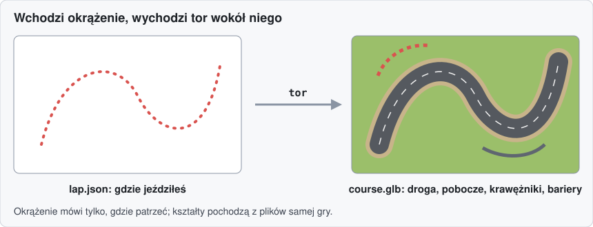
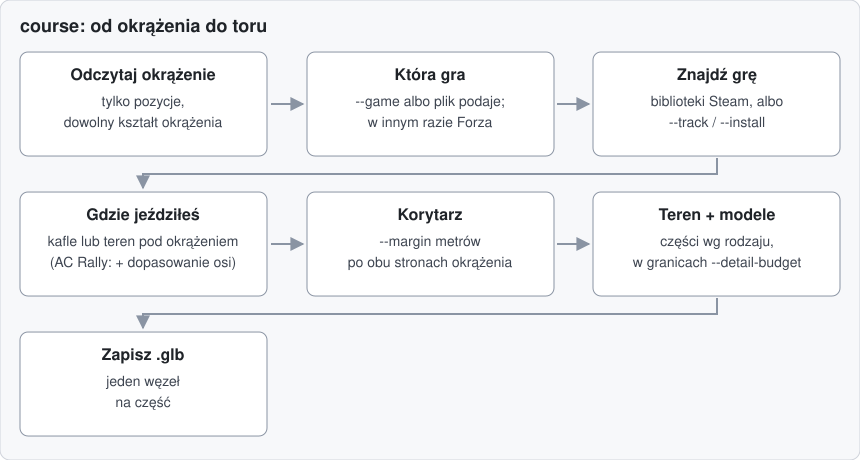

# Eksport trasy {#course-export}

**Mówiąc prosto:** przejechałeś okrążenie, a to buduje tor, po którym jechałeś, jako plik 3D. Okrążenie to tylko linia punktów. Drogę, trawę i krawężniki biorą się z plików samej gry.

`course` zamienia okrążenie w trasę: podłoże w pasie po obu stronach miejsca, gdzie jechał samochód, i to, co na tym podłożu stoi, jako jeden plik `.glb` dla przeglądarki. Ta strona opisuje to, co wspólne dla wszystkich trzech obsługiwanych gier. Strony pod nią opisują, czym się różnią:

- [Forza Horizon](course-forza-horizon.md): archiwa ForzaTech `.minizip`
- [BeamNG.drive](course-beamng.md): archiwa zip, mapa wysokości terenu, skompilowane kształty
- [Assetto Corsa Rally](course-assetto-corsa-rally.md): Unreal 5 IoStore, etap World Partition
- [Poziomy szczegółowości i budżet](detail-budget.md): ile trójkątów dostają umieszczone modele i które kopie zostają

## Kroki {#the-steps}

Słowa użyte niżej: **klatka** to to, w którą stronę wskazują osie; **korytarz** to pas podłoża po obu stronach okrążenia; **kafelek** to jeden kwadratowy fragment terenu gry; **LOD** (poziom szczegółowości) to jedna z uproszczonych kopii modelu.

1. **Odczytaj okrążenie.** Same pozycje, z dowolnego z kształtów opisanych w [Dane okrążenia](lap-inputs.md). Prędkość i sterowanie nie są używane. Okrążenie z mniej niż dwiema próbkami jest odrzucane ("holds no driving").
2. **Ustal grę.** Najpierw `--game`, potem pole `game` w pliku okrążenia, a w ostateczności Forza (zob. [Polecenia](commands.md#which-game)).
3. **Znajdź zainstalowaną grę.** Wszystkie trzy przeszukują każdą bibliotekę Steam wymienioną w `config\libraryfolders.vdf` Steama. Forza przeszukuje też `C:\XboxGames`. `--track` (Forza) albo `--install` (BeamNG, AC Rally) pomija szukanie.
4. **Znajdź, gdzie jechano.** Nigdy nie rozstrzyga się tego samym dopasowaniem nazwy. Forza wybiera tor, którego kafelki terenu pokrywają okrążenie. BeamNG wybiera poziom, na którego terenie (albo drogach) leżą próbki okrążenia. AC Rally sprawdza każdy etap w ośmiu orientacjach osi i wybiera tę, która kładzie na drodze najwięcej okrążenia.
5. **Wytnij korytarz** o szerokości `--margin` metrów po obu stronach jazdy (niżej).
6. **Zbuduj podłoże** wewnątrz korytarza, sklasyfikowane jako droga, pobocze, żwir i ziemia, teren, oznaczenia, ślady opon albo woda. Dla każdego kwadratu 512 m zapiekasz teksturę podłoża.
7. **Umieść modele** stojące w korytarzu, według kategorii, na poziomie szczegółowości wybranym według odległości i budżetu trójkątów.
8. **Zapisz `.glb`**: jeden nazwany węzeł na część. Zobacz [Format wyjściowy](output-format.md).

Co wypisuje uruchomienie, tu na syntetycznej instalacji BeamNG.drive, którą budują testy, z 50-metrowym okrążeniem po pasie drogi:

## Korytarz {#the-corridor}

Wycinka to pas wokół przejechanej linii, a nie prostokąt opisany na okrążeniu. Dla toru kołowego oba są prawie takie same. Przy przejeździe punkt-punkt prostokąt to w większości zbocze, po którym nikt nie jeździ, a pas może mieć dziesiątą część jego powierzchni. Źródło: [`corridor.py`](https://github.com/Holdi601/3DHeat-GameFiles/blob/main/heat3d_gamefiles/corridor.py).

Tak się go buduje:

- Jazda jest rzutowana na płaszczyznę podłoża: x i z okrążenia (w BeamNG: x i y własnej ramki gry).
- Rasteryzuje się ją na siatce komórek **4 m** (`CELL`). Każda komórka, której dotyka jazda, jest poszerzana o dysk o promieniu `margin + 4 m` we wszystkich kierunkach.
- Kolejne próbki oddalone od siebie o mniej niż **50 m** (`JOIN`) są łączone punktami co 4 m, żeby pas nie miał dziur. Próbki dalej od siebie traktuje się jako osobne odcinki jazdy i nie łączy się ich. Biblioteka kursu to wiele plików okrążeń jeden za drugim, a meta jednego sprintu i start następnego nie mogą rysować pasa przez całą mapę.
- Trójkąt zostaje, jeśli którykolwiek jego narożnik, środek krawędzi albo środek ciężkości leży w pasie. Punkty środkowe łapią duży trójkąt, który przecina wąski pas, mając wszystkie narożniki poza nim.
- Wysokość nie jest częścią wycinania. Pudełko ograniczające także wysokość wycięłoby podłoże spod wzgórza, po którym prowadzi droga.

Konsola podaje powierzchnię korytarza, na przykład `cutting 80 m either side of the driving: 1.53 km2 of a 6,000 by 3,600 m box`.

BeamNG i AC Rally budują jeszcze szerszy korytarz **zasięgu** o szerokości `margin + 60 m`. Umieszczony model jest brany pod uwagę, jeśli jego początek leży w korytarzu zasięgu, a rysowany tylko wtedy, gdy jego obrys dotyka właściwego korytarza. Dzięki temu długi obiekt, którego początek leży tuż poza pasem, nie zginie. BeamNG używa też korytarza zasięgu do wyboru nakładek drogowych do malowania.

## Z czego zbudowane jest podłoże {#what-the-ground-is-made-of}

Każdy eksport dzieli trójkąty podłoża na te same rodzaje, a każdy rodzaj zapisuje jako osobną część, żeby przeglądarka mogła ją pokazać albo ukryć:

| Rodzaj | Nazwa części | Jednolity kolor (liniowe RGB) | Forza | BeamNG | AC Rally |
|---|---|---|---|---|---|
| droga | `ground:road` | 0.22, 0.22, 0.23 | pasy drogi: część asfaltowa | modele warstw typu `ASPHALT`, nakładki drogowe, zamodelowana droga | kafelki trasy (`/MeshesTrack/`) |
| pobocze | `ground:verge` | 0.52, 0.47, 0.30 | pasy drogi: utwardzone pobocze | chodniki i modele poboczy | - |
| żwir i ziemia | `ground:gravel and dirt` | 0.50, 0.42, 0.30 | - | warstwy ziemi, żwiru, piasku i błota oraz nakładki | - |
| teren | `ground:terrain` | 0.30, 0.44, 0.18 | wszystko inne | wszystko inne | kafelki `_Terrain` i daleki teren |
| krawężniki | `ground:kerbs` | 0.60, 0.12, 0.10 (Forza) | rekwizyty `road_gen_rum*` | modele krawężników, podjazdów i wybojów | modele krawężników |
| oznaczenia | `ground:markings` | 0.90, 0.90, 0.88 | podsiatki nakładek, podniesione o 5 cm | namalowane w teksturze | - |
| ślady opon | `ground:tyre marks` | 0.20, 0.17, 0.16 | podsiatki nakładek, podniesione o 5 cm | namalowane w teksturze | - |
| woda | `water:water` | 0.16, 0.34, 0.48 | materiały wody | płaszczyzna morza, bloki wody, rzeki | - |

Kolory jednolite dobrano tak, żeby czytało się je od razu, a nie tak, by pasowały do gry. Używa się ich dla części bez tekstury i w przeglądarkach, które ignorują tekstury. Źródło: [`surfaces.py`](https://github.com/Holdi601/3DHeat-GameFiles/blob/main/heat3d_gamefiles/surfaces.py).

Części podłoża dzielą się na kwadraty 512 m, a każdy kwadrat niesie własny zapieczony obraz, więc nazwy części zawierają kwadrat:

| Gra | Nazwa części podłoża | Klucz kwadratu |
|---|---|---|
| Forza | `ground:road x-2046 z1023` | nazwa siatki kafelka terenu (kroki co 1023, zob. [Forza Horizon](course-forza-horizon.md)) |
| BeamNG | `ground:road 3_-2` | `floor(x / 512)`, `floor(y / 512)` w metrach BeamNG |
| AC Rally | `ground:road 1_-4` | `floor(x / 51200)`, `floor(y / 51200)` w centymetrach Unreala |

## Co stoi na podłożu {#what-stands-on-it}

Umieszczone modele zapisuje się w częściach `structure:<category>`, albo w `ground:kerbs` dla krawężników (we wszystkich trzech grach). Gdy część ma własną teksturę, nazwa tekstury albo materiału idzie za kategorią, na przykład `structure:barriers bar_armco_bclr`.

| Kategoria | Forza | BeamNG | AC Rally |
|---|---|---|---|
| bariery | tak | tak | tak |
| rekwizyty | tak | tak | tak |
| znaki | tak | tak | tak |
| budynki | tak (zastępniki całych budynków, tam gdzie gra je ma) | tak | tak |
| infrastruktura | tak | tak | tak |
| mosty | tak | tak | (zaliczane do infrastruktury) |
| skały | tak | tak | tak |
| krawężniki | tak, jako podłoże | tak, jako podłoże | tak, jako podłoże |
| drzewa | z `--trees` | z `--trees` | z `--trees` |
| elementy do rozbicia | z `--trees` | - | - |

Podział szczegółowości jest we wszystkich trzech grach taki sam. Kopie w odległości do 25 m od jazdy mają pełny szczegół, kopie w odległości 25-60 m mają o jeden poziom mniej, a dalsze mają najgrubszy poziom. Potem najbardziej kosztowne modele schodzą w dół, aż zmieści się budżet trójkątów. Gdy nawet najgrubsze poziomy nie mieszczą się w podanym przez ciebie budżecie, kopie są pomijane. Krawężniki nigdy nie są upraszczane ani pomijane. Zobacz [Poziomy szczegółowości i budżet](detail-budget.md).

## Opcje, które kształtują wynik {#options-that-shape-the-result}

| Chcesz | Użyj |
|---|---|
| mniejszego pliku | `--no-textures` (jednolite kolory), `--texture-size 1024` albo `512`, `--detail-budget N`, `--margin 40` |
| samego podłoża | `--no-placed` |
| także scenerii | `--trees` |
| innej pory roku (Forza) | `--season winter` |
| gry spoza Steama | `--track` (Forza) albo `--install` (BeamNG, AC Rally) |
| okrążenia, którego wyszukiwanie nie umieszcza | `--level` (BeamNG, AC Rally), `--track` (Forza) |

## Współrzędne {#coordinates}

Każdy eksport zapisuje metry z osią Y w górę, w ramce, w którą wpasowuje się zapisane okrążenie tej samej gry:

| Gra | Zapisywana ramka |
|---|---|
| Forza | własne współrzędne świata gry, bez zmian |
| BeamNG | `(x, z, -y)` z świata BeamNG z osią Z w górę, czyli obrót, który stosuje rejestrator telemetrii |
| AC Rally | ramka okrążenia, znaleziona dopasowaniem: centymetry Unreala stają się metrami, a osie X i Y Unreala stają się x i z okrążenia w tej z ośmiu orientacji, która pasuje |

Zobacz [Format wyjściowy](output-format.md).
