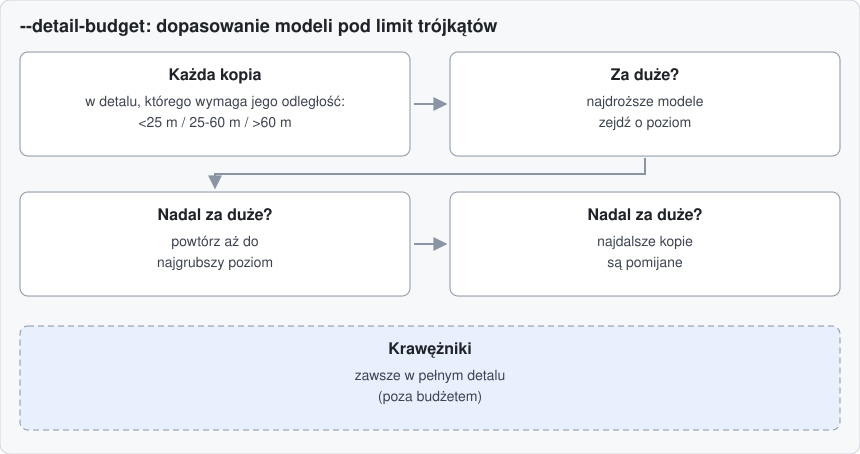

# Poziomy szczegółowości i budżet {#levels-of-detail-and-the-budget}

**Trójkąt** to maleńki płaski kawałek modelu 3D. Więcej trójkątów znaczy większy, wolniejszy plik. **Budżet** to limit tej liczby. **Poziom szczegółowości** to prostsza kopia modelu, używana, gdy jest daleko.

Najdrobniejszy poziom wszystkiego, co stoi wokół toru, to kilka milionów trójkątów. Na przykład setki odcinków bariery i stosy opon, po około tysiąc trójkątów każdy. Miejski korytarz mieści ponad sto tysięcy kopii. Dlatego każdy eksport trasy daje umieszczonym modelom **budżet trójkątów** i decyduje, dla każdego modelu, na jakim poziomie szczegółowości jest rysowany, a w razie potrzeby, które kopie pominąć.

Schemat napisano dla Forzy ([`forzaplacement.py`](https://github.com/Holdi601/3DHeat-GameFiles/blob/main/heat3d_gamefiles/forzaplacement.py): `choose_levels`, `auto_budget`, `_fit`), a BeamNG i AC Rally używają jego części. Teren nie wlicza się w budżet.

## Pasma odległości {#distance-bands}

Odległość każdej kopii od jazdy mierzy się w płaszczyźnie podłoża, do najbliższej próbki okrążenia. Okrążenie najpierw redukuje się do co najwyżej 1000 punktów, co kosztuje kilka metrów precyzji i nic, co miałoby tu znaczenie. Kopie trafiają potem do trzech pasm, a każda para (model, pasmo) jest liczona osobno:

| Pasmo | Odległość | Zaczyna od |
|---|---|---|
| bliskie | poniżej 25 m (`NEAR`) | najdrobniejszego poziomu |
| środkowe | 25-60 m (`FAR`) | o jeden poziom grubszego |
| dalekie | 60 m i więcej | najgrubszego poziomu |

Bez trasy (Forza `terrain --box`) odległość mierzy się do środka pudełka.

## Schodzenie w dół, by się zmieścić {#stepping-down-to-fit}



Koszt wpisu (model, pasmo) to liczba kopii razy liczba trójkątów na jego bieżącym poziomie. Dopóki suma przekracza budżet, wpis z największym kosztem schodzi o jeden poziom w dół. Tak się powtarza, aż suma się zmieści albo nic nie może już zejść niżej. Wpisy przypięte nie schodzą nigdy:

| Gra | Przypięte na pełnym szczegółu |
|---|---|
| Forza | krawężniki (`road_gen_rum*`) |
| BeamNG | krawężniki i każdy kształt, który niesie nawierzchnię jezdni |
| AC Rally | krawężniki |

Podsumowanie Forzy podaje to jako `N of M models drawn at a coarser level to fit the budget`.

## Automatyczny budżet {#the-automatic-budget}

Bez `--detail-budget` budżet ustala się sam tak, żeby **żadna kopia nie została pominięta**:

```
budget = max(1,500,000, 1.25 x sum(copies x coarsest level))
```

Wpisy przypięte liczą się na najdrobniejszym poziomie. Te 25% (`HEADROOM`) pozwala rzeczom przy drodze zachować trochę szczegółu. Na wiejskim torze wychodzi to na podłogę 1,5 miliona (`DEFAULT_BUDGET`). W mieście, gdzie korytarz mieści ponad sto tysięcy kopii, budżet rośnie do ponad dziesięciu milionów, a plik do kilkuset MB. Przeglądarka sobie z tym radzi.

## Budżet, który podajesz {#a-budget-you-give}

`--detail-budget N` to **sufit**. Poziomy schodzą w dół jak wyżej. Jeśli nawet najgrubsze poziomy się nie mieszczą, kopie są pomijane:

| Gra | Kolejność pomijania kopii |
|---|---|
| Forza | najpierw wszystko w odległości 25 m lub więcej od jazdy, potem to, co stoi przy drodze; w każdej grupie najpierw to, co z drogi wygląda najmniej: największa odległość / rozmiar (rozmiar = przekątna pudełka modelu razy jego największa skala, co najmniej 0,25 m) |
| BeamNG | najdalsze od jazdy najpierw |
| AC Rally | najdalsze od jazdy najpierw, jak w BeamNG |
| Battlefield 6 | najmniejsze najpierw: przekątna pudełka razy skala |

Krawężniki (a w BeamNG także modele nawierzchni jezdni) nigdy nie są pomijane, więc budżet mniejszy niż ich własny koszt przekroczą one jako jedyne.

Forza używa odległości podzielonej przez rozmiar, bo gdyby kierować się samą odległością, jednostka klimatyzacji na ścianie dziewięć metrów od drogi przeżyłaby dwudziestometrową fasadę, na której wisi, leżącą dwanaście metrów dalej. Rzeczy przy drodze idą na koniec bez względu na rozmiar, bo trzymetrowa bariera pięć metrów od linii to krawędź toru, a pięćdziesięciometrowy budynek sześćdziesiąt metrów wstecz to tło.

Podsumowanie podaje
`N of M copies left out to fit the budget, the smallest and furthest from the driving first (--detail-budget raises it)`
(Forza) albo `N copies left out to fit the budget, the furthest from the driving first (--detail-budget raises it)`
(BeamNG, AC Rally).

## Całe budynki (Forza) {#whole-buildings-forza}

Zastępnik całego budynku liczy się jako jedna kopia, a odległość mierzy się do najbliższej krawędzi budynku. Jest zachowywany albo pomijany jako całość. Modułowe elementy, które zastępuje, nie są w ogóle liczone do budżetu. Zobacz [Forza Horizon](course-forza-horizon.md#buildings-drawn-whole).

## Czym jest poziom szczegółowości w każdej grze {#what-a-level-of-detail-is-per-game}

| Gra | Poziomy pochodzą z |
|---|---|
| Forza | maski poziomów na poziomie trójkąta w podsiatkach `Mesh` modelu (bit `level + 1`); `0xFFFF` dla elementów do rozbicia tylko dla modelu bez oznaczonego poziomu |
| BeamNG | `details` kształtu `.cdae` o nieujemnym rozmiarze, od największego; dla `.dae` końcowa liczba w nazwach węzłów siatki (`barrier75`, `barrier40`) |
| AC Rally | zapisane w siatce statycznej poziomy szczegółowości, od najdrobniejszego |
| Battlefield 6 | poziomy szczegółowości MeshSet, od najdrobniejszego, liczące tylko sekcje, które się rysuje (bez kopii cieni i kopii tylko do głębi), i bez ostatniego poziomu, który jest zastępnikiem widoku z daleka (materiały `M_LastLod`, `M_Billboard`, `M_Vista`: krata pylonu staje się wtedy pełnym szpikulcem) |

`level` w Battlefield 6 nie ma okrążenia, więc nie ma pasm odległości: każda siatka to jeden wpis, a każda kopia ma ten sam poziom. Automatyczny budżet to powyższy wzór z przypiętym tłem terenu. Mapa wysokości stoi poza budżetem i jest dobierana przez `--ground-spacing`. Przy budżecie, który podajesz, gdy każda siatka jest już na najgrubszym poziomie, kopie pomija się od najmniejszej, a rozmiarem jest przekątna pudełka siatki razy skala kopii, bo nie ma jazdy, od której mierzyłoby się odległość. Tło terenu nigdy nie jest pomijane. Poziom wychodzi automatycznie około dziesięciu milionów trójkątów.

## Wybór liczby {#choosing-a-number}

| Chcesz | Spróbuj |
|---|---|
| wszystkiego, pełny szczegół przy drodze | zostaw automatycznie |
| kilka razy mniejszy plik | `--detail-budget 500000` z `--texture-size 1024` |
| tylko podłoże | `--no-placed` (budżet się nie liczy) |
