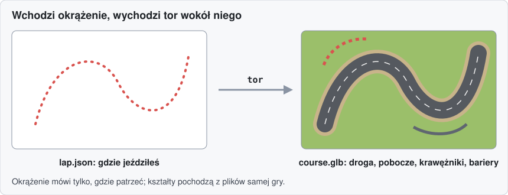
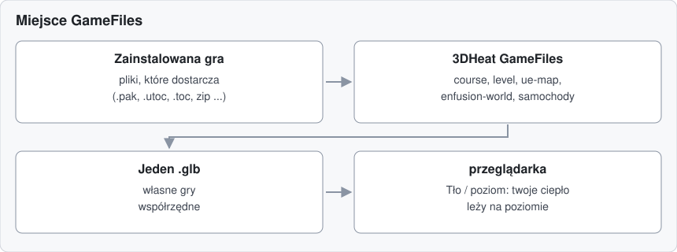

# 3DHeat GameFiles {#dheat-gamefiles}

**Czym jest?** Narzędzie, które buduje model 3D toru wyścigowego albo poziomu gry
z plików gry, którą już masz zainstalowaną.

**Po co go używać?** Przeglądarka 3DHeat maluje, gdzie jeździłeś lub grałeś, jako ciepło.
Dzięki temu narzędziu maluje to na prawdziwym torze albo poziomie, a nie w pustej przestrzeni.

**Przykład:** weź okrążenie, które przejechałeś. Narzędzie buduje wokół niego drogę i teren
jako jeden plik 3D, więc przeglądarka może namalować twoją prędkość lub wypadki na prawdziwym torze:



Nigdy nie używałeś wiersza poleceń? Zacznij od [Zanim zaczniesz](before-you-start.md).

Szczegółowo: czyta dane poziomu z archiwów, które dostarcza gra, i zapisuje je jako binarny plik glTF
(`.glb`). Jego głównym zadaniem jest **eksport toru**: podajesz okrążenie, a narzędzie zapisuje teren, drogę
odróżnioną od pobocza i trawy, krawężniki, bariery, ściany opon, znaki i budynki wokół niego.

To część [3DHeat](https://github.com/Holdi601/3DHeat), przeglądarki do mapy cieplnej telemetrii w czasie
rzeczywistym, analizy wyścigów i przeglądu meczów
([dokumentacja](https://holdi601.github.io/3DHeat/)). Pliki `.glb`, które zapisuje to narzędzie,
to poziomy, na których przeglądarka rysuje ciepło.



To jeden z trzech sposobów, by geometria poziomu trafiła do 3DHeat:

| Droga | Potrzebuje | Daje |
|---|---|---|
| 3DHeat Unreal Exporter | projekt Unreal otwarty w edytorze | dokładną geometrię |
| 3DHeat GameCapture | ekran i nagranie | przybliżenie |
| **3DHeat GameFiles** | **zainstalowaną, dostarczoną grę** | **dokładną geometrię, bez projektu** |

Pakiet Python: `heat3d_gamefiles`. Repozytorium:
[Holdi601/3DHeat-GameFiles](https://github.com/Holdi601/3DHeat-GameFiles). Licencja: MIT.

## Co potrafi {#what-it-can-do}

| Gra lub silnik | Eksport toru (`course`) | Czytanie archiwów |
|---|---|---|
| Forza Horizon (ForzaTech) | tak: teren, droga i pobocze, tekstura podłoża, umieszczone modele w ich własnych teksturach | `identify`, `list`, `extract` dla `.minizip`; `identify` dla `.modelbin`; modele, teren i tekstury przez `course` i `terrain` |
| BeamNG.drive | tak: teren, naklejki drogowe, modelowane tory, umieszczone modele, woda | `identify`, `list`, `extract` dla zip-ów poziomów; `identify` dla `.ter`, `.cdae`; `.dae` przez `course` |
| Assetto Corsa Rally (Unreal 5.6) | tak: kafle terenu etapu, zapieczona kolor podłoża, umieszczone modele w płaskich kolorach | `identify`, `list`, `extract` dla IoStore `.utoc`/`.ucas`; pakiety zen, statyczne siatki, tekstury przez `course` |
| Pakiety Unreal `.pak` (wersje 8-12) | nie | `identify`, `list`, `extract` |
| Unity (format 22 i nowszy) | nie | `identify`, `meshes` |
| Battlefield 6 (Frostbite `.toc`/`.cas`) | bez okrążenia; cały poziom przez `level`: teren, umieszczone siatki, ich mapy kolorów z `--textures` | `identify`, `levels`; paczki, siatki, teren, tekstury i rozmieszczenie przez `level` |
| Source 2 `.vpk` | nie | `identify`, `list`, `extract` |
| Gry Unreal 5 z World Partition | bez okrążenia; cała mapa przez `ue-map` (wypisywana przez `ue-maps`): teren, budynki HLOD i rekwizyty, woda | - |
| Arma Reforger (Enfusion) | bez okrążenia; cały świat przez `enfusion-world` (wypisywany przez `enfusion-worlds`): teren w swoich kolorach, morze, budynki jako pudełka | - |
| Forza (samochody) | `cars`: każdy samochód w niskim detalu, dla zakładki Analiza wyścigowa przeglądarki | - |

Okrążenia z Assetto Corsa EVO i iRacing są odrzucane z podaniem powodu. Zobacz
[Ograniczenia i znane luki](limits-and-known-gaps.md).

## Instalacja {#install}

Nigdy nie używałeś wiersza poleceń? Najpierw przeczytaj [Zanim zaczniesz](before-you-start.md).

Potrzebujesz **Pythona 3.10 lub nowszego** (rozwijany na 3.13) oraz pakietów z
[`requirements.txt`](https://github.com/Holdi601/3DHeat-GameFiles/blob/main/requirements.txt).

```
git clone https://github.com/Holdi601/3DHeat-GameFiles.git
cd 3DHeat-GameFiles
pip install -r requirements.txt
```

Sprawdź: `python -m heat3d_gamefiles --help`. Powinieneś zobaczyć
`usage: heat3d_gamefiles [-h]` i listę czasowników. Wszystkie polecenia uruchamiaj z folderu
repozytorium, jako `python -m heat3d_gamefiles <czasownik>`.

| Pakiet | Do czego |
|---|---|
| numpy | wszystko, co dekoduje geometrię |
| lz4 | archiwa Forzy (głównie bloki LZ4), niektóre paczki Unity, bloki LZ4 IoStore |
| Pillow | dekodowanie tekstur BC1-BC7, zapis tekstur JPEG w `.glb` |
| msgpack, zstandard | skompilowane kształty BeamNG (`.cdae`) |
| cryptography | tylko do otwierania zaszyfrowanego `.pak` kluczem, który już masz |
| pytest | testy |

Zawartość Unreal skompresowana przez **Oodle** wymaga biblioteki Oodle, która już jest na twoim komputerze.
Żadnej nie dołączamy do tego narzędzia. Zobacz [Oodle](reader-oodle.md).

Narzędzie jest pisane dla Windows. Znajduje gry przez listę bibliotek Steam i `%LOCALAPPDATA%`,
a Oodle ładuje jako bibliotekę DLL Windows. Inne platformy nie były testowane.

## Szybki start {#quick-start}

**Plik okrążenia** to zapis tego, dokąd pojechał twój samochód: lista punktów x, y, z.
Pochodzi z [3DHeat GameCapture](https://github.com/Holdi601/3DHeat-GameCapture)
albo z biblioteki okrążeń aplikacji FH Companion; ręcznie wpisany CSV też działa
([Dane wejściowe okrążeń](lap-inputs.md)).

```
# Forza: plik okrążenia, folder okrążeń albo nazwa toru z biblioteki FH Companion
python -m heat3d_gamefiles course "Example Circuit"
python -m heat3d_gamefiles course path\to\lap.json -o course.glb

# BeamNG.drive albo Assetto Corsa Rally: plik heat3d-lap mówi, z której gry pochodzi
python -m heat3d_gamefiles course my_lap.json

# Każdy tor z biblioteki FH Companion, po jednym .glb
python -m heat3d_gamefiles courses -o courses

# Battlefield 6: wypisz poziomy, potem eksportuj jeden (duży plik; zob. Polecenia)
python -m heat3d_gamefiles levels
python -m heat3d_gamefiles level <level> -o level.glb --textures

# Unreal 5 World Partition i Arma Reforger: wypisz, potem eksportuj
python -m heat3d_gamefiles ue-maps "<game>"
python -m heat3d_gamefiles ue-map "<game>" <map> -o map.glb
python -m heat3d_gamefiles enfusion-worlds
python -m heat3d_gamefiles enfusion-world <world> -o world.glb

# Każdy samochód Forzy, dla zakładki Analiza wyścigowa przeglądarki
python -m heat3d_gamefiles cars -o forza.h3dcars

# Co to za plik?
python -m heat3d_gamefiles identify some_archive.pak
```

Otwórz `.glb` w przeglądarce 3DHeat. Oryginalne współrzędne świata gry są zachowane
(zob. [Format wyjściowy](output-format.md)), więc nagrane okrążenie pasuje do toru.

## Mapa dokumentacji {#map-of-this-documentation}

- [Zanim zaczniesz](before-you-start.md): Python, terminal, pierwsze polecenie.
- [Polecenia](commands.md): każdy czasownik i opcja, z przykładami.
- [Opis poleceń](../cli-reference.md): `--help` każdego czasownika, generowane z kodu.
- [Przeglądanie archiwów](inspecting-archives.md): `identify`, `list`, `extract`, `meshes`, krok po kroku.
- [Eksport toru](course-export.md): jak okrążenie staje się torem, dla wszystkich gier.
  - [Forza Horizon](course-forza-horizon.md)
  - [BeamNG.drive](course-beamng.md)
  - [Assetto Corsa Rally](course-assetto-corsa-rally.md)
  - [Poziomy szczegółowości i budżet](detail-budget.md)
- [Całe poziomy](whole-levels.md): poziom, mapa albo świat bez okrążenia.
  - [Poziomy Battlefield 6](level-battlefield.md): `levels`, `level`
  - [Mapy Unreal 5](level-unreal-world-partition.md): `ue-maps`, `ue-map`
  - [Światy Arma Reforger](level-arma-reforger.md): `enfusion-worlds`, `enfusion-world`
- [Samochody Forzy](forza-cars.md): `cars`, plik samochodów dla zakładki Analiza wyścigowa przeglądarki.
- [Dane wejściowe okrążeń](lap-inputs.md): każdy kształt pliku okrążenia, jaki przyjmuje narzędzie.
- [Format wyjściowy](output-format.md): co jest w `.glb`.
- [Czytniki archiwów](archive-readers.md): jedna strona na format kontenera, z opisem tego, co czyta, czego nie czyta i dlaczego.
- [Ograniczenia i znane luki](limits-and-known-gaps.md)
- [Rozwiązywanie problemów](troubleshooting.md): komunikaty o błędach i co z nimi zrobić.
- [Zasady i licencje](rules-and-licences.md): bez kluczy, twoje własne pliki, bez redystrybucji.
- [Aktualizacje](updates.md): sprawdzanie aktualizacji i `heat3d_update`.
- [Rozwój](development.md): mapa modułów i testy, w tym testy uruchamiane na zainstalowanych grach.
- [Utrzymanie](maintaining.md): lista kontrolna wydania dla tych stron.

## Część 3DHeat {#part-of-3dheat}

3DHeat GameFiles to jedno z darmowych narzędzi wokół przeglądarki 3DHeat:

| Narzędzie | Co robi | Dokumentacja |
|---|---|---|
| [3DHeat](https://github.com/Holdi601/3DHeat) | przeglądarka: mapy cieplne 3D, analiza wyścigów i przegląd meczów w przeglądarce | [strona](https://holdi601.github.io/3DHeat/) |
| [GameFiles](https://github.com/Holdi601/3DHeat-GameFiles) | tory i poziomy z plików, które dostarcza gra, jako `.glb` | [strona](https://holdi601.github.io/3DHeat-GameFiles/) |
| [GameCapture](https://github.com/Holdi601/3DHeat-GameCapture) | telemetria okrążeń z gier wyścigowych; poziomy odtworzone z nagrań rozgrywki | [strona](https://holdi601.github.io/3DHeat-GameCapture/) |
| [Unreal Exporter](https://github.com/Holdi601/3DHeat-UnrealExporter) | wtyczka do edytora Unreal, która zapisuje poziom jako `.glb` | [strona](https://holdi601.github.io/3DHeat-UnrealExporter/) |
| [CS2](https://github.com/Holdi601/3DHeat-CS2) | dema Counter-Strike 2 jako pliki meczów; mapy jako `.glb` | [strona](https://holdi601.github.io/3DHeat-CS2/) |
| [Watcher](https://github.com/Holdi601/3DHeat-Watcher) | w tle zapisuje twoją grę z tego, co gry publikują | [strona](https://holdi601.github.io/3DHeat-Watcher/) |
| [Ext-WarThunder](https://github.com/Holdi601/3DHeat-Ext-WarThunder) | replaye War Thunder jako pliki meczów | [strona](https://holdi601.github.io/3DHeat-Ext-WarThunder/) |
| [Ext-WoT](https://github.com/Holdi601/3DHeat-Ext-WoT) | replaye World of Tanks jako pliki meczów | [strona](https://holdi601.github.io/3DHeat-Ext-WoT/) |
| [Ext-WoWs](https://github.com/Holdi601/3DHeat-Ext-WoWs) | replaye World of Warships jako pliki meczów | [strona](https://holdi601.github.io/3DHeat-Ext-WoWs/) |
| [Ext-Squad](https://github.com/Holdi601/3DHeat-Ext-Squad) | dema serwerów Squad jako pliki meczów | [strona](https://holdi601.github.io/3DHeat-Ext-Squad/) |
| [Ext-DCS](https://github.com/Holdi601/3DHeat-Ext-DCS) | mapy DCS World jako poziomy `.glb` | [strona](https://holdi601.github.io/3DHeat-Ext-DCS/) |
| [Ext-IL2](https://github.com/Holdi601/3DHeat-Ext-IL2) | mapy IL-2 Sturmovik jako poziomy `.glb` | [strona](https://holdi601.github.io/3DHeat-Ext-IL2/) |

Każdy czytnik gry to osobny mały projekt z własnym plikiem licencji, własnymi wydaniami i własnym systemem zgłoszeń, więc można go instalować, aktualizować, utrzymywać - albo wycofać na prośbę właściciela praw - niezależnie, bez wpływu na przeglądarkę i pozostałe narzędzia.

Pliki meczów przeglądarki opisano w
[Jeden plik na mecz: `.3dheat`](https://holdi601.github.io/3DHeat/container.html);
poziom zrobiony tutaj wczytuje się obok nich w panelu **Tło / poziom** przeglądarki.
