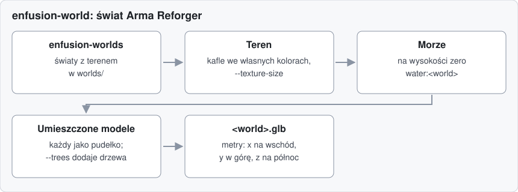

# Światy Arma Reforger: `enfusion-worlds` i `enfusion-world` {#arma-reforger-worlds-enfusion-worlds-and-enfusion-world}

**Czym to jest?** Cały świat Arma Reforger jako jeden plik 3D. **Po co?** Żeby ciepło z gry miało pod sobą teren i budynki. (*Enfusion* to silnik, na którym zrobiono Arma Reforger; *świat* to to, co gra nazywa mapą.)

Eksportuje cały świat Enfusion zainstalowanej Arma Reforger: teren w kolorach jej własnych kafelków superteksturowych, morze i każdy umieszczony model jako pudełko, w metrach samej gry.



## Krok po kroku {#step-by-step}

1. **Wypisz światy**, które mają teren:

   ```
   python -m heat3d_gamefiles enfusion-worlds
   python -m heat3d_gamefiles enfusion-worlds --install "D:\Games\Arma Reforger"
   ```

2. **Wyeksportuj jeden**, po jego nazwie folderu w `worlds/`, tak jak jest wypisana:

   ```
   python -m heat3d_gamefiles enfusion-world <world> -o world.glb
   ```

3. **Warianty:**

   ```
   python -m heat3d_gamefiles enfusion-world <world> --trees               # vegetation too, as boxes
   python -m heat3d_gamefiles enfusion-world <world> --texture-size 0      # flat colour, small file
   python -m heat3d_gamefiles enfusion-world <world> --ground-spacing 4 --no-structures
   ```

4. **Otwórz `world.glb`** w panelu Tło / poziom przeglądarki 3DHeat ([wczytywanie poziomu](https://holdi601.github.io/3DHeat/levels.html)).

## Opcje {#options}

| Opcja | Domyślnie | Znaczenie |
|---|---|---|
| `<world>` | wymagane | świat, tak jak wypisuje go `enfusion-worlds` |
| `-o`, `--out FILE` | `<world>.glb` | plik do zapisu |
| `--install FOLDER` | biblioteka Steam, w której jest gra | folder gry |
| `--ground-spacing METRES` | 2 (własne ustawienie terenu) | odstęp wierzchołków terenu w pliku |
| `--texture-size PIXELS` | 4096 | dłuższy bok obrazu koloru podłoża; 0 dla jednolitego koloru |
| `--no-structures` | | pomija umieszczone modele |
| `--trees` | wyłączone | umieszcza także drzewa i inną roślinność, jako pudełka |

## Przykładowe wyjście {#example-output}

```text
<world> -> world.glb
  ground      <n> triangles, <w> x <h> m; <n> of <n> tile-edge vertices disagree; colour <w> x <h>
  structure   <n> boxes from <n> entities
  water       <n> triangles (the sea)
  left out    <what>: <n>, ...
```

## Części {#the-parts}

`ground:<world>` (teren), `water:<world>` (morze, na wysokości zero) i `structure:<world>` (pudełka). Współrzędne są samej gry: x na wschód, y w górę, z na północ, w metrach, czyli to, co podaje nagranie z gry. Ramka gry jest lewoskrętna. *Odwróć oś świata* w przeglądarce pokazuje ją bez lustrzanego odbicia.

## Jak to się czyta i sprawdza {#how-it-is-read-and-checked}

Nie trzeba Workbencha i nic nie jest zaszyfrowane.

| Format | Czym jest | Sprawdzone względem |
|---|---|---|
| `.pak` | fragment danych i drzewo katalogów, wpisy zapisane lub zlib | drzewo zużywa swój fragment dokładnie; próbkowane wpisy zlib rozpakowują się do dokładnie podanego rozmiaru |
| `.edds` | nagłówek DDS, potem dla każdego poziomu mip fragmenty `COPY` lub `LZ4 ` | poziomy po fragmentach dekodują się do dokładnie swojego rozmiaru, zużywając dokładnie swoje bajty |
| `.terr` / `.ttile` | nagłówek i kafelki wysokości 16-bitowe | każda wspólna krawędź kafelków zgadza się dokładnie |
| supertekstura | kolor podłoża każdego kafelka, około metra na piksel | zgadza się z morzem w wysokościach; żadne odwrócenie ani transpozycja nie pasuje lepiej |
| `.ent` | nazwy, identyfikatory zasobów GUID, potem encje jako typowane wartości | plik świata parsuje się do ostatniego bajtu |
| `resourceDatabase.rdb` | GUID na ścieżkę | prawie każdy GUID używany przez świat nazywa istniejący plik |

Obiekty oznaczone jako stojące na bezwzględnej wysokości leżą w odległości centymetrów od odkodowanego terenu (przy transponowanej siatce byłyby oddalone o metry). Nie są rysowane: własne trójkąty modeli, drzewa domyślnie (`--trees` dodaje je jako pudełka), encje potomne, jeziora i rzeki, tekstury z nagłówkami sprzed DX10.

**Terminy:** licencja gry dopuszcza użytek niekomercyjny i zabrania inżynierii wstecznej plików gry. Czytanie własnej instalacji to twoja decyzja w jej ramach; wynik służy do twojego własnego użytku i nie jest do udostępniania.
