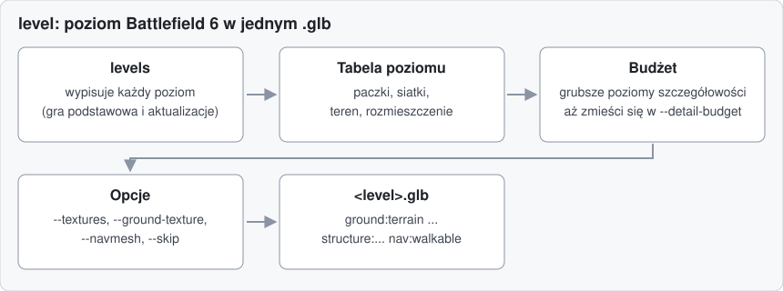

# Poziomy Battlefield 6: `levels` i `level` {#battlefield-6-levels-levels-and-level}

**Czym to jest?** Cały poziom Battlefield 6 jako jeden plik 3D. **Po co?** Żeby ciepło z twoich meczów miało pod sobą teren i budynki. (*Frostbite* to silnik, na którym zrobiono Battlefield; *mapa wysokości* to teren zapisany jako siatka wysokości.)

Eksportuje cały poziom Frostbite zainstalowanej gry: mapę wysokości terenu, każdą siatkę, którą rozmieszczają grupy statycznych modeli, obiekty umieszczone pojedynczo, tło terenu wokół mapy, a na życzenie mapy kolorów powierzchni, nakładki terenu zapieczone w podłożu i powierzchnie, po których chodzą żołnierze.



## Krok po kroku {#step-by-step}

1. **Wypisz poziomy**, które gra zawiera:

   ```
   python -m heat3d_gamefiles levels
   python -m heat3d_gamefiles levels --install "D:\Games\<game folder>"
   ```

   Każda linia to tabela poziomu (`levels/<level>/<level>.toc`) z rozmiarem i miejscem pochodzenia: `Data` dla gry podstawowej, `Update/<pack>` dla aktualizacji.

2. **Wyeksportuj jeden**, po nazwie, unikalnej części nazwy albo ścieżce jego `.toc`. Zacznij bez tekstur, żeby zobaczyć kształt i rozmiar:

   ```
   python -m heat3d_gamefiles level <level> -o level.glb
   ```

3. **Dodaj kolor**, gdy wygląda dobrze:

   ```
   python -m heat3d_gamefiles level <level> -o level.glb --textures 512 --ground-texture 0.5
   ```

4. **Dodaj powierzchnie do chodzenia** albo zmniejsz plik:

   ```
   python -m heat3d_gamefiles level <level> --textures 512 --ground-texture 0.5 --navmesh
   python -m heat3d_gamefiles level <level> --textures 256 --detail-budget 3000000 --ground-spacing 8
   ```

5. **Otwórz `level.glb`** w panelu Tło / poziom przeglądarki 3DHeat ([wczytywanie poziomu](https://holdi601.github.io/3DHeat/levels.html)).

## Opcje {#options}

| Opcja | Domyślnie | Znaczenie |
|---|---|---|
| `<level>` | wymagane | nazwa, tak jak wypisuje ją `levels`, unikalna część nazwy albo `.toc` poziomu |
| `-o`, `--out FILE` | `<level>.glb` | plik do zapisu |
| `--install FOLDER` | szukany w bibliotekach Steam | folder gry |
| `--textures [PIXELS]` | wyłączone; bez rozmiaru 512 | mapa koloru każdej powierzchni, najwyżej PIXELS na bok |
| `--ground-texture [METRES]` | wyłączone; bez wartości 0.5 | zapieka drogi, place i oznaczenia w kolor podłoża, METRES na piksel |
| `--navmesh` | wyłączone | dodaje siatkę nawigacyjną żołnierza jako `nav:walkable` |
| `--ground-spacing METRES` | 4 | najdrobniejszy odstęp mapy wysokości; 0 wyłącza ją |
| `--detail-budget N` | najgrubsze kopie plus jedna czwarta, co najmniej 1 500 000 | sufit trójkątów (teren nigdy nie jest uproszczany) |
| `--skip TEXT` | | pomija grupy modeli, których nazwa partycji zawiera TEXT; można podać wielokrotnie |
| `--by-mesh` | wyłączone | jedna część na siatkę źródłową i materiał, żeby znaleźć, czym jest część |
| `--clamped-uvs` | wyłączone | dla renderów, które nie potrafią powtarzać tekstury |

Pełna tabela, z rozmiarami, których można się spodziewać (cały poziom ma setki MB), jest na stronie [Polecenia](commands.md#levels-and-level-frostbite). Jak czyta się tabele, pakiety, siatki i teren, opisano na [Frostbite](reader-frostbite.md).

## Przykładowe wyjście {#example-output}

Co wypisuje `level`, w zarysie (wiersze tak, jak je pisze kod; `<n>` i nazwy zmieniają się zależnie od poziomu):

```text
<n> copies of <n> meshes, from <n> static model groups
      <n>  <group>
      <n>  placed one by one (object and prefab references)
<n> meshes left out: <why>
<n> triangles, budget <n>; <n> meshes drawn at a coarser level to fit
           <n>  ground:terrain
           <n>  structure:buildings, <n> textures
           ...
<n> of <n> drawn sections carry their colour map; the rest are flat colours
Ground: <what the ground is>.
Navigation mesh: <tiles read>.
-> level.glb (<n> MB)
```

## Części {#the-parts}

`ground:terrain` (mapa wysokości), `ground:terrain backdrop` i `ground:terrain blend`, `structure:<kind>` dla każdego rodzaju siatki (dla każdej mapy kolorów przy `--textures`, z dopiskiem ` (destructible)` dla rzeczy, które mogą zostać zniszczone w meczu), oraz `nav:walkable` przy `--navmesh`. Zobacz [Format wyjściowy](output-format.md).

Plik zawiera treści gry: jest przeznaczony na maszynę, na której powstał, a nie do przekazywania dalej ([Zasady i licencje](rules-and-licences.md)).
