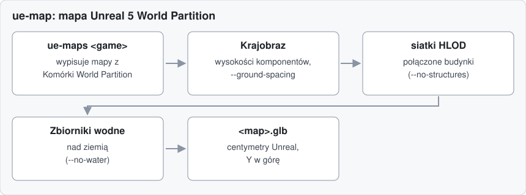

# Mapy Unreal 5 World Partition: `ue-maps` i `ue-map` {#unreal-5-world-partition-maps-ue-maps-and-ue-map}

**Czym to jest?** Cała mapa gry na Unreal 5 jako jeden plik 3D: podłoże, budynki i woda. **Po co?** Żeby ciepło z tej gry miało pod sobą mapę. (*World Partition* to sposób, w jaki Unreal 5 dzieli dużą mapę na kawałki; *HLOD* to uproszczony zastępnik grupy budynków, ten, który gra rysuje z daleka.)

Eksportuje całą mapę gry na Unreal 5, której mapy są zapieczone jako komórki World Partition: landscape, scalone siatki HLOD mapy (jej budynki i rekwizyty tak, jak gra je rysuje z daleka) i jej zbiorniki wodne. Nie potrzeba edytora ani projektu, tylko zainstalowanej gry.



## Krok po kroku {#step-by-step}

1. **Wypisz mapy.** `<game>` to folder gry, jej `Content/Paks` albo nazwa jej folderu w bibliotece Steam:

   ```
   python -m heat3d_gamefiles ue-maps "<Steam game folder name>"
   python -m heat3d_gamefiles ue-maps "D:\Games\<game>"
   ```

   Każda mapa z zapieczonymi komórkami World Partition jest wypisana wraz ze ścieżką pakietu.

2. **Wyeksportuj jedną**, po nazwie albo unikalnej części nazwy:

   ```
   python -m heat3d_gamefiles ue-map "<game>" <map> -o map.glb
   ```

3. **Samo podłoże albo grubiej:**

   ```
   python -m heat3d_gamefiles ue-map "<game>" <map> --no-structures --no-water
   python -m heat3d_gamefiles ue-map "<game>" <map> --ground-spacing 4
   ```

4. **Otwórz `map.glb`** w panelu Tło / poziom przeglądarki 3DHeat ([wczytywanie poziomu](https://holdi601.github.io/3DHeat/levels.html)).

## Opcje {#options}

| Opcja | Domyślnie | Znaczenie |
|---|---|---|
| `<game>` | wymagane | folder gry, jej `Content/Paks` albo nazwa jej folderu Steam |
| `<map>` | wymagane | nazwa, tak jak wypisuje ją `ue-maps`, albo unikalna jej część |
| `-o`, `--out FILE` | `<map>.glb` | plik do zapisu |
| `--ground-spacing METRES` | 2 | odstęp wierzchołków landscape, zaokrąglony do całkowitej liczby jego własnych kwadratów |
| `--no-structures` | | pomija budynki i rekwizyty HLOD |
| `--no-water` | | pomija zbiorniki wodne |

Treści kompresowane Oodle wymagają biblioteki Oodle już zainstalowanej na komputerze (zob. [Oodle](reader-oodle.md)).

## Przykładowe wyjście {#example-output}

```text
<map> -> map.glb
  ground      <n> triangles from <n> landscape components; <n> of <n> vertices stored twice disagree
  structure   <n> triangles in <n> HLOD meshes
  water       <n> triangles from <n> water bodies
```

Liczba niezgodności to samokontrola: sąsiednie komponenty landscape zapisują wspólną krawędź dwa razy, a obie wersje muszą się zgadzać. Mapa 3 km przy 2 m to około 4,6 miliona trójkątów podłoża.

## Części {#the-parts}

`ground:<map>` (landscape), `structure:<map>` (siatki HLOD) i `water:<map>` (woda leżąca nad podłożem).

**Jednostki:** to jedyny eksport, który **nie jest w metrach**: centymetry Unreala, z zamienionymi osiami Y i Z (Y w górę), ramka, którą zapisuje 3DHeat Unreal Exporter. Telemetria z tej samej gry używa tej samej ramki, więc leży na mapie.

## Jak to się czyta i sprawdza {#how-it-is-read-and-checked}

| Część | Czytana z | Sprawdzona względem |
|---|---|---|
| podłoże | 16-bitowej mapy wysokości każdego komponentu landscape, umieszczonej przez bazę sekcji na przekształceniu landscape | każdy wierzchołek zapisany dwa razy (na szwie albo krawędzi komponentu) musi się zgadzać; niezgodności są liczone i wypisywane, a nie wygładzane |
| struktury | scalone siatki HLOD mapy, zbudowane przez silnik we współrzędnych świata | siatka jest zachowywana tylko wtedy, gdy granice, które cache'uje jej komponent, opisują jej własne wierzchołki |
| woda | siatka każdego zbiornika wodnego, położona na siatce podłoża, zachowana tam, gdzie stoi nad podłożem | woda leży kilka metrów nad podłożem pod nią, jak rzeka nad swoim korytem |

Właściwości landscape odnajduje się po kształcie, a nie po numerze slotu (sloty przesuwają się między wersjami silnika). Struktury to uproszczone zastępniki, a nie pełnoszczegółowe modele. Roślinność, nakładki i materiały landscape nie są eksportowane; podłoże jest bez tekstury i cieniowane przez przeglądarkę. Szczegóły archiwów: [Unreal 5 IoStore](reader-unreal-iostore.md).

**Twoje własne pliki:** mapa jest odczytywana z gry zainstalowanej na twoim komputerze i zapisywana na twoim dysku, do twojej własnej analizy; nic z gry nie jest dołączane do tego narzędzia.
