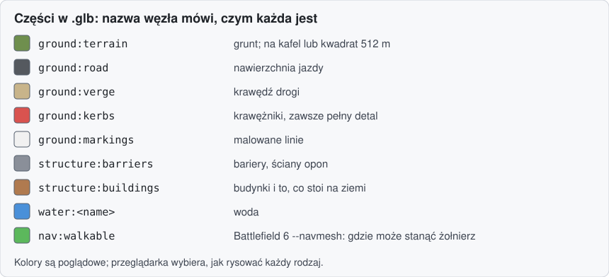

# Format pliku wyjściowego {#output-format}

Plik `.glb` to jeden plik 3D: grunt, budynki i woda toru albo poziomu, który
otwierasz w panelu Tło / poziom przeglądarki 3DHeat.

Każdy eksport (`course`, `courses`, `terrain`, `level`, `ue-map`, `enfusion-world`) zapisuje jeden plik
**binary glTF 2.0** (`.glb`). Jest celowo mały i płaski, i ułożony tak, jak przeglądarka
3DHeat czyta poziom. Źródło:
[`glb.py`](https://github.com/Holdi601/3DHeat-GameFiles/blob/main/heat3d_gamefiles/glb.py).

## Struktura {#structure}

```
scene 0
 ├─ node "ground:terrain x-2046 z1023"  -> mesh 0 -> 1 primitive, material 0
 ├─ node "ground:road x-2046 z1023"     -> mesh 1 -> 1 primitive, material 1
 ├─ node "ground:markings"               -> mesh 2 -> ...
 ├─ node "ground:kerbs road_gen_rum_..." -> ...
 ├─ node "structure:barriers bar_armco_bclr"
 └─ ...
```

- **Jeden węzeł na część**, wszystkie w korzeniu sceny, **bez przekształceń**. Cała geometria jest już we współrzędnych świata.
- Każdy węzeł ma własną siatkę z **jednym prymitywem** i własnym materiałem. Węzeł, siatka i materiał niosą nazwę części.
- Każdy prymityw ma **własne, zwarte tablice wierzchołków**, tylko te wierzchołki, których część używa. Wspólna tablica wierzchołków jest poprawnym glTF, ale czytnik, który rozwija akcesory każdego prymitywu, trzymałby każdy wierzchołek tyle razy, ile jest części.
- `asset.generator` to `heat3d_gamefiles`.
- **Niewiele `extras`** i żadnej nazwy gry, toru ani poziomu:
  - część zniszczalnej siatki Battlefield 6 niesie `{"destructible": true}` w swoim węźle;
  - eksport toru Forza mówi, co zawiera, w `asset.extras` (wersja formatu, dopasowany identyfikator trasy, ile kopii warstwy własnej wyścigu, areny; zobacz [Tory Forza Horizon](course-forza-horizon.md#writing-the-file)), a jego włączane części niosą swoją warstwę w węźle: `{"layer": "event", "route": <id>}` dla warstwy własnej wyścigu, `{"layer": "layer"}` dla innej włączanej warstwy, `{"layer": "venue"}` dla gruntu areny.

  Wszystko inne, czego potrzebuje przeglądarka, jest w nazwach węzłów.

## Nazwy węzłów: klasyfikacja {#node-names-the-classification}



Przeglądarka bierze klasę części z **nazwy węzła** (w zastępstwie nazwy siatki),
i tylko wtedy, gdy nazwa pasuje do wzorca

```
^(ground|structure|water)\s*[:|]
```

Wszystko inne jest klasyfikowane heurystyką napisaną dla krajobrazów Unreal. Dlatego
każda część, którą pisze eksporter, zaczyna się jednym z tych prefiksów albo od
`nav:` (poniżej).

| Prefiks | Znaczenie | Zapisywane części |
|---|---|---|
| `ground:` | powierzchnia jazdy i ziemia | `ground:road`, `ground:verge`, `ground:terrain`, `ground:gravel and dirt`, `ground:kerbs`, `ground:markings`, `ground:tyre marks`, `ground:venue`, `ground:plinths` |
| `structure:` | to, co na tym stoi | `structure:barriers`, `structure:props`, `structure:signs`, `structure:buildings`, `structure:infrastructure`, `structure:bridges`, `structure:rocks`, `structure:smashables`, `structure:trees`; warstwy Forza `structure:event_<category>` i `structure:layer_<category>` |
| `water:` | woda | `water:water`; `water:<map>` (`ue-map`), `water:<world>` (`enfusion-world`) |
| `nav:` | gdzie może iść żołnierz (Battlefield 6, tylko z `--navmesh`) | `nav:walkable` |

`nav:` nie pasuje do wzorca przeglądarki powyżej, więc przeglądarka sortuje go heurystyką;
to osobna część, żebyś mógł ją pokazać lub ukryć osobno. `ue-map` zapisuje
`ground:<map>`, `structure:<map>` i `water:<map>`; `enfusion-world` zapisuje
`ground:<world>`, `structure:<world>` i `water:<world>`.

Po rodzaju następuje, zależnie od gry:

| Przykład | Znaczenie |
|---|---|
| `ground:road x-2046 z1023` | grunt Forzy w kaflu terenu o nazwie `x-2046 z1023` (jednostki siatki, 1023 na 512 m) |
| `ground:road 3_-2` | grunt BeamNG w kwadracie 512 m (3, -2) |
| `ground:road 3_-2 asphalt_light` | modelowana powierzchnia jezdna BeamNG materiału `asphalt_light` w tym kwadracie |
| `ground:road 1_-4` | grunt AC Rally w kwadracie 512 m (1, -4) przestrzeni Unreal |
| `structure:barriers bar_armco_bclr` | modele Forzy umieszczone, dzielące jedną teksturę (ich nazwa bez GUID) |
| `structure:barriers` | modele umieszczone bez tekstury (Forza, AC Rally) |
| `structure:event_barriers bar_example_bclr` | Forza: to, co dopasowany wyścig wystawia dla siebie, osobno od wolnej jazdy (dodatki węzła `{"layer": "event", "route": <id>}`) |
| `structure:layer_props` | Forza: warstwa, którą gra włącza dla czegoś innego niż ten wyścig (aktywność, znajdźka, warstwa w czasie działania) |
| `ground:venue`, `ground:plinths` | Forza: modele już we współrzędnych świata - własny grunt areny (podłoga stadionu) i grunt, którym ubrano ulicę |
| `structure:barriers armco_metal` | modele umieszczone BeamNG jednego materiału |
| `ground:markings`, `water:water` | płaskie części, po jednej na cały plik |
| `ground:terrain` (Battlefield 6) | mapa wysokości; `ground:terrain backdrop` to odległe siatki terenu, `ground:terrain blend` to siatki, które wtapiają się w teren |
| `nav:walkable` (Battlefield 6, `--navmesh`) | siatka nawigacyjna poziomu dla żołnierza: gdzie można stać, płaski zielony |
| `ground:terrain x-512 z-512` (Battlefield 6, `--ground-texture`) | mapa wysokości pod jednym zapieczonym kaflem dekali, nazwana po niskim rogu kafla w metrach |
| `structure:buildings t_concreteclean_01_cs` (Battlefield 6, `--textures`) | każda powierzchnia tego rodzaju pokazująca tę mapę kolorów; bez `--textures` jedna część na rodzaj, bez przyrostka |
| `structure:buildings t_concreteclean_01_cs (destructible)` (Battlefield 6) | to samo, dla siatek, które mecz może zniszczyć: tych z własnym zasobem zniszczenia o tej samej nazwie (ściany, domy, rekwizyty). Węzeł niesie też dodatki glTF `{"destructible": true}`. Ich stany po zniszczeniu nie są eksportowane |

Przeglądarka może filtrować według tych nazw. Na przykład "tylko powierzchnia wyścigowa" to
`ground:road` razem z `ground:kerbs`, we wszystkich trzech grach, a "świat bez rekwizytów
wyścigu" to wszystko poza `structure:event_*`. Prefiks decyduje też o tym, jak
przeglądarka rysuje część: grunt jako powierzchnię, na której leży ciepło, a
struktury jako to, co na niej stoi.

## Jednostki, osie i układ {#units-axes-and-frame}

- **Metry, Y w górę**, konwencja glTF, dla każdego eksportu poza `ue-map`. Niczego nie przeskalowuje się ani nie przesuwa środka: liczby to współrzędne świata gry, i o to chodzi, że czyta się archiwum zamiast je odtwarzać.
- **Mapy Unreal 5 (`ue-map`): centymetry**, własna jednostka Unreal, z zamienionymi osiami Y i Z, tak żeby Y było w górę - układ, który zapisuje 3DHeat Unreal Exporter i którego używa telemetria gry. Jedyny eksport nie w metrach.
- **Arma Reforger (`enfusion-world`):** metry gry, x na wschód, y w górę, z na północ. Układ gry jest lewoskrętny; opcja przeglądarki *invert world axis* pokazuje go nieodwróconego.
- **Forza:** współrzędne świata gry (x, y w górę, z), bez zmian. Takie same jak w jej telemetrii, więc nagrane okrążenie leży na torze.
- **BeamNG.drive:** `(x, z, -y)` świata BeamNG z osią Z w górę, czyli obrót, który stosuje rejestrator telemetrii. Obrót, a nie odbicie lustrzane.
- **Battlefield 6:** współrzędne świata gry (x, y w górę, z), bez zmian: przekształcenia instancji poziomu są zastosowane do każdej siatki tak, jak są zapisane. Lustrzane kopie mają ponownie nawinięte trójkąty, żeby ich normalne wskazywały na zewnątrz.
- **Assetto Corsa Rally:** układ okrążenia. Centymetry Unreal stają się metrami, Z Unreal staje się y, a X i Y Unreal stają się x i z w jednej z ośmiu orientacji, którą dopasowało okrążenie (zobacz [Assetto Corsa Rally](course-assetto-corsa-rally.md#which-stage-and-which-way-round)). Trójkąty są nawijane ponownie tam, gdzie to odwzorowanie odbija.

Każdy eksport zachowuje osie, których używa jego telemetria, więc nagranie i poziom
mają wspólny układ. Nie sprawdzono jeszcze, czy ten układ jest lewo- czy prawoskrętny
w każdej grze.

## Dane wierzchołków {#vertex-data}

Domyślna jest postać **skwantowana** (`quantize=True`). Wymaga rozszerzenia
`KHR_mesh_quantization`, wpisanego zarówno w `extensionsUsed`, jak i w `extensionsRequired`.

| Atrybut | Skwantowany (domyślny) | Pełna precyzja (`quantize=False`) |
|---|---|---|
| `POSITION` | float32 VEC3, z min/max | float32 VEC3 |
| `NORMAL` | int8 VEC3 znormalizowany, dopełniony do 4 bajtów (krok 4) | float32 VEC3 |
| `TEXCOORD_0` (tylko części z teksturą) | uint16 VEC2 znormalizowany, przycięty do 0-1; float32 VEC2 tam, gdzie tekstury się powtarzają (Battlefield 6) | float32 VEC2 |
| `COLOR_0` (części bez tekstury, gdy jakaś część ma kolor) | uint8 VEC3 znormalizowany, dopełniony do 4 bajtów | float32 VEC3 |
| indeksy | uint16, gdy część ma co najwyżej 65 535 wierzchołków, inaczej uint32 | uint32 |

Wierzchołek ma 20 bajtów zamiast 32 (24 zamiast 44 z kolorem). To zabiera jedną trzecią
każdego pliku i decyduje, czy miejski tor ładuje się w karcie przeglądarki, czy nie.
Koszt to mniej niż pół stopnia normalnej i 1/65 535 UV (piętnasta część texela przy
4 096 px). Wiersz poleceń zawsze zapisuje postać skwantowaną. `write_glb(..., quantize=False)`
w Pythonie zapisuje drugą.

Normalne pochodzą z gry, tam gdzie ją je zapisuje (teren i modele Forzy, kształty i teren BeamNG).
W innych przypadkach są liczone jako wygładzone normalne ważone polem z trójkątów. Normalne AC Rally
są zawsze liczone.

## Materiały, kolory i tekstury {#materials-colours-and-textures}

- Każdy materiał ma `metallicFactor 0`, `roughnessFactor 1`.
- **Część z teksturą:** `baseColorTexture` z obrazem części, UV i bez koloru wierzchołków. glTF mnoży oba, więc powierzchnia wyszłaby podwójnie przyciemniona.
- **Część bez tekstury:** kolor wierzchołków `COLOR_0` z płaskim kolorem części i białym `baseColorFactor`. Jeśli żadna część w pliku nie ma koloru, nie ma `COLOR_0`. Tam, gdzie części dzielą wierzchołki, wygrywa kolor późniejszej części, więc płaskie części są zapisywane w kolejności rosnącej ważności.
- **Obrazy** są osadzone w fragmencie binarnym jako **JPEG**, jakość 90, bez podpróbkowania chrominancji, tylko RGB (alfa jest odrzucana) - z wyjątkiem wycinanej mapy Battlefield 6 (liście, płoty), która jest **PNG** z alfą, na materiale z `alphaMode` MASK, `alphaCutoff` 0,5 i `doubleSided` (zobacz [Frostbite](reader-frostbite.md#textures-and-materials)). Przeglądarka 3DHeat odrzuca texele poniżej progu. Grunt 2048 px z trawą i koronami drzew to szum dla kodera bezstratnego: kilka megabajtów kafla jako PNG, poniżej jednego jako JPEG. Obraz współdzielony przez kilka części jest zapisany raz.
- Jeden próbnik dla wszystkich tekstur: liniowe powiększanie, liniowo-mipmapowe pomniejszanie, **przycięcie do krawędzi** w obu osiach, dla eksportów torów, których tekstury pokrywają powierzchnie raz. BeamNG rysuje powtarzające się tekstury modeli jako płaskie kolory (zobacz [BeamNG.drive](course-beamng.md#placed-models)).
- Eksport Battlefield 6 z `--textures`, którego materiały się powtarzają, zapisuje własne współrzędne tekstur gry, bez przycinania, jako float32 `TEXCOORD_0` nawet w postaci skwantowanej, z próbnikiem, który **powtarza** w obu osiach (`write_glb(..., repeat=True)`): ceglany mur to jedna para trójkątów, której UV biegnie od 0 do 40. Przeglądarka 3DHeat zawija taką teksturę w swoim atlasie (zobacz jej stronę *Model levels*). Dla renderera, który nie umie powtarzać tekstury, `level --clamped-uvs` (`write_level(..., clamped=True)`) tnie każdy trójkąt wzdłuż linii, gdzie jego tekstura się powtarza, i przesuwa każdy kawałek w 0..1: te same piksele na tej samej powierzchni, około jedną piątą więcej trójkątów. Trójkąty, na których tekstura powtarza się ponad 16 razy, zachowują swoje współrzędne. Trójkąt, który jego tekstura pocięłaby na więcej niż 4 kawałki - kora powtarzająca się wzdłuż każdej gałęzi drzewa, której cięcie zamieniło 1 099 trójkątów jednego drzewa w 51 735 - trafia do własnej części `<part> (average colour)`, w średnim kolorze tekstury; `level` podaje, ile ich jest.

| Tekstura | Rozmiar | Pokrywa |
|---|---|---|
| grunt (wszystkie gry poza Battlefield 6) | `--texture-size`: 2048, 1024 albo 512 px | jeden kwadrat 512 m: 25, 50 albo 100 cm na piksel |
| mapa wysokości Battlefield 6 | największy mip mapy kolorów tła poziomu, przycięty | kwadrat terenu: 32 m na piksel w sprawdzonym poziomie |
| powierzchnie Battlefield 6 | `--textures`: co najwyżej tyle px na bok | własna tekstura powierzchni, raz na kawałek (cięta tam, gdzie się powtarza) |
| zapieczony grunt Battlefield 6 | `--ground-texture`: metry na piksel, kafle do 4 096 px | jeden kafel obszaru dekali: 2 048 m przy 0,5 m na piksel |
| model umieszczony Forzy | co najwyżej 256 px | własny układ UV modelu |
| model umieszczony BeamNG | co najwyżej 256 px | własny układ UV modelu, tylko tam, gdzie się nie powtarza |
| model umieszczony AC Rally | brak | płaskie kolory |

## Co zapisujący odrzuca {#what-the-writer-refuses}

`write_glb` zgłasza błąd, zamiast zapisać plik, który przeglądarka otworzyłaby i pokazała
błędnie:

| Odrzucane | Dlaczego |
|---|---|
| pozycje nie N x 3 albo nieskończone | zepsuta siatka |
| indeks poza końcem listy wierzchołków | renderuje się jako szum |
| część z teksturą, gdy plik nie ma UV | renderuje się jako jeden rozmazany piksel |
| zero trójkątów | renderuje się jako nic |
| tablica normalnych, kolorów albo UV o złej długości albo nieskończona | potrzebna jest jedna wartość na wierzchołek |

## Czytanie gdzie indziej {#reading-it-elsewhere}

Każdy glTF 2.0 viewer, który obsługuje `KHR_mesh_quantization`, powinien otworzyć te
pliki. Sprawdzono tylko przeglądarkę 3DHeat; inne przeglądarki nie są zweryfikowane.
Czytnik bez tego rozszerzenia odrzuca plik, bo jest oznaczone jako wymagane. Pliki mogą
być duże: około 80 MB dla krajowego toru, do kilkuset MB dla miejskiego toru z
automatycznym budżetem.

## W 3DHeat {#in-3dheat}

Załaduj `.glb` w panelu Tło / poziom przeglądarki [3DHeat](https://github.com/Holdi601/3DHeat);
telemetria, którą nagrasz w tej samej grze, leży na nim, bo obie strony zachowują
współrzędne gry. Dokumentacja samej przeglądarki
([holdi601.github.io/3DHeat](https://holdi601.github.io/3DHeat/)) opisuje panel Tło / poziom
i pliki z przejazdami, które zapisują inne narzędzia
([Jeden plik na przejazd: `.3dheat`](https://holdi601.github.io/3DHeat/container.html)).
Poziom nie jest zapisany w każdym pliku `.3dheat`: przejazd nazywa go w swoich
`references` (`kind: "level"`, nazwa i sha256), a `.glb` zostaje obok przejazdów.
