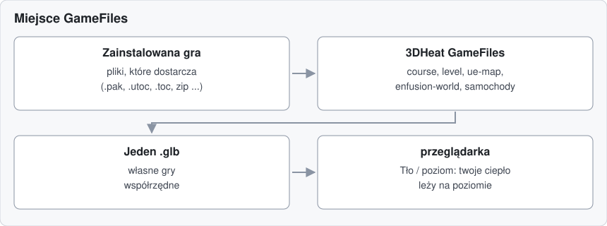

# Całe poziomy {#whole-levels}

**Prostymi słowami:** w strzelankach i innych grach bez okrążeń narzędzie zapisuje całą mapę
jako jeden plik 3D, żeby przeglądarka mogła narysować, gdzie gracze się poruszali.

`course` wycina teren wokół okrążenia. Dla gier bez okrążeń narzędzie eksportuje cały poziom,
mapę albo świat naraz:

| Gra albo silnik | Lista | Eksport | Strona |
|---|---|---|---|
| Battlefield 6 (Frostbite) | `levels` | `level <level>` | [Poziomy Battlefield 6](level-battlefield.md) |
| Gry Unreal 5 z World Partition | `ue-maps <game>` | `ue-map <game> <map>` | [Mapy Unreal 5](level-unreal-world-partition.md) |
| Arma Reforger (Enfusion) | `enfusion-worlds` | `enfusion-world <world>` | [Światy Arma Reforger](level-arma-reforger.md) |

Każda para działa tak samo: pierwsze polecenie wypisuje to, co ma zainstalowana gra, a drugie
zapisuje jedną z nich jako pojedynczy `.glb` we współrzędnych świata tej gry, dzięki czemu pozycje
nagrane w tej grze leżą na nim. Części nazywają się `ground:`, `structure:` i `water:`, jak każdy
inny eksport (zobacz [Format wyjściowy](output-format.md)); wczytaj plik w panelu Tło / poziom
przeglądarki 3DHeat.

