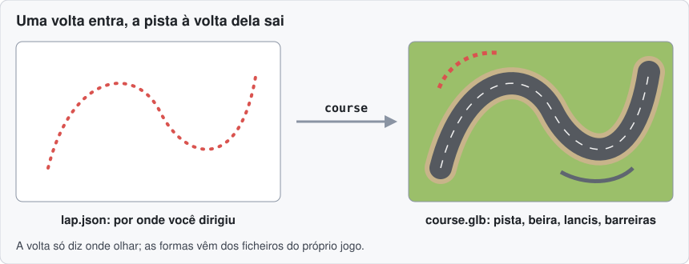
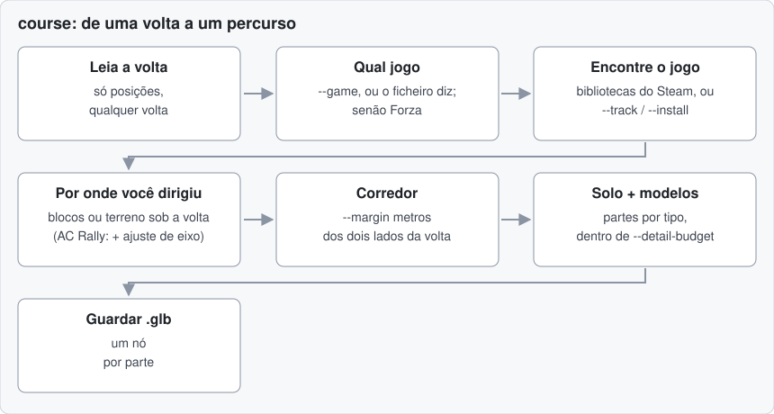

# Exportação do percurso {#course-export}

**Em palavras simples:** uma volta foi feita; isto monta o percurso que ela percorreu, como um ficheiro 3D. A volta é só uma linha de pontos; a estrada, a relva e
os lancis vêm dos próprios ficheiros do jogo.

`course` transforma uma volta num percurso: o solo numa faixa dos dois lados
por onde o carro foi, e o que fica em pé sobre esse solo, tudo num único `.glb`
para o visualizador. Esta página cobre o que os três jogos suportados têm em
comum. As páginas abaixo dela cobrem o que muda:

- [Forza Horizon](course-forza-horizon.md): ficheiros `.minizip` do ForzaTech
- [BeamNG.drive](course-beamng.md): ficheiros zip, um heightfield de terreno, formas compiladas
- [Assetto Corsa Rally](course-assetto-corsa-rally.md): Unreal 5 IoStore, uma etapa World Partition
- [Níveis de detalhe e o orçamento](detail-budget.md): quantos triângulos os modelos colocados recebem, e quais cópias ficam

## As etapas {#the-steps}

Palavras usadas abaixo: um **referencial** é a direção para onde os eixos apontam;
o **corredor** é a faixa de solo dos dois lados da volta; um **tile** é uma peça
quadrada do terreno de um jogo; um **LOD** (nível de detalhe) é uma das cópias
mais simples de um modelo.

1. **Ler a volta.** Só as posições, de qualquer um dos formatos de
   [Entradas de volta](lap-inputs.md). A velocidade e os controlos não são usados.
   Uma volta com menos de duas amostras é recusada ("holds no driving").
2. **Decidir o jogo.** `--game`, depois o campo `game` do ficheiro da volta, e
   então o Forza (veja [Comandos](commands.md#which-game)).
3. **Achar o jogo instalado.** Os três procuram em todas as bibliotecas da Steam
   listadas no `config\libraryfolders.vdf` da Steam. O Forza também procura em
   `C:\XboxGames`. `--track` (Forza) ou `--install` (BeamNG, AC Rally) saltam a busca.
4. **Achar onde a volta foi dada.** Isso nunca é decidido só por um nome. O Forza
   escolhe a pista cujos tiles de terreno cobrem a volta. O BeamNG escolhe o nível
   cujo terreno (ou estradas) recebe as amostras da volta. O AC Rally testa cada
   etapa em oito orientações de eixo e escolhe a que põe mais da volta sobre a estrada.
5. **Recortar um corredor** de `--margin` metros dos dois lados da pilotagem (veja abaixo).
6. **Montar o solo** dentro do corredor, classificado como estrada, berma,
   gravilha e terra, terreno, marcações, marcas de pneu ou água, e assar uma
   textura de solo para cada quadrado de 512 m.
7. **Colocar os modelos** que estão no corredor, por categoria, num nível de
   detalhe escolhido pela distância e por um orçamento de triângulos.
8. **Escrever o `.glb`**: um nó nomeado por parte. Veja [Formato de saída](output-format.md).

O que uma execução imprime. Aqui, num BeamNG.drive sintético que os testes
montam, uma volta de 50 m por uma faixa de estrada:

## O corredor {#the-corridor}

O recorte é uma faixa em volta da linha percorrida, e não a caixa envolvente da
volta. Num circuito as duas são quase iguais. Numa corrida ponto a ponto a caixa
fica sobretudo em encosta que ninguém percorre, e a faixa pode ter um décimo da
área dela. Fonte:
[`corridor.py`](https://github.com/Holdi601/3DHeat-GameFiles/blob/main/heat3d_gamefiles/corridor.py).

Como ela é montada:

- A pilotagem é projetada no plano do solo: x e z da volta
  (BeamNG: x e y do próprio referencial do jogo).
- Ela é rasterizada numa grade de células de **4 m** (`CELL`). Cada célula que a
  pilotagem toca é alargada por um disco de raio `margin + 4 m` em todas as direções.
- Amostras consecutivas com menos de **50 m** de distância (`JOIN`) são ligadas
  por pontos a cada 4 m, para que a faixa não tenha falhas. Amostras mais distantes
  são tratadas como trechos separados de pilotagem e não são ligadas. Uma biblioteca
  de percursos são vários ficheiros de volta em sequência, e o fim de um sprint e o
  começo do próximo não podem desenhar uma faixa atravessando o mapa.
- Um triângulo é mantido se algum canto, o meio de alguma aresta ou o seu centroide
  estiver na faixa. Os pontos do meio apanham um triângulo grande que atravessa uma
  faixa estreita com todos os cantos de fora.
- A altura nunca faz parte do recorte. Uma caixa que limitasse a altitude cortaria
  o solo de baixo de uma encosta que a estrada sobe.

O consola informa a área do corredor, por exemplo
`cutting 80 m either side of the driving: 1.53 km2 of a 6,000 by 3,600 m box`.

O BeamNG e o AC Rally também montam um corredor de **alcance** mais largo, de
`margin + 60 m`. Um modelo colocado é considerado se a sua origem estiver no corredor
de alcance, e só é desenhado se a sua pegada tocar o corredor real. Assim, um objeto
longo cuja origem fica logo fora da faixa não se perde. O BeamNG também usa o
corredor de alcance para escolher quais decalques de estrada pintar.

## Do que é feito o solo {#what-the-ground-is-made-of}

Toda exportação classifica os triângulos de solo nos mesmos tipos, e cada tipo é
escrito como uma parte própria, para que o visualizador possa mostrar ou esconder:

| Tipo | Nome da parte | Cor chapada (RGB linear) | Forza | BeamNG | AC Rally |
|---|---|---|---|---|---|
| estrada | `ground:road` | 0.22, 0.22, 0.23 | faixas de estrada: a parte de asfalto | modelos de camada `ASPHALT`, decalques de estrada, estrada modelada | tiles de pista (`/MeshesTrack/`) |
| berma | `ground:verge` | 0.52, 0.47, 0.30 | faixas de estrada: o ombro | passeios e modelos de berma | - |
| gravilha e terra | `ground:gravel and dirt` | 0.50, 0.42, 0.30 | - | camadas e decalques de terra, gravilha, areia e lama | - |
| terreno | `ground:terrain` | 0.30, 0.44, 0.18 | todo o resto | todo o resto | tiles `_Terrain` e terreno distante |
| lancis | `ground:kerbs` | 0.60, 0.12, 0.10 (Forza) | props `road_gen_rum*` | modelos de lancil, guia e de passadeira | modelos de lancil e guia |
| marcações | `ground:markings` | 0.90, 0.90, 0.88 | submalhas de decalque, elevadas 5 cm | pintadas na textura | - |
| marcas de pneu | `ground:tyre marks` | 0.20, 0.17, 0.16 | submalhas de decalque, elevadas 5 cm | pintadas na textura | - |
| água | `water:water` | 0.16, 0.34, 0.48 | materiais de água | plano do mar, blocos de água, rios | - |

As cores chapadas são escolhidas para ler bem de relance, não para imitar o jogo.
Elas servem às partes sem textura e aos visualizadores que ignoram texturas. Fonte:
[`surfaces.py`](https://github.com/Holdi601/3DHeat-GameFiles/blob/main/heat3d_gamefiles/surfaces.py).

As partes de solo são divididas por quadrado de 512 m, e cada quadrado carrega a
sua própria imagem assada, então os nomes das partes levam o quadrado:

| Jogo | Nome da parte de solo | Chave do quadrado |
|---|---|---|
| Forza | `ground:road x-2046 z1023` | o nome da grade do tile de terreno (passos de 1023, veja [Forza Horizon](course-forza-horizon.md)) |
| BeamNG | `ground:road 3_-2` | `floor(x / 512)`, `floor(y / 512)` em metros do BeamNG |
| AC Rally | `ground:road 1_-4` | `floor(x / 51200)`, `floor(y / 51200)` em centímetros do Unreal |

## O que fica em pé sobre ele {#what-stands-on-it}

Os modelos colocados são escritos em partes chamadas `structure:<categoria>`, ou
`ground:kerbs` para os lancis (nos três jogos). Quando uma parte tem a própria
textura, o nome da textura ou do material segue a categoria, por exemplo
`structure:barriers bar_armco_bclr`.

| Categoria | Forza | BeamNG | AC Rally |
|---|---|---|---|
| barreiras | sim | sim | sim |
| objetos de cenário | sim | sim | sim |
| placas | sim | sim | sim |
| edificações | sim (edificações inteiras de substituição, quando o jogo as tem) | sim | sim |
| infraestrutura | sim | sim | sim |
| pontes | sim | sim | (classificadas como infraestrutura) |
| rochas | sim | sim | sim |
| lancis | sim, como solo | sim, como solo | sim, como solo |
| árvores | com `--trees` | com `--trees` | com `--trees` |
| objetos esmagáveis | com `--trees` | - | - |

A divisão do detalhe é a mesma nos três. Cópias a até 25 m da pilotagem começam
no detalhe total, cópias a 25-60 m ficam um nível mais grosseiras, e cópias mais
longe ficam no nível mais grosseiro. Depois, os modelos mais caros descem de nível
até que um orçamento de triângulos caiba, e onde nem os níveis mais grosseiros
cabem num orçamento informado, cópias são deixadas de fora. Os lancis nunca
são simplificados nem deixados de fora. Veja [Níveis de detalhe e o orçamento](detail-budget.md).

## Opções que mudam o resultado {#options-that-shape-the-result}

| Quer | Use |
|---|---|
| um ficheiro menor | `--no-textures` (cores chapadas), `--texture-size 1024` ou `512`, `--detail-budget N`, `--margin 40` |
| só o solo | `--no-placed` |
| o cenário também | `--trees` |
| outra estação (Forza) | `--season winter` |
| um jogo fora da Steam | `--track` (Forza) ou `--install` (BeamNG, AC Rally) |
| uma volta que a busca não encontra | `--level` (BeamNG, AC Rally), `--track` (Forza) |

## Coordenadas {#coordinates}

Cada exportação grava metros com Y para cima, num referencial em que uma volta
gravada do mesmo jogo se alinha:

| Jogo | Referencial gravado |
|---|---|
| Forza | as próprias coordenadas do mundo do jogo, sem alteração |
| BeamNG | `(x, z, -y)` do mundo de Z para cima do BeamNG, que é a rotação aplicada pelo gravador de telemetria |
| AC Rally | o referencial da volta, achado por ajuste: centímetros do Unreal tornam-se metros, e X e Y do Unreal tornam-se x e z da volta na orientação das oito que encaixar |

Veja [Formato de saída](output-format.md).
