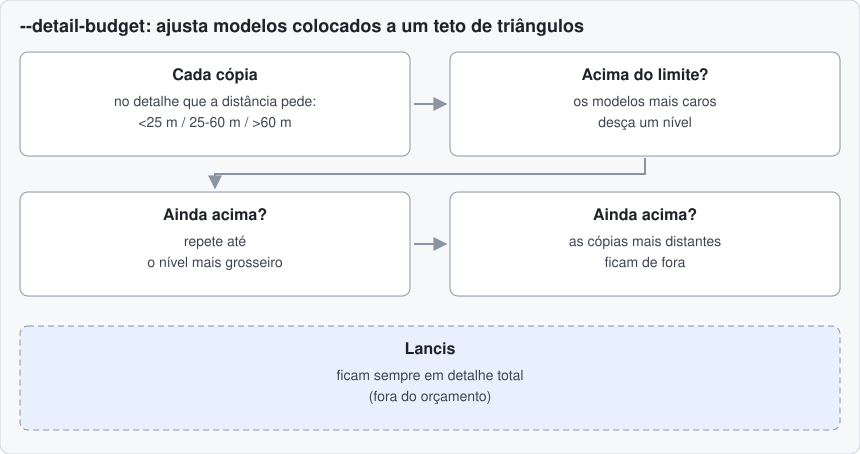

# Níveis de detalhe e o orçamento {#levels-of-detail-and-the-budget}

Um **triângulo** é uma peça plana e minúscula de um modelo 3D. Mais triângulos
significa um ficheiro maior e mais lento. O **orçamento** é um limite de quantos
triângulos podem existir. Um **nível de detalhe** é uma cópia mais simples de um
modelo, usada quando ele está longe.

O total de tudo o que fica em volta de um circuito, no nível mais fino, chega a
vários milhões de triângulos. Por exemplo, centenas de segmentos de guard-rail e
pilhas de pneus com cerca de mil triângulos cada. Um corredor urbano tem mais de
cem mil cópias. Por isso, toda exportação de percurso dá aos modelos colocados um
**orçamento de triângulos** e decide, modelo a modelo, em qual nível de detalhe ele
é desenhado e, se precisar, quais cópias deixar de fora.

O esquema foi escrito para o Forza
([`forzaplacement.py`](https://github.com/Holdi601/3DHeat-GameFiles/blob/main/heat3d_gamefiles/forzaplacement.py):
`choose_levels`, `auto_budget`, `_fit`), e o BeamNG e o AC Rally reaproveitam
suas partes. O terreno não conta no orçamento.

## Faixas de distância {#distance-bands}

A distância de cada cópia até à pilotagem é medida no plano do solo, até à amostra
mais próxima da volta. Antes disso, a volta é reduzida para no máximo 1.000 pontos,
o que custa alguns metros de precisão e nada que importe aqui. Depois, as cópias
caem em três faixas, e cada par (modelo, faixa) é orçado separadamente:

| Faixa | Distância | Começa em |
|---|---|---|
| perto | menos de 25 m (`NEAR`) | o nível mais fino |
| média | 25-60 m (`FAR`) | um nível mais grosseiro |
| longe | 60 m ou mais | o nível mais grosseiro |

Sem uma rota (Forza `terrain --box`), a distância é medida até ao meio da caixa.

## Descer de nível para caber {#stepping-down-to-fit}



O custo de uma entrada (modelo, faixa) é cópias x triângulos no nível atual. Enquanto
o total estiver acima do orçamento, a entrada que custa mais desce um nível, e isso
se repete até ao total caber ou nenhuma entrada poder descer mais. Entradas fixadas
nunca descem:

| Jogo | Fixado no detalhe total |
|---|---|
| Forza | lancis (`road_gen_rum*`) |
| BeamNG | lancis, e toda forma que carrega superfície de rodagem |
| AC Rally | lancis |

O resumo do Forza informa isso como
`N of M models drawn at a coarser level to fit the budget`.

## O orçamento automático {#the-automatic-budget}

Sem `--detail-budget`, o orçamento se dimensiona sozinho para que **nenhuma cópia
seja deixada de fora**:

```
budget = max(1,500,000, 1.25 x sum(copies x coarsest level))
```

As entradas fixadas contam no nível mais fino. Os 25% (`HEADROOM`) deixam o que
fica ao lado da estrada manter algum detalhe. Num circuito de campo isso dá o piso de
1,5 milhão (`DEFAULT_BUDGET`). Num percurso urbano, onde o corredor tem mais de cem
mil cópias, ele cresce para mais de dez milhões, e o ficheiro para várias centenas de
MB. O visualizador carrega isso.

## Um orçamento informado {#a-budget-you-give}

`--detail-budget N` é um **teto**. Os níveis descem como descrito acima. Se nem os
níveis mais grosseiros couberem, cópias são deixadas de fora:

| Jogo | Ordem em que as cópias são deixadas de fora |
|---|---|
| Forza | primeiro tudo a 25 m ou mais da pilotagem, depois o que fica ao lado da estrada; dentro de cada grupo, primeiro o que parece menor da estrada: maior distância / tamanho (tamanho = a diagonal da caixa envolvente do modelo vezes a sua maior escala, no mínimo 0,25 m) |
| BeamNG | mais longe da pilotagem primeiro |
| AC Rally | mais longe da pilotagem primeiro, como no BeamNG |
| Battlefield 6 | menor primeiro: diagonal da caixa envolvente vezes a escala |

Os lancis (e, no BeamNG, os modelos de superfície de rodagem) nunca são deixados
de fora. Assim, um orçamento menor do que eles custam sozinhos é ultrapassado por
eles, e por mais nada.

A ferramenta usa distância sobre tamanho no Forza porque, ordenado só pela
distância, um aparelho de ar-condicionado numa parede a nove metros sobrevive à
fachada de vinte metros em que está pendurado, a doze metros. Coisas ao lado da
estrada vêm por último, qualquer que seja o tamanho, porque uma barreira de três
metros a cinco da linha é a borda da pista, enquanto um edifício de cinquenta metros
a sessenta de distância é cenário.

O resumo informa
`N of M copies left out to fit the budget, the smallest and furthest from the driving first (--detail-budget raises it)`
(Forza), ou `N copies left out to fit the budget, the furthest from the driving first (--detail-budget raises it)`
(BeamNG, AC Rally).

## Edificações inteiras (Forza) {#whole-buildings-forza}

Uma substituição de edificação inteira conta como uma cópia, com a distância medida
até à aresta mais próxima do edifício. Ela é mantida ou deixada de fora como uma
unidade. As peças modulares que ela substitui não entram no orçamento. Veja
[Forza Horizon](course-forza-horizon.md#buildings-drawn-whole).

## O que é um nível de detalhe, por jogo {#what-a-level-of-detail-is-per-game}

| Jogo | De onde vêm os níveis |
|---|---|
| Forza | a máscara de nível por triângulo das submalhas `Mesh` do modelo (bit `level + 1`); `0xFFFF` para peças quebráveis, só num modelo sem nível marcado |
| BeamNG | os `details` da forma `.cdae` com tamanho não negativo, do maior para o menor; no `.dae`, o número no fim do nome do nó de malha (`barrier75`, `barrier40`) |
| AC Rally | os níveis de detalhe guardados da malha estática, do mais fino para o mais grosseiro |
| Battlefield 6 | os níveis de detalhe do MeshSet, do mais fino para o mais grosseiro, contando só as secções desenhadas (não as cópias de sombra e de profundidade), e sem contar um último nível que seja um substituto de vista distante (materiais `M_LastLod`, `M_Billboard`, `M_Vista`: a treliça de um poste tornaria-se um espeto sólido) |

O `level` do Battlefield 6 não tem percurso, então não há faixas de distância: cada
malha é uma entrada, e cada cópia fica no mesmo nível. O orçamento automático é a
fórmula acima com o pano de fundo do terreno fixado; o heightfield fica fora do
orçamento e seu tamanho é dado por `--ground-spacing`. Sob um orçamento informado,
depois que cada malha está no seu nível mais grosseiro, cópias são deixadas de fora
começando pela menor, medida pela diagonal da caixa envolvente da malha vezes a
escala da cópia, já que não há pilotagem da qual medir a distância. O pano de fundo
do terreno nunca é deixado de fora. Um nível chega a cerca de dez milhões de triângulos
automaticamente.

## Escolher um número {#choosing-a-number}

| Objetivo | Experimente |
|---|---|
| tudo, com detalhe total perto da estrada | deixe automático |
| um ficheiro algumas vezes menor | `--detail-budget 500000` com `--texture-size 1024` |
| só o solo | `--no-placed` (sem orçamento envolvido) |
